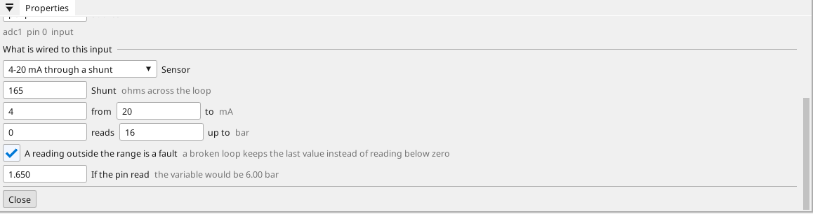
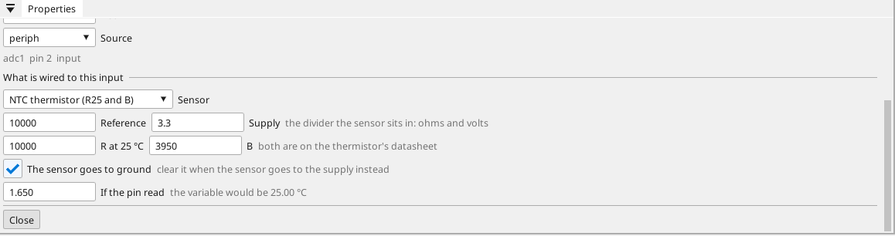
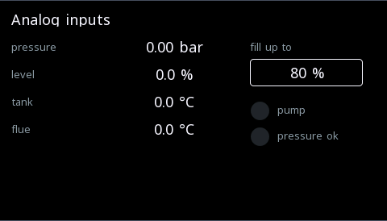

# Analog inputs that read real values

A converter measures **volts**. A pressure transmitter, a level
sensor, a thermistor and a Pt1000 all end up as volts on a pin, and
what those volts MEAN is a property of what is wired there — not of
the converter.

So a channel says what is wired to it, and the device does the
arithmetic. The variable holds **bar**, **percent**, **degrees** —
everywhere it is read: the screen, the browser, the logic, the trend,
OPC UA, Modbus, MQTT.

{: .sb-center}

---

## What you can pick

| Sensor | What you enter | What the variable holds |
|:---|:---|:---|
| **0-10 V / 0-5 V** through a divider | the divider, and what the range means | your unit |
| **4-20 mA / 0-20 mA** through a shunt | the shunt in ohms, and the range | your unit |
| **NTC thermistor** | the reference resistor and supply, R25 and B | °C |
| **NTC, Steinhart-Hart** | the same, with the three coefficients | °C |
| **Pt100 / Pt1000** | the reference resistor and supply | °C |
| **Raw** | gain and offset, as before | whatever you compute |

Every type arrives with the **usual numbers already filled in** — a
165 Ω shunt, a 10 kΩ reference, 3.3 V — and every one of them can be
overwritten, because the next board is not the last one.

---

## Where it is

On the variable's own sheet, under its source. It appears for every
input that measures volts: a converter's channel (ADS1115, ADS1118)
and the board's own ADC alike.

Pick the sensor, check the numbers, and read the last line:

!!! tip "The editor tells you what a reading would be"
    Type a voltage into **If the pin read** and the line beside it
    says what the variable would hold. It is the device's own
    arithmetic answering — the same function the runtime runs — so a
    divider wired upside down shows up at your desk instead of on a
    commissioning day.

{: .sb-center}

---

## The wiring each type expects

**A voltage sensor** goes through a divider, because a 10 V signal
does not belong on a 3.3 V pin. The **divider** number is how many
times bigger the sensor's voltage is than the pin's: a 10 kΩ / 3.3 kΩ
pair is about 4.

**A current loop** goes through a **shunt** — the resistor the loop's
current flows through. 165 Ω turns 4-20 mA into 0.66-3.3 V, which is
inside every converter we ship. The range is in milliamps and what it
means is in your own unit.

**A thermistor or an RTD** is a resistance, so it sits in a divider
with a known **reference resistor** and **supply**. Which half it
sits in is a tick box: *the sensor goes to ground* (the reference
pulls up) or the other way round.

!!! note "Where the numbers come from"
    R25 and B are on the thermistor's datasheet; a Pt100 is 100 Ω at
    zero degrees and a Pt1000 is 1000 Ω. Nothing here has to be
    measured — it is all printed on the part or its box.

---

## A broken loop is not a low reading

A 4-20 mA sensor that reads 0 mA is not at its zero point: its loop is
broken, or nothing is connected. Left alone, that would arrive as a
large negative pressure and look like real data.

With **a reading outside the range is a fault** ticked — the default
for 4-20 mA — such a reading is refused: the variable keeps the value
it had, and the reason goes into the diagnostic buffer once. The same
happens to a resistance sensor whose input sits at either supply rail,
which is what a cut or shorted wire looks like.

!!! warning "Stale, not wrong"
    A refused reading leaves the last good value in place. That is
    deliberate: on a machine a wrong number is worse than an old one.
    If it matters, watch the value for movement — or put the sensor's
    own fault signal on a second input.

---

## The example

`examples\analog_inputs.prj32` is the whole thing on one screen: a
4-20 mA pressure transmitter, a 0-10 V level sensor, a thermistor in
the tank and a Pt1000 in the flue, on one ADS1115 — and not a single
computed gain anywhere.

{: .sb-center}

Its logic is three rungs, and they are readable because the values are
real:

- the pressure is sane while it is below its limit **in bar**,
- the tank is low while the level is below the setpoint **in percent**,
- the pump runs while both hold.

Nobody can write "below 3 bar" against a raw converter count.

---

## What to check when a value looks wrong

| What you see | Where to look |
|:---|:---|
| The value is a fixed multiple of what it should be | the divider, or the shunt |
| It moves the right way but the ends are wrong | the range and what it means — they are two pairs, not one |
| A temperature that is wildly off | which half of the divider the sensor is in (the tick box), then the reference resistor |
| A temperature that moves the WRONG way | an NTC falls as it warms; a Pt rises. The type says which |
| The value never moves | the reading may be refused — check the wiring at the pin |
| Everything reads zero | the converter itself: its address, and whether the bus finds it |

---

## What this is not

- **Not a replacement for a proper RTD converter.** A divider is a
  divider; for a three-wire Pt100 and tenth-of-a-degree work, use a
  MAX31865, which delivers degrees by itself.
- **Not a thermocouple input.** Those need cold-junction
  compensation and their own chip.
- **Not a filter.** A noisy signal is what the variable's deadband is
  for.
