# Boolean blocks

Eight blocks that work with TRUE and FALSE: four gates, two edge
detectors and two latches.

In ladder you rarely need the gates — contacts in series *are* an AND and
contacts in parallel *are* an OR. They earn their place in FBD, and in
rungs where the logic reads better as a box than as a knot of contacts.

---

## The gates

| Block | Inputs | Output | Q is TRUE when |
|:---|:---:|:---:|:---|
| **AND** | IN1, IN2 | Q | both inputs are TRUE |
| **OR** | IN1, IN2 | Q | at least one input is TRUE |
| **XOR** | IN1, IN2 | Q | exactly one input is TRUE |
| **NOT** | IN | Q | the input is FALSE |

<!-- blk:AND -->
**AND**

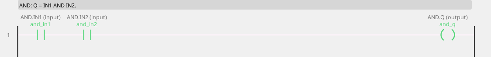

```iecst
PROGRAM AND_ST
  and_q_st := and_in1 AND and_in2;
END_PROGRAM
```

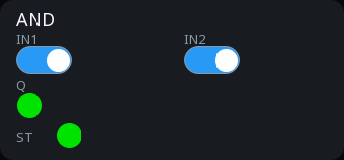

<!-- /blk -->

<!-- blk:OR -->
**OR**

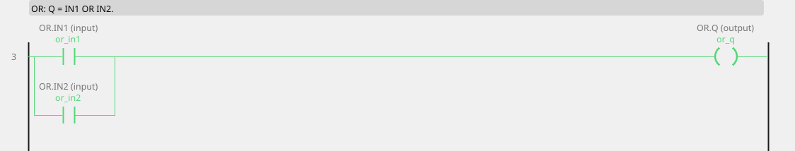

```iecst
PROGRAM OR_ST
  or_q_st := or_in1 OR or_in2;
END_PROGRAM
```

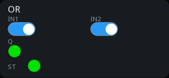

<!-- /blk -->

<!-- blk:XOR -->
**XOR**

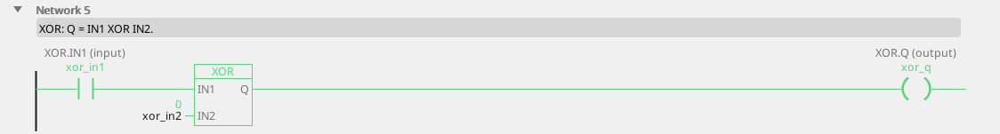

```iecst
PROGRAM XOR_ST
  xor_q_st := xor_in1 XOR xor_in2;
END_PROGRAM
```

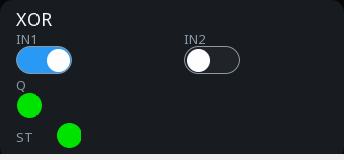

<!-- /blk -->

<!-- blk:NOT -->
**NOT**


```iecst
PROGRAM NOT_ST
  not_q_st := NOT not_in;
END_PROGRAM
```


<!-- /blk -->

An unconnected input is FALSE — which matters: an unconnected input on an
AND holds the output FALSE forever, and on an OR it changes nothing.

**XOR** is the one people reach for least and then find indispensable: it
is "these two disagree". Two end-position sensors that should never both
be on, a command and a feedback that ought to match, a pair of redundant
switches.

```
sensor_open ──IN1─┐
sensor_shut ──IN2─┤ XOR ├── Q ──> position_implausible
```

---

## R_TRIG — rising edge

**Q is TRUE for exactly one cycle after CLK rises.**

| Pin | Type | Meaning |
|:---|:---:|:---|
| `CLK` | input, bool | the signal being watched |
| `Q` | output, bool | one cycle of TRUE per rising edge |

<!-- blk:R_TRIG -->
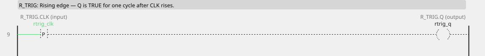

```iecst
PROGRAM R_TRIG_ST
VAR rtrig : R_TRIG; END_VAR
  rtrig(CLK := rtrig_clk);
  rtrig_q_st := rtrig.Q;
END_PROGRAM
```


<!-- /blk -->

**What it is for:** turning "it is on" into "it just turned on". A button
held down should start one thing, not restart it a hundred times a
second.

```
start_button ──[R_TRIG]── Q ──> begin_cycle
```

---

## F_TRIG — falling edge

**Q is TRUE for exactly one cycle after CLK drops.**

| Pin | Type | Meaning |
|:---|:---:|:---|
| `CLK` | input, bool | the signal being watched |
| `Q` | output, bool | one cycle of TRUE per falling edge |

<!-- blk:F_TRIG -->
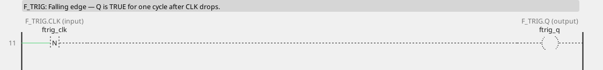

```iecst
PROGRAM F_TRIG_ST
VAR ftrig : F_TRIG; END_VAR
  ftrig(CLK := ftrig_clk);
  ftrig_q_st := ftrig.Q;
END_PROGRAM
```


<!-- /blk -->

**What it is for:** reacting to something ending. A part leaving a
sensor, a guard being released, a signal that was there and is not.

!!! tip "One cycle is short"
    An edge pulse lives for a single cycle — 10 ms or so. It is meant to
    be *consumed* by the logic in the same cycle: counted, latched, used
    as a trigger. It is not something a person can see, and it is not
    something a slow device will notice. Latch it if it has to last.

---

## SR — set-dominant latch

**Remembers. If both inputs are TRUE, SET wins.**

| Pin | Type | Meaning |
|:---|:---:|:---:|
| `S1` | input, bool | set |
| `R` | input, bool | reset |
| `Q1` | output, bool | the remembered state |

<!-- blk:SR -->
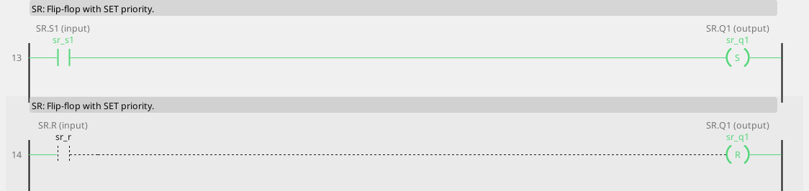

```iecst
PROGRAM SR_ST
VAR sr : SR; END_VAR
  sr(S1 := sr_s1, R := sr_r);
  sr_q1_st := sr.Q1;
END_PROGRAM
```

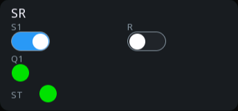

<!-- /blk -->

## RS — reset-dominant latch

**Remembers. If both inputs are TRUE, RESET wins.**

| Pin | Type | Meaning |
|:---|:---:|:---:|
| `S` | input, bool | set |
| `R1` | input, bool | reset |
| `Q1` | output, bool | the remembered state |

<!-- blk:RS -->
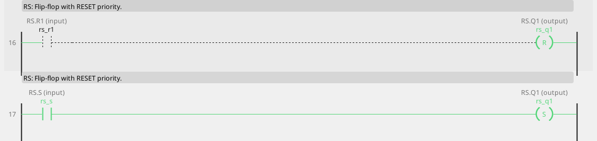

```iecst
PROGRAM RS_ST
VAR rs : RS; END_VAR
  rs(S := rs_s, R1 := rs_r1);
  rs_q1_st := rs.Q1;
END_PROGRAM
```


<!-- /blk -->

The only difference between the two is what happens when set and reset
arrive **together** — and that is exactly the case you have to think
about, because sooner or later both arrive at once.

**Choose by asking which one is the safe answer:**

- A fault latch: a new fault arriving while somebody presses acknowledge
  should stay latched → **SR** (set wins).
- A running flag: a stop arriving while start is held should stop it →
  **RS** (reset wins).

```
fault_detected ──S1─┐
operator_ack   ──R──┤ SR ├── Q1 ──> fault_latched
```

!!! danger "A latch is not a safety function"
    Reset priority is not a substitute for a hard-wired stop circuit.
    Emergency stop, guards and light curtains are wired, not programmed —
    see [Intended use](intended-use.md).

---

## Latch or coil?

Ladder has set and reset coils (`-(S)-`, `-(R)-`), which do the same
thing as these blocks. The difference is where the decision lives:

- **Coils** put set and reset on separate rungs. Easy to read, and the
  priority is decided by which rung comes last.
- **A latch block** puts both on one line with the priority written into
  the block name, where nobody can miss it.

For anything where the both-at-once case matters, the block is the
clearer choice.

---

## Bit access

Boolean logic often needs one bit out of a word — a status word from a
drive, a mask from a fieldbus device. You do not need a block for that:
write `status.3` on a pin and it reads bit 3 of the integer variable
`status`. The same spelling works as an output.

Bits are written **atomically**, so the logic writing bit 0 and a screen
writing bit 1 never lose each other's work. See [Variables](variables.md).
