# Comparison blocks

Five comparisons and a selector. These are how a number becomes a
decision.

---

## The comparisons

| Block | Q is TRUE when |
|:---|:---:|
| **GT** | IN1 > IN2 |
| **GE** | IN1 ≥ IN2 |
| **LT** | IN1 < IN2 |
| **LE** | IN1 ≤ IN2 |
| **EQ** | IN1 and IN2 are equal within EPS |

<!-- blk:GT -->
**GT**

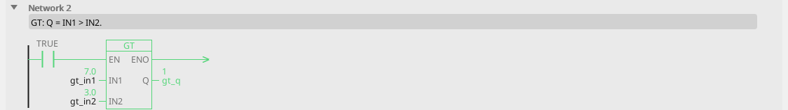

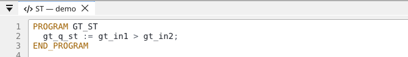


<!-- /blk -->

<!-- blk:GE -->
**GE**

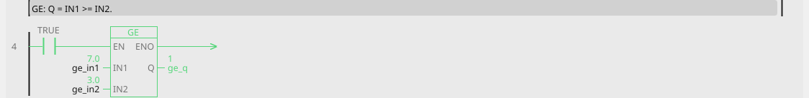


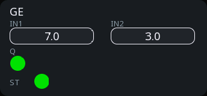

<!-- /blk -->

<!-- blk:LT -->
**LT**

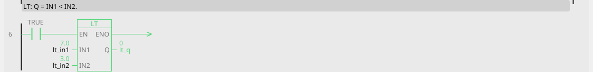


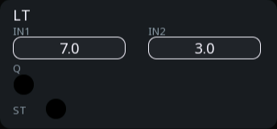

<!-- /blk -->

<!-- blk:LE -->
**LE**

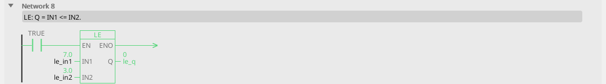

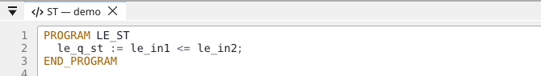

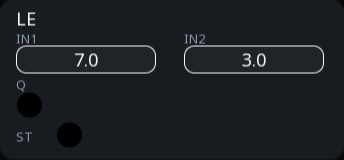

<!-- /blk -->

All take two number inputs and give one boolean output. An unconnected
input is 0, so `GT` with only IN1 wired asks "is it positive?".

---

## EQ — equal within a tolerance

| Pin | Type | Meaning |
|:---|:---:|:---:|
| `IN1`, `IN2` | inputs, number | the two values |
| `EPS` | parameter, number (0) | how close counts as equal |
| `Q` | output, bool | TRUE when \|IN1 − IN2\| ≤ EPS |

<!-- blk:EQ -->
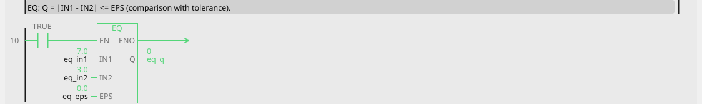

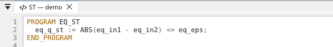

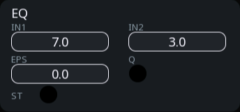

<!-- /blk -->

EQ has a tolerance and the others do not, for a reason worth
understanding: **two calculated numbers are almost never exactly equal.**

Ask whether a temperature has reached 50.0 °C with an exact comparison
and you may wait forever — the measurement passes 49.9997 and 50.0001
and never lands on 50.0 exactly.

```
temp     ──IN1─┐
setpoint ──IN2─┤ EQ EPS=0.5 ├── Q ──> at_temperature
```

"Within half a degree" is what you meant anyway.

!!! tip "Leave EPS at 0 only for whole numbers"
    Comparing a step count, a recipe number or a state code with EPS = 0
    is fine — those are exact. For anything measured or calculated, give
    it a tolerance that reflects what the sensor can actually resolve.

---

## Comparisons chatter at the threshold

This is the single most common problem with a comparison on real
hardware, and it is not a bug in the block.

A measurement sitting near the limit — noise, vibration, a sensor's last
digit — crosses back and forth many times a second. The output follows,
and downstream something switches at the same rate. A relay clacks, an
alarm floods the log, a WEBview client drowns in updates.

**The fix is hysteresis:** switch on at one level, off at a lower one.
That is what [HYST](blocks-signal.md#hyst-comparator-with-hysteresis)
does, and for anything driving a physical output it should be your
default choice over GT/LT.

Use plain comparisons for decisions inside the logic, where chattering
costs nothing.

!!! tip "Deadband is the other half"
    An analog variable with a deadband stops reporting changes smaller than
    the deadband, which quiets everything reading it — screens, trends,
    WEBview. Set it on the variable, not in the logic. See [Variables](variables.md).

---

## SEL — selector

**OUT = IN1 when G is TRUE, IN0 when it is FALSE.**

| Pin | Type | Meaning |
|:---|:---:|:---:|
| `G` | input, bool | which one to pass |
| `IN0` | input, number | passed when G is FALSE |
| `IN1` | input, number | passed when G is TRUE |
| `OUT` | output, number | the chosen value |

<!-- blk:SEL -->
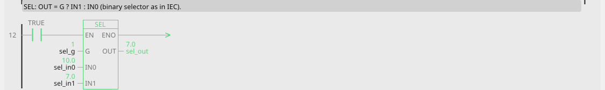

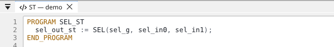

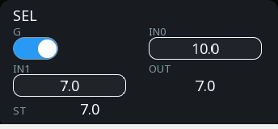

<!-- /blk -->

The IEC binary selector: an if-then-else you can draw.

**What it is for:** two setpoints and a switch between them. Day and
night temperature, fast and slow speed, manual and automatic value.

```
night_mode ──G───┐
    temp_day ──IN0─┤ SEL ├── OUT ──> setpoint
  temp_night ──IN1─┘
```

Both inputs are read every cycle whichever one wins, so there is no
"stale" side — swap G and the output follows immediately.

