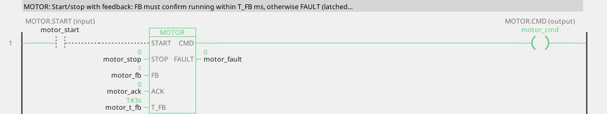
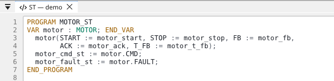
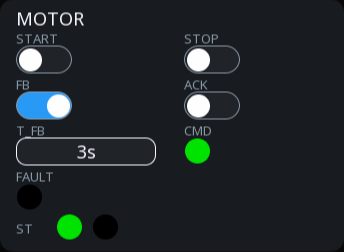
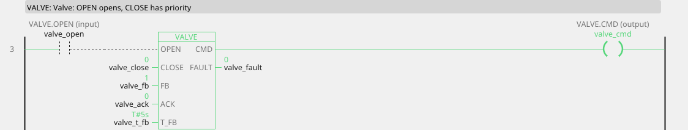
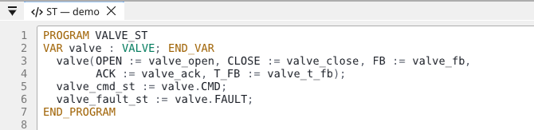
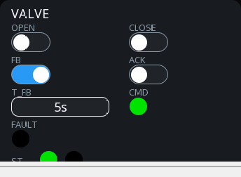
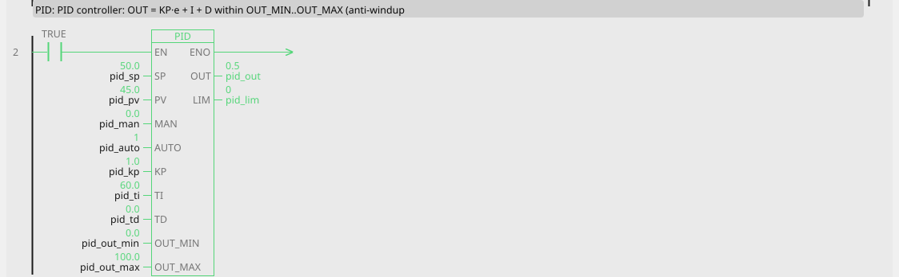
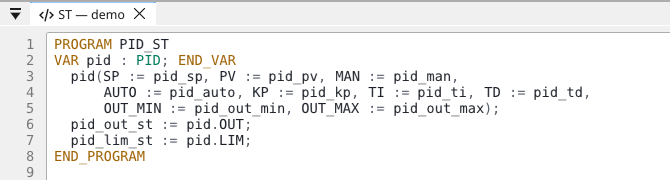
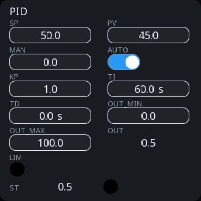

# Equipment blocks

Three blocks that anyone controlling equipment ends up needing, and that
ctrl32 ships so you do not have to write them: a motor starter, a valve,
and a PID controller.

They are bigger than the rest of the library because they contain the
parts that are easy to forget — feedback supervision, latched faults, an
acknowledge that only works when it is safe, and an integrator that does
not wind up.

---

## MOTOR — start/stop with feedback

| Pin | Type | Meaning |
|:---|:---:|:---|
| `START` | input, bool | start command |
| `STOP` | input, bool | stop command — **overrides START** |
| `FB` | input, bool | feedback: the motor is actually running |
| `ACK` | input, bool | acknowledge a fault |
| `T_FB` | parameter, ms (3000) | how long feedback may take |
| `CMD` | output, bool | the contactor command |
| `FAULT` | output, bool | latched fault |

<!-- blk:MOTOR -->






<!-- /blk -->

What it does, in order:

1. START raises CMD — unless STOP is present, which always wins.
2. From then on, **FB must confirm within T_FB ms**. If it does not,
   FAULT latches and CMD drops.
3. FAULT stays latched until ACK — and **ACK only works at standstill**,
   so nobody can acknowledge a fault into a running motor.

```
start_pb ──START─┐
 stop_pb ──STOP──┤            ├── CMD   ──> contactor
aux_contact ──FB─┤ MOTOR      ├── FAULT ──> motor_fault
 ack_pb  ──ACK───┘ T_FB=3000
```

**Why the feedback matters.** Without it, a blown fuse, a tripped
overload or a contactor that welded open looks exactly like a running
motor: the command is on and the program is content. With it, the program
knows within three seconds that what it asked for did not happen —
instead of carrying on as though it had.

!!! tip "Wire the feedback to the thing you want to be sure of"
    An auxiliary contact on the contactor proves the coil pulled in. A
    current relay proves current is flowing. A speed switch proves the
    shaft is turning. Each one catches more failures than the one before
    it, and costs a little more.

!!! warning "STOP is not an emergency stop"
    STOP is a command in software. Emergency stop is a wired circuit that
    removes power without asking the program. See [Intended use](intended-use.md).

---

## VALVE — open/close with end-position check

| Pin | Type | Meaning |
|:---|:---:|:---:|
| `OPEN` | input, bool | open command |
| `CLOSE` | input, bool | close command — **has priority** |
| `FB` | input, bool | end-position feedback |
| `ACK` | input, bool | acknowledge a fault |
| `T_FB` | parameter, ms (5000) | how long the travel may take |
| `CMD` | output, bool | the valve output |
| `FAULT` | output, bool | latched fault |

<!-- blk:VALVE -->






<!-- /blk -->

The same shape as MOTOR, with the timing a valve needs: T_FB defaults to
five seconds because a valve has to physically travel, and CLOSE wins
over OPEN because closed is the safer state for most processes.

```
recipe_step ──OPEN──┐
   e_stop_ok ──CLOSE─┤            ├── CMD   ──> valve_solenoid
   limit_sw ──FB─────┤ VALVE      ├── FAULT ──> valve_stuck
    ack_pb  ──ACK────┘ T_FB=5000
```

A latched FAULT here means the valve did not reach its end position in
time — jammed, no air, a broken limit switch, or a travel time that is
simply longer than T_FB on a cold morning. All four are worth knowing
about.

!!! tip "Set T_FB from the real thing, not the catalogue"
    Watch the actual travel time in the [Scope](scope.md), then give it
    generous headroom — perhaps double. A T_FB set too tight produces
    nuisance faults on a cold morning, and nuisance faults teach whoever
    is using it to acknowledge without looking, which is worse than no
    fault at all.

---

## PID — controller

| Pin | Type | Meaning |
|:---|:---:|:---|
| `SP` | input, number | setpoint |
| `PV` | input, number | process value (the measurement) |
| `MAN` | input, number | manual output value |
| `AUTO` | input, bool | TRUE = automatic, FALSE = manual |
| `KP` | parameter (1) | proportional gain |
| `TI` | parameter, **seconds** (60) | integral time — 0 disables I |
| `TD` | parameter, **seconds** (0) | derivative time — 0 disables D |
| `OUT_MIN`, `OUT_MAX` | parameters (0, 100) | output range |
| `OUT` | output, number | the control output |
| `LIM` | output, bool | TRUE while the output is saturated |

<!-- blk:PID -->






<!-- /blk -->

Note the units: **TI and TD are in seconds**, not milliseconds. Every
other block in the library uses ms; controllers are tuned in seconds
everywhere in the world, and matching that convention prevents more
mistakes than consistency would.

### The three things that make it usable

**Anti-windup.** When the output is pinned at its limit, the integrator
stops accumulating. Without this, a controller that spends ten minutes
asking for more than the equipment can deliver builds up an enormous
integral, and then overshoots wildly when the process finally responds.
`LIM` tells you it is happening.

**Bumpless transfer.** In manual (`AUTO` = FALSE), OUT follows MAN *and
the integrator tracks it*. Switch back to automatic and the output stays
where it was, then moves from there. No jump, no bang.

**Derivative on the measurement, not the error.** A setpoint step would
otherwise produce an enormous derivative kick. This one takes D from PV,
with a TD/8 filter on it, so changing the setpoint moves the output
smoothly.

### Tuning, briefly

1. Start with **TI = 0, TD = 0** — proportional only. Raise KP until the
   process responds briskly and just begins to oscillate, then halve it.
2. Bring in **TI**: start around the process's response time in seconds
   and reduce it until the remaining offset disappears without the loop
   getting sloppy.
3. **Leave TD at 0** unless you have a slow process with real transport
   delay. Derivative amplifies noise, and on most projects it costs more
   than it gives.

!!! tip "Watch it, do not guess"
    Put SP, PV and OUT on one [trend](operation.md) and change one
    parameter at a time. Ten minutes of watching beats an afternoon of
    theory, and the trend is the record of what you did.

!!! warning "Filter the measurement before the controller, gently"
    Noise on PV becomes noise on OUT, and with derivative it becomes a
    lot of noise. A small [PT1](blocks-signal.md#pt1-first-order-filter)
    helps — but every millisecond of filtering is a millisecond of delay
    in the loop, so use as little as works.
