# Maths blocks

Arithmetic, and the assignment block. Nothing surprising here — the
value is in knowing what happens at the edges.

---

## The arithmetic

| Block | Inputs | Output | Result |
|:---|:---:|:---:|:---:|
| **ADD** | IN1…IN4 | OUT | IN1 + IN2 + IN3 + IN4 |
| **SUB** | IN1, IN2 | OUT | IN1 − IN2 |
| **MUL** | IN1, IN2 | OUT | IN1 × IN2 |
| **DIV** | IN1, IN2 | OUT | IN1 ÷ IN2 |
| **MIN** | IN1, IN2 | OUT | the smaller of the two |
| **MAX** | IN1, IN2 | OUT | the larger of the two |
| **ABS** | IN | OUT | the value without its sign |

<!-- blk:ADD -->
**ADD**

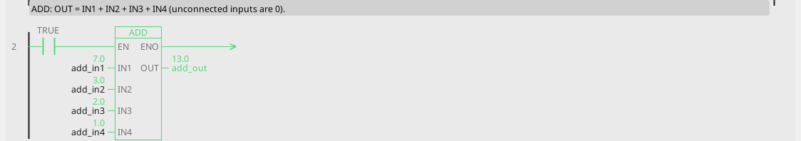

```iecst
PROGRAM ADD_ST
  add_out_st := add_in1 + add_in2 + add_in3 + add_in4;
END_PROGRAM
```

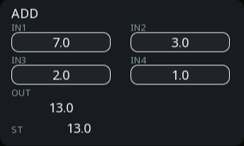

<!-- /blk -->

<!-- blk:SUB -->
**SUB**

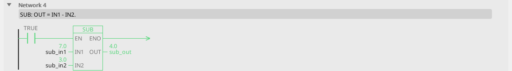

```iecst
PROGRAM SUB_ST
  sub_out_st := sub_in1 - sub_in2;
END_PROGRAM
```


<!-- /blk -->

<!-- blk:MUL -->
**MUL**

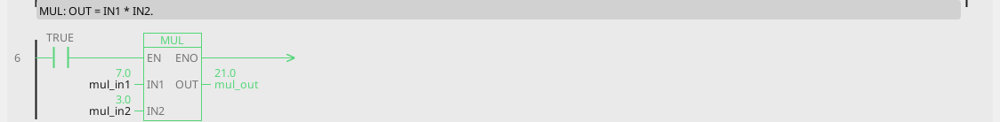

```iecst
PROGRAM MUL_ST
  mul_out_st := mul_in1 * mul_in2;
END_PROGRAM
```

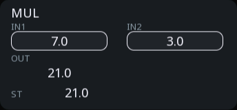

<!-- /blk -->

<!-- blk:DIV -->
**DIV**

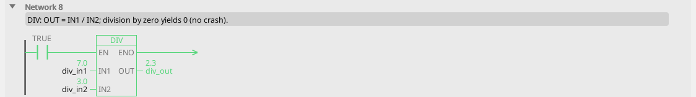

```iecst
PROGRAM DIV_ST
  div_out_st := div_in1 / div_in2;
END_PROGRAM
```

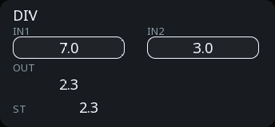

<!-- /blk -->

<!-- blk:ABS -->
**ABS**

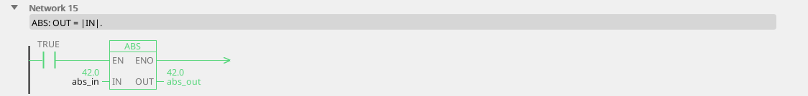

```iecst
PROGRAM ABS_ST
  abs_out_st := ABS(abs_in);
END_PROGRAM
```


<!-- /blk -->

**ADD takes up to four inputs**, and unconnected ones are 0. A new ADD
shows two; *Add input* on its right-click menu opens the third and the
fourth, *Remove input* takes the last one away. An input in use is
always shown.

**Every other input is 0 when unconnected too**, and that is worth a
thought on MUL (result 0) and DIV (see below).

---

## Division by zero gives zero

`DIV` with IN2 = 0 produces **0**. It does not fault, does not produce
infinity, and does not stop the equipment.

This is a deliberate choice: a divisor that is briefly zero is perfectly
normal — a flow that has not started, a length not yet measured, a sensor
still warming up. A controller that halted the cycle over it would be
useless.

!!! warning "Zero is a plausible-looking wrong answer"
    The danger is not the crash that does not happen, it is the 0 that
    flows onward and looks like a real measurement. Where the result
    drives something that matters, check the divisor:

    ```
    flow ──IN1─┐
    time ──IN2─┤ DIV ├── OUT ──> rate
    time ──[GT 0]── Q ──> rate_valid
    ```

    and let `rate_valid` gate whatever uses `rate`.

---

## MIN and MAX as guards

The obvious use is picking the larger of two measurements. The more
common one is putting a floor or a ceiling on a value:

<!-- blk:MIN -->
**MIN**

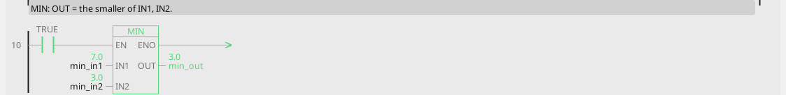

```iecst
PROGRAM MIN_ST
  min_out_st := MIN(min_in1, min_in2);
END_PROGRAM
```

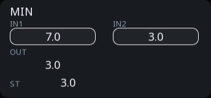

<!-- /blk -->

<!-- blk:MAX -->
**MAX**

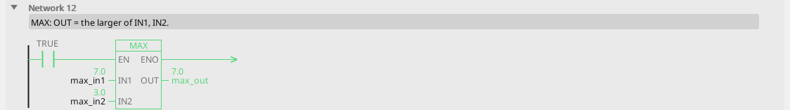

```iecst
PROGRAM MAX_ST
  max_out_st := MAX(max_in1, max_in2);
END_PROGRAM
```

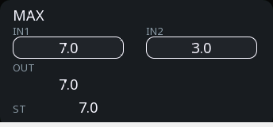

<!-- /blk -->

```
setpoint ──IN1─┐
      50 ──IN2─┤ MAX ├── OUT ──> setpoint_guarded
```

Now the setpoint can never go below 50, whatever a screen or a fieldbus
writes into it.

For a floor **and** a ceiling in one block, use
[LIMIT](blocks-signal.md#limit-clamp) instead — that is what it is for.

---

## MOVE — assignment

**OUT = IN.** The IEC assignment, as a block.

| Pin | Type | Meaning |
|:---|:---:|:---:|
| `IN` | input, number | the source |
| `OUT` | output, number | the destination |

<!-- blk:MOVE -->
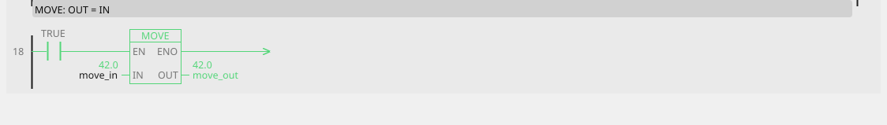

```iecst
PROGRAM MOVE_ST
  move_out_st := move_in;
END_PROGRAM
```


<!-- /blk -->

It looks like it does nothing, and in a diagram it nearly does — its job
is to get a value from one variable into another. Where it earns its keep is
**in a ladder rung**, as the plain result box: while the rung conducts,
the value is committed; while it does not, the destination holds.

```
recipe_ready ──[ MOVE IN=recipe_temp ]── OUT ──> setpoint
```

The setpoint takes the recipe value the moment the recipe is ready, and
keeps it afterwards. That "commit a value when a condition is met" is
one of the most common things a control program does.

---

## Numbers on ctrl32

Values are floating point, which means:

- **Fractions are fine.** 0.1 °C, 2.5 mm, no scaling tricks needed.
- **Big integers lose precision.** Past about 16 million, consecutive
  whole numbers stop being distinguishable. A part counter that must be
  exact into the millions belongs in an integer variable.
- **Equality is unreliable.** `1.0 - 0.9 - 0.1` is not exactly 0. Never
  test two calculated values with `=`; use
  [EQ with a tolerance](blocks-compare.md#eq-equal-within-a-tolerance),
  which exists for exactly this reason.

## Order matters

Blocks execute in program order and pass values through variables, so a chain
of calculations has to be *written* in the order it flows. A block
reading a variable that a later block writes gets last cycle's value.

For a long calculation this is where [Structured Text](st-language.md)
becomes the better tool: expressions evaluate in the order you write
them, on one line, with no intermediate variables at all.
