# Motion blocks

The motion library is **PLCopen Motion Control Part 1**, whole and with
the specification's own names, inputs and outputs: `MC_Power`,
`MC_MoveAbsolute`, `MC_GearIn` mean here exactly what they mean in any
other controller a programmer has met. Every block of Part 1 is in the
Toolbox and in Structured Text; the blocks that need a servo with its own
position loop, tables kept on the device or a probe input are marked
**Linux** below and run on the Linux runtime - a frequency drive over
CANopen on a board gets the rest.

Every block takes an **AXIS** at the call. Which axis is never guessed:
in [Structured Text](st-language.md) you write
`pwr(AXIS := 0, Enable := go);` and the compiler refuses a motion block
without it. A guessed axis is a moving axle.

The names a project used before this library - `MC_POWER`, `MC_MOVEABS`,
`MC_READACTVEL`, `Accel`, `RatioNum`... - stay as **aliases**: an older
project opens and builds; the one value whose meaning moved
(`MC_MOVEVELOCITY`'s `Direction`, a reverse flag before, a direction
number now) is translated when the project opens.

---

## What every block answers

Part 1 gives every block the same face, and the runtime keeps to its
timing rules:

| Pin | Meaning |
|:---|:---|
| `Execute` | the command starts on the **rising edge**; the outputs hold while `Execute` is TRUE and fall when it falls (or stay one cycle when it fell before the command ended) |
| `Enable` | a level: the block works while TRUE and answers `Valid` while its values are good |
| `Done` / `InVelocity` / `InGear` / `InSync` | the command reached its goal |
| `Busy` | the block has taken the command and has not finished with it |
| `Active` | the command is the one moving the axis now (a buffered one waits with `Busy` and no `Active`) |
| `CommandAborted` | another command took the axis, or the axis was stopped |
| `Error`, `ErrorID` | the command failed, and why |

`ErrorID` is one table for the whole library:

| ErrorID | Meaning |
|:---:|:---|
| 1 | the axis is not bound to a drive |
| 2 | the axis is not powered (`MC_Power` first) |
| 3 | the axis is in **ErrorStop** - acknowledge with `MC_Reset` |
| 4 | the axis is stopping (an `MC_Stop` holds it) |
| 5 | the axis is homing |
| 6 | the axis is not homed and the command needs an absolute position |
| 7 | an input is out of range (a negative velocity, a direction that does not exist, a zero ratio) |
| 8 | this drive cannot do it (a position move on a drive with no position feedback, a torque command on a frequency drive) |
| 9 | the master axis is invalid |
| 10 | the block is not on this runtime (a Linux block on a board) |
| 11 | the drive reports a fault |
| 12 | the target is past a software limit |
| 13 | the following error exceeded its limit |
| 14 | the bus to the drive is down |
| 15 | the command buffer is full |
| 16 | the table (cam, profile, cam switches) is missing or wrong |
| 17 | the drive is in the wrong mode for the command |
| 18 | the parameter is read-only |
| 19 | the axis has to stand still for this |
| 20 | the axis is not synchronised |

A command **buffer mode** decides what a new command does to the one
running: `mcAborting` (the default) takes the axis at once, `mcBuffered`
waits for the running one to finish, `mcBlendingLow` / `mcBlendingHigh`
/ `mcBlendingPrevious` / `mcBlendingNext` join the two moves at the
lower, higher, previous or next velocity. The names are constants in
Structured Text (`BufferMode := mcBuffered`).

---

## The axis

An axis is in exactly one state, and `MC_ReadStatus` tells which:

```
Disabled --MC_Power--> Standstill --move--> DiscreteMotion / ContinuousMotion
                           |                        |
                        MC_Home                  MC_Stop
                           |                        |
                        Homing                   Stopping --(Execute falls)--> Standstill
   any state --fault or limit--> ErrorStop --MC_Reset--> Standstill (or Disabled)
   a geared or cammed follower: SynchronizedMotion
```

`MC_Stop` is special: while its `Execute` holds, the axis stays in
**Stopping** and refuses every other motion command (ErrorID 4) - it is
the controlled stop of a sequence, not an emergency stop. `MC_Halt`
stops the same way but lets the next command take the axis at once.

### Units and time

The axis has **units** - revolutions, millimetres, degrees - and
`units_per_rev` says how many make one turn of the motor (1 = the axis
counts revolutions). Positions and distances are in units; velocities in
units per the axis's **time base**, per **minute** by default (a 1 unit =
1 revolution axis speaks rpm, as every older project did), per
**second** (PLCopen's u/s), or **rpm** - revolutions per minute whatever
the position unit, the natural pair for a servo whose positions are its
increments; accelerations and decelerations in that velocity unit **per
second**; jerk per second squared. A block's
`Acceleration` 0 takes the axis's **default ramp**; 0 everywhere means the
built-in 1000 rpm/s on a servo and the drive's own ramp on a frequency
drive.

The axis window's *Limits and defaults* holds the time base, the system
limits (velocity, acceleration, deceleration, jerk - every command is
capped by them), the default ramps, the **modulo** period of a rotary
axis, the **software limits** (a target past them is refused with
ErrorID 12, a moving axis stops at them and goes ErrorStop) and the
**following-error** limit. `MC_ReadParameter` reads them by their Part 1
numbers (1 commanded position, 2 and 3 the software limits, 4 the limits
enabled, 7 the following error, 8 the maximum velocity, 9 the commanded
velocity, 10 the actual velocity, 12 to 17 the acceleration, deceleration
and jerk limits), `MC_WriteParameter` moves the application limits while
the program runs.

---

## Turning the axis on

### MC_Power

| Pin | Type | Meaning |
|:---|:---:|:---|
| `Enable` | input, bool | axis on / off |
| `Enable_Positive`, `Enable_Negative` | parameters, bool (TRUE) | the directions the axis may move in |
| `Status` | output, bool | the axis is powered - every move waits for it |
| `Valid` | output, bool | the block speaks for a bound axis |
| `Error`, `ErrorID` | outputs | |

Nothing moves until `Status` is TRUE. On a CANopen or EtherCAT drive this
runs the CiA 402 state machine - several steps of controlword and
statusword that the block handles for you. A move started before
`Status` is an Error 2; a program gates its `Execute` on `Status` (the
shipped `DRIVE_i550` block does exactly that).

### MC_Reset

| Pin | Type | Meaning |
|:---|:---:|:---|
| `Execute` | input, bool | acknowledge the axis fault |
| `Done`, `Busy`, `Error`, `ErrorID` | outputs | |

Fault acknowledge on the rising edge. If the axis stays in ErrorStop the
cause is still present - a reset does not clear a fault that is still
happening.

### MC_ReadStatus

| Pin | Type | Meaning |
|:---|:---:|:---|
| `Enable` | input, bool | |
| `Valid`, `Busy`, `Error`, `ErrorID` | outputs | |
| `ErrorStop`, `Disabled`, `Stopping`, `Homing`, `Standstill`, `DiscreteMotion`, `ContinuousMotion`, `SynchronizedMotion` | outputs, bool | exactly one is TRUE: the axis's state |

### MC_ReadAxisError

| Pin | Type | Meaning |
|:---|:---:|:---|
| `Enable` | input, bool | |
| `Valid`, `Busy`, `Error`, `ErrorID` | outputs | |
| `AxisErrorID` | output, number | the drive's own error code (the CiA 402 error register, the EtherCAT slave's AL status) |

<!-- blk:MC_Power -->
**MC_Power**


```iecst
PROGRAM MC_Power_ST
VAR mcpow : MC_Power; END_VAR
  mcpow(AXIS := 0, Enable := mcpow_enable,
        Enable_Positive := mcpow_enable_positive,
        Enable_Negative := mcpow_enable_negative);
  mcpow_status_st := mcpow.Status;
  mcpow_valid_st := mcpow.Valid;
  mcpow_error_st := mcpow.Error;
  mcpow_errorid_st := mcpow.ErrorID;
END_PROGRAM
```


<!-- /blk -->

<!-- blk:MC_Reset -->
**MC_Reset**

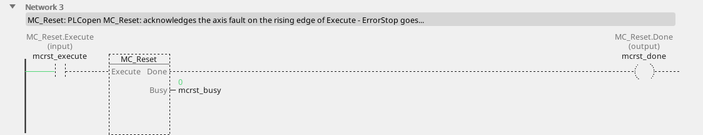

```iecst
PROGRAM MC_Reset_ST
VAR mcrst : MC_Reset; END_VAR
  mcrst(AXIS := 0, Execute := mcrst_execute);
  mcrst_done_st := mcrst.Done;
  mcrst_busy_st := mcrst.Busy;
  mcrst_error_st := mcrst.Error;
  mcrst_errorid_st := mcrst.ErrorID;
END_PROGRAM
```

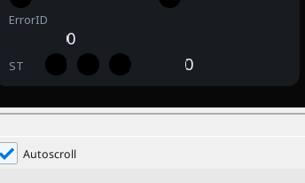

<!-- /blk -->

<!-- blk:MC_ReadStatus -->
**MC_ReadStatus**

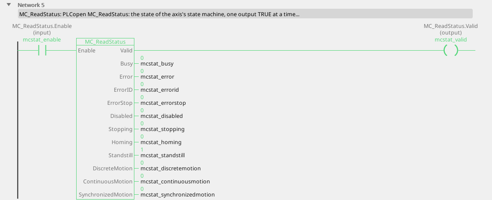

```iecst
PROGRAM MC_ReadStatus_ST
VAR mcstat : MC_ReadStatus; END_VAR
  mcstat(AXIS := 0, Enable := mcstat_enable);
  mcstat_valid_st := mcstat.Valid;
  mcstat_busy_st := mcstat.Busy;
  mcstat_error_st := mcstat.Error;
  mcstat_errorid_st := mcstat.ErrorID;
  mcstat_errorstop_st := mcstat.ErrorStop;
  mcstat_disabled_st := mcstat.Disabled;
  mcstat_stopping_st := mcstat.Stopping;
  mcstat_homing_st := mcstat.Homing;
  mcstat_standstill_st := mcstat.Standstill;
  mcstat_discretemotion_st := mcstat.DiscreteMotion;
  mcstat_continuousmotion_st := mcstat.ContinuousMotion;
  mcstat_synchronizedmotion_st := mcstat.SynchronizedMotion;
END_PROGRAM
```

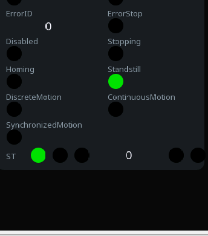

<!-- /blk -->

<!-- blk:MC_ReadAxisError -->
**MC_ReadAxisError**

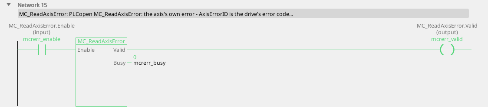

```iecst
PROGRAM MC_ReadAxisError_ST
VAR mcrerr : MC_ReadAxisError; END_VAR
  mcrerr(AXIS := 0, Enable := mcrerr_enable);
  mcrerr_valid_st := mcrerr.Valid;
  mcrerr_busy_st := mcrerr.Busy;
  mcrerr_error_st := mcrerr.Error;
  mcrerr_errorid_st := mcrerr.ErrorID;
  mcrerr_axiserrorid_st := mcrerr.AxisErrorID;
END_PROGRAM
```

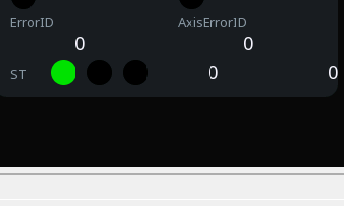

<!-- /blk -->

<!-- blk:MC_Power -->
**MC_Power**


```iecst
PROGRAM MC_Power_ST
VAR mcpow : MC_Power; END_VAR
  mcpow(AXIS := 0, Enable := mcpow_enable,
        Enable_Positive := mcpow_enable_positive,
        Enable_Negative := mcpow_enable_negative);
  mcpow_status_st := mcpow.Status;
  mcpow_valid_st := mcpow.Valid;
  mcpow_error_st := mcpow.Error;
  mcpow_errorid_st := mcpow.ErrorID;
END_PROGRAM
```


<!-- /blk -->

<!-- blk:MC_Reset -->
**MC_Reset**


```iecst
PROGRAM MC_Reset_ST
VAR mcrst : MC_Reset; END_VAR
  mcrst(AXIS := 0, Execute := mcrst_execute);
  mcrst_done_st := mcrst.Done;
  mcrst_busy_st := mcrst.Busy;
  mcrst_error_st := mcrst.Error;
  mcrst_errorid_st := mcrst.ErrorID;
END_PROGRAM
```


<!-- /blk -->

<!-- blk:MC_ReadStatus -->
**MC_ReadStatus**


```iecst
PROGRAM MC_ReadStatus_ST
VAR mcstat : MC_ReadStatus; END_VAR
  mcstat(AXIS := 0, Enable := mcstat_enable);
  mcstat_valid_st := mcstat.Valid;
  mcstat_busy_st := mcstat.Busy;
  mcstat_error_st := mcstat.Error;
  mcstat_errorid_st := mcstat.ErrorID;
  mcstat_errorstop_st := mcstat.ErrorStop;
  mcstat_disabled_st := mcstat.Disabled;
  mcstat_stopping_st := mcstat.Stopping;
  mcstat_homing_st := mcstat.Homing;
  mcstat_standstill_st := mcstat.Standstill;
  mcstat_discretemotion_st := mcstat.DiscreteMotion;
  mcstat_continuousmotion_st := mcstat.ContinuousMotion;
  mcstat_synchronizedmotion_st := mcstat.SynchronizedMotion;
END_PROGRAM
```


<!-- /blk -->

<!-- blk:MC_ReadAxisError -->
**MC_ReadAxisError**


```iecst
PROGRAM MC_ReadAxisError_ST
VAR mcrerr : MC_ReadAxisError; END_VAR
  mcrerr(AXIS := 0, Enable := mcrerr_enable);
  mcrerr_valid_st := mcrerr.Valid;
  mcrerr_busy_st := mcrerr.Busy;
  mcrerr_error_st := mcrerr.Error;
  mcrerr_errorid_st := mcrerr.ErrorID;
  mcrerr_axiserrorid_st := mcrerr.AxisErrorID;
END_PROGRAM
```


<!-- /blk -->

---

## Making it move

### MC_MoveVelocity

| Pin | Type | Meaning |
|:---|:---:|:---|
| `Execute` | input, bool | start on the rising edge |
| `Velocity` | input, number | the speed, in units per the time base |
| `ContinuousUpdate` | parameter, bool | a changed `Velocity` is taken at once while `Execute` holds |
| `Acceleration`, `Deceleration`, `Jerk` | parameters | the ramps (0 = the axis's defaults) |
| `Direction` | parameter (mcPositiveDirection) | `mcPositiveDirection` 1, `mcNegativeDirection` 3, `mcCurrentDirection` 4 |
| `BufferMode` | parameter | |
| `InVelocity` | output, bool | the commanded velocity is reached (PLCopen judges the set value) |
| `Busy`, `Active`, `CommandAborted`, `Error`, `ErrorID` | outputs | |

Ramps up to `Velocity` and holds it - a conveyor, a pump, a fan,
anything that runs at a speed rather than to a position. `Busy` and
`Active` stay on after `Execute` falls (the axis keeps turning);
`InVelocity` falls with `Execute`.

### MC_Halt

| Pin | Type | Meaning |
|:---|:---:|:---|
| `Execute` | input, bool | |
| `Deceleration`, `Jerk`, `BufferMode` | parameters | |
| `Done`, `Busy`, `Active`, `CommandAborted`, `Error`, `ErrorID` | outputs | |

A controlled stop that **does not lock** the axis: the next command
takes it at once, even before it stands.

### MC_Stop

| Pin | Type | Meaning |
|:---|:---:|:---|
| `Execute` | input, bool | |
| `Deceleration`, `Jerk` | parameters | the ramp (0 = the axis's default) |
| `Done`, `Busy`, `Active`, `CommandAborted`, `Error`, `ErrorID` | outputs | |

A controlled stop that **holds**: the axis is in Stopping while `Execute`
is TRUE and every motion command is refused (ErrorID 4) until it falls.
Not an emergency stop - see below.

### MC_MoveAbsolute

| Pin | Type | Meaning |
|:---|:---:|:---|
| `Execute` | input, bool | |
| `Position` | input, number | where to go, in units from the axis zero |
| `Velocity` | input, number | how fast to travel |
| `ContinuousUpdate`, `Acceleration`, `Deceleration`, `Jerk` | parameters | |
| `Direction` | parameter (mcShortestWay) | on a modulo axis: `mcPositiveDirection`, `mcShortestWay` 2, `mcNegativeDirection`, `mcCurrentDirection` |
| `BufferMode` | parameter | |
| `Done`, `Busy`, `Active`, `CommandAborted`, `Error`, `ErrorID` | outputs | |

Absolute: the position is measured from the axis zero, so the axis must
be **homed** first (ErrorID 6 otherwise) - unless the drive's position is
absolute, as a servo's is.

### MC_MoveRelative

Same pins, `Distance` instead of `Position`: move this far from the
setpoint you are at. No homing required; errors do not accumulate,
because every move starts from the commanded position, not from a
measured one.

### MC_MoveAdditive

`Distance` is added to the **target of the running move**: a stack of
additive moves ends where their sum says, whatever the axis was doing
when each arrived.

### MC_Home

| Pin | Type | Meaning |
|:---|:---:|:---|
| `Execute` | input, bool | start the reference run |
| `Position` | input, number | the position the reference point gets |
| `BufferMode` | parameter | |
| `Done`, `Busy`, `Active`, `CommandAborted`, `Error`, `ErrorID` | outputs | |

Until this has completed, absolute positions mean nothing. On a
frequency drive the run approaches the home switch at the axis's homing
speed and, where a local encoder gives a Z pulse, creeps to it; without
one the switch edge itself is the zero. A servo with absolute feedback is
homed where it stands.

### MC_SetPosition

| Pin | Type | Meaning |
|:---|:---:|:---|
| `Execute` | input, bool | |
| `Position` | input, number | the new value of the current position |
| `Mode` | parameter, bool | FALSE absolute: the axis now stands at `Position`; TRUE relative: `Position` is added |
| `ExecutionMode` | parameter | `mcImmediately` or `mcQueued` (after the running command) |
| `Done`, `Busy`, `Error`, `ErrorID` | outputs | |

Moves the coordinate system, not the axis.

### MC_SetOverride

| Pin | Type | Meaning |
|:---|:---:|:---|
| `Enable` | input, bool | |
| `VelFactor`, `AccFactor`, `JerkFactor` | parameters (1.0) | 0 to 1: the factor every running and coming command is scaled by |
| `Enabled`, `Busy`, `Error`, `ErrorID` | outputs | |

<!-- blk:MC_MoveVelocity -->
**MC_MoveVelocity**

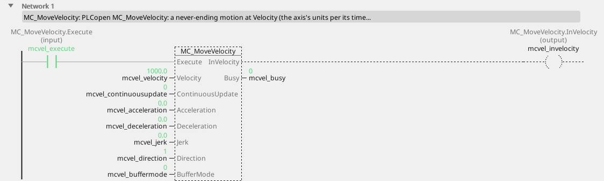

```iecst
PROGRAM MC_MoveVelocity_ST
VAR mcvel : MC_MoveVelocity; END_VAR
  mcvel(AXIS := 0, Execute := mcvel_execute,
        Velocity := mcvel_velocity,
        ContinuousUpdate := mcvel_continuousupdate,
        Acceleration := mcvel_acceleration,
        Deceleration := mcvel_deceleration, Jerk := mcvel_jerk,
        Direction := mcvel_direction,
        BufferMode := mcvel_buffermode);
  mcvel_invelocity_st := mcvel.InVelocity;
  mcvel_busy_st := mcvel.Busy;
  mcvel_active_st := mcvel.Active;
  mcvel_commandaborted_st := mcvel.CommandAborted;
  mcvel_error_st := mcvel.Error;
  mcvel_errorid_st := mcvel.ErrorID;
END_PROGRAM
```

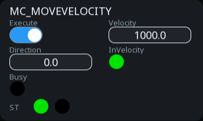

<!-- /blk -->

<!-- blk:MC_Halt -->
**MC_Halt**


```iecst
PROGRAM MC_Halt_ST
VAR mchlt : MC_Halt; END_VAR
  mchlt(AXIS := 0, Execute := mchlt_execute,
        Deceleration := mchlt_deceleration, Jerk := mchlt_jerk,
        BufferMode := mchlt_buffermode);
  mchlt_done_st := mchlt.Done;
  mchlt_busy_st := mchlt.Busy;
  mchlt_active_st := mchlt.Active;
  mchlt_commandaborted_st := mchlt.CommandAborted;
  mchlt_error_st := mchlt.Error;
  mchlt_errorid_st := mchlt.ErrorID;
END_PROGRAM
```


<!-- /blk -->

<!-- blk:MC_Stop -->
**MC_Stop**


```iecst
PROGRAM MC_Stop_ST
VAR mcstop : MC_Stop; END_VAR
  mcstop(AXIS := 0, Execute := mcstop_execute,
         Deceleration := mcstop_deceleration,
         Jerk := mcstop_jerk);
  mcstop_done_st := mcstop.Done;
  mcstop_busy_st := mcstop.Busy;
  mcstop_active_st := mcstop.Active;
  mcstop_commandaborted_st := mcstop.CommandAborted;
  mcstop_error_st := mcstop.Error;
  mcstop_errorid_st := mcstop.ErrorID;
END_PROGRAM
```


<!-- /blk -->

<!-- blk:MC_MoveAbsolute -->
**MC_MoveAbsolute**


```iecst
PROGRAM MC_MoveAbsolute_ST
VAR mcabs : MC_MoveAbsolute; END_VAR
  mcabs(AXIS := 0, Execute := mcabs_execute,
        Position := mcabs_position, Velocity := mcabs_velocity,
        ContinuousUpdate := mcabs_continuousupdate,
        Acceleration := mcabs_acceleration,
        Deceleration := mcabs_deceleration, Jerk := mcabs_jerk,
        Direction := mcabs_direction,
        BufferMode := mcabs_buffermode);
  mcabs_done_st := mcabs.Done;
  mcabs_busy_st := mcabs.Busy;
  mcabs_active_st := mcabs.Active;
  mcabs_commandaborted_st := mcabs.CommandAborted;
  mcabs_error_st := mcabs.Error;
  mcabs_errorid_st := mcabs.ErrorID;
END_PROGRAM
```

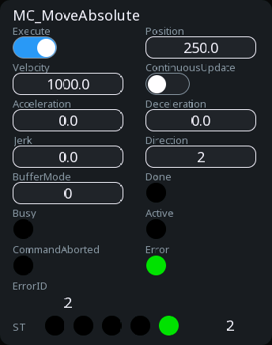

<!-- /blk -->

<!-- blk:MC_MoveRelative -->
**MC_MoveRelative**

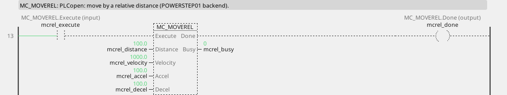

```iecst
PROGRAM MC_MoveRelative_ST
VAR mcrel : MC_MoveRelative; END_VAR
  mcrel(AXIS := 0, Execute := mcrel_execute,
        Distance := mcrel_distance, Velocity := mcrel_velocity,
        ContinuousUpdate := mcrel_continuousupdate,
        Acceleration := mcrel_acceleration,
        Deceleration := mcrel_deceleration, Jerk := mcrel_jerk,
        BufferMode := mcrel_buffermode);
  mcrel_done_st := mcrel.Done;
  mcrel_busy_st := mcrel.Busy;
  mcrel_active_st := mcrel.Active;
  mcrel_commandaborted_st := mcrel.CommandAborted;
  mcrel_error_st := mcrel.Error;
  mcrel_errorid_st := mcrel.ErrorID;
END_PROGRAM
```


<!-- /blk -->

<!-- blk:MC_MoveAdditive -->
**MC_MoveAdditive**

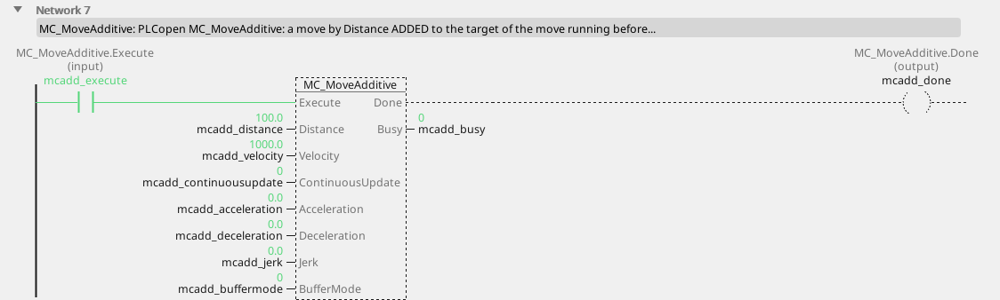

```iecst
PROGRAM MC_MoveAdditive_ST
VAR mcadd : MC_MoveAdditive; END_VAR
  mcadd(AXIS := 0, Execute := mcadd_execute,
        Distance := mcadd_distance, Velocity := mcadd_velocity,
        ContinuousUpdate := mcadd_continuousupdate,
        Acceleration := mcadd_acceleration,
        Deceleration := mcadd_deceleration, Jerk := mcadd_jerk,
        BufferMode := mcadd_buffermode);
  mcadd_done_st := mcadd.Done;
  mcadd_busy_st := mcadd.Busy;
  mcadd_active_st := mcadd.Active;
  mcadd_commandaborted_st := mcadd.CommandAborted;
  mcadd_error_st := mcadd.Error;
  mcadd_errorid_st := mcadd.ErrorID;
END_PROGRAM
```

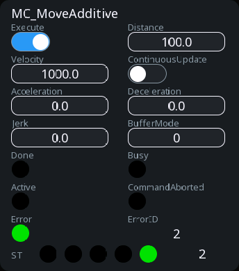

<!-- /blk -->

<!-- blk:MC_Home -->
**MC_Home**

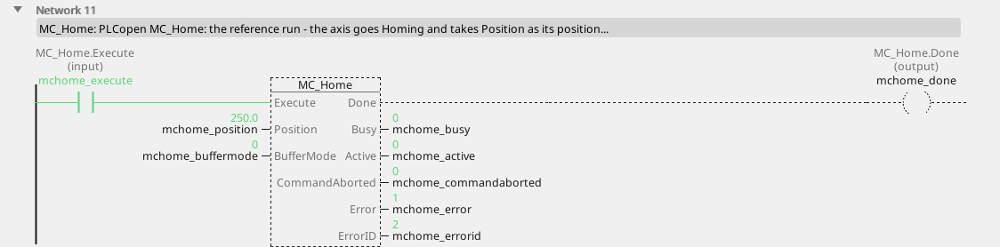

```iecst
PROGRAM MC_Home_ST
VAR mchome : MC_Home; END_VAR
  mchome(AXIS := 0, Execute := mchome_execute,
         Position := mchome_position,
         BufferMode := mchome_buffermode);
  mchome_done_st := mchome.Done;
  mchome_busy_st := mchome.Busy;
  mchome_active_st := mchome.Active;
  mchome_commandaborted_st := mchome.CommandAborted;
  mchome_error_st := mchome.Error;
  mchome_errorid_st := mchome.ErrorID;
END_PROGRAM
```

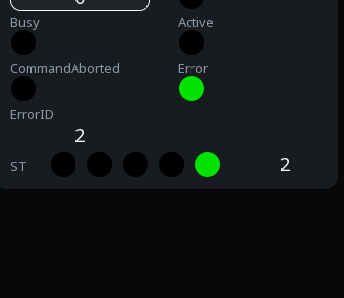

<!-- /blk -->

<!-- blk:MC_SetPosition -->
**MC_SetPosition**


```iecst
PROGRAM MC_SetPosition_ST
VAR mcspos : MC_SetPosition; END_VAR
  mcspos(AXIS := 0, Execute := mcspos_execute,
         Position := mcspos_position, Mode := mcspos_mode,
         ExecutionMode := mcspos_executionmode);
  mcspos_done_st := mcspos.Done;
  mcspos_busy_st := mcspos.Busy;
  mcspos_error_st := mcspos.Error;
  mcspos_errorid_st := mcspos.ErrorID;
END_PROGRAM
```


<!-- /blk -->

<!-- blk:MC_SetOverride -->
**MC_SetOverride**

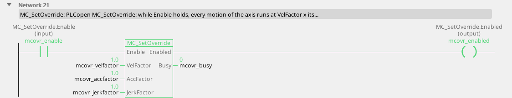

```iecst
PROGRAM MC_SetOverride_ST
VAR mcovr : MC_SetOverride; END_VAR
  mcovr(AXIS := 0, Enable := mcovr_enable,
        VelFactor := mcovr_velfactor,
        AccFactor := mcovr_accfactor,
        JerkFactor := mcovr_jerkfactor);
  mcovr_enabled_st := mcovr.Enabled;
  mcovr_busy_st := mcovr.Busy;
  mcovr_error_st := mcovr.Error;
  mcovr_errorid_st := mcovr.ErrorID;
END_PROGRAM
```

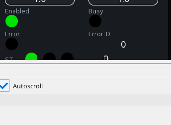

<!-- /blk -->

<!-- blk:MC_MoveVelocity -->
**MC_MoveVelocity**


```iecst
PROGRAM MC_MoveVelocity_ST
VAR mcvel : MC_MoveVelocity; END_VAR
  mcvel(AXIS := 0, Execute := mcvel_execute,
        Velocity := mcvel_velocity,
        ContinuousUpdate := mcvel_continuousupdate,
        Acceleration := mcvel_acceleration,
        Deceleration := mcvel_deceleration, Jerk := mcvel_jerk,
        Direction := mcvel_direction,
        BufferMode := mcvel_buffermode);
  mcvel_invelocity_st := mcvel.InVelocity;
  mcvel_busy_st := mcvel.Busy;
  mcvel_active_st := mcvel.Active;
  mcvel_commandaborted_st := mcvel.CommandAborted;
  mcvel_error_st := mcvel.Error;
  mcvel_errorid_st := mcvel.ErrorID;
END_PROGRAM
```


<!-- /blk -->

<!-- blk:MC_Halt -->
**MC_Halt**


```iecst
PROGRAM MC_Halt_ST
VAR mchlt : MC_Halt; END_VAR
  mchlt(AXIS := 0, Execute := mchlt_execute,
        Deceleration := mchlt_deceleration, Jerk := mchlt_jerk,
        BufferMode := mchlt_buffermode);
  mchlt_done_st := mchlt.Done;
  mchlt_busy_st := mchlt.Busy;
  mchlt_active_st := mchlt.Active;
  mchlt_commandaborted_st := mchlt.CommandAborted;
  mchlt_error_st := mchlt.Error;
  mchlt_errorid_st := mchlt.ErrorID;
END_PROGRAM
```


<!-- /blk -->

<!-- blk:MC_Stop -->
**MC_Stop**


```iecst
PROGRAM MC_Stop_ST
VAR mcstop : MC_Stop; END_VAR
  mcstop(AXIS := 0, Execute := mcstop_execute,
         Deceleration := mcstop_deceleration,
         Jerk := mcstop_jerk);
  mcstop_done_st := mcstop.Done;
  mcstop_busy_st := mcstop.Busy;
  mcstop_active_st := mcstop.Active;
  mcstop_commandaborted_st := mcstop.CommandAborted;
  mcstop_error_st := mcstop.Error;
  mcstop_errorid_st := mcstop.ErrorID;
END_PROGRAM
```


<!-- /blk -->

<!-- blk:MC_MoveAbsolute -->
**MC_MoveAbsolute**


```iecst
PROGRAM MC_MoveAbsolute_ST
VAR mcabs : MC_MoveAbsolute; END_VAR
  mcabs(AXIS := 0, Execute := mcabs_execute,
        Position := mcabs_position, Velocity := mcabs_velocity,
        ContinuousUpdate := mcabs_continuousupdate,
        Acceleration := mcabs_acceleration,
        Deceleration := mcabs_deceleration, Jerk := mcabs_jerk,
        Direction := mcabs_direction,
        BufferMode := mcabs_buffermode);
  mcabs_done_st := mcabs.Done;
  mcabs_busy_st := mcabs.Busy;
  mcabs_active_st := mcabs.Active;
  mcabs_commandaborted_st := mcabs.CommandAborted;
  mcabs_error_st := mcabs.Error;
  mcabs_errorid_st := mcabs.ErrorID;
END_PROGRAM
```


<!-- /blk -->

<!-- blk:MC_MoveRelative -->
**MC_MoveRelative**


```iecst
PROGRAM MC_MoveRelative_ST
VAR mcrel : MC_MoveRelative; END_VAR
  mcrel(AXIS := 0, Execute := mcrel_execute,
        Distance := mcrel_distance, Velocity := mcrel_velocity,
        ContinuousUpdate := mcrel_continuousupdate,
        Acceleration := mcrel_acceleration,
        Deceleration := mcrel_deceleration, Jerk := mcrel_jerk,
        BufferMode := mcrel_buffermode);
  mcrel_done_st := mcrel.Done;
  mcrel_busy_st := mcrel.Busy;
  mcrel_active_st := mcrel.Active;
  mcrel_commandaborted_st := mcrel.CommandAborted;
  mcrel_error_st := mcrel.Error;
  mcrel_errorid_st := mcrel.ErrorID;
END_PROGRAM
```


<!-- /blk -->

<!-- blk:MC_MoveAdditive -->
**MC_MoveAdditive**


```iecst
PROGRAM MC_MoveAdditive_ST
VAR mcadd : MC_MoveAdditive; END_VAR
  mcadd(AXIS := 0, Execute := mcadd_execute,
        Distance := mcadd_distance, Velocity := mcadd_velocity,
        ContinuousUpdate := mcadd_continuousupdate,
        Acceleration := mcadd_acceleration,
        Deceleration := mcadd_deceleration, Jerk := mcadd_jerk,
        BufferMode := mcadd_buffermode);
  mcadd_done_st := mcadd.Done;
  mcadd_busy_st := mcadd.Busy;
  mcadd_active_st := mcadd.Active;
  mcadd_commandaborted_st := mcadd.CommandAborted;
  mcadd_error_st := mcadd.Error;
  mcadd_errorid_st := mcadd.ErrorID;
END_PROGRAM
```


<!-- /blk -->

<!-- blk:MC_Home -->
**MC_Home**


```iecst
PROGRAM MC_Home_ST
VAR mchome : MC_Home; END_VAR
  mchome(AXIS := 0, Execute := mchome_execute,
         Position := mchome_position,
         BufferMode := mchome_buffermode);
  mchome_done_st := mchome.Done;
  mchome_busy_st := mchome.Busy;
  mchome_active_st := mchome.Active;
  mchome_commandaborted_st := mchome.CommandAborted;
  mchome_error_st := mchome.Error;
  mchome_errorid_st := mchome.ErrorID;
END_PROGRAM
```


<!-- /blk -->

<!-- blk:MC_SetPosition -->
**MC_SetPosition**


```iecst
PROGRAM MC_SetPosition_ST
VAR mcspos : MC_SetPosition; END_VAR
  mcspos(AXIS := 0, Execute := mcspos_execute,
         Position := mcspos_position, Mode := mcspos_mode,
         ExecutionMode := mcspos_executionmode);
  mcspos_done_st := mcspos.Done;
  mcspos_busy_st := mcspos.Busy;
  mcspos_error_st := mcspos.Error;
  mcspos_errorid_st := mcspos.ErrorID;
END_PROGRAM
```


<!-- /blk -->

<!-- blk:MC_SetOverride -->
**MC_SetOverride**


```iecst
PROGRAM MC_SetOverride_ST
VAR mcovr : MC_SetOverride; END_VAR
  mcovr(AXIS := 0, Enable := mcovr_enable,
        VelFactor := mcovr_velfactor,
        AccFactor := mcovr_accfactor,
        JerkFactor := mcovr_jerkfactor);
  mcovr_enabled_st := mcovr.Enabled;
  mcovr_busy_st := mcovr.Busy;
  mcovr_error_st := mcovr.Error;
  mcovr_errorid_st := mcovr.ErrorID;
END_PROGRAM
```


<!-- /blk -->

The operator's "slower, please": a potentiometer or a setpoint screen on
`VelFactor` scales the whole program's motion without touching a
command.

---

## Reading the axis

| Block | Reads |
|:---|:---|
| `MC_ReadActualPosition` | `Position` in units from the zero |
| `MC_ReadActualVelocity` | `Velocity` in units per the time base |
| `MC_ReadActualTorque` | `Torque` in per cent of the rated torque (a servo) |
| `MC_ReadMotionState` | `ConstantVelocity`, `Accelerating`, `Decelerating`, `DirectionPositive`, `DirectionNegative`; `Source` picks the set value (`mcSetValue`) or the measured one (`mcActualValue`) |
| `MC_ReadAxisInfo` | `HomeAbsSwitch`, `LimitSwitchPos`, `LimitSwitchNeg`, `Simulation`, `CommunicationReady`, `ReadyForPowerOn`, `PowerOn`, `IsHomed`, `AxisWarning` |
| `MC_ReadParameter` / `MC_ReadBoolParameter` | the parameter `ParameterNumber` (the table above; 1000 the chain delay, 1001 the modulo period) |
| `MC_WriteParameter` / `MC_WriteBoolParameter` | write it, `ExecutionMode` immediately or queued |

<!-- blk:MC_ReadActualPosition -->
**MC_ReadActualPosition**

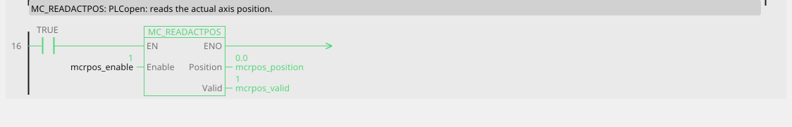

```iecst
PROGRAM MC_ReadActualPosition_ST
VAR mcrpos : MC_ReadActualPosition; END_VAR
  mcrpos(AXIS := 0, Enable := mcrpos_enable);
  mcrpos_valid_st := mcrpos.Valid;
  mcrpos_busy_st := mcrpos.Busy;
  mcrpos_error_st := mcrpos.Error;
  mcrpos_errorid_st := mcrpos.ErrorID;
  mcrpos_position_st := mcrpos.Position;
END_PROGRAM
```

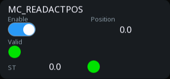

<!-- /blk -->

<!-- blk:MC_ReadActualVelocity -->
**MC_ReadActualVelocity**


```iecst
PROGRAM MC_ReadActualVelocity_ST
VAR mcrvel : MC_ReadActualVelocity; END_VAR
  mcrvel(AXIS := 0, Enable := mcrvel_enable);
  mcrvel_valid_st := mcrvel.Valid;
  mcrvel_busy_st := mcrvel.Busy;
  mcrvel_error_st := mcrvel.Error;
  mcrvel_errorid_st := mcrvel.ErrorID;
  mcrvel_velocity_st := mcrvel.Velocity;
END_PROGRAM
```


<!-- /blk -->

<!-- blk:MC_ReadActualTorque -->
**MC_ReadActualTorque**


```iecst
PROGRAM MC_ReadActualTorque_ST
VAR mcrtrq : MC_ReadActualTorque; END_VAR
  mcrtrq(AXIS := 0, Enable := mcrtrq_enable);
  mcrtrq_valid_st := mcrtrq.Valid;
  mcrtrq_busy_st := mcrtrq.Busy;
  mcrtrq_error_st := mcrtrq.Error;
  mcrtrq_errorid_st := mcrtrq.ErrorID;
  mcrtrq_torque_st := mcrtrq.Torque;
END_PROGRAM
```


<!-- /blk -->

<!-- blk:MC_ReadMotionState -->
**MC_ReadMotionState**

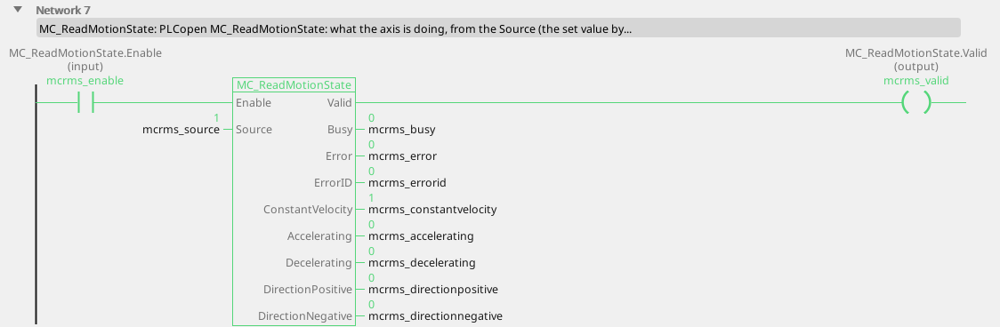

```iecst
PROGRAM MC_ReadMotionState_ST
VAR mcrms : MC_ReadMotionState; END_VAR
  mcrms(AXIS := 0, Enable := mcrms_enable,
        Source := mcrms_source);
  mcrms_valid_st := mcrms.Valid;
  mcrms_busy_st := mcrms.Busy;
  mcrms_error_st := mcrms.Error;
  mcrms_errorid_st := mcrms.ErrorID;
  mcrms_constantvelocity_st := mcrms.ConstantVelocity;
  mcrms_accelerating_st := mcrms.Accelerating;
  mcrms_decelerating_st := mcrms.Decelerating;
  mcrms_directionpositive_st := mcrms.DirectionPositive;
  mcrms_directionnegative_st := mcrms.DirectionNegative;
END_PROGRAM
```

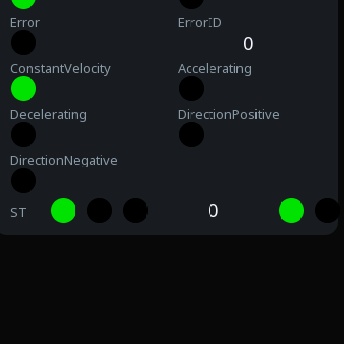

<!-- /blk -->

<!-- blk:MC_ReadAxisInfo -->
**MC_ReadAxisInfo**

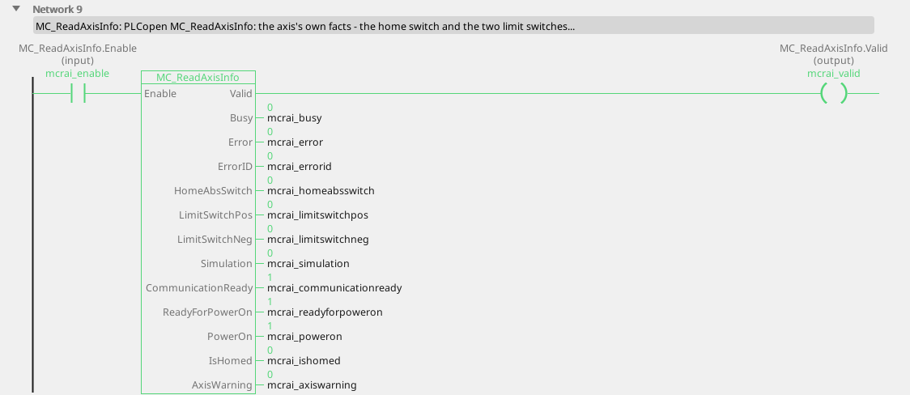

```iecst
PROGRAM MC_ReadAxisInfo_ST
VAR mcrai : MC_ReadAxisInfo; END_VAR
  mcrai(AXIS := 0, Enable := mcrai_enable);
  mcrai_valid_st := mcrai.Valid;
  mcrai_busy_st := mcrai.Busy;
  mcrai_error_st := mcrai.Error;
  mcrai_errorid_st := mcrai.ErrorID;
  mcrai_homeabsswitch_st := mcrai.HomeAbsSwitch;
  mcrai_limitswitchpos_st := mcrai.LimitSwitchPos;
  mcrai_limitswitchneg_st := mcrai.LimitSwitchNeg;
  mcrai_simulation_st := mcrai.Simulation;
  mcrai_communicationready_st := mcrai.CommunicationReady;
  mcrai_readyforpoweron_st := mcrai.ReadyForPowerOn;
  mcrai_poweron_st := mcrai.PowerOn;
  mcrai_ishomed_st := mcrai.IsHomed;
  mcrai_axiswarning_st := mcrai.AxisWarning;
END_PROGRAM
```

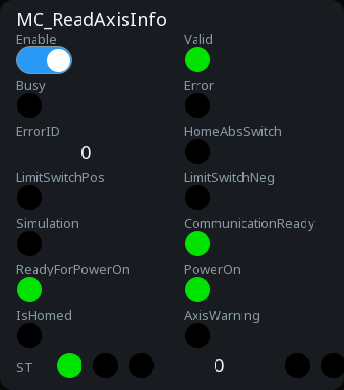

<!-- /blk -->

<!-- blk:MC_ReadParameter -->
**MC_ReadParameter**

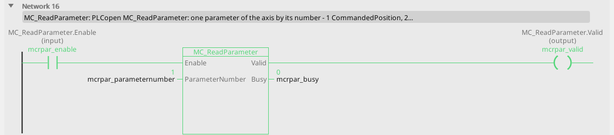

```iecst
PROGRAM MC_ReadParameter_ST
VAR mcrpar : MC_ReadParameter; END_VAR
  mcrpar(AXIS := 0, Enable := mcrpar_enable,
         ParameterNumber := mcrpar_parameternumber);
  mcrpar_valid_st := mcrpar.Valid;
  mcrpar_busy_st := mcrpar.Busy;
  mcrpar_error_st := mcrpar.Error;
  mcrpar_errorid_st := mcrpar.ErrorID;
  mcrpar_value_st := mcrpar.Value;
END_PROGRAM
```

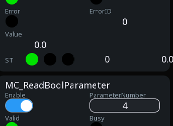

<!-- /blk -->

<!-- blk:MC_ReadBoolParameter -->
**MC_ReadBoolParameter**

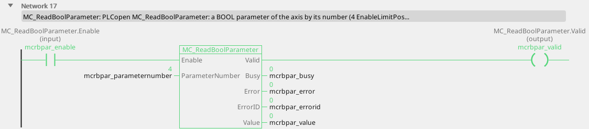

```iecst
PROGRAM MC_ReadBoolParameter_ST
VAR mcrbpar : MC_ReadBoolParameter; END_VAR
  mcrbpar(AXIS := 0, Enable := mcrbpar_enable,
          ParameterNumber := mcrbpar_parameternumber);
  mcrbpar_valid_st := mcrbpar.Valid;
  mcrbpar_busy_st := mcrbpar.Busy;
  mcrbpar_error_st := mcrbpar.Error;
  mcrbpar_errorid_st := mcrbpar.ErrorID;
  mcrbpar_value_st := mcrbpar.Value;
END_PROGRAM
```

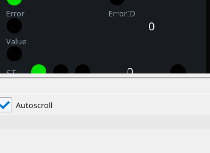

<!-- /blk -->

<!-- blk:MC_WriteParameter -->
**MC_WriteParameter**

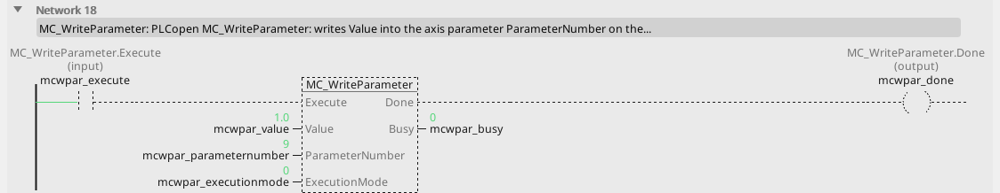

```iecst
PROGRAM MC_WriteParameter_ST
VAR mcwpar : MC_WriteParameter; END_VAR
  mcwpar(AXIS := 0, Execute := mcwpar_execute,
         Value := mcwpar_value,
         ParameterNumber := mcwpar_parameternumber,
         ExecutionMode := mcwpar_executionmode);
  mcwpar_done_st := mcwpar.Done;
  mcwpar_busy_st := mcwpar.Busy;
  mcwpar_error_st := mcwpar.Error;
  mcwpar_errorid_st := mcwpar.ErrorID;
END_PROGRAM
```

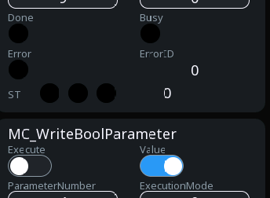

<!-- /blk -->

<!-- blk:MC_WriteBoolParameter -->
**MC_WriteBoolParameter**

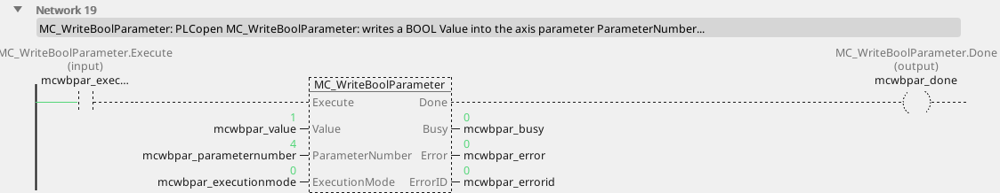

```iecst
PROGRAM MC_WriteBoolParameter_ST
VAR mcwbpar : MC_WriteBoolParameter; END_VAR
  mcwbpar(AXIS := 0, Execute := mcwbpar_execute,
          Value := mcwbpar_value,
          ParameterNumber := mcwbpar_parameternumber,
          ExecutionMode := mcwbpar_executionmode);
  mcwbpar_done_st := mcwbpar.Done;
  mcwbpar_busy_st := mcwbpar.Busy;
  mcwbpar_error_st := mcwbpar.Error;
  mcwbpar_errorid_st := mcwbpar.ErrorID;
END_PROGRAM
```

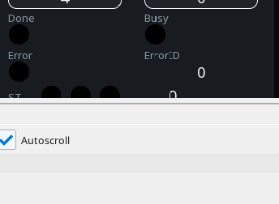

<!-- /blk -->

<!-- blk:MC_ReadActualPosition -->
**MC_ReadActualPosition**


```iecst
PROGRAM MC_ReadActualPosition_ST
VAR mcrpos : MC_ReadActualPosition; END_VAR
  mcrpos(AXIS := 0, Enable := mcrpos_enable);
  mcrpos_valid_st := mcrpos.Valid;
  mcrpos_busy_st := mcrpos.Busy;
  mcrpos_error_st := mcrpos.Error;
  mcrpos_errorid_st := mcrpos.ErrorID;
  mcrpos_position_st := mcrpos.Position;
END_PROGRAM
```


<!-- /blk -->

<!-- blk:MC_ReadActualVelocity -->
**MC_ReadActualVelocity**


```iecst
PROGRAM MC_ReadActualVelocity_ST
VAR mcrvel : MC_ReadActualVelocity; END_VAR
  mcrvel(AXIS := 0, Enable := mcrvel_enable);
  mcrvel_valid_st := mcrvel.Valid;
  mcrvel_busy_st := mcrvel.Busy;
  mcrvel_error_st := mcrvel.Error;
  mcrvel_errorid_st := mcrvel.ErrorID;
  mcrvel_velocity_st := mcrvel.Velocity;
END_PROGRAM
```


<!-- /blk -->

<!-- blk:MC_ReadActualTorque -->
**MC_ReadActualTorque**


```iecst
PROGRAM MC_ReadActualTorque_ST
VAR mcrtrq : MC_ReadActualTorque; END_VAR
  mcrtrq(AXIS := 0, Enable := mcrtrq_enable);
  mcrtrq_valid_st := mcrtrq.Valid;
  mcrtrq_busy_st := mcrtrq.Busy;
  mcrtrq_error_st := mcrtrq.Error;
  mcrtrq_errorid_st := mcrtrq.ErrorID;
  mcrtrq_torque_st := mcrtrq.Torque;
END_PROGRAM
```


<!-- /blk -->

<!-- blk:MC_ReadMotionState -->
**MC_ReadMotionState**


```iecst
PROGRAM MC_ReadMotionState_ST
VAR mcrms : MC_ReadMotionState; END_VAR
  mcrms(AXIS := 0, Enable := mcrms_enable,
        Source := mcrms_source);
  mcrms_valid_st := mcrms.Valid;
  mcrms_busy_st := mcrms.Busy;
  mcrms_error_st := mcrms.Error;
  mcrms_errorid_st := mcrms.ErrorID;
  mcrms_constantvelocity_st := mcrms.ConstantVelocity;
  mcrms_accelerating_st := mcrms.Accelerating;
  mcrms_decelerating_st := mcrms.Decelerating;
  mcrms_directionpositive_st := mcrms.DirectionPositive;
  mcrms_directionnegative_st := mcrms.DirectionNegative;
END_PROGRAM
```


<!-- /blk -->

<!-- blk:MC_ReadAxisInfo -->
**MC_ReadAxisInfo**


```iecst
PROGRAM MC_ReadAxisInfo_ST
VAR mcrai : MC_ReadAxisInfo; END_VAR
  mcrai(AXIS := 0, Enable := mcrai_enable);
  mcrai_valid_st := mcrai.Valid;
  mcrai_busy_st := mcrai.Busy;
  mcrai_error_st := mcrai.Error;
  mcrai_errorid_st := mcrai.ErrorID;
  mcrai_homeabsswitch_st := mcrai.HomeAbsSwitch;
  mcrai_limitswitchpos_st := mcrai.LimitSwitchPos;
  mcrai_limitswitchneg_st := mcrai.LimitSwitchNeg;
  mcrai_simulation_st := mcrai.Simulation;
  mcrai_communicationready_st := mcrai.CommunicationReady;
  mcrai_readyforpoweron_st := mcrai.ReadyForPowerOn;
  mcrai_poweron_st := mcrai.PowerOn;
  mcrai_ishomed_st := mcrai.IsHomed;
  mcrai_axiswarning_st := mcrai.AxisWarning;
END_PROGRAM
```


<!-- /blk -->

<!-- blk:MC_ReadParameter -->
**MC_ReadParameter**


```iecst
PROGRAM MC_ReadParameter_ST
VAR mcrpar : MC_ReadParameter; END_VAR
  mcrpar(AXIS := 0, Enable := mcrpar_enable,
         ParameterNumber := mcrpar_parameternumber);
  mcrpar_valid_st := mcrpar.Valid;
  mcrpar_busy_st := mcrpar.Busy;
  mcrpar_error_st := mcrpar.Error;
  mcrpar_errorid_st := mcrpar.ErrorID;
  mcrpar_value_st := mcrpar.Value;
END_PROGRAM
```


<!-- /blk -->

<!-- blk:MC_ReadBoolParameter -->
**MC_ReadBoolParameter**


```iecst
PROGRAM MC_ReadBoolParameter_ST
VAR mcrbpar : MC_ReadBoolParameter; END_VAR
  mcrbpar(AXIS := 0, Enable := mcrbpar_enable,
          ParameterNumber := mcrbpar_parameternumber);
  mcrbpar_valid_st := mcrbpar.Valid;
  mcrbpar_busy_st := mcrbpar.Busy;
  mcrbpar_error_st := mcrbpar.Error;
  mcrbpar_errorid_st := mcrbpar.ErrorID;
  mcrbpar_value_st := mcrbpar.Value;
END_PROGRAM
```


<!-- /blk -->

<!-- blk:MC_WriteParameter -->
**MC_WriteParameter**


```iecst
PROGRAM MC_WriteParameter_ST
VAR mcwpar : MC_WriteParameter; END_VAR
  mcwpar(AXIS := 0, Execute := mcwpar_execute,
         Value := mcwpar_value,
         ParameterNumber := mcwpar_parameternumber,
         ExecutionMode := mcwpar_executionmode);
  mcwpar_done_st := mcwpar.Done;
  mcwpar_busy_st := mcwpar.Busy;
  mcwpar_error_st := mcwpar.Error;
  mcwpar_errorid_st := mcwpar.ErrorID;
END_PROGRAM
```


<!-- /blk -->

<!-- blk:MC_WriteBoolParameter -->
**MC_WriteBoolParameter**


```iecst
PROGRAM MC_WriteBoolParameter_ST
VAR mcwbpar : MC_WriteBoolParameter; END_VAR
  mcwbpar(AXIS := 0, Execute := mcwbpar_execute,
          Value := mcwbpar_value,
          ParameterNumber := mcwbpar_parameternumber,
          ExecutionMode := mcwbpar_executionmode);
  mcwbpar_done_st := mcwbpar.Done;
  mcwbpar_busy_st := mcwbpar.Busy;
  mcwbpar_error_st := mcwbpar.Error;
  mcwbpar_errorid_st := mcwbpar.ErrorID;
END_PROGRAM
```


<!-- /blk -->

Every reader takes `Enable` and answers `Valid`, `Busy`, `Error`,
`ErrorID` and its value. **`Valid` is the pin that matters.** It goes
FALSE when the value is stale - the drive has stopped answering, the bus
has dropped - and acting on a stale position is a fault that appears
once a month and nobody understands. Gate anything that uses the
position on `Valid`.

---

## Continuous and superimposed motion

**Linux.** `MC_MoveContinuousAbsolute` and `MC_MoveContinuousRelative`
travel to `Position` / by `Distance` and **arrive at `EndVelocity`**
instead of standing still - the entry of a conveyor section at line
speed; `InEndVelocity` once the end velocity is reached at the target.

<!-- blk:MC_MoveContinuousAbsolute -->
**MC_MoveContinuousAbsolute**

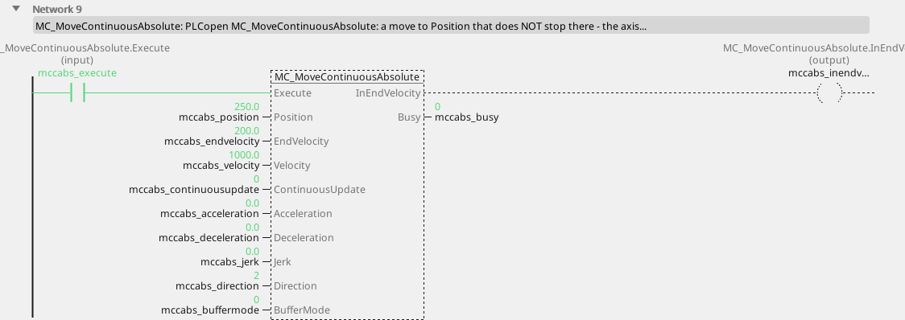

```iecst
PROGRAM MC_MoveContinuousAbsolute_ST
VAR mccabs : MC_MoveContinuousAbsolute; END_VAR
  mccabs(AXIS := 0, Execute := mccabs_execute,
         Position := mccabs_position,
         EndVelocity := mccabs_endvelocity,
         Velocity := mccabs_velocity,
         ContinuousUpdate := mccabs_continuousupdate,
         Acceleration := mccabs_acceleration,
         Deceleration := mccabs_deceleration,
         Jerk := mccabs_jerk, Direction := mccabs_direction,
         BufferMode := mccabs_buffermode);
  mccabs_inendvelocity_st := mccabs.InEndVelocity;
  mccabs_busy_st := mccabs.Busy;
  mccabs_active_st := mccabs.Active;
  mccabs_commandaborted_st := mccabs.CommandAborted;
  mccabs_error_st := mccabs.Error;
  mccabs_errorid_st := mccabs.ErrorID;
END_PROGRAM
```

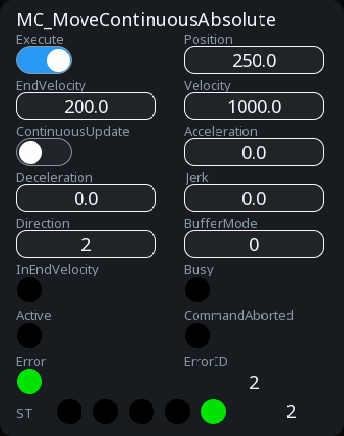

<!-- /blk -->

<!-- blk:MC_MoveContinuousRelative -->
**MC_MoveContinuousRelative**

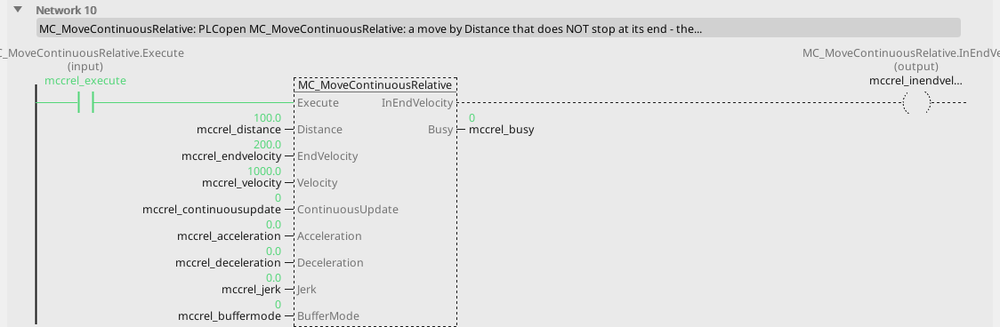

```iecst
PROGRAM MC_MoveContinuousRelative_ST
VAR mccrel : MC_MoveContinuousRelative; END_VAR
  mccrel(AXIS := 0, Execute := mccrel_execute,
         Distance := mccrel_distance,
         EndVelocity := mccrel_endvelocity,
         Velocity := mccrel_velocity,
         ContinuousUpdate := mccrel_continuousupdate,
         Acceleration := mccrel_acceleration,
         Deceleration := mccrel_deceleration,
         Jerk := mccrel_jerk, BufferMode := mccrel_buffermode);
  mccrel_inendvelocity_st := mccrel.InEndVelocity;
  mccrel_busy_st := mccrel.Busy;
  mccrel_active_st := mccrel.Active;
  mccrel_commandaborted_st := mccrel.CommandAborted;
  mccrel_error_st := mccrel.Error;
  mccrel_errorid_st := mccrel.ErrorID;
END_PROGRAM
```

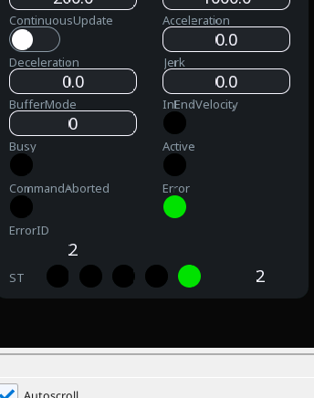

<!-- /blk -->

<!-- blk:MC_MoveSuperimposed -->
**MC_MoveSuperimposed**

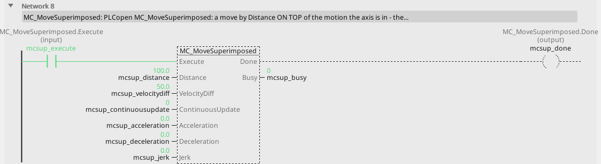

```iecst
PROGRAM MC_MoveSuperimposed_ST
VAR mcsup : MC_MoveSuperimposed; END_VAR
  mcsup(AXIS := 0, Execute := mcsup_execute,
        Distance := mcsup_distance,
        VelocityDiff := mcsup_velocitydiff,
        ContinuousUpdate := mcsup_continuousupdate,
        Acceleration := mcsup_acceleration,
        Deceleration := mcsup_deceleration, Jerk := mcsup_jerk);
  mcsup_done_st := mcsup.Done;
  mcsup_busy_st := mcsup.Busy;
  mcsup_active_st := mcsup.Active;
  mcsup_commandaborted_st := mcsup.CommandAborted;
  mcsup_error_st := mcsup.Error;
  mcsup_errorid_st := mcsup.ErrorID;
  mcsup_covereddistance_st := mcsup.CoveredDistance;
END_PROGRAM
```

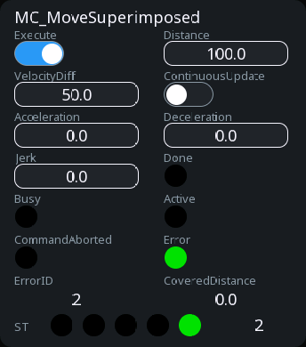

<!-- /blk -->

<!-- blk:MC_HaltSuperimposed -->
**MC_HaltSuperimposed**


```iecst
PROGRAM MC_HaltSuperimposed_ST
VAR mchlts : MC_HaltSuperimposed; END_VAR
  mchlts(AXIS := 0, Execute := mchlts_execute,
         Deceleration := mchlts_deceleration,
         Jerk := mchlts_jerk);
  mchlts_done_st := mchlts.Done;
  mchlts_busy_st := mchlts.Busy;
  mchlts_active_st := mchlts.Active;
  mchlts_commandaborted_st := mchlts.CommandAborted;
  mchlts_error_st := mchlts.Error;
  mchlts_errorid_st := mchlts.ErrorID;
END_PROGRAM
```


<!-- /blk -->

<!-- blk:MC_MoveContinuousAbsolute -->
**MC_MoveContinuousAbsolute**


```iecst
PROGRAM MC_MoveContinuousAbsolute_ST
VAR mccabs : MC_MoveContinuousAbsolute; END_VAR
  mccabs(AXIS := 0, Execute := mccabs_execute,
         Position := mccabs_position,
         EndVelocity := mccabs_endvelocity,
         Velocity := mccabs_velocity,
         ContinuousUpdate := mccabs_continuousupdate,
         Acceleration := mccabs_acceleration,
         Deceleration := mccabs_deceleration,
         Jerk := mccabs_jerk, Direction := mccabs_direction,
         BufferMode := mccabs_buffermode);
  mccabs_inendvelocity_st := mccabs.InEndVelocity;
  mccabs_busy_st := mccabs.Busy;
  mccabs_active_st := mccabs.Active;
  mccabs_commandaborted_st := mccabs.CommandAborted;
  mccabs_error_st := mccabs.Error;
  mccabs_errorid_st := mccabs.ErrorID;
END_PROGRAM
```


<!-- /blk -->

<!-- blk:MC_MoveContinuousRelative -->
**MC_MoveContinuousRelative**


```iecst
PROGRAM MC_MoveContinuousRelative_ST
VAR mccrel : MC_MoveContinuousRelative; END_VAR
  mccrel(AXIS := 0, Execute := mccrel_execute,
         Distance := mccrel_distance,
         EndVelocity := mccrel_endvelocity,
         Velocity := mccrel_velocity,
         ContinuousUpdate := mccrel_continuousupdate,
         Acceleration := mccrel_acceleration,
         Deceleration := mccrel_deceleration,
         Jerk := mccrel_jerk, BufferMode := mccrel_buffermode);
  mccrel_inendvelocity_st := mccrel.InEndVelocity;
  mccrel_busy_st := mccrel.Busy;
  mccrel_active_st := mccrel.Active;
  mccrel_commandaborted_st := mccrel.CommandAborted;
  mccrel_error_st := mccrel.Error;
  mccrel_errorid_st := mccrel.ErrorID;
END_PROGRAM
```


<!-- /blk -->

<!-- blk:MC_MoveSuperimposed -->
**MC_MoveSuperimposed**


```iecst
PROGRAM MC_MoveSuperimposed_ST
VAR mcsup : MC_MoveSuperimposed; END_VAR
  mcsup(AXIS := 0, Execute := mcsup_execute,
        Distance := mcsup_distance,
        VelocityDiff := mcsup_velocitydiff,
        ContinuousUpdate := mcsup_continuousupdate,
        Acceleration := mcsup_acceleration,
        Deceleration := mcsup_deceleration, Jerk := mcsup_jerk);
  mcsup_done_st := mcsup.Done;
  mcsup_busy_st := mcsup.Busy;
  mcsup_active_st := mcsup.Active;
  mcsup_commandaborted_st := mcsup.CommandAborted;
  mcsup_error_st := mcsup.Error;
  mcsup_errorid_st := mcsup.ErrorID;
  mcsup_covereddistance_st := mcsup.CoveredDistance;
END_PROGRAM
```


<!-- /blk -->

<!-- blk:MC_HaltSuperimposed -->
**MC_HaltSuperimposed**


```iecst
PROGRAM MC_HaltSuperimposed_ST
VAR mchlts : MC_HaltSuperimposed; END_VAR
  mchlts(AXIS := 0, Execute := mchlts_execute,
         Deceleration := mchlts_deceleration,
         Jerk := mchlts_jerk);
  mchlts_done_st := mchlts.Done;
  mchlts_busy_st := mchlts.Busy;
  mchlts_active_st := mchlts.Active;
  mchlts_commandaborted_st := mchlts.CommandAborted;
  mchlts_error_st := mchlts.Error;
  mchlts_errorid_st := mchlts.ErrorID;
END_PROGRAM
```


<!-- /blk -->

`MC_MoveSuperimposed` rides **on top** of whatever the axis is doing: a
`Distance` at `VelocityDiff` more than the running command, with its own
ramps - a register correction while the web runs; `CoveredDistance`
reports what was added so far. `MC_HaltSuperimposed` stops the
superimposed part alone.

---

## The Motion page

**Linux.** The tables the motion blocks read are made on the **Motion**
page of a Linux device: right-click **Motion** in the device tree (it sits
beside Cameras and Vision) or use the buttons on the page.

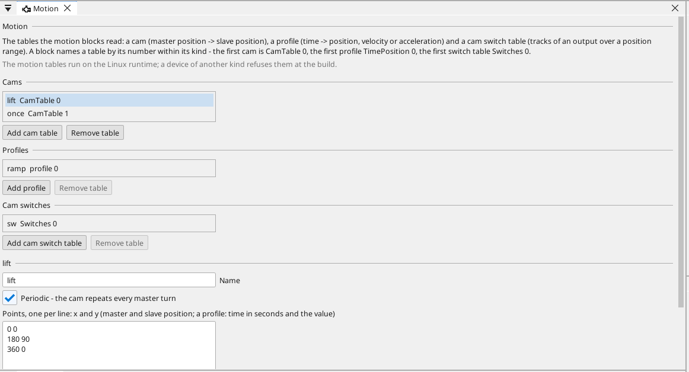

Three kinds of table live there, each in its own list:

| Kind | What it holds | How a block names it |
|---|---|---|
| **Cam** | master position to slave position, one point per line; **Periodic** makes the cam repeat every master turn | `CamTable 0`, `CamTable 1`, ... in `MC_CamTableSelect` |
| **Profile** | time in seconds to position, velocity or acceleration | `TimePosition 0`, `TimeVelocity 0`, `TimeAcceleration 0` in the profile blocks |
| **Cam switch table** | tracks: an output (1 to 32), the first and the last position it is on, an on lead and an off lag in milliseconds | `Switches 0` in `MC_DigitalCamSwitch` |

A table has a **Name** (one word of up to 31 characters, not taken by
another table of the kind) and the number the blocks use is its place in
its list - the first cam is 0. **Points** are typed one per line, x and y,
with x going up, two to 256 of them; **Apply points** checks and takes
them, and a line the page cannot read is named under the field. The
tracks of a switch table are a table of their own: **Add track**, edit the
cells, **Remove track**.

**Remove table** takes a table out; a block that named it answers
`ErrorID` 16 (the table is missing or wrong) until another table takes its
number. The tables travel in the project and with it to the device; a
device of another kind than Linux refuses them at the build.

---

## Profiles and cams

**Linux.** A **profile** is a table of time against position, velocity
or acceleration the axis follows from `Execute`: `MC_PositionProfile`,
`MC_VelocityProfile`, `MC_AccelerationProfile` name their table
(`TimePosition`, `TimeVelocity`, `TimeAcceleration` - the project's
tables), take `ArraySize` points (0 = all), stretch time by `TimeScale`
and the value by its scale, shift it by `Offset`.

<!-- blk:MC_PositionProfile -->
**MC_PositionProfile**


```iecst
PROGRAM MC_PositionProfile_ST
VAR mcppro : MC_PositionProfile; END_VAR
  mcppro(AXIS := 0, Execute := mcppro_execute,
         TimePosition := mcppro_timeposition,
         ArraySize := mcppro_arraysize,
         TimeScale := mcppro_timescale,
         PositionScale := mcppro_positionscale,
         Offset := mcppro_offset,
         BufferMode := mcppro_buffermode);
  mcppro_done_st := mcppro.Done;
  mcppro_busy_st := mcppro.Busy;
  mcppro_active_st := mcppro.Active;
  mcppro_commandaborted_st := mcppro.CommandAborted;
  mcppro_error_st := mcppro.Error;
  mcppro_errorid_st := mcppro.ErrorID;
END_PROGRAM
```


<!-- /blk -->

<!-- blk:MC_VelocityProfile -->
**MC_VelocityProfile**

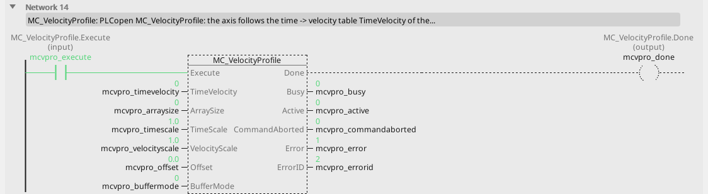

```iecst
PROGRAM MC_VelocityProfile_ST
VAR mcvpro : MC_VelocityProfile; END_VAR
  mcvpro(AXIS := 0, Execute := mcvpro_execute,
         TimeVelocity := mcvpro_timevelocity,
         ArraySize := mcvpro_arraysize,
         TimeScale := mcvpro_timescale,
         VelocityScale := mcvpro_velocityscale,
         Offset := mcvpro_offset,
         BufferMode := mcvpro_buffermode);
  mcvpro_done_st := mcvpro.Done;
  mcvpro_busy_st := mcvpro.Busy;
  mcvpro_active_st := mcvpro.Active;
  mcvpro_commandaborted_st := mcvpro.CommandAborted;
  mcvpro_error_st := mcvpro.Error;
  mcvpro_errorid_st := mcvpro.ErrorID;
END_PROGRAM
```

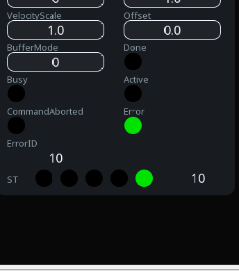

<!-- /blk -->

<!-- blk:MC_AccelerationProfile -->
**MC_AccelerationProfile**

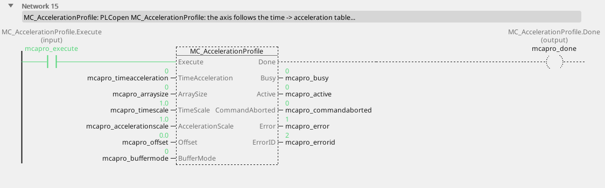

```iecst
PROGRAM MC_AccelerationProfile_ST
VAR mcapro : MC_AccelerationProfile; END_VAR
  mcapro(AXIS := 0, Execute := mcapro_execute,
         TimeAcceleration := mcapro_timeacceleration,
         ArraySize := mcapro_arraysize,
         TimeScale := mcapro_timescale,
         AccelerationScale := mcapro_accelerationscale,
         Offset := mcapro_offset,
         BufferMode := mcapro_buffermode);
  mcapro_done_st := mcapro.Done;
  mcapro_busy_st := mcapro.Busy;
  mcapro_active_st := mcapro.Active;
  mcapro_commandaborted_st := mcapro.CommandAborted;
  mcapro_error_st := mcapro.Error;
  mcapro_errorid_st := mcapro.ErrorID;
END_PROGRAM
```

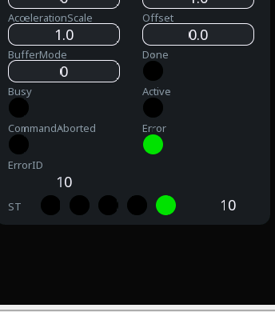

<!-- /blk -->

<!-- blk:MC_CamTableSelect -->
**MC_CamTableSelect**

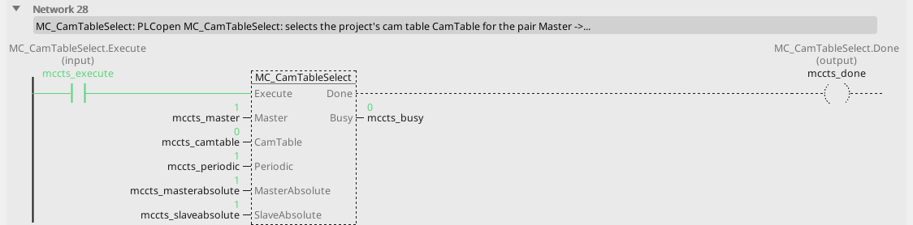

```iecst
PROGRAM MC_CamTableSelect_ST
VAR mccts : MC_CamTableSelect; END_VAR
  mccts(AXIS := 0, Execute := mccts_execute,
        Master := mccts_master, CamTable := mccts_camtable,
        Periodic := mccts_periodic,
        MasterAbsolute := mccts_masterabsolute,
        SlaveAbsolute := mccts_slaveabsolute);
  mccts_done_st := mccts.Done;
  mccts_busy_st := mccts.Busy;
  mccts_error_st := mccts.Error;
  mccts_errorid_st := mccts.ErrorID;
  mccts_camtableid_st := mccts.CamTableID;
END_PROGRAM
```

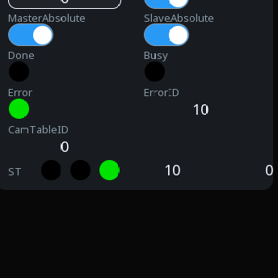

<!-- /blk -->

<!-- blk:MC_CamIn -->
**MC_CamIn**


```iecst
PROGRAM MC_CamIn_ST
VAR mccami : MC_CamIn; END_VAR
  mccami(AXIS := 2, Execute := mccami_execute,
         MasterOffset := mccami_masteroffset,
         SlaveOffset := mccami_slaveoffset,
         CamTableID := mccami_camtableid,
         Master := mccami_master,
         ContinuousUpdate := mccami_continuousupdate,
         MasterScaling := mccami_masterscaling,
         SlaveScaling := mccami_slavescaling,
         StartMode := mccami_startmode,
         MasterStartDistance := mccami_masterstartdistance,
         MasterSyncPosition := mccami_mastersyncposition,
         BufferMode := mccami_buffermode);
  mccami_insync_st := mccami.InSync;
  mccami_busy_st := mccami.Busy;
  mccami_active_st := mccami.Active;
  mccami_commandaborted_st := mccami.CommandAborted;
  mccami_error_st := mccami.Error;
  mccami_errorid_st := mccami.ErrorID;
  mccami_endofprofile_st := mccami.EndOfProfile;
END_PROGRAM
```


<!-- /blk -->

<!-- blk:MC_CamOut -->
**MC_CamOut**

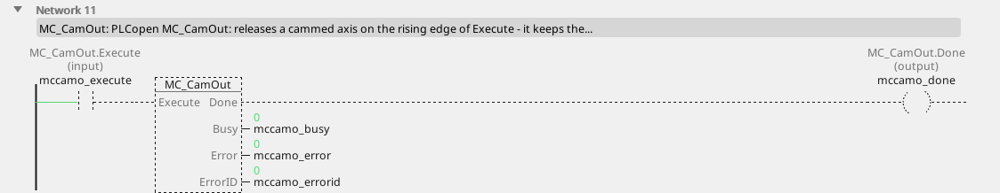

```iecst
PROGRAM MC_CamOut_ST
VAR mccamo : MC_CamOut; END_VAR
  mccamo(AXIS := 2, Execute := mccamo_execute);
  mccamo_done_st := mccamo.Done;
  mccamo_busy_st := mccamo.Busy;
  mccamo_error_st := mccamo.Error;
  mccamo_errorid_st := mccamo.ErrorID;
END_PROGRAM
```


<!-- /blk -->

<!-- blk:MC_PositionProfile -->
**MC_PositionProfile**


```iecst
PROGRAM MC_PositionProfile_ST
VAR mcppro : MC_PositionProfile; END_VAR
  mcppro(AXIS := 0, Execute := mcppro_execute,
         TimePosition := mcppro_timeposition,
         ArraySize := mcppro_arraysize,
         TimeScale := mcppro_timescale,
         PositionScale := mcppro_positionscale,
         Offset := mcppro_offset,
         BufferMode := mcppro_buffermode);
  mcppro_done_st := mcppro.Done;
  mcppro_busy_st := mcppro.Busy;
  mcppro_active_st := mcppro.Active;
  mcppro_commandaborted_st := mcppro.CommandAborted;
  mcppro_error_st := mcppro.Error;
  mcppro_errorid_st := mcppro.ErrorID;
END_PROGRAM
```


<!-- /blk -->

<!-- blk:MC_VelocityProfile -->
**MC_VelocityProfile**


```iecst
PROGRAM MC_VelocityProfile_ST
VAR mcvpro : MC_VelocityProfile; END_VAR
  mcvpro(AXIS := 0, Execute := mcvpro_execute,
         TimeVelocity := mcvpro_timevelocity,
         ArraySize := mcvpro_arraysize,
         TimeScale := mcvpro_timescale,
         VelocityScale := mcvpro_velocityscale,
         Offset := mcvpro_offset,
         BufferMode := mcvpro_buffermode);
  mcvpro_done_st := mcvpro.Done;
  mcvpro_busy_st := mcvpro.Busy;
  mcvpro_active_st := mcvpro.Active;
  mcvpro_commandaborted_st := mcvpro.CommandAborted;
  mcvpro_error_st := mcvpro.Error;
  mcvpro_errorid_st := mcvpro.ErrorID;
END_PROGRAM
```


<!-- /blk -->

<!-- blk:MC_AccelerationProfile -->
**MC_AccelerationProfile**


```iecst
PROGRAM MC_AccelerationProfile_ST
VAR mcapro : MC_AccelerationProfile; END_VAR
  mcapro(AXIS := 0, Execute := mcapro_execute,
         TimeAcceleration := mcapro_timeacceleration,
         ArraySize := mcapro_arraysize,
         TimeScale := mcapro_timescale,
         AccelerationScale := mcapro_accelerationscale,
         Offset := mcapro_offset,
         BufferMode := mcapro_buffermode);
  mcapro_done_st := mcapro.Done;
  mcapro_busy_st := mcapro.Busy;
  mcapro_active_st := mcapro.Active;
  mcapro_commandaborted_st := mcapro.CommandAborted;
  mcapro_error_st := mcapro.Error;
  mcapro_errorid_st := mcapro.ErrorID;
END_PROGRAM
```


<!-- /blk -->

<!-- blk:MC_CamTableSelect -->
**MC_CamTableSelect**


```iecst
PROGRAM MC_CamTableSelect_ST
VAR mccts : MC_CamTableSelect; END_VAR
  mccts(AXIS := 0, Execute := mccts_execute,
        Master := mccts_master, CamTable := mccts_camtable,
        Periodic := mccts_periodic,
        MasterAbsolute := mccts_masterabsolute,
        SlaveAbsolute := mccts_slaveabsolute);
  mccts_done_st := mccts.Done;
  mccts_busy_st := mccts.Busy;
  mccts_error_st := mccts.Error;
  mccts_errorid_st := mccts.ErrorID;
  mccts_camtableid_st := mccts.CamTableID;
END_PROGRAM
```


<!-- /blk -->

<!-- blk:MC_CamIn -->
**MC_CamIn**


```iecst
PROGRAM MC_CamIn_ST
VAR mccami : MC_CamIn; END_VAR
  mccami(AXIS := 2, Execute := mccami_execute,
         MasterOffset := mccami_masteroffset,
         SlaveOffset := mccami_slaveoffset,
         CamTableID := mccami_camtableid,
         Master := mccami_master,
         ContinuousUpdate := mccami_continuousupdate,
         MasterScaling := mccami_masterscaling,
         SlaveScaling := mccami_slavescaling,
         StartMode := mccami_startmode,
         MasterStartDistance := mccami_masterstartdistance,
         MasterSyncPosition := mccami_mastersyncposition,
         BufferMode := mccami_buffermode);
  mccami_insync_st := mccami.InSync;
  mccami_busy_st := mccami.Busy;
  mccami_active_st := mccami.Active;
  mccami_commandaborted_st := mccami.CommandAborted;
  mccami_error_st := mccami.Error;
  mccami_errorid_st := mccami.ErrorID;
  mccami_endofprofile_st := mccami.EndOfProfile;
END_PROGRAM
```


<!-- /blk -->

<!-- blk:MC_CamOut -->
**MC_CamOut**


```iecst
PROGRAM MC_CamOut_ST
VAR mccamo : MC_CamOut; END_VAR
  mccamo(AXIS := 2, Execute := mccamo_execute);
  mccamo_done_st := mccamo.Done;
  mccamo_busy_st := mccamo.Busy;
  mccamo_error_st := mccamo.Error;
  mccamo_errorid_st := mccamo.ErrorID;
END_PROGRAM
```


<!-- /blk -->

A **cam** couples the axis to a master through a table of master
position against follower position: `MC_CamTableSelect` names the table
(`CamTable`), whether it repeats (`Periodic`) and whether its two columns
are absolute, and answers `CamTableID`; `MC_CamIn` engages the follower
to `Master` with that id, scaled (`MasterScaling`, `SlaveScaling`),
offset (`MasterOffset`, `SlaveOffset`), and starts `mcAbsolute`,
`mcRelative` or `mcRampIn` over `MasterStartDistance` from
`MasterSyncPosition`; `InSync` once it rides the table, `EndOfProfile`
each time a non-periodic table ends. `MC_CamOut` releases it where it
stands.

The tables live in the project (the *Tables* page of the editor) and
travel with it to the device.

---

## The line shaft

**Linux** - a servo in cyclic position mode on EtherCAT with the
distributed clock; a frequency drive or the simulation answers Error 8.

| Block | Inputs | Parameters | Outputs |
|:---|:---:|:---:|:---:|
| `MC_GearIn` | Execute | Master, RatioNumerator, RatioDenominator, MasterValueSource, Acceleration, Deceleration, Jerk, BufferMode, Delay | InGear, Busy, Active, CommandAborted, Error, ErrorID, Register |
| `MC_GearOut` | Execute | | Done, Busy, Error, ErrorID |
| `MC_GearInPos` | Execute, MasterSyncPosition, SlaveSyncPosition, Velocity | Master, RatioNumerator, RatioDenominator, MasterValueSource, SyncMode, MasterStartDistance, Acceleration, Deceleration, Jerk, BufferMode, Delay | StartSync, InSync, Busy, Active, CommandAborted, Error, ErrorID, Register |
| `MC_PhasingAbsolute` | Execute, PhaseShift, Velocity | Acceleration, Deceleration, Jerk, BufferMode | Done, Busy, Active, CommandAborted, Error, ErrorID |
| `MC_PhasingRelative` | Execute, PhaseShift, Velocity | the same | the same |
| `MC_CombineAxes` | Execute | Master1, Master2, CombineMode, the two gear ratios, the two value sources, BufferMode | InSync, Busy, Active, CommandAborted, Error, ErrorID |

<!-- blk:MC_GearIn -->
**MC_GearIn**

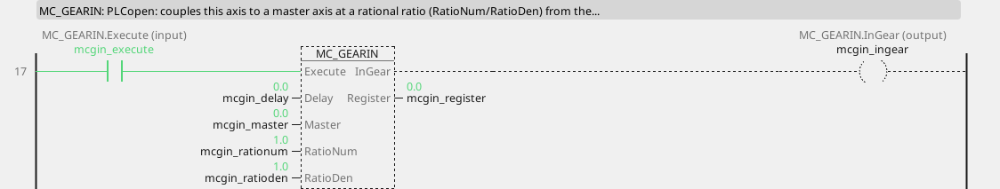

```iecst
PROGRAM MC_GearIn_ST
VAR mcgin : MC_GearIn; END_VAR
  mcgin(AXIS := 2, Execute := mcgin_execute,
        Master := mcgin_master,
        ContinuousUpdate := mcgin_continuousupdate,
        RatioNumerator := mcgin_rationumerator,
        RatioDenominator := mcgin_ratiodenominator,
        MasterValueSource := mcgin_mastervaluesource,
        Acceleration := mcgin_acceleration,
        Deceleration := mcgin_deceleration, Jerk := mcgin_jerk,
        BufferMode := mcgin_buffermode, Delay := mcgin_delay);
  mcgin_ingear_st := mcgin.InGear;
  mcgin_busy_st := mcgin.Busy;
  mcgin_active_st := mcgin.Active;
  mcgin_commandaborted_st := mcgin.CommandAborted;
  mcgin_error_st := mcgin.Error;
  mcgin_errorid_st := mcgin.ErrorID;
  mcgin_register_st := mcgin.Register;
END_PROGRAM
```

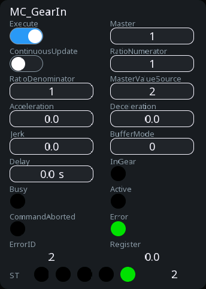

<!-- /blk -->

<!-- blk:MC_GearOut -->
**MC_GearOut**

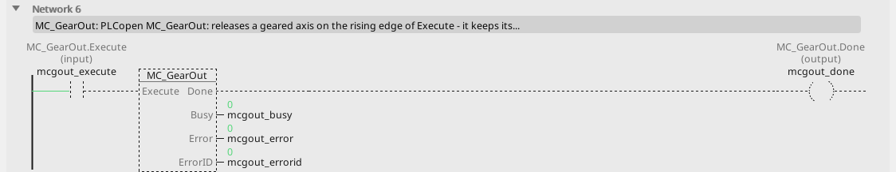

```iecst
PROGRAM MC_GearOut_ST
VAR mcgout : MC_GearOut; END_VAR
  mcgout(AXIS := 2, Execute := mcgout_execute);
  mcgout_done_st := mcgout.Done;
  mcgout_busy_st := mcgout.Busy;
  mcgout_error_st := mcgout.Error;
  mcgout_errorid_st := mcgout.ErrorID;
END_PROGRAM
```

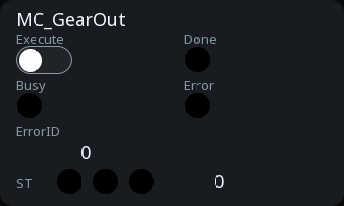

<!-- /blk -->

<!-- blk:MC_GearInPos -->
**MC_GearInPos**

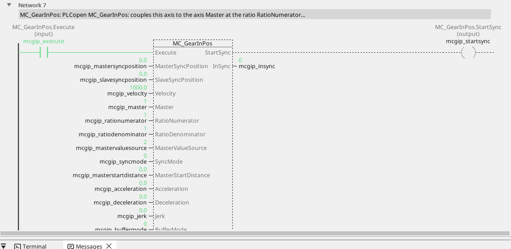

```iecst
PROGRAM MC_GearInPos_ST
VAR mcgip : MC_GearInPos; END_VAR
  mcgip(AXIS := 2, Execute := mcgip_execute,
        MasterSyncPosition := mcgip_mastersyncposition,
        SlaveSyncPosition := mcgip_slavesyncposition,
        Velocity := mcgip_velocity, Master := mcgip_master,
        RatioNumerator := mcgip_rationumerator,
        RatioDenominator := mcgip_ratiodenominator,
        MasterValueSource := mcgip_mastervaluesource,
        SyncMode := mcgip_syncmode,
        MasterStartDistance := mcgip_masterstartdistance,
        Acceleration := mcgip_acceleration,
        Deceleration := mcgip_deceleration, Jerk := mcgip_jerk,
        BufferMode := mcgip_buffermode, Delay := mcgip_delay);
  mcgip_startsync_st := mcgip.StartSync;
  mcgip_insync_st := mcgip.InSync;
  mcgip_busy_st := mcgip.Busy;
  mcgip_active_st := mcgip.Active;
  mcgip_commandaborted_st := mcgip.CommandAborted;
  mcgip_error_st := mcgip.Error;
  mcgip_errorid_st := mcgip.ErrorID;
  mcgip_register_st := mcgip.Register;
END_PROGRAM
```

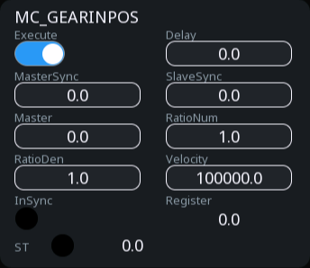

<!-- /blk -->

<!-- blk:MC_PhasingAbsolute -->
**MC_PhasingAbsolute**


```iecst
PROGRAM MC_PhasingAbsolute_ST
VAR mcpha : MC_PhasingAbsolute; END_VAR
  mcpha(AXIS := 2, Execute := mcpha_execute,
        PhaseShift := mcpha_phaseshift,
        Velocity := mcpha_velocity,
        ContinuousUpdate := mcpha_continuousupdate,
        Acceleration := mcpha_acceleration,
        Deceleration := mcpha_deceleration, Jerk := mcpha_jerk,
        BufferMode := mcpha_buffermode);
  mcpha_done_st := mcpha.Done;
  mcpha_busy_st := mcpha.Busy;
  mcpha_active_st := mcpha.Active;
  mcpha_commandaborted_st := mcpha.CommandAborted;
  mcpha_error_st := mcpha.Error;
  mcpha_errorid_st := mcpha.ErrorID;
END_PROGRAM
```


<!-- /blk -->

<!-- blk:MC_PhasingRelative -->
**MC_PhasingRelative**


```iecst
PROGRAM MC_PhasingRelative_ST
VAR mcphr : MC_PhasingRelative; END_VAR
  mcphr(AXIS := 2, Execute := mcphr_execute,
        PhaseShift := mcphr_phaseshift,
        Velocity := mcphr_velocity,
        ContinuousUpdate := mcphr_continuousupdate,
        Acceleration := mcphr_acceleration,
        Deceleration := mcphr_deceleration, Jerk := mcphr_jerk,
        BufferMode := mcphr_buffermode);
  mcphr_done_st := mcphr.Done;
  mcphr_busy_st := mcphr.Busy;
  mcphr_active_st := mcphr.Active;
  mcphr_commandaborted_st := mcphr.CommandAborted;
  mcphr_error_st := mcphr.Error;
  mcphr_errorid_st := mcphr.ErrorID;
END_PROGRAM
```


<!-- /blk -->

<!-- blk:MC_CombineAxes -->
**MC_CombineAxes**


```iecst
PROGRAM MC_CombineAxes_ST
VAR mccomb : MC_CombineAxes; END_VAR
  mccomb(AXIS := 2, Execute := mccomb_execute,
         Master1 := mccomb_master1, Master2 := mccomb_master2,
         ContinuousUpdate := mccomb_continuousupdate,
         CombineMode := mccomb_combinemode,
         GearRatioNumeratorM1 := mccomb_gearrationumeratorm1,
         GearRatioDenominatorM1 := mccomb_gearratiodenominatorm1,
         GearRatioNumeratorM2 := mccomb_gearrationumeratorm2,
         GearRatioDenominatorM2 := mccomb_gearratiodenominatorm2,
         MasterValueSourceM1 := mccomb_mastervaluesourcem1,
         MasterValueSourceM2 := mccomb_mastervaluesourcem2,
         BufferMode := mccomb_buffermode);
  mccomb_insync_st := mccomb.InSync;
  mccomb_busy_st := mccomb.Busy;
  mccomb_active_st := mccomb.Active;
  mccomb_commandaborted_st := mccomb.CommandAborted;
  mccomb_error_st := mccomb.Error;
  mccomb_errorid_st := mccomb.ErrorID;
END_PROGRAM
```


<!-- /blk -->

<!-- blk:MC_GearIn -->
**MC_GearIn**


```iecst
PROGRAM MC_GearIn_ST
VAR mcgin : MC_GearIn; END_VAR
  mcgin(AXIS := 2, Execute := mcgin_execute,
        Master := mcgin_master,
        ContinuousUpdate := mcgin_continuousupdate,
        RatioNumerator := mcgin_rationumerator,
        RatioDenominator := mcgin_ratiodenominator,
        MasterValueSource := mcgin_mastervaluesource,
        Acceleration := mcgin_acceleration,
        Deceleration := mcgin_deceleration, Jerk := mcgin_jerk,
        BufferMode := mcgin_buffermode, Delay := mcgin_delay);
  mcgin_ingear_st := mcgin.InGear;
  mcgin_busy_st := mcgin.Busy;
  mcgin_active_st := mcgin.Active;
  mcgin_commandaborted_st := mcgin.CommandAborted;
  mcgin_error_st := mcgin.Error;
  mcgin_errorid_st := mcgin.ErrorID;
  mcgin_register_st := mcgin.Register;
END_PROGRAM
```


<!-- /blk -->

<!-- blk:MC_GearOut -->
**MC_GearOut**


```iecst
PROGRAM MC_GearOut_ST
VAR mcgout : MC_GearOut; END_VAR
  mcgout(AXIS := 2, Execute := mcgout_execute);
  mcgout_done_st := mcgout.Done;
  mcgout_busy_st := mcgout.Busy;
  mcgout_error_st := mcgout.Error;
  mcgout_errorid_st := mcgout.ErrorID;
END_PROGRAM
```


<!-- /blk -->

<!-- blk:MC_GearInPos -->
**MC_GearInPos**


```iecst
PROGRAM MC_GearInPos_ST
VAR mcgip : MC_GearInPos; END_VAR
  mcgip(AXIS := 2, Execute := mcgip_execute,
        MasterSyncPosition := mcgip_mastersyncposition,
        SlaveSyncPosition := mcgip_slavesyncposition,
        Velocity := mcgip_velocity, Master := mcgip_master,
        RatioNumerator := mcgip_rationumerator,
        RatioDenominator := mcgip_ratiodenominator,
        MasterValueSource := mcgip_mastervaluesource,
        SyncMode := mcgip_syncmode,
        MasterStartDistance := mcgip_masterstartdistance,
        Acceleration := mcgip_acceleration,
        Deceleration := mcgip_deceleration, Jerk := mcgip_jerk,
        BufferMode := mcgip_buffermode, Delay := mcgip_delay);
  mcgip_startsync_st := mcgip.StartSync;
  mcgip_insync_st := mcgip.InSync;
  mcgip_busy_st := mcgip.Busy;
  mcgip_active_st := mcgip.Active;
  mcgip_commandaborted_st := mcgip.CommandAborted;
  mcgip_error_st := mcgip.Error;
  mcgip_errorid_st := mcgip.ErrorID;
  mcgip_register_st := mcgip.Register;
END_PROGRAM
```


<!-- /blk -->

<!-- blk:MC_PhasingAbsolute -->
**MC_PhasingAbsolute**


```iecst
PROGRAM MC_PhasingAbsolute_ST
VAR mcpha : MC_PhasingAbsolute; END_VAR
  mcpha(AXIS := 2, Execute := mcpha_execute,
        PhaseShift := mcpha_phaseshift,
        Velocity := mcpha_velocity,
        ContinuousUpdate := mcpha_continuousupdate,
        Acceleration := mcpha_acceleration,
        Deceleration := mcpha_deceleration, Jerk := mcpha_jerk,
        BufferMode := mcpha_buffermode);
  mcpha_done_st := mcpha.Done;
  mcpha_busy_st := mcpha.Busy;
  mcpha_active_st := mcpha.Active;
  mcpha_commandaborted_st := mcpha.CommandAborted;
  mcpha_error_st := mcpha.Error;
  mcpha_errorid_st := mcpha.ErrorID;
END_PROGRAM
```


<!-- /blk -->

<!-- blk:MC_PhasingRelative -->
**MC_PhasingRelative**


```iecst
PROGRAM MC_PhasingRelative_ST
VAR mcphr : MC_PhasingRelative; END_VAR
  mcphr(AXIS := 2, Execute := mcphr_execute,
        PhaseShift := mcphr_phaseshift,
        Velocity := mcphr_velocity,
        ContinuousUpdate := mcphr_continuousupdate,
        Acceleration := mcphr_acceleration,
        Deceleration := mcphr_deceleration, Jerk := mcphr_jerk,
        BufferMode := mcphr_buffermode);
  mcphr_done_st := mcphr.Done;
  mcphr_busy_st := mcphr.Busy;
  mcphr_active_st := mcphr.Active;
  mcphr_commandaborted_st := mcphr.CommandAborted;
  mcphr_error_st := mcphr.Error;
  mcphr_errorid_st := mcphr.ErrorID;
END_PROGRAM
```


<!-- /blk -->

<!-- blk:MC_CombineAxes -->
**MC_CombineAxes**


```iecst
PROGRAM MC_CombineAxes_ST
VAR mccomb : MC_CombineAxes; END_VAR
  mccomb(AXIS := 2, Execute := mccomb_execute,
         Master1 := mccomb_master1, Master2 := mccomb_master2,
         ContinuousUpdate := mccomb_continuousupdate,
         CombineMode := mccomb_combinemode,
         GearRatioNumeratorM1 := mccomb_gearrationumeratorm1,
         GearRatioDenominatorM1 := mccomb_gearratiodenominatorm1,
         GearRatioNumeratorM2 := mccomb_gearrationumeratorm2,
         GearRatioDenominatorM2 := mccomb_gearratiodenominatorm2,
         MasterValueSourceM1 := mccomb_mastervaluesourcem1,
         MasterValueSourceM2 := mccomb_mastervaluesourcem2,
         BufferMode := mccomb_buffermode);
  mccomb_insync_st := mccomb.InSync;
  mccomb_busy_st := mccomb.Busy;
  mccomb_active_st := mccomb.Active;
  mccomb_commandaborted_st := mccomb.CommandAborted;
  mccomb_error_st := mccomb.Error;
  mccomb_errorid_st := mccomb.ErrorID;
END_PROGRAM
```


<!-- /blk -->

A line shaft is one axis following another: the plate cylinders of a
press follow the drum, a slitter follows the web, a labeller follows the
conveyor. `MC_GearIn` couples the block's axis to the axis `Master` at
the ratio `RatioNumerator : RatioDenominator` - from the master's
**measured** position (`MasterValueSource` = `mcActualValue`) or its set
value, every bus cycle, exactly (a ratio of 2:3 never drifts, however
long the line runs), with the master's velocity through the ratio as the
follower's feed-forward.

`Delay` is our extension: the chain delay the follower compensates, in
seconds - the time between the master's position being sampled and the
follower's setpoint being applied. Without it a follower lags the master
by velocity × delay, an error that grows with speed and doubles when the
cycle doubles, which is what a press shows as colours running away
during ramps. Measure it, do not guess it: run the line at a constant
speed with `Delay` 0, read `Register`, divide by the speed - that
quotient is the delay. `Delay` is read every cycle, so it can be tuned
from a screen while the line runs.

`Master` may be a servo axis or a **virtual master** - an axis with no
drive that the program commands, or one that follows a counter variable
(the drum's encoder); the EtherCAT page says how it is made.

`Register` is our other extension: the follower's actual position against
the master's, through the ratio and the phase, in the follower's units -
0 is in register, and a ramp of the master shows the uncompensated delay
as a bump the size of velocity × delay. `MC_PhasingAbsolute` shifts the
follower against the master to `PhaseShift` units,
`MC_PhasingRelative` by `PhaseShift` more, moved at `Velocity` - the
register measures against the shifted relation, so a phase set on
purpose is not an error. `MC_GearOut` releases the follower where it
stands; disabling it releases it too.

`MC_GearInPos` gears in **at a defined relation of the two positions**:
when the master stands at `MasterSyncPosition` the follower stands at
`SlaveSyncPosition`, the relation repeating every `RatioDenominator`
master revolutions. At gear-in the follower moves into that relation at
`Velocity` - at once (`SyncMode` `mcCatchUp`), or over
`MasterStartDistance` of the master's travel before the sync position
(`mcSyncOnMasterPosition`), `StartSync` while it does; while `Execute`
holds, a changed `SlaveSyncPosition` is a further move - the operator's
register trim, or the phase a job carries - and a changed ratio is
applied at standstill (`MC_GearIn` applies a changed ratio the same way).
So a job's phases are plain numbers a recipe keeps: the same relation
comes back after a job change and after a restart, without a mark and
without a homing run, because the drives' positions are absolute.
`InSync` is in gear and in the relation.

`MC_CombineAxes` makes the follower the **sum or difference** of two
masters through two ratios (`CombineMode` `mcAddAxes` /
`mcSubAxes`) - a cross-cutter whose knife follows the web and the
correction axis at once.

---

## Torque

| Block | Inputs | Parameters | Outputs |
|:---|:---:|:---:|:---:|
| `MC_SetTorqueLimit` | Enable, PosLimit, NegLimit | | Enabled, Busy, Error, ErrorID |
| `MC_TorqueControl` | Execute, Torque | TorqueRamp, Velocity, Acceleration, Deceleration, Jerk, Direction, BufferMode | InTorque, Busy, Active, CommandAborted, Error, ErrorID |
| `MC_TorqueFF` | Enable, AccGain | | Enabled, Busy, Error, ErrorID, Torque |

<!-- blk:MC_SetTorqueLimit -->
**MC_SetTorqueLimit**


```iecst
PROGRAM MC_SetTorqueLimit_ST
VAR mctlim : MC_SetTorqueLimit; END_VAR
  mctlim(AXIS := 0, Enable := mctlim_enable,
         PosLimit := mctlim_poslimit,
         NegLimit := mctlim_neglimit);
  mctlim_enabled_st := mctlim.Enabled;
  mctlim_busy_st := mctlim.Busy;
  mctlim_error_st := mctlim.Error;
  mctlim_errorid_st := mctlim.ErrorID;
END_PROGRAM
```


<!-- /blk -->

<!-- blk:MC_TorqueControl -->
**MC_TorqueControl**


```iecst
PROGRAM MC_TorqueControl_ST
VAR mctrq : MC_TorqueControl; END_VAR
  mctrq(AXIS := 0, Execute := mctrq_execute,
        Torque := mctrq_torque,
        ContinuousUpdate := mctrq_continuousupdate,
        TorqueRamp := mctrq_torqueramp,
        Velocity := mctrq_velocity,
        Acceleration := mctrq_acceleration,
        Deceleration := mctrq_deceleration, Jerk := mctrq_jerk,
        Direction := mctrq_direction,
        BufferMode := mctrq_buffermode);
  mctrq_intorque_st := mctrq.InTorque;
  mctrq_busy_st := mctrq.Busy;
  mctrq_active_st := mctrq.Active;
  mctrq_commandaborted_st := mctrq.CommandAborted;
  mctrq_error_st := mctrq.Error;
  mctrq_errorid_st := mctrq.ErrorID;
END_PROGRAM
```


<!-- /blk -->

<!-- blk:MC_TorqueFF -->
**MC_TorqueFF**


```iecst
PROGRAM MC_TorqueFF_ST
VAR mctff : MC_TorqueFF; END_VAR
  mctff(AXIS := 0, Enable := mctff_enable,
        AccGain := mctff_accgain);
  mctff_enabled_st := mctff.Enabled;
  mctff_busy_st := mctff.Busy;
  mctff_error_st := mctff.Error;
  mctff_errorid_st := mctff.ErrorID;
  mctff_torque_st := mctff.Torque;
END_PROGRAM
```


<!-- /blk -->

<!-- blk:MC_SetTorqueLimit -->
**MC_SetTorqueLimit**


```iecst
PROGRAM MC_SetTorqueLimit_ST
VAR mctlim : MC_SetTorqueLimit; END_VAR
  mctlim(AXIS := 0, Enable := mctlim_enable,
         PosLimit := mctlim_poslimit,
         NegLimit := mctlim_neglimit);
  mctlim_enabled_st := mctlim.Enabled;
  mctlim_busy_st := mctlim.Busy;
  mctlim_error_st := mctlim.Error;
  mctlim_errorid_st := mctlim.ErrorID;
END_PROGRAM
```


<!-- /blk -->

<!-- blk:MC_TorqueControl -->
**MC_TorqueControl**


```iecst
PROGRAM MC_TorqueControl_ST
VAR mctrq : MC_TorqueControl; END_VAR
  mctrq(AXIS := 0, Execute := mctrq_execute,
        Torque := mctrq_torque,
        ContinuousUpdate := mctrq_continuousupdate,
        TorqueRamp := mctrq_torqueramp,
        Velocity := mctrq_velocity,
        Acceleration := mctrq_acceleration,
        Deceleration := mctrq_deceleration, Jerk := mctrq_jerk,
        Direction := mctrq_direction,
        BufferMode := mctrq_buffermode);
  mctrq_intorque_st := mctrq.InTorque;
  mctrq_busy_st := mctrq.Busy;
  mctrq_active_st := mctrq.Active;
  mctrq_commandaborted_st := mctrq.CommandAborted;
  mctrq_error_st := mctrq.Error;
  mctrq_errorid_st := mctrq.ErrorID;
END_PROGRAM
```


<!-- /blk -->

<!-- blk:MC_TorqueFF -->
**MC_TorqueFF**


```iecst
PROGRAM MC_TorqueFF_ST
VAR mctff : MC_TorqueFF; END_VAR
  mctff(AXIS := 0, Enable := mctff_enable,
        AccGain := mctff_accgain);
  mctff_enabled_st := mctff.Enabled;
  mctff_busy_st := mctff.Busy;
  mctff_error_st := mctff.Error;
  mctff_errorid_st := mctff.ErrorID;
  mctff_torque_st := mctff.Torque;
END_PROGRAM
```


<!-- /blk -->

A servo's torque is a number the program can hold. `MC_SetTorqueLimit`
(our extension) writes the positive and the negative torque limit (per
cent of the motor's rated torque) to the drive **every bus cycle** while
`Enable` holds - the classic tension control of a winder (the speed set
a little above the line, the torque limit is the tension), or a gentle
approach against a mechanical stop. The drive's image has to carry the
limit words (the *Torque limits* PDO of a servo family travels beside the
cyclic pair when the device is added from its description); without them
the block answers Error 8. Without the block the drive keeps its own
limits.

`MC_TorqueControl` commands the torque itself: a servo declared in
**cyclic synchronous torque** mode on its slave is given `Torque` per
cent of its rated torque while `Execute` holds, ramped at `TorqueRamp`,
and the drive limits its speed to `Velocity` - an unloaded motor in
torque control runs away to that limit, so the limit is not optional.
`InTorque` once the actual torque is within 5 % of the command. A servo
in position mode, a frequency drive or the simulation answer Error 8 or
17.

`MC_TorqueFF` (our extension, **Linux**) is the **acceleration
feed-forward** of a servo in position mode. A position loop can only
produce the torque a ramp needs by falling behind first; the feed-forward
hands the drive that torque up front - `AccGain` times the acceleration
the setpoint asks for - as the drive's torque offset, per mille of the
rated torque. That acceleration is exact where the setpoint is ours: the
axis's own ramp or move, or the master's through the ratio while the
axis is geared; a virtual master that reads an encoder measures it over
a short window, so the offset is quiet at constant speed. `AccGain` is
per mille per revolution per second squared and stands for the inertia
behind the axis: found on the real axis by watching the register through
a ramp, never computed - a bare motor needs almost none, a plate cylinder
needs it. `Torque` shows the offset in force; a drive without the word
answers `Enabled` false.

---

## Probes and digital words

**Linux.** `MC_TouchProbe` records the axis position at the edge of a
probe input (`TriggerInput` names the drive's probe 1 or 2, rising or
falling) - at once, or only inside the window `FirstPosition` to
`LastPosition` (`WindowOnly`); `RecordedPosition` and `Done` when it
fired, `MC_AbortTrigger` disarms it. The drive's cyclic set has to carry
its touch-probe words.

<!-- blk:MC_TouchProbe -->
**MC_TouchProbe**


```iecst
PROGRAM MC_TouchProbe_ST
VAR mcprb : MC_TouchProbe; END_VAR
  mcprb(AXIS := 0, Execute := mcprb_execute,
        FirstPosition := mcprb_firstposition,
        LastPosition := mcprb_lastposition,
        TriggerInput := mcprb_triggerinput,
        WindowOnly := mcprb_windowonly);
  mcprb_done_st := mcprb.Done;
  mcprb_busy_st := mcprb.Busy;
  mcprb_error_st := mcprb.Error;
  mcprb_errorid_st := mcprb.ErrorID;
  mcprb_recordedposition_st := mcprb.RecordedPosition;
  mcprb_commandaborted_st := mcprb.CommandAborted;
END_PROGRAM
```


<!-- /blk -->

<!-- blk:MC_AbortTrigger -->
**MC_AbortTrigger**


```iecst
PROGRAM MC_AbortTrigger_ST
VAR mcprbx : MC_AbortTrigger; END_VAR
  mcprbx(AXIS := 0, Execute := mcprbx_execute,
         TriggerInput := mcprbx_triggerinput);
  mcprbx_done_st := mcprbx.Done;
  mcprbx_busy_st := mcprbx.Busy;
  mcprbx_error_st := mcprbx.Error;
  mcprbx_errorid_st := mcprbx.ErrorID;
END_PROGRAM
```


<!-- /blk -->

<!-- blk:MC_DigitalCamSwitch -->
**MC_DigitalCamSwitch**


```iecst
PROGRAM MC_DigitalCamSwitch_ST
VAR mccsw : MC_DigitalCamSwitch; END_VAR
  mccsw(AXIS := 0, Enable := mccsw_enable,
        Switches := mccsw_switches,
        EnableMask := mccsw_enablemask,
        ValueSource := mccsw_valuesource);
  mccsw_inoperation_st := mccsw.InOperation;
  mccsw_busy_st := mccsw.Busy;
  mccsw_error_st := mccsw.Error;
  mccsw_errorid_st := mccsw.ErrorID;
  mccsw_outputs_st := mccsw.Outputs;
END_PROGRAM
```


<!-- /blk -->

<!-- blk:MC_ReadDigitalInput -->
**MC_ReadDigitalInput**


```iecst
PROGRAM MC_ReadDigitalInput_ST
VAR mcrdi : MC_ReadDigitalInput; END_VAR
  mcrdi(AXIS := 0, Enable := mcrdi_enable, Input := mcrdi_input,
        InputNumber := mcrdi_inputnumber);
  mcrdi_valid_st := mcrdi.Valid;
  mcrdi_busy_st := mcrdi.Busy;
  mcrdi_error_st := mcrdi.Error;
  mcrdi_errorid_st := mcrdi.ErrorID;
  mcrdi_value_st := mcrdi.Value;
END_PROGRAM
```


<!-- /blk -->

<!-- blk:MC_ReadDigitalOutput -->
**MC_ReadDigitalOutput**


```iecst
PROGRAM MC_ReadDigitalOutput_ST
VAR mcrdo : MC_ReadDigitalOutput; END_VAR
  mcrdo(AXIS := 0, Enable := mcrdo_enable,
        Output := mcrdo_output,
        OutputNumber := mcrdo_outputnumber);
  mcrdo_valid_st := mcrdo.Valid;
  mcrdo_busy_st := mcrdo.Busy;
  mcrdo_error_st := mcrdo.Error;
  mcrdo_errorid_st := mcrdo.ErrorID;
  mcrdo_value_st := mcrdo.Value;
END_PROGRAM
```


<!-- /blk -->

<!-- blk:MC_WriteDigitalOutput -->
**MC_WriteDigitalOutput**


```iecst
PROGRAM MC_WriteDigitalOutput_ST
VAR mcwdo : MC_WriteDigitalOutput; END_VAR
  mcwdo(AXIS := 0, Execute := mcwdo_execute,
        Value := mcwdo_value, Output := mcwdo_output,
        OutputNumber := mcwdo_outputnumber,
        ExecutionMode := mcwdo_executionmode);
  mcwdo_done_st := mcwdo.Done;
  mcwdo_busy_st := mcwdo.Busy;
  mcwdo_error_st := mcwdo.Error;
  mcwdo_errorid_st := mcwdo.ErrorID;
END_PROGRAM
```


<!-- /blk -->

<!-- blk:MC_TouchProbe -->
**MC_TouchProbe**


```iecst
PROGRAM MC_TouchProbe_ST
VAR mcprb : MC_TouchProbe; END_VAR
  mcprb(AXIS := 0, Execute := mcprb_execute,
        FirstPosition := mcprb_firstposition,
        LastPosition := mcprb_lastposition,
        TriggerInput := mcprb_triggerinput,
        WindowOnly := mcprb_windowonly);
  mcprb_done_st := mcprb.Done;
  mcprb_busy_st := mcprb.Busy;
  mcprb_error_st := mcprb.Error;
  mcprb_errorid_st := mcprb.ErrorID;
  mcprb_recordedposition_st := mcprb.RecordedPosition;
  mcprb_commandaborted_st := mcprb.CommandAborted;
END_PROGRAM
```


<!-- /blk -->

<!-- blk:MC_AbortTrigger -->
**MC_AbortTrigger**


```iecst
PROGRAM MC_AbortTrigger_ST
VAR mcprbx : MC_AbortTrigger; END_VAR
  mcprbx(AXIS := 0, Execute := mcprbx_execute,
         TriggerInput := mcprbx_triggerinput);
  mcprbx_done_st := mcprbx.Done;
  mcprbx_busy_st := mcprbx.Busy;
  mcprbx_error_st := mcprbx.Error;
  mcprbx_errorid_st := mcprbx.ErrorID;
END_PROGRAM
```


<!-- /blk -->

<!-- blk:MC_DigitalCamSwitch -->
**MC_DigitalCamSwitch**


```iecst
PROGRAM MC_DigitalCamSwitch_ST
VAR mccsw : MC_DigitalCamSwitch; END_VAR
  mccsw(AXIS := 0, Enable := mccsw_enable,
        Switches := mccsw_switches,
        EnableMask := mccsw_enablemask,
        ValueSource := mccsw_valuesource);
  mccsw_inoperation_st := mccsw.InOperation;
  mccsw_busy_st := mccsw.Busy;
  mccsw_error_st := mccsw.Error;
  mccsw_errorid_st := mccsw.ErrorID;
  mccsw_outputs_st := mccsw.Outputs;
END_PROGRAM
```


<!-- /blk -->

<!-- blk:MC_ReadDigitalInput -->
**MC_ReadDigitalInput**


```iecst
PROGRAM MC_ReadDigitalInput_ST
VAR mcrdi : MC_ReadDigitalInput; END_VAR
  mcrdi(AXIS := 0, Enable := mcrdi_enable, Input := mcrdi_input,
        InputNumber := mcrdi_inputnumber);
  mcrdi_valid_st := mcrdi.Valid;
  mcrdi_busy_st := mcrdi.Busy;
  mcrdi_error_st := mcrdi.Error;
  mcrdi_errorid_st := mcrdi.ErrorID;
  mcrdi_value_st := mcrdi.Value;
END_PROGRAM
```


<!-- /blk -->

<!-- blk:MC_ReadDigitalOutput -->
**MC_ReadDigitalOutput**


```iecst
PROGRAM MC_ReadDigitalOutput_ST
VAR mcrdo : MC_ReadDigitalOutput; END_VAR
  mcrdo(AXIS := 0, Enable := mcrdo_enable,
        Output := mcrdo_output,
        OutputNumber := mcrdo_outputnumber);
  mcrdo_valid_st := mcrdo.Valid;
  mcrdo_busy_st := mcrdo.Busy;
  mcrdo_error_st := mcrdo.Error;
  mcrdo_errorid_st := mcrdo.ErrorID;
  mcrdo_value_st := mcrdo.Value;
END_PROGRAM
```


<!-- /blk -->

<!-- blk:MC_WriteDigitalOutput -->
**MC_WriteDigitalOutput**


```iecst
PROGRAM MC_WriteDigitalOutput_ST
VAR mcwdo : MC_WriteDigitalOutput; END_VAR
  mcwdo(AXIS := 0, Execute := mcwdo_execute,
        Value := mcwdo_value, Output := mcwdo_output,
        OutputNumber := mcwdo_outputnumber,
        ExecutionMode := mcwdo_executionmode);
  mcwdo_done_st := mcwdo.Done;
  mcwdo_busy_st := mcwdo.Busy;
  mcwdo_error_st := mcwdo.Error;
  mcwdo_errorid_st := mcwdo.ErrorID;
END_PROGRAM
```


<!-- /blk -->

`MC_DigitalCamSwitch` drives up to 32 outputs from the axis position -
the `Switches` table of the project says which output is on between
which positions (and ahead of them by a time, for a slow valve),
`EnableMask` which switches are armed, `ValueSource` whether the set or
the measured position counts; `Outputs` is the word, `InOperation` while
it runs.

`MC_ReadDigitalInput`, `MC_ReadDigitalOutput` and `MC_WriteDigitalOutput`
reach one bit of the drive's digital words (`Input` / `Output` picks the
word, the number the bit).

---

## A frequency drive is not a servo

The reference target on CANopen is a **frequency drive** with no position
loop of its own: the board generates the profile and sends a speed
setpoint every cycle. That has consequences worth knowing before
promising anything.

**Position comes over the bus, and the bus takes time.** Sampling in the
drive, transfer over CAN and the PLC cycle add up to a real 15 to 30 ms.
At 500 mm/s that is 7 to 15 mm of travel you do not know about yet.

**Which is why the creep phase is mandatory.** `MC_MoveAbsolute` and
`MC_MoveRelative` on such a drive run on the ramp positioning engine: the
profile ramps down to the axis's **creep speed** before the target and
stops inside its **window**. At 20 mm/s a 20 ms delay is 0.4 mm; at
500 mm/s the same delay is 10 mm. The creep phase is not an
optimisation, it is what makes the accuracy possible.

**The position has to come from somewhere.** The axis names it in its
window: a **variable** that carries the drive's own counter over PDO
(*Position feedback* lists the project's integer variables; *Counter
increments per revolution* is that counter's resolution, so the axis
can speak its units while the engine counts increments), or a local
**encoder** on the board. An axis with neither is a velocity axis: a
position move answers Error 8, `MC_MoveVelocity`, `MC_Stop`, `MC_Halt`
and the readers work.

**Realistic repeatability is ±0.5 to 2 mm**, depending on the mechanics.
It is not a servo and it should not be sold as one.

!!! danger "Set the drive's own ramps to minimum where the program positions"
    The most common commissioning problem on this hardware: the drive has
    acceleration ramps configured *and* the program ramps the setpoint.
    The two disagree, and a positioning axis overshoots and oscillates.
    One place owns the profile - the program - so wind the drive's ramps
    down and leave them there. A velocity-only axis may keep the drive's
    ramps: there the program's default ramp is quicker and the drive's
    own decides.

!!! warning "Watch for stale position data"
    The axis's **position watchdog** stops the motion when no fresh
    position arrives within a few cycles. Positioning on a value that
    stopped arriving is the failure that shows up once a month and takes
    a week to find.

---

## Safety

Stopping over CANopen or EtherCAT is **not** a safety function. Neither
is `MC_Stop`, and neither is anything on this page.

- Limit switches belong **hard-wired** into the drive or onto inputs -
  the software limits are a supplement, not protection.
- A drive's **STO** terminals are what an emergency stop wires into.
- Define what happens on loss of the encoder, on a motion timeout, and
  on a deviation between commanded and actual speed. All three occur on
  real projects.

See [Intended use](intended-use.md).

---

## Setting the drive up

The i550 ships with **Lenze's own state machine active**, not CiA 402 -
the full story, and the DIP switches worth writing on the drawing, is in
[CANopen - drives](canopen.md). The startup block switches the mode over
SDO so a project built from the i550 profile never meets it.

The quickest road to a working axis is the **CAN axis wizard**:
right-click *CANopen Master* in the project tree and choose *Add Axis
(drive)*, or press the *CAN wizard...* button in an axis window. The whole
road from the wiring to the first turn of the motor, with pictures, is
[A drive over CAN, step by step](tutorial-i550-can.md).

{: .sb-center}

It takes the axis name, the node-ID and the profile and makes three
things in one step:

- the **CAN device** of that node with the two PDOs the runtime
  exchanges on every SYNC (TPDO1 statusword + speed, RPDO1 controlword +
  setpoint) and the start-up SDO writes (velocity mode; on the i550 the
  network-control pair that switches its own state machine off)
- the **variables the MC blocks bind to**: `enable`, `run`, `stop`,
  `reset`, `speed`, `ready`, `fault`, `running`, `velocity`; an axis
  that positions adds `move`, `home`, `target`, `position`, `done`
- the **axis** itself, opened in its window

The first axis gets single words; a second one gets its name as a
prefix (`feed_speed`), editable in the dialog. A variable that already
exists under that name is kept, never duplicated. What the wizard makes
is an ordinary project afterwards - every part can be changed by hand.

See [CANopen blocks](blocks-can.md) for what talks to a drive directly,
[EtherCAT](ethercat.md) for the servos, and [Buses](buses.md) for the
wiring.
