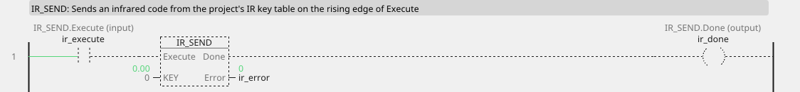
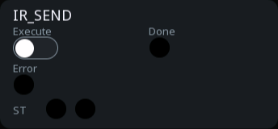
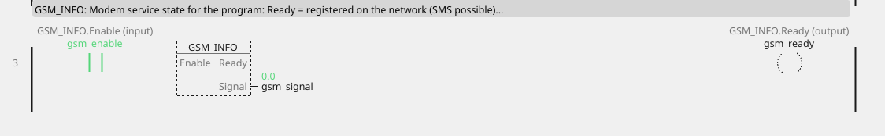
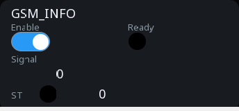

# Service blocks

Blocks that let the program reach a service the board provides:
infrared, SMS, the modem's own state, and the diagnostics of a vehicle
control unit.

They share a shape. The board does the slow work — a modem takes seconds
to send an SMS — while the block reports progress on its outputs and the
cycle carries on. Nothing here ever blocks the equipment.

---

## IR_SEND — send an infrared code

| Pin | Type | Meaning |
|:---|:---:|:---|
| `Execute` | input, bool | send on the rising edge |
| `KEY` | parameter (0) | index into the project's IR key table |
| `Done` | output, bool | the code went out |
| `Error` | output, bool | no transmitter, or KEY out of range |

<!-- blk:IR_SEND -->


```iecst
PROGRAM IR_SEND_ST
VAR ir : IR_SEND; END_VAR
  ir(Execute := ir_execute, KEY := 0);
  ir_done_st := ir.Done;
  ir_error_st := ir.Error;
END_PROGRAM
```



<!-- /blk -->

The codes themselves are not in the logic — they are **learned into the
project** on the peripherals page, where each one gets a number. The
block sends number KEY.

`Done` holds while Execute holds, after a successful transmit.

**What it is for:** driving equipment that has no other interface. Air
conditioning, a projector, a heat pump, a roller door — anything whose
only input is a remote control.

```
temp_too_high ──[R_TRIG]── Execute ──[IR_SEND KEY=2]── Done ──> ac_commanded
```

!!! tip "Infrared is one-way"
    Nothing tells you the air conditioner obeyed. Where it matters,
    measure the result — a temperature that stops rising, a current that
    starts flowing — rather than trusting `Done`, which only means the
    code was transmitted.

---

## SMS_SEND — send a message

| Pin | Type | Meaning |
|:---|:---:|:---|
| `Execute` | input, bool | send on the rising edge |
| `MSG` | parameter (0) | which message, 0–7 as numbered on the modem page |
| `NUM` | parameter (0) | recipient: **0 = everyone configured**, 1–4 = one number |
| `Done` | output, bool | queued successfully |
| `Error` | output, bool | see below |

<!-- blk:SMS_SEND -->


```iecst
PROGRAM SMS_SEND_ST
  IF sms_execute THEN
    sms_done_st := SMS_SEND('block library: SMS_SEND fired', 0);
  END_IF;
END_PROGRAM
```


<!-- /blk -->

Message texts and phone numbers live in the **project**, not the logic —
so changing a text or a number is an edit and an upload, not a code
change. The block picks message MSG and sends it to recipient NUM.

`Error` means one of: no modem service configured, an empty message or
number, or the service is busy. All three are retried simply by giving
Execute another rising edge.

**What it is for:** telling somebody who is not standing at the hardware.
A cold store that lost cooling at three in the morning, a pump station
that tripped, a batch that finished.

```
fault_critical ──[TON PT=60000]── Q ──[R_TRIG]── Execute ──[SMS_SEND MSG=0 NUM=0]
```

The minute of delay is deliberate — it stops a fault that clears itself
from waking anybody up.

!!! warning "An SMS is a notification, never a control path"
    Messages get delayed, dropped and duplicated by networks you do not
    control. Nothing on the equipment may depend on one arriving.

!!! tip "Rate-limit yourself"
    A fault that chatters can send hundreds of messages and a bill to
    match. Put a [TON](blocks-timers.md) in front of the trigger and a
    latch behind it, so one fault sends one message.

---

## GSM_INFO — modem state

| Pin | Type | Meaning |
|:---|:---:|:---|
| `Enable` | input, bool | read the modem state |
| `Ready` | output, bool | registered on the network — SMS is possible |
| `Signal` | output, number | last signal reading, 0–31 |

The logic-facing view of the modem. `Ready` is the pin to gate SMS
sending on: attempting to send while the modem is not registered wastes a
trigger.

`Signal` is the raw +CSQ reading, refreshed about every 30 seconds:

| Value | Meaning |
|:---|:---:|
| 0 | no signal — **or not measured yet** |
| 1–9 | marginal, expect failures |
| 10–14 | usable |
| 15–31 | good |

<!-- blk:GSM_INFO -->


```iecst
PROGRAM GSM_INFO_ST
VAR gsm : GSM_INFO; END_VAR
  gsm(Enable := gsm_enable);
  gsm_ready_st := gsm.Ready;
  gsm_signal_st := gsm.Signal;
END_PROGRAM
```



<!-- /blk -->

Without a configured modem, both outputs stay 0.

```
Enable ──[GSM_INFO]── Ready ──┐
fault_latched ─────────────────┤ AND ├── Execute ──[SMS_SEND]
```

!!! tip "Show the signal on a screen during installation"
    The person mounting the board can then find a spot where the antenna
    works, instead of discovering the problem months later when the first
    real alarm fails to arrive.

!!! note "There is also a status variable"
    A modem status variable carries the same information to *screens*. This
    block is the version for *logic* — interlocks and retry gating. Use
    whichever fits where you are working.

---

## Diagnostics: asking a control unit

On a vehicle bus a control unit answers questions: what the fault codes
are, what a measured value is right now. The values a project reads
regularly are set up on the Diagnostics node and arrive on their own —
no program is needed for them. These three blocks are for what a
**person** sets off: read the faults, clear them, ask once.

They need a board whose runtime carries the diagnostics. On one that
does not, every block reports `Error` — which is the honest answer to
"read the faults" on equipment that cannot.

### UDS_DTC — read the fault codes

| Pin | Type | Meaning |
|:---|:---:|:---|
| `Execute` | input, bool | ask on the rising edge |
| `ECU` | parameter (0) | which control unit, as numbered on the Diagnostics node |
| `Done` | output, bool | it answered |
| `Error` | output, bool | it refused, said nothing, or there are no diagnostics |

The count of faults and the first of their codes land in the variables
the control unit's page names, so a screen shows them like any other
value. Every code also goes into the diagnostic buffer with its time —
that is the record a service engineer reads afterwards.

```iecst
PROGRAM READ_FAULTS
VAR dtc : UDS_DTC; END_VAR
  dtc(Execute := btn_read_faults, ECU := 0);
  faults_read := dtc.Done;
  faults_error := dtc.Error;
END_PROGRAM
```

### UDS_CLEAR — clear them

| Pin | Type | Meaning |
|:---|:---:|:---|
| `Execute` | input, bool | clear on the rising edge |
| `ECU` | parameter (0) | which control unit |
| `Done` | output, bool | it confirmed; the fault variables went back to zero |
| `Error` | output, bool | it refused, said nothing, or there are no diagnostics |

!!! tip "A unit may refuse while the machine runs"
    Clearing faults is often allowed only with the engine stopped. `Error`
    then means exactly that, and the program should say so rather than
    retry — the answer will not change while the conditions do not.

### UDS_READ — ask for one value now

| Pin | Type | Meaning |
|:---|:---:|:---|
| `Execute` | input, bool | ask on the rising edge |
| `ECU` | parameter (0) | which control unit |
| `DID` | parameter (0) | which value, by the number its document gives |
| `Done` | output, bool | it answered |
| `Error` | output, bool | it refused, said nothing, or there are no diagnostics |

!!! note "One question at a time"
    A control unit answers one question at a time, which is what the
    protocol allows. A block pressed while another question of the same
    unit is still in hand reports `Error`; the program tries again on the
    next press.

---

## Configuring the services

None of these blocks configure anything. The IR transmitter, the modem,
the message texts and the phone numbers are all set up in the project,
on the peripherals and modem pages — see [Peripherals and
services](peripherals-and-services.md).

That separation is deliberate: a phone number changes when somebody
changes job, and that should be an edit in a form, not a change to the
equipment's logic.
