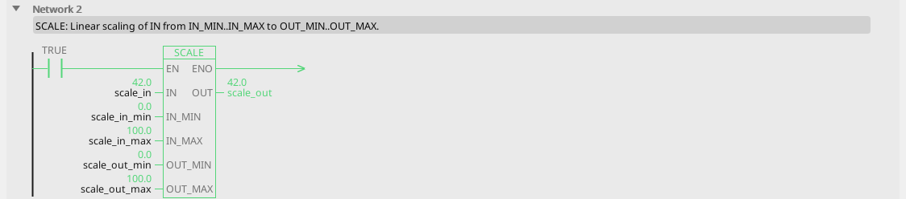
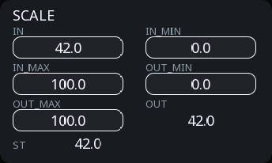
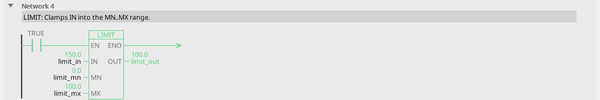
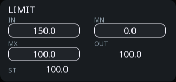
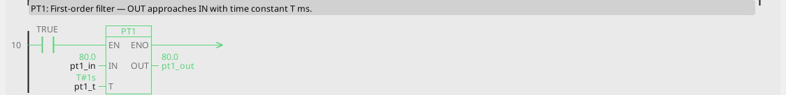

# Signal handling

Five blocks that stand between a raw value and a usable one: scaling,
clamping, switching cleanly, limiting how fast something changes, and
smoothing noise.

These are the blocks that turn "the sensor says 6234" into something a
equipment can act on.

---

## SCALE — linear conversion

**Maps IN from one range onto another.**

| Pin | Type | Meaning |
|:---|:---:|:---:|
| `IN` | input, number | the raw value |
| `IN_MIN`, `IN_MAX` | parameters (0, 100) | the range IN arrives in |
| `OUT_MIN`, `OUT_MAX` | parameters (0, 100) | the range you want |
| `OUT` | output, number | the converted value |

<!-- blk:SCALE -->


```iecst
PROGRAM SCALE_ST
  scale_out_st := SCALE(scale_in, scale_in_min, scale_in_max, scale_out_min, scale_out_max);
END_PROGRAM
```



<!-- /blk -->

**What it is for:** every analog input, ever. A 4–20 mA sensor arriving
as raw counts, a 0–10 V level, a fieldbus word that means something
physical.

```
raw_pressure ──[SCALE 0..4095 → 0..16]── OUT ──> pressure_bar
```

Two things worth knowing:

- **It does not clamp.** IN below IN_MIN gives OUT below OUT_MIN, and
  that is intentional — a reading under range is information, not
  something to hide. Follow it with [LIMIT](#limit-clamp) when the
  consumer needs a guaranteed range.
- **Reversing is legal.** Put the larger number in OUT_MIN and the
  smaller in OUT_MAX and the scale inverts, which is how you handle a
  sensor wired backwards without touching the wiring.

---

## LIMIT — clamp

**Holds IN inside MN…MX.**

| Pin | Type | Meaning |
|:---|:---:|:---:|
| `IN` | input, number | the value |
| `MN`, `MX` | parameters (0, 100) | the allowed range |
| `OUT` | output, number | IN, clamped |

<!-- blk:LIMIT -->


```iecst
PROGRAM LIMIT_ST
  limit_out_st := LIMIT(limit_mn, limit_in, limit_mx);
END_PROGRAM
```



<!-- /blk -->

**What it is for:** making sure a value that came from somewhere you do
not control — a screen, a recipe, a fieldbus master — cannot ask for
something impossible.

```
setpoint_from_hmi ──[LIMIT MN=20 MX=80]── OUT ──> setpoint
```

!!! warning "Clamping hides the fact that it clamped"
    A setpoint pinned at 80 looks exactly like a setpoint of 80. If it
    matters that somebody asked for more, compare the input with the
    output and flag it — one [EQ](blocks-compare.md) and you have an
    "out of range" indication instead of a silent surprise.

---

## HYST — comparator with hysteresis

**Q switches on at IN ≥ ON, and off again only at IN ≤ OFF.**

| Pin | Type | Meaning |
|:---|:---:|:---:|
| `IN` | input, number | the measurement |
| `ON` | parameter (100) | switch-on level |
| `OFF` | parameter (90) | switch-off level |
| `Q` | output, bool | the switched output |

<!-- blk:HYST -->


```iecst
PROGRAM HYST_ST
VAR hyst : HYST; END_VAR
  hyst(IN := hyst_in, ON := hyst_on, OFF := hyst_off);
  hyst_q_st := hyst.Q;
END_PROGRAM
```


<!-- /blk -->

The gap between ON and OFF is the hysteresis, and it is why this block
exists: a plain comparison at a single threshold chatters when the
measurement sits near it, and everything downstream chatters with it.

**What it is for:** anything where a number switches something physical.
Thermostats above all.

```
temp ──[HYST ON=22 OFF=20]── Q ──> heating
```

Heating comes on at 22 and off at 20 — a two-degree swing that stops the
relay clacking every few seconds.

**ON must be greater than or equal to OFF**, and the editor refuses a
block where it is not — a rising threshold below the falling one is
almost always a swapped pair of numbers rather than an intention.

For the opposite sense — switch on when a value *falls* — put a
[NOT](blocks-boolean.md) after it. `HYST ON=22 OFF=20` followed by NOT
gives you cooling that starts at 20 and stops at 22, with the same
two-degree gap doing the same job.

!!! success "How wide should the gap be?"
    Wide enough that normal noise cannot cross it, and no wider — the
    swing is felt by whatever the equipment does. For temperature, a
    degree or two. For a pressure switch, a few percent. If you are
    unsure, watch the raw value in the [Scope](scope.md) for a minute
    and make the gap bigger than the wobble you see.

---

## RAMP — rate limiter

**OUT follows IN, but changes at most RATE units per second.**

| Pin | Type | Meaning |
|:---|:---:|:---:|
| `IN` | input, number | the target |
| `RATE` | parameter, units/s (10) | the fastest OUT may change |
| `OUT` | output, number | the rate-limited value |

<!-- blk:RAMP -->


```iecst
PROGRAM RAMP_ST
VAR ramp : RAMP; END_VAR
  ramp(IN := ramp_in, RATE := ramp_rate);
  ramp_out_st := ramp.OUT;
END_PROGRAM
```


<!-- /blk -->

**What it is for:** stopping a step change from becoming a mechanical
shock. An operator typing a new speed, a recipe changing a setpoint, a
mode switch — all of them can move a number instantly, and the equipment
cannot follow instantly.

```
speed_request ──[RAMP RATE=50]── OUT ──> speed_setpoint
```

The request may jump from 0 to 500; the setpoint takes ten seconds to
get there.

!!! warning "Two ramps fighting is the classic drive problem"
    If the drive has its own acceleration ramp *and* the program ramps
    the setpoint, the two disagree and the axis overshoots or oscillates.
    Set the drive's ramps to minimum and let one place own the profile.
    See [Motion blocks](blocks-motion.md).

---

## PT1 — first-order filter

**OUT approaches IN with time constant T.**

| Pin | Type | Meaning |
|:---|:---:|:---:|
| `IN` | input, number | the noisy value |
| `T` | parameter, ms (1000) | time constant |
| `OUT` | output, number | the smoothed value |

<!-- blk:PT1 -->


```iecst
PROGRAM PT1_ST
VAR pt1 : PT1; END_VAR
  pt1(IN := pt1_in, T := pt1_t);
  pt1_out_st := pt1.OUT;
END_PROGRAM
```


<!-- /blk -->

After T milliseconds the output has covered about 63 % of a step; after
about 3×T it has effectively arrived. Bigger T means smoother and slower.

**What it is for:** a measurement that jumps around more than the thing
it measures. A flow meter, a load cell on a vibrating frame, a
temperature sensor picking up electrical noise.

```
raw_weight ──[PT1 T=500]── OUT ──> weight
```

    For a value that is only *displayed*, a filter is nearly free and
    makes a screen far more pleasant to read.

---

## Putting them in order

The usual chain for an analog input, left to right:

```
raw ──[SCALE]── engineering units ──[PT1]── smooth ──[LIMIT]── safe ──> logic
```

Scale first so everything downstream is in real units. Filter second, on
a value you can reason about. Clamp last, closest to whatever must not
receive nonsense.

Then take the decision with [HYST](#hyst-comparator-with-hysteresis)
rather than a bare comparison, and the whole path from sensor to relay is
quiet, readable and hard to get wrong.
