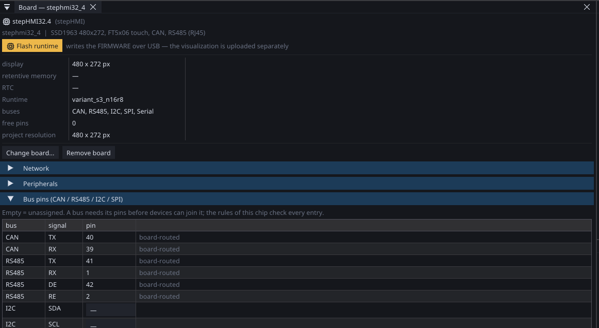

# Buses and peripherals

The board speaks Modbus on RS485 and Ethernet, CANopen to drives, raw CAN
frames, MQTT for telemetry — and drives local chips over I2C, SPI and
1-Wire.

**Every bus ends in the same place: the variable table.** A value that arrived
over Modbus looks exactly like one measured on a local pin, and the logic
does not care which it was. That is the whole design — you wire the
outside world into variables once, and everything afterwards (screens, logic,
trends, WEBview, alarms) works with variables.

---

## What each one is for

| Bus | Use it for | Reach |
|:---|:---|:---:|
| **Modbus RTU** (RS485) | I/O modules, meters, sensors, simple drives | ~1000 m on one pair |
| **Modbus TCP** (ethernet) | PLCs, SCADA, other boards | wherever the network goes |
| **CANopen** | frequency and servo drives, professional I/O | ~40 m at 1 Mbit/s |
| **Raw CAN** | a device with its own frame format | as above |
| **MQTT** | telemetry to a dashboard or a home system | over the network |
| **[+7](plus7.md)** (ethernet) | reading and writing a Siemens S7 PLC — the panel replaces the old HMI | wherever the network goes |
| **[net32](net32.md)** (WiFi, ethernet, CAN) | our network — ctrl32 devices as one system: home automation, shared variables, every node with its own logic | the network, or ~40 m of CAN |
| **I2C** | expanders, RTC, sensors on the board | centimetres |
| **SPI** | displays, memory, fast converters | centimetres |
| **1-Wire** | temperature sensors, cheap and many | tens of metres |

---

## Choosing between Modbus and CANopen

Both talk to drives. They are not interchangeable.

**Modbus RTU** is simple, universal and slow. A request goes out, an
answer comes back, and the next device waits its turn. Almost every
industrial device speaks it, and for reading a temperature once a second
it is perfect.

**CANopen** is a real fieldbus. Devices send when there is something to
send, the timing is tied to the cycle, and a drive that stops answering
is noticed by heartbeat rather than by a timeout. For an axis that has to
move accurately, that is the difference between a setup and a
demonstration.

**Rule of thumb:** if it moves and it matters, CANopen. If it measures,
Modbus.

---

## Master or slave

ctrl32 is both, on both Modbus flavours.

- **Master** — the board asks. The usual case: I/O modules, meters,
  drives.
- **Slave** — the board answers. Someone else's PLC or SCADA reads the
  equipment's state from you.

A board can be a master on RS485 and a slave on ethernet at the same
time, which is exactly what a setup integrated into a larger line
needs: it runs its own equipment and reports upward.

!!! note "Modbus TCP has a connection limit"
    Each connection costs 6–8 kB of RAM, so the number of simultaneous
    clients is capped and enforced. A SCADA that opens one connection per
    variable will hit it; one that opens a connection and reads blocks will
    not.

---

## Timing belongs to the cycle

The order in which the world is read and written is not incidental:

```
1. read inputs      → into the process image
2. run the logic    → works ONLY on that image
3. write outputs
4. wait for the period
```

The logic never reaches for a bus directly. It reads a snapshot taken at
the start of the cycle — which is why the same program gives the same
result twice, and why a value cannot change halfway through a
calculation.

**CANopen PDOs follow that rhythm**: received at the start of the cycle,
transmitted at the end. Never asynchronously, because a frame arriving at
a random moment produces jitter that cannot be measured and therefore
cannot be compensated.

**SDO parameterisation happens at startup only.** An SDO exchange waits
for an answer, and waiting inside the cycle destroys the timing. See
[CANopen blocks](blocks-can.md).

---

## What the bus load costs

Worth knowing before designing a setup around a number:

- A CANopen **PDO** at 500 kbit/s takes about **130 µs**. Four drives
  with two PDOs each is roughly 1 ms — 10 % of a 10 ms cycle. Eight
  drives is still comfortable; beyond that, shorten the cycle or move to
  1 Mbit/s, which costs bus length.
- A Modbus RTU **request and answer** at 9600 baud takes tens of
  milliseconds; at 115200 baud, a few. Polling twenty registers from
  eight devices every cycle will not work. Polling what you need, as
  often as it actually changes, will.

The board reports its own cycle time — minimum, average, maximum — and an
overrun counter. Watch those while commissioning instead of calculating
in advance; see [Performance and limits](limits.md).

---

## The bus pins are part of the project

On ESP32 boards, CAN, RS485, I²C and SPI are not soldered to fixed
positions — the project says where they live, and the assignment
travels with the program. The **Bus pins** section of the board page
is the one place they are set: each position is a dropdown of the
**allowed pins** — pins the chip cannot give you are not offered at
all — and an empty entry keeps the board's own default.

{: .sb-center}

- **A board that routes the bus itself** — a fitted CAN transceiver, a
  wired RS485 driver — shows its positions read-only. They are part of
  the hardware; the project cannot move them.
- **A preset's suggested positions** are only claimed while the project
  uses that bus. Drop CAN from the project and its pins return to the
  free pool — a digital input can take them.
- **A module target** — your own hardware around a bare WROOM — starts
  with everything free. Every assignment is checked against the
  module's electrical rules as you type: flash pins, input-only pins,
  strapping pins, one pin claimed twice. The same check runs again at
  build, so an illegal assignment never reaches the hardware.

**RS485 comes in three wirings**, chosen on the RS485 page:

| Wiring | Pins | When |
|:---|:---|:---|
| DE + RE separate | tx, rx, de, re | full control transceivers (MAX485 with both pins routed) |
| DE+RE tied | tx, rx, de | the common two-wire module with DE and RE bridged |
| auto-direction | tx, rx | converters that switch direction themselves |

On STM32 the positions are fixed by the silicon's pin matrix — the
fields do not apply there, and the editor says so.

---

## The traps that cost days

!!! warning "Float word order on Modbus"
    A 32-bit float occupies two registers and vendors disagree about
    which half comes first. Get it wrong and the value is not slightly
    off, it is nonsense — sometimes *plausible* nonsense, which is worse.
    Devices from the catalogue carry the right word order already; when
    adding one by hand, check it against a value you know.

!!! warning "RS485 termination"
    A line without termination works on the bench and fails
    intermittently in a cabinet next to a drive. Terminate both **ends**
    of the line, once each — not every device on it.

!!! warning "A drive in the wrong state machine"
    The Lenze i550 ships with its own state machine active, not CiA 402.
    You write a correct controlword, the drive does nothing, and you go
    looking for the bug in your own code. The startup block switches the
    mode over SDO, so you never meet this — but if you are talking to a
    drive by hand, remember it exists.

!!! warning "Heartbeat is not optional"
    A drive that stops answering must be noticed, and the reaction is a
    **quick stop**. Carrying on with the last values received is how a
    equipment keeps moving after the thing controlling it has gone.

---

## Where to go next

| | |
|:---|:---|
| [Modbus](modbus.md) | RTU and TCP, master and slave, the device catalogue |
| [Raw CAN](rawcan.md) | mapping CAN frames straight onto variables |
| [MQTT](mqtt.md) | telemetry into ThingsBoard, OpenRemote or Home Assistant |
| [CANopen blocks](blocks-can.md) | talking to a drive directly |
| [Motion blocks](blocks-motion.md) | driving an axis |
| [Peripherals and services](peripherals-and-services.md) | expanders, converters, RTC and the rest |
| [Adding a peripheral](adding-peripherals.md) | the two-minute click-through, recorded |
