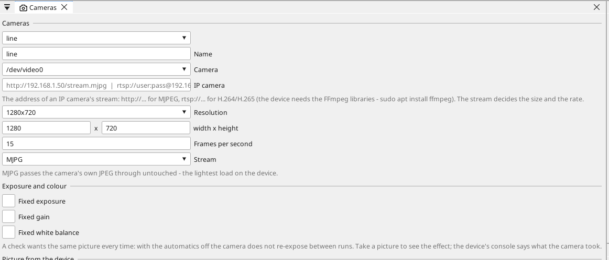
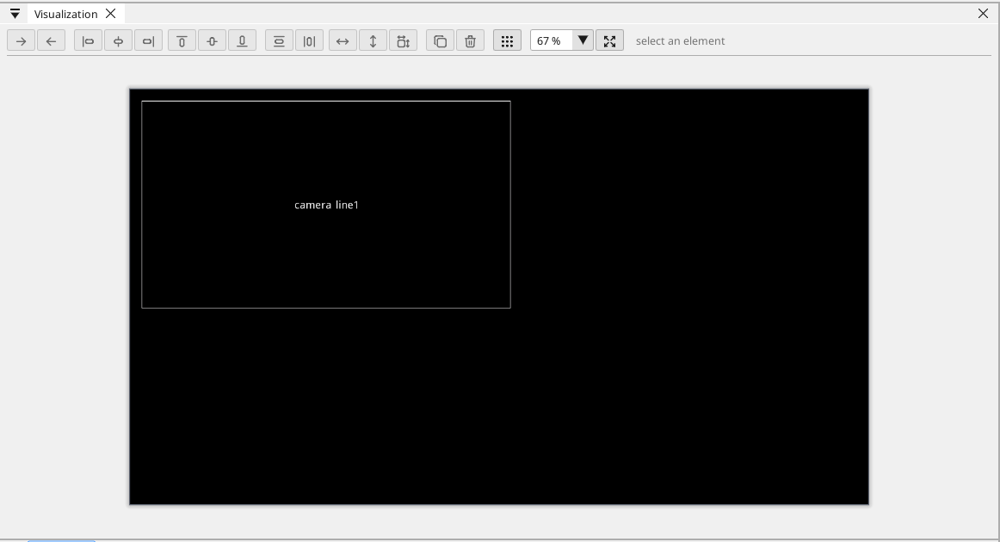

# Cameras

A Linux device can show a **live camera picture** on its own screen
(HMIview) and in the browser (WEBview). Plug a USB camera into the
device, add it to the project, drop a **camera** element on a screen -
that is all. Nothing is programmed.

!!! note "Linux devices only"
    Cameras belong to the Linux runtime. The Toolbox offers the camera
    element only when the project's target is a Linux device, and a
    project for another board that carries one is refused at build.

## Which cameras

Any **USB video class** camera - the ordinary USB camera that needs no
driver on a PC works on the device too. A camera that delivers
**MJPG** (almost every one does) is the best choice: the device passes
the camera's own pictures through without decoding them, so a camera
costs the device almost nothing.

A project carries up to **four** cameras.

**IP cameras** work too: type the address of the camera's MJPEG stream
(`http://192.168.1.50/stream.mjpg` - most network cameras offer one) in
the camera's page. The device reads the stream itself; the stream
decides the picture size and the rate. Only plain `http://` - the
device does not do TLS.

## Adding a camera

The camera is a device of the Linux target, and it has its own node in
the tree: **Cameras**, right under the device.

{: .sb-center}

1. **Scan the device** on its board page - the scan lists the cameras
   plugged into it, by name.
2. Right-click **Cameras** → **Add camera** and pick one of them. A
   project with no scan yet gets the first camera, `/dev/video0`.
3. Click the camera to open its page.

{: .sb-center}

| Field | What it does |
|:---|:---|
| Name | how the screens name the camera |
| Camera | which camera of the device (the scanned ones are listed first) |
| Resolution | the picture size the camera delivers |
| Frames per second | how many pictures a second the camera delivers |
| Stream | **MJPG** (recommended) or YUYV, for a camera that has no MJPG |

**Exposure and colour.** A check wants the same picture every time,
and a camera's automatics give a different one each run - a part that
was *present* at one exposure is gone at the next. Tick **Fixed
exposure**, **Fixed gain** or **Fixed white balance** and type the
value; the device sets the camera when it opens it and says on its
console what the camera took. Leave them off for a live picture that
only people look at - the device then puts the camera back on its
automatics when it opens it (a USB camera keeps a setting until it is
unplugged, so a check project that ran before does not leave its
exposure behind).

**Take a picture** fetches one picture from the device and shows it on
the page - the quickest check that the camera is plugged in, pointed
the right way and in focus. It needs the device's address: go online,
or enter the address for the network upload.

A camera is removed with a right-click on it → **Remove camera**.

## The camera on a screen

The **camera** element is in the Toolbox. Draw it on a screen and set
its text to the camera's name; the picture fills the element with its
proportions kept. In the editor the element shows the camera's name,
on the device it shows the camera.

{: .sb-center}

The same screen in the **browser** shows the same picture, about ten
times a second - the WEBview draws the screens of the device's glass,
the camera included.

The device also serves the camera to anything else on the network:

| Address | What it answers |
|:---|:---|
| `http://<device>:8080/cam/0.jpg` | the latest picture of the project's first camera |
| `http://<device>:8080/cam/0.mjpg` | the live stream (MJPEG), at most two viewers per camera |

The number is the camera's position in the project: 0 is the first.

## The control comes first

The camera runs **below the PLC**: its pictures are taken on their own
threads, off the core the cycle and the EtherCAT line use. When the
device is busy, a picture is dropped - the cycle never waits for a
camera.

## Looking and deciding

A camera can also **check**: is the part there, is it the right colour,
where is its edge, what does its code say - the answers become
variables. See [Vision](vision.md).

## What comes next

Stereo cameras and the Raspberry Pi camera port.
