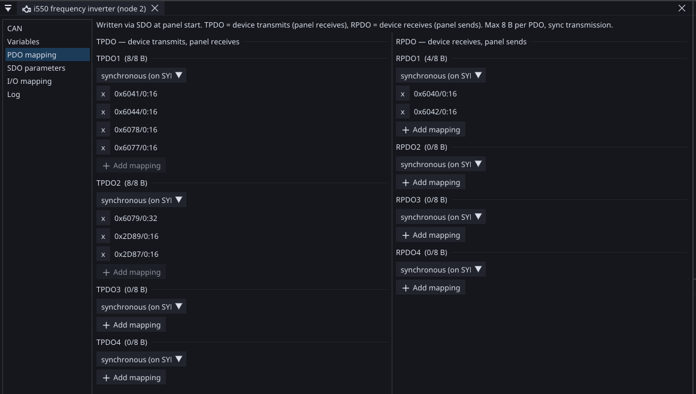
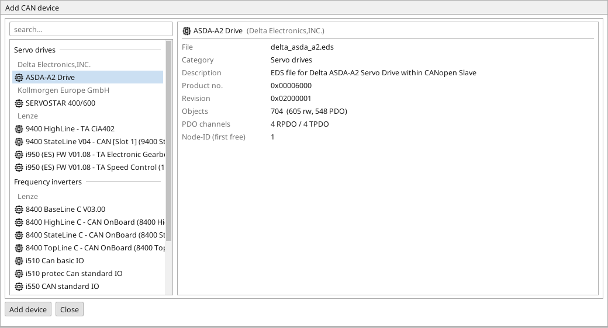

# CANopen

A drive on a CAN bus is not a device you poll — it is a device
with a state machine, a scheduled exchange of process data, and a
heartbeat that tells you the moment it stops listening.

ctrl32 is the **manager**: NMT master, SDO client, SYNC producer and
heartbeat monitor. The devices on the bus are its nodes.

---

## Why not just use Modbus

Both can talk to a drive, and the difference is not speed.

**Modbus** is request and answer. You ask for a register, you wait, you
get it. A drive that has stopped answering looks the same as a slow one
until a timeout expires, and the timing of the exchange has nothing to do
with the timing of your control loop.

**CANopen** is scheduled. Process data (**PDO**) arrives at the start of
your cycle and leaves at the end, so what the logic reads is what was
true this cycle, every cycle. A device that goes quiet is noticed by
**heartbeat** within a defined time, and the reaction is yours to
program.

For an axis that must move accurately, that difference is the whole
game. For a temperature you read once a second, Modbus is simpler and
just as good.

---

## PDO and SDO — the two conversations

{: .sb-center}

**PDO — process data.** Small, fast, cyclic. The controlword, the
setpoint, the actual position, the status. No addressing overhead, no
acknowledgement: a frame goes out and whoever cares receives it.

**SDO — service data.** A request and a confirmed answer, used to read
and write the device's parameters by index and sub-index. It is how you
configure a device — and it takes milliseconds.

!!! danger "Never do SDO inside the cycle"
    An SDO exchange waits for an answer from another device. Waiting
    inside the cycle destroys its timing, non-reproducibly, and shows up
    later as jitter nobody can explain.

    ctrl32 enforces this: `CO_SDOWRITE` and `CO_SDOREAD` are compiled
    into **startup records** and never execute in the cycle. Parameterise
    at startup, use PDOs for everything that repeats.

---

## The tie to the cycle

```
SYNC  →  RPDO in  →  logic  →  TPDO out  →  wait for the period
```

Receive at the start, transmit at the end, always in that order. The
logic works on a snapshot, exactly as it does with local I/O.

**For position feedback, set the drive's PDO to synchronous
transmission** — sent in response to SYNC rather than whenever the drive
feels like it. Event-driven transmission means values arriving at
unpredictable moments, and a delay you cannot measure is a delay you
cannot compensate. Everything positioning does rests on that number
being knowable.

---

## What the bus can carry

At 500 kbit/s an 8-byte PDO takes about **130 µs**.

| Setup | Bus time | Share of a 10 ms cycle |
|:---|:---:|:---:|
| 4 drives, 2 PDOs each | ~1 ms | 10 % |
| 8 drives, 2 PDOs each | ~2 ms | 20 % |

Eight drives is comfortable. Beyond that, shorten the cycle or move to
1 Mbit/s — which costs bus length, because CAN trades speed against
distance.

---

## Heartbeat is not optional

Every node reports periodically that it is alive. The manager watches,
and a node that misses its window is **failed**, not merely late.

**The reaction belongs in your program, and it should be a quick stop.**
Carrying on with the last values received is how a setup keeps moving
after the thing controlling it has gone — and it is the failure mode that
looks fine right up until it does not.

---

## EDS import

A CANopen device comes with an **EDS file** (Electronic Data Sheet,
CiA 306) — the manufacturer's description of every object it exposes,
with indices, sub-indices, types and names.

ctrl32 reads it. *Tools → Device library* installs an EDS into the
project's device repository; from there you pick objects and the editor
**generates the variables**, correctly typed and correctly addressed.
*Add CAN device* shows the repository with the card of each file —
click a device and its parameters are read out on the spot: objects,
how many are writable, the PDO channels, the first free node-ID.

{: .sb-center}

That is the difference between an afternoon with a manual and five
minutes with a file. Object `0x6041` sub `0` becomes a variable called
what the manufacturer called it, with the right size and the right sign.

**The parser is deliberately tolerant.** Vendor EDS files are creative:
unknown sections and keys are skipped rather than refused, because a file
that will not load is worth nothing and a file with two odd lines is
worth almost everything. A genuinely unreadable file fails and changes
nothing.

!!! note "EDS is read only in the editor"
    The board never sees an EDS. The pack carries the resulting
    variables, already resolved — so nothing is parsed on the equipment and
    nothing depends on a file being present.

---

## Drives: the trap that costs a day

The reference target is the **Lenze i550**, and it ships with **Lenze's
own state machine active**, not CiA 402.

Write a correct controlword into a drive in that state and nothing
happens. No error, no complaint — the drive simply does not react, and
the search for the bug goes into your own code, where it is not.

The startup block switches the mode over SDO, so a project built from the
i550 profile never meets this. If you are talking to one by hand, it is
the first thing to check.

Node ID, baud rate and termination are DIP switches on the drive itself —
worth writing on the drawing, because nothing in software can tell you
they are wrong.

---

## Safety

**Stopping over CANopen is not a safety function.** Neither is a
quick-stop command, nor anything else on this page. What is — STO
terminals, hard-wired limit switches, and the reactions worth defining
— is in [Motion blocks — safety](blocks-motion.md) and
[Intended use](intended-use.md).

---

## Where to go next

| | |
|:---|:---|
| [CANopen blocks](blocks-can.md) | `CO_CIA402`, `CO_SDOWRITE`, `CO_SDOREAD`, `CO_RAMPTIME` |
| [Motion blocks](blocks-motion.md) | the PLCopen layer above them |
| [Raw CAN](rawcan.md) | a device with its own frame format, no CANopen involved |
| [Buses](buses.md) | wiring, termination, and choosing between buses |
