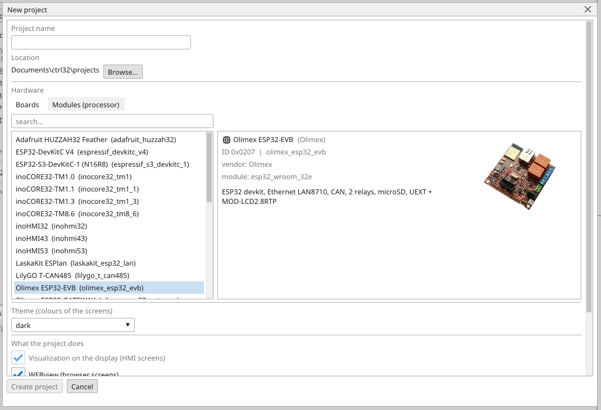
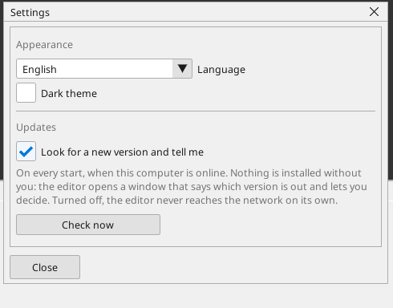
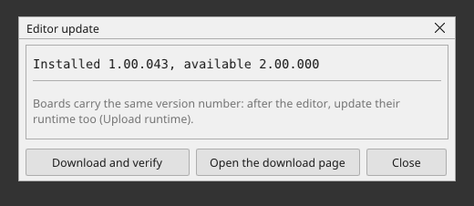

# Editor

ctrl32 Editor is an **installed application**, not a web page. The reason is
simple: it draws exactly the pixels you will see on the board — the same
renderer as in the firmware is built into it, fonts, roundings and colours
included. What you see is what gets downloaded.

{: .sb-center}

## What the installer puts on the PC

`ctrl32-setup-<version>.exe` installs everything the editor needs:

| Part | What it is for |
|:---|:---|
| `ctrl32_editor.exe` | the editor itself |
| `ctrl32.dat` | the catalog of boards and chips |
| `runtimes\` | the prebuilt runtime (firmware) of every supported board |
| `linux\` under `%ProgramData%\ctrl32` | the Linux runtime bundles, see [Setting up a Linux device](linux-setup.md) |
| `tutorials\` | small sample projects, one idea each |
| `examples\` | the example projects of the tested boards, one folder per board - the same projects as the [hardware guides](https://ctrl32.com/docs/wiki/) |

The ST compiler, the pack builder and the flasher are **compiled into
the editor** — there is no helper program to install, to go missing or
to be a version behind, and no toolchain on the PC. The pack the editor
builds is byte for byte the one a release is tested with.

Your own files live under `Documents\ctrl32`: new projects in
`Documents\ctrl32\projects`, your own theme files in
`Documents\ctrl32\themes`.

## Layout

| Part | Where | What is in it |
|:---|:---:|:---|
| **Menu** | top | File, Edit, View, Project, Build, Online, Debug, Tools, Window, Help |
| **Toolbar** | under the menu | new, save, undo/redo, TEST, ONLINE, download |
| **Project tree** | left | the board and everything running on it |
| **Documents** | centre | every tree node has a **page**, opened as a tab |
| **Toolbox** | right | what the visible editor takes: widgets for a screen, blocks for LD/FBD — grouped as Boolean, Math, Timers, Counters, General, Motion, CAN and GSM/GPS (groups start collapsed) |
| **Status bar** | bottom | the result of the last build, the connection state |

The **bug icon at the top right** opens mail to `bugs@ctrl32.com` —
reporting a fault should be one click from wherever you hit it.

{: .sb-center}

## The tree follows the hardware, not the protocols

```
project
  board
    Application          programs, variables, visualizations, axes
    CAN                  the bus itself: bitrate, termination
      Raw CAN            frame-to-variable mapping
      CANopen master     + devices
    RS485                the line: baud, parity, stop bits
      Modbus RTU master  + devices
      Modbus RTU slave   the board as a slave
    Ethernet             DHCP/static IP, mDNS
      Modbus TCP         master and slave
      MQTT               telemetry / Home Assistant
    I2C, SPI             local buses and chips
    Settings
```

One wire can carry several protocols, and the same protocol can run on two
wires (Modbus on RS485 **and** on Ethernet). Sorting by protocol could not
express that; this way matches the hardware.

In a **net32 system project** one more level sits above the board: the
system, with one row per device. A click switches the whole editor to
that device; clicking the system name opens the net32 canvas where the
devices' shared variables are wired together. See
[the system project](net32.md#the-system-project).

!!! note "Settings live on pages, not in the right-click menu"
    A context menu holds **actions** — add, delete, rename. Never settings.
    The bus speed is on the bus page, where a person looks for it. A popup
    is only for **picking from a catalog** (boards, devices, dictionary
    objects).

Nodes for features that are not finished yet are in the tree as well — their
page says so. A customer has to see what the board can have, not guess it.

### What Application holds

| Object | Holds |
|:---|:---|
| **VAR** | the variables (more lists and the retain list RVAR are added from *Add Object*, see [Variables](variables.md)) |
| **PLC_PRG** | the first program, in the language the wizard was given |
| **Tasks** | which programs run, and how often (below) |
| **HMIview** | the board's own screens |
| **WEBview** | the browser's screens |

`VAR`, `PLC_PRG` and one screen are created with the project.

## A new project

The editor starts empty. *New project* — the button on the Welcome tab,
the first icon of the toolbar, or `Ctrl+N` — opens one window with
everything a fresh project needs:

{: .sb-center}

| Field | What it decides |
|:---|:---|
| **Project name** | mandatory; it becomes the folder and the file name: `<location>\<name>\<name>.prj32` |
| **Location** | `Documents\ctrl32\projects` unless you browse elsewhere |
| **Hardware** | a board from the catalog (its card shows what it carries) or the processor module your own hardware carries; Linux devices are listed under *Linux*. The hardware decides the pins, the memory and which runtime is flashed — a project cannot be deployed without one. **Drives only** makes a project with no hardware at all: see below |
| **Theme** | the colour set the screens start with (see [HMIview](hmiview.md#colour-carries-meaning)) |
| **What the project does** | visualization on the display, WEBview screens, the first program in ladder or ST, and the roles: CAN master, Modbus RTU or TCP slave, MQTT, net32. Every tick creates the matching part of the project |

On a **module** the *Visualization* tick decides which runtime the module
gets: the one with a display, or the headless one with the bigger program
limits (see [Performance and limits](limits.md)). A catalog board's type
comes from the catalog, so the tick follows the board. On an ESP32-C3 or
C6 module the wizard makes a [node](node.md) project: no program
language, no visualization, only the WEBview page.

**Drives only** - the third tab of *Hardware* - makes a project of
frequency and servo drives alone: no board, no program, no screens. The
drives are added under **Drives** in the device tree, set on their pages
and written to the drives from this PC (see [Drives](drives.md)). A board
can be added to the project later.

*Create project* writes the file and opens the tree on it. Nothing in the
wizard is final: every part can be added or removed later from the tree,
and the hardware can be changed on the board tab — a project may change
hardware.

## Tasks — which programs run

Under *Application* the tree has a *Tasks* node. Each task is a cycle
with its period and priority — *FAST (10 ms, priority 1)* is the main
one and every new project starts with its first program in it. Under a
task you see the programs it calls, in the order they run.

A project holds up to four tasks. The priority follows the period: the
task with the shortest period is priority 1 and runs first when several
are due — the same rule the device schedules them by. *FAST* owns the
inputs and outputs; the other tasks run logic only, each at its own
period.

A program runs only when a task calls it or another program calls it.
A program that nothing calls stays in the project, is drawn grey in the
tree and does not run; hover it and the tree says so. Right-click a task
to change its period, rename it, add a program to it or remove it;
right-click a program under a task to move it up or down in the run
order or to take it out. The program's own menu offers the same choice
under *Task*, including *(none)*.

**Calling a program from a program.** Write its name as a statement in
ST — `STATS();` — or drop the program from the insert menu as a box in
FBD or LD (the box menu's *Programs* group). The called program runs at that point of the caller's cycle, on its
own variables, and what it wrote the caller reads right after the call.
A called program needs no task; the tree shows it in normal colour and
says it is called. A program cannot be called and run by a task at the
same time (it would run twice), calls never form a loop, and they nest
at most eight deep — the build says so.

A project saved before this version keeps working exactly as it did:
every program that had no task written in the file belongs to *FAST*,
and the programs keep the order they ran in.

## Toolbar

| Icon | What it does |
|:---|:---|
| :ti-file-plus: | new project — the wizard: name, folder, board or module, what the project does (the editor starts empty until one is created or opened) |
| :ti-folder-open: | open project |
| :ti-device-floppy: | save project |
| :ti-arrow-back-up: :ti-arrow-forward-up: | undo / redo (both unlimited; the count is in the Edit menu) |
| :ti-terminal-2: | the board's serial terminal |
| :ti-wave-square: | the scope (trace) |
| :ti-eyeglass: | [find devices](find-devices.md) |
| *port picker* | which COM port or address the editor talks to — an IP address or `name.local` is taken anywhere a COM port is. It starts **empty**, and the download and runtime dialogs ask for a port at the moment bytes are about to move: a port nobody chose would read as configured |
| :ti-plug: | **ONLINE** — connect to a real board (:ti-plug-connected: while connected) |
| :ti-download: | **download to the board** (F5) — the only coloured icon in the bar |

While a simulation runs (*Online → Simulation*), a transport joins
the bar: :ti-player-stop: stop, :ti-player-pause: pause,
:ti-player-track-next: one PLC cycle. The complete reference of
menus, keys and mouse gestures is
[Controls and shortcuts](editor-controls.md).

There is deliberately only one blue icon. Downloading into a setup is an
action that must not be confused with any other; everything else is a flat
icon like in any ordinary application.

## TEST — simulation without a board

*Online → Simulation* switches the editor into running: the PLC cycle runs on the PC,
screens react, blocks compute, variables change. It can be paused and stepped
cycle by cycle (*Debug → Step*).

What runs is **the same compiled program and the same block library** as in the
board — the VM is compiled for the PC as well. So logic can be debugged at
your desk and reach the equipment finished.

While it runs the canvas is live: a button on the screen presses with
the mouse, a lamp lights, an input takes a typed value. A value typed
into an input reaches the logic in the next cycle — nothing is rebuilt
and nothing is downloaded, because a block parameter bound to a variable
reads it every cycle. Simulation needs no hardware connected and does not
depend on the board picked; most of a project can be built and tested
this way first.

## Properties and the sheet

A single click selects an element — a widget, a block, a contact — and
the **Properties** panel shows its fields: a widget's variable, text and
mode, a block's pins and parameters. A double-click on a block opens the
same rows as a **sheet** right where the block is. Both edit the same
thing; use whichever is closer to hand. A block parameter can take a
variable instead of a literal, which is what makes a time or a limit
adjustable from a screen without a rebuild.

The difference from [online monitoring](online.md): TEST computes the
values, ONLINE **reads them from the equipment**.

## Build (F7) and download (F5)

**F7** only builds the project and reports the result. **F5** builds and
downloads it.

When a build fails, a window opens with the **whole** output — the text can
be selected and copied with a button, and the same text is in
`build\last_build_error.txt`. A truncated line in the status bar was never
enough for anyone to help you with.

## Language

*View → Language*. The editor speaks English, Slovak, Czech, Polish,
Hungarian, German, Italian, Spanish, Romanian, Turkish, Ukrainian and
Bulgarian.
The first start picks the
language your Windows runs in, when the editor has it, and the choice is
remembered between runs. The documentation is English.

The translations were made by the authors with automatic translation
and checked where a native speaker was at hand — a wrong word in your
language is worth a message, it gets fixed in the next release.

## AI assistant connection (MCP server)

An AI assistant on your computer — any client that speaks MCP, the
Model Context Protocol — can join your **running editor session**: it sees the
project you have open, runs the build, reads the connected board, and
can make edits that appear live in the editor, each one undoable with
Ctrl+Z. It starts from *Tools → MCP server*, it is off by default,
and it never leaves this computer.

The whole story — starting it, every tool it gets, and the safety rules — is on its own page:
[The AI assistant (MCP server)](mcp.md).

## Licence

The terms are on the [Licensing](licensing.md) page.

## Updates

*Help -> Check for updates* reads a small signed notice from our web and
tells you whether a newer version exists; with *Check on start* ticked
the editor does this quietly every time it starts. Without internet
nothing happens and nothing is shown.

That request tells us how many installations there are. It carries three
things: a random number the editor draws for itself the first time it
runs, the version, and the interface language. The random number is not
derived from your computer or your name, and nothing about
your projects is sent.

**When a newer version exists the editor says so by itself.** The update
dialog opens on the next start, whoever you are - knowing that a new
version is out is not a privilege.
*Later* closes it for this run, and *Help -> New version* opens it again
whenever you want it.

The switch is in *Tools -> Settings*, under **Updates**. Turned off, the
editor never reaches the network on its own and asks for nothing at all.

{: .sb-center}



- **Install now** fetches the installer into your temporary folder,
  judges it twice - its fingerprint must equal the one in the signed
  notice, and the file must carry our publisher signature - and then
  starts it and closes the editor; the installer replaces the program
  the usual way. A file that fails either test is deleted and the
  dialog says so. The installer never starts while the open project has
  unsaved changes - save first, nothing is closed under you.
- **Open the download page** takes you to the web instead, the manual
  road.

The editor never updates itself on its own: every step above is your
click. And because a device carries the same version number as the
editor that programmed it, update the runtime of your devices after the
editor (*Upload runtime*) - the editor refuses to work with a runtime of
a different number.
