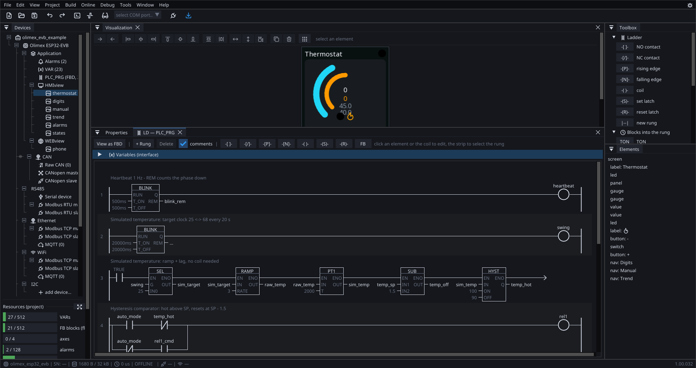

# Editor

ctrl32 Editor is an **installed application**, not a web page. The reason is
simple: it draws exactly the pixels you will see on the board — the same
renderer as in the firmware is built into it, fonts, roundings and colours
included. What you see is what gets downloaded.

{: .sb-center}

## Layout

| Part | Where | What is in it |
|:---|:---:|:---|
| **Menu** | top | File, Edit, View, Project, Build, Online, Debug, Tools, Window, Help |
| **Toolbar** | under the menu | new, save, undo/redo, TEST, ONLINE, download |
| **Project tree** | left | the board and everything running on it |
| **Documents** | centre | every tree node has a **page**, opened as a tab |
| **Toolbox** | right | what the visible editor takes: widgets for a screen, blocks for LD/FBD — grouped as Boolean, Math, Timers, Counters, General, Motion, CAN and GSM/GPS (groups start collapsed) |
| **Status bar** | bottom | the result of the last build, the connection state |

The **bug icon at the top right** opens mail to `bugs@ctrl32.com` —
reporting a fault should be one click from wherever you hit it.

{: .sb-center}

## The tree follows the hardware, not the protocols

```
project
  board
    Application          programs, variables, visualizations, axes
    CAN                  the bus itself: bitrate, termination
      Raw CAN            frame-to-variable mapping
      CANopen master     + devices
    RS485                the line: baud, parity, stop bits
      Modbus RTU master  + devices
      Modbus RTU slave   the board as a slave
    Ethernet             DHCP/static IP, mDNS
      Modbus TCP         master and slave
      MQTT               telemetry / Home Assistant
    I2C, SPI             local buses and chips
    Settings
```

One wire can carry several protocols, and the same protocol can run on two
wires (Modbus on RS485 **and** on Ethernet). Sorting by protocol could not
express that; this way matches the hardware.

!!! note "Settings live on pages, not in the right-click menu"
    A context menu holds **actions** — add, delete, rename. Never settings.
    The bus speed is on the bus page, where a person looks for it. A popup
    is only for **picking from a catalog** (boards, devices, dictionary
    objects).

Nodes for features that are not finished yet are in the tree as well — their
page says so. A customer has to see what the board can have, not guess it.

## Toolbar

| Icon | What it does |
|:---|:---|
| :ti-file-plus: | new project |
| :ti-folder-open: | open project |
| :ti-device-floppy: | save project |
| :ti-arrow-back-up: :ti-arrow-forward-up: | undo / redo (both unlimited; the count is in the Edit menu) |
| :ti-terminal-2: | the board's serial terminal |
| :ti-wave-square: | the scope (trace) |
| :ti-eyeglass: | [find devices](find-devices.md) |
| *port picker* | which COM port or address the editor talks to |
| :ti-plug: | **ONLINE** — connect to a real board (:ti-plug-connected: while connected) |
| :ti-download: | **download to the board** (F5) — the only coloured icon in the bar |

While a simulation runs (*Online → Simulation*), a transport joins
the bar: :ti-player-stop: stop, :ti-player-pause: pause,
:ti-player-track-next: one PLC cycle. The complete reference of
menus, keys and mouse gestures is
[Controls and shortcuts](editor-controls.md).

There is deliberately only one blue icon. Downloading into a setup is an
action that must not be confused with any other; everything else is a flat
icon like in any ordinary application.

## TEST — simulation without a board

*Online → Simulation* switches the editor into running: the PLC cycle runs on the PC,
screens react, blocks compute, variables change. It can be paused and stepped
cycle by cycle (*Debug → Step*).

What runs is **the same compiled program and the same block library** as in the
board — the VM is compiled for the PC as well. So logic can be debugged at
your desk and reach the equipment finished.

The difference from [online monitoring](online.md): TEST computes the
values, ONLINE **reads them from the equipment**.

## Build (F7) and download (F5)

**F7** only builds the project and reports the result. **F5** builds and
downloads it.

When a build fails, a window opens with the **whole** output — the text can
be selected and copied with a button, and the same text is in
`build\last_build_error.txt`. A truncated line in the status bar was never
enough for anyone to help you with.

## Language and theme

*View → Language* and *View → Dark theme*. The choice is remembered between
runs.

## Licence

- what is paid is everything that **leaves the editor**: saving a project
  file, and talking to a real board — download and online alike.

## Updates

*Help → Check for updates* looks at our web and tells you whether a newer
version exists. Downloading is manual — the editor never updates itself
behind your back, because the editor version is tied to what is running in
customers' boards.
