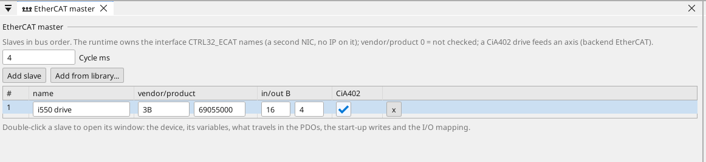
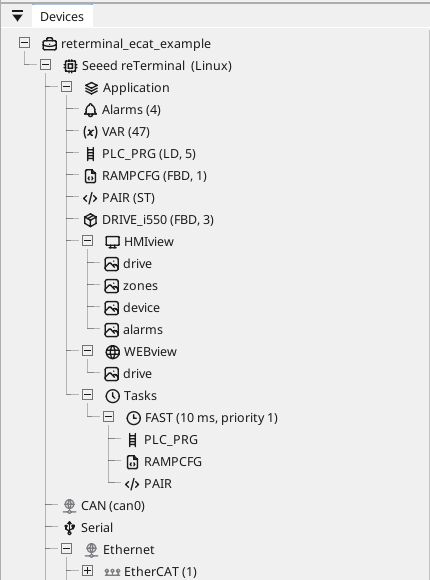
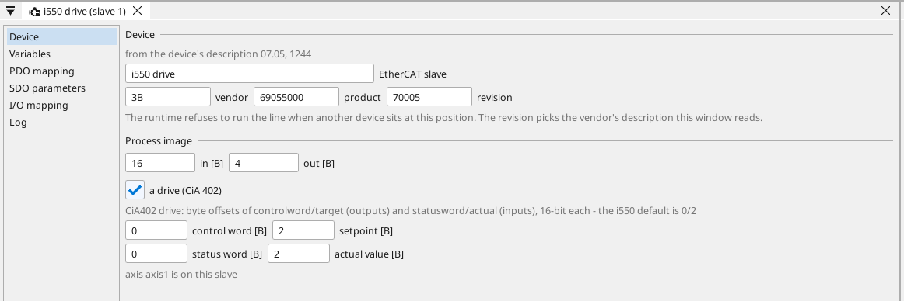
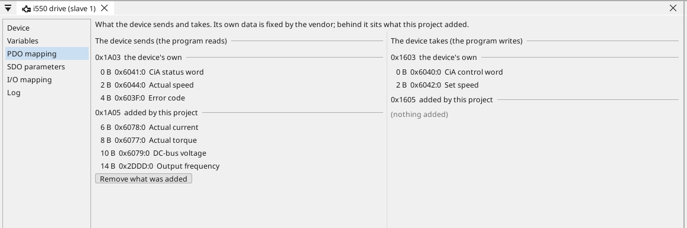
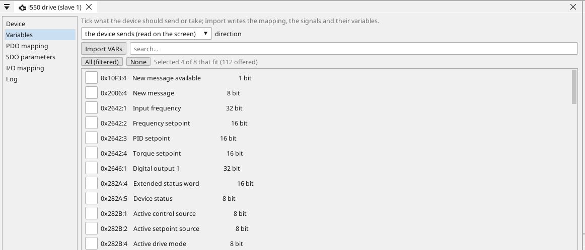
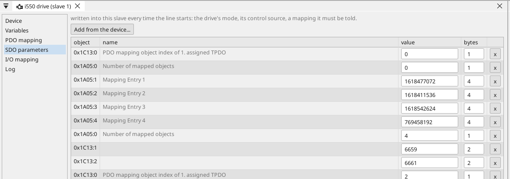
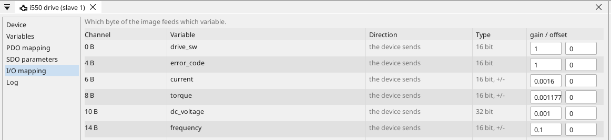

# EtherCAT

An EtherCAT line is one loop of cable through every device and back.
There is no polling and no addressing in the usual sense: a single
frame travels the loop, each device reads its own bytes out of it and
writes its own bytes into it as the frame passes. That is why a
hundred terminals cost the same cycle as three.

ctrl32 is the **master** of that line, on a Linux device with a
network port to spare. The devices on it are its slaves, in the order
they are wired.

---

## What it costs you to set up

Nothing that a CANopen drive does not also cost, and one thing less:
there are no node-IDs to set with DIP switches. A slave is identified
by **where it sits** on the cable, and by what it says it is — its
vendor and product code. The runtime refuses to run the line when the
device at a position is not the one the project expects, which is the
protection you would otherwise get from a careful label.

---

## The device comes from its description

Every vendor ships an **ESI file** — an XML description of the device:
its identity, the sizes of its process data, what travels in it and
what can be written. It plays exactly the part an EDS file plays for
CANopen.

{: .sb-center}

Put the file in the device library (*Tools › Device library*, the
EtherCAT section) and the EtherCAT page's **Add from library** turns a
picked device into a slave: identity, image sizes, the CiA 402 layout
when it is a drive, and one signal with its variable for every value
the device sends by default. The Lenze i550 ships in the library.

---

## The device's window

{: .sb-center}

Double-click a slave and it opens with the same tabs a CAN device has:

{: .sb-center}

- **Device** — who it is: vendor, product, the revision of the
  description it came from, the sizes of its process image, and for a
  drive the four byte offsets of the CiA 402 words.
- **Variables** — the device's own objects. Tick what it should send or
  take and *Import* writes the rest.
- **PDO mapping** — what really travels, in the shape every EtherCAT
  tool uses: the slave's **sync managers** (SM2 carries the outputs,
  SM3 the inputs), the **PDOs assigned** to the one picked, and the
  **entries** of the PDO picked among those, each with its offset and
  its name. The device's own mapping is the vendor's and is shown as
  it is; the configurable PDO is the one this project fills.
- **SDO parameters** — what is written into the device every time the
  line starts.
- **I/O mapping** — which byte of the image feeds which variable, with
  its gain and offset.
- **Log** — the device's own messages, read from the panel.

{: .sb-center}

---

## Process data and what a master may add

A slave's process data is partly fixed by its vendor and partly the
master's choice. A drive, for instance, always sends its status word,
its actual speed and its error code; its current, torque, DC link
voltage and output frequency are objects the master may **add** to the
data it sends.

{: .sb-center}

That is what **Map from the device** does. Tick the values in the
device's own dictionary and the editor writes the whole plan: the
mapping, the assignment in the order the standard wants, the signals
that read those bytes, the variables they need and the new image size.
Map again and the plan is replaced, not appended to.

{: .sb-center}

Doing it by hand means composing 32-bit mapping words out of an index,
a sub-index and a bit width, and writing them in an order the device
accepts. A drive that receives them in the wrong order answers with a
mapping error and sends zeros — and looks, from the outside, exactly
like a broken device.

---

## Which byte is which variable

{: .sb-center}

The signals of a slave are plain variables with a byte offset, a width
and a gain. A screen reads them, a program computes with them, and
nothing in between needs code.

---

## A drive on the line

A CiA 402 drive is an **axis**, and the motion blocks command it the
same way whether it sits on CANopen or on EtherCAT — `MC_POWER`,
`MC_MOVEVELOCITY` and the rest do not know the difference. The axis
wizard makes the whole thing in one step: the slave from its
description, the axis on its position, the start-up writes that put
the drive in velocity mode under network control, and the variables
the blocks bind to.

What a drive needs beyond that is its **motor data**, and that lives
in the drive, not in the project. A drive that has never met the motor
runs the factory values and trips on its first start.

---

## Safety

Stopping over EtherCAT is **not** a safety function. The emergency
stop belongs on the drive's STO terminals, hard-wired, exactly as with
any other bus.

---

## What the line does not do

- **One line per device.** The master runs on one network interface;
  a second line would need a second port and is not supported.
- **No distributed clocks.** The cycle is the runtime's own, which is
  what a drive in velocity mode and a terminal both need. Motion that
  requires synchronised clocks across slaves is out of scope.
- **Linux only.** The boards run CANopen; EtherCAT wants an interface
  that belongs to the master alone.

---

## Where to go next

- [reTerminal, the drive on EtherCAT](example-reterminal-ecat.md) — the
  example this page's pictures come from.
- [CANopen](canopen.md) — the same drive on the other bus.
- [Motion blocks](blocks-motion.md) — what commands an axis.

---

*EtherCAT® is a registered trademark and patented technology, licensed by Beckhoff Automation GmbH, Germany.*
