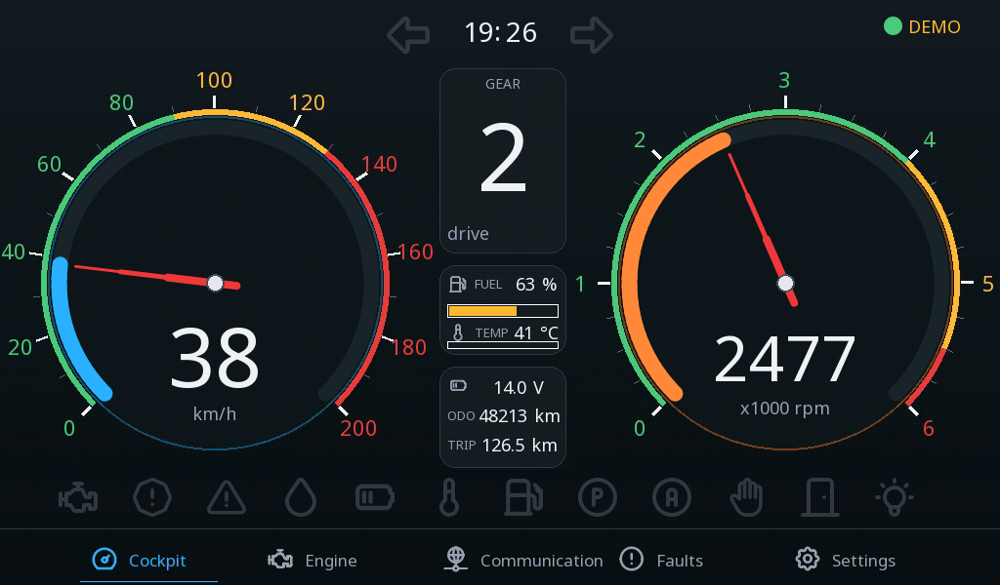
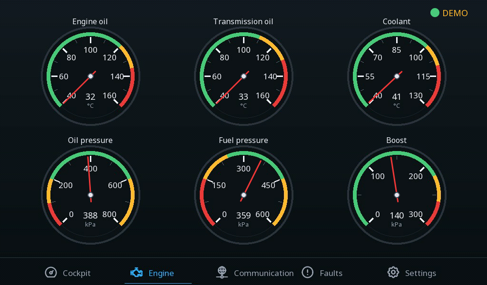
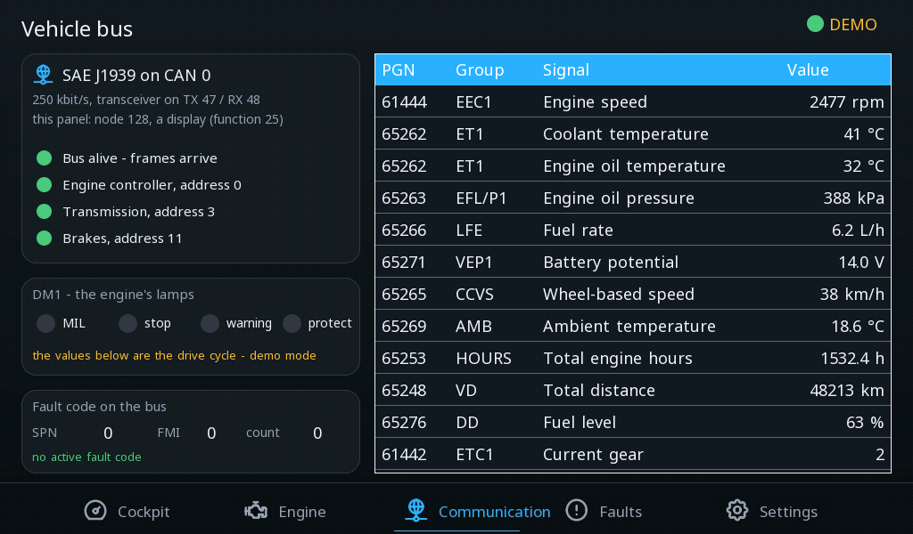
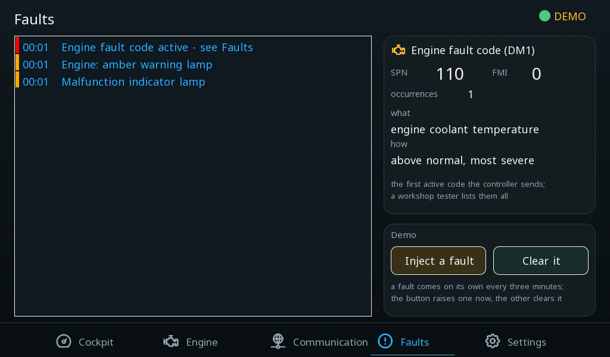
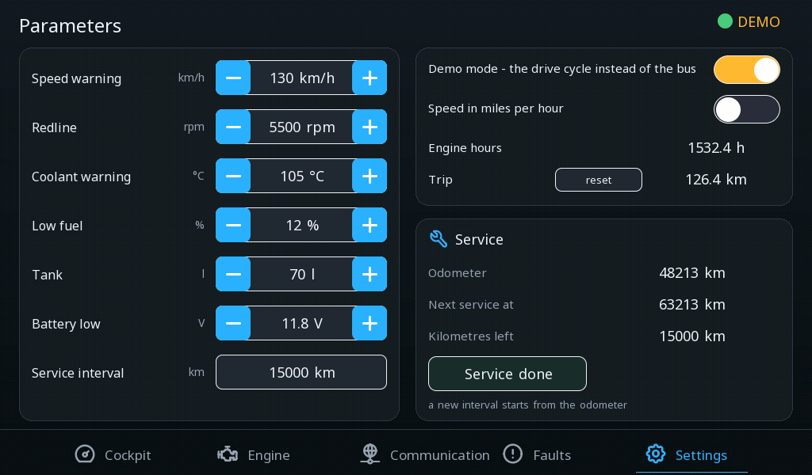

# Car cockpit — an instrument cluster on the vehicle bus

A driver's view on a 7" panel: the speed and the engine speed on two
gauges, the gear, fuel, coolant, the battery, the odometer and the trip,
the turn signals and a row of warning lamps. Behind the glass the panel
is a node on the vehicle's **J1939** bus: the engine controller, the
transmission and the brakes broadcast their parameter groups and the
panel reads them — no program needed for a value to arrive. The faults
the engine reports land in the alarm list with their code spelled out,
and the limits a driver cares about are parameters kept on the panel.

!!! note "A vehicle bus is not a car's OBD port"
    SAE J1939 is the bus of trucks, buses, agricultural and construction
    machines, generator sets and boats — the parameter groups here (engine
    speed out of EEC1, coolant out of ET1, the fault lamps out of DM1) are
    the ones every such engine sends. A passenger car speaks over its
    diagnostic connector and that conversation is [Vehicle
    diagnostics](vehicle-diagnostics.md), on a Linux device.

---

## What it shows

{: .sb-center}

**The cluster.** Two gauges with their coloured scales and the redline,
tapered needles and large readouts, the gear in the middle (N, R or the
number), fuel and coolant as bars with their numbers, the battery
voltage, the odometer, the trip, the clock from the panel's own time and
the turn signals. Along the bottom twelve lamps: engine (MIL), stop,
warning, oil pressure, battery, coolant, fuel, parking brake, ABS, belt,
door and the high beam — each lit in its own colour while its variable
is true and dim otherwise. The scales, the
bezels, the words and the dim icons are one background picture per
screen; only the live parts draw over it (the same way as the [house
dashboard](examples.md)).

{: .sb-center}

**Engine.** Six round instruments the way a cabin shows them: the
temperature of the engine oil, of the transmission oil and of the
coolant; the oil pressure, the fuel delivery pressure and the boost.
Each face carries its green, amber and red bands, and the needle is a
`line` widget **turned by the value** (`rotate:` from −135° at the
minimum to +135° at the maximum), with the number underneath. The
values come out of ET1, EFL/P1, TRF1 and IC1.

{: .sb-center}

**Communication.** The bus the panel listens to: node 128 on CAN 0 at
250 kbit/s, and whether the engine controller (address 0), the
transmission (3) and the brakes (11) are talking — a controller is
alive while its values keep changing, two seconds of silence and its
lamp goes red and the alarm says so. The four DM1 lamps the engine
sends, the first active fault code, and a table of every signal the
panel reads with the parameter group it comes out of: EEC1, EEC2, ET1,
EFL/P1, LFE, VEP1, CCVS, AMB, HOURS, VD, DD, ETC1. Every row is a
variable with a J1939 source — the group, the start bit, the width, the
gain and the offset come from the shipped library
([Vehicle buses](vehicle-buses.md)).

{: .sb-center}

**Faults.** The alarm list on the left — the engine's lamps, a fault code,
a limit crossed, the bus silent — and on the right the engine's **active
fault code** out of DM1: the SPN and the FMI as numbers, the count, and
both in words (SPN 110 is the coolant temperature, FMI 0 is "above
normal, most severe"). In demo mode a fault comes on its own every three
minutes; the two buttons raise one now and clear it.

{: .sb-center}

**Parameters.** What a driver sets and the panel keeps over a restart:
the speed warning, the redline, the coolant and the low-fuel warning,
the tank, the battery limit, the service interval; demo mode and the
units (the speed in mph beside the gauge). The service block counts
down from the odometer and **Service done** — confirmed — starts a new
interval.

---

## How it is built

- **The bus fills variables.** Under `j1939:` the panel is a node with
  an address and a NAME; each control unit lists the groups it sends and
  each signal names the variable it lands in. Nothing else is needed for
  a value — the program only decides what the gauges show.
- **Two programs.** `SIM` is the drive cycle: it pulls away, shifts up,
  cruises, brakes and stops, burns fuel, warms the coolant, counts the
  kilometres, blinks the turn signal, and raises a fault now and then.
  `DASH` picks the source — the drive cycle in demo mode, the bus
  otherwise — computes the lamps against the parameters with hysteresis,
  watches each controller for silence, spells the fault code out, and
  runs the service counter.
- **Alarms on lamps.** Every alarm is `is_true` on a lamp variable the
  program sets, so a limit lives in a parameter the driver changes, not
  in the alarm's definition.
- **The fault code in words.** DM1 carries the lamps in its first two
  bytes and the first fault code in the next four: the SPN's three parts
  and the FMI are plain signals of the group; the program joins the SPN
  and sets one word variable per known code, and a label per word sits
  on the screen with `visible_if`.

---

## Worth copying

- **A warning lamp from one icon.** An icon's colour is its text colour,
  so a state that paints `fg` lights it: `state: { var: l_oil,
  true_color: "#E83A3A", false_color: "#343A46", paint: fg }` — one
  widget per lamp, no logic behind it.
- **A needle with a shape.** The gauge's own needle is a thin line; with
  `needle: false` and `show_value: false` the gauge keeps the arc and the
  cluster draws its own: three `line` widgets of falling width in one
  square rect centred on the hub, all with the same `rotate:`, and a
  `shape` ellipse as the hub; the number is a `value` in a 84 px digit
  face. A screen holds 64 widgets and a line is three of them (the line
  and its two points) — the six small dials take one segment each.
- **The scale outside the gauge.** The gauge draws the arc, the needle
  and the number; the coloured bands and the numbers around it are part
  of the background picture, placed with the gauge's own geometry (135°
  plus 270° of sweep, clockwise) so the needle points at them.
- **A round instrument from a line.** A `line` widget whose rect is
  centred on the dial and whose points run from just below the centre to
  the tip, with `rotate: { var, min, max, from: -135, to: 135 }`, is a
  needle on any face you draw; a small `shape` ellipse over the centre is
  the hub.
- **A keypad for a big number.** The service interval is an `input`
  (a tap opens the keypad); the others are spinboxes — a spinbox step
  stops at a few hundred.
- **Hysteresis in the program.** `IF cool > p_cool_lim THEN ... ELSIF
  cool < p_cool_lim - 4.0 THEN ...` keeps a lamp from flickering around
  the limit without a delay on the alarm.

---

## Something to try

- Press **Inject a fault** on the Faults screen and watch the coolant
  climb past its warning on the cockpit — then **Clear it**.
- Switch the speed to mph on the Parameters screen; the gauge keeps its
  scale in km/h and the number beside it changes.
- Turn demo mode off with nothing on the CAN pins: the controllers' lamps
  go red after two seconds and the alarm list says the bus is silent.