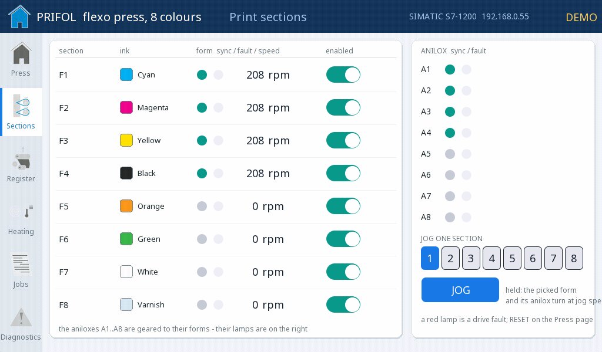
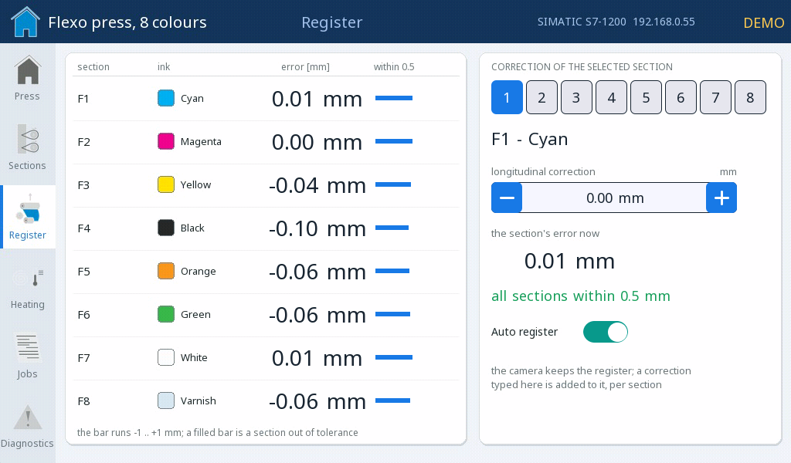
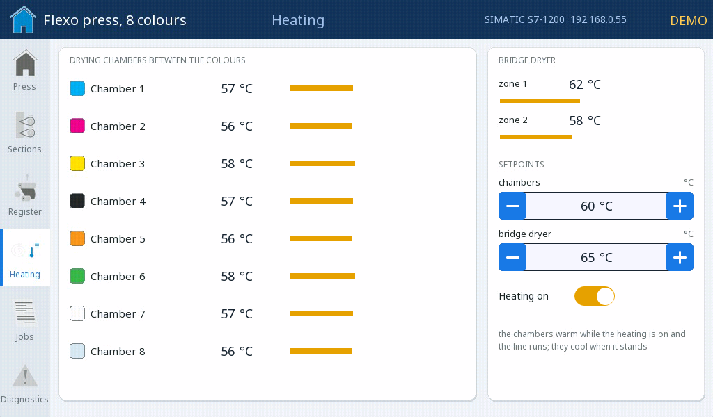
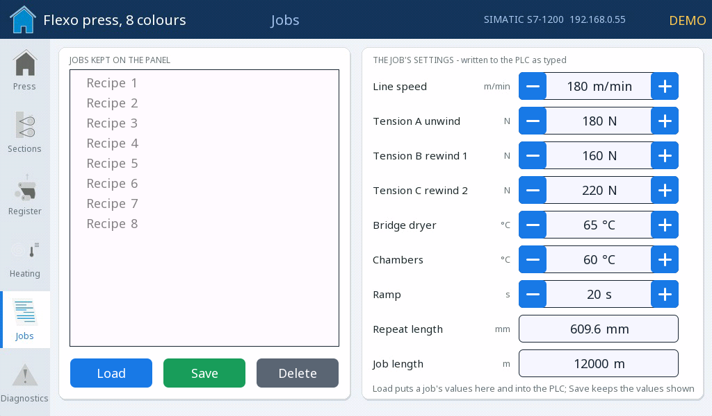
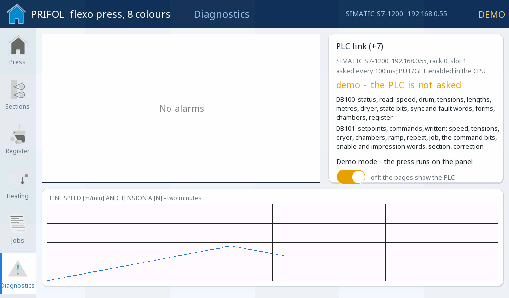

# Flexo press — the operator panel of a SIMATIC

An eight-colour central-impression flexographic press whose control is
a SIMATIC. The panel is its HMI over **+7**: it reads the
PLC's status block and writes the setpoints and commands — nothing else
is needed in the PLC, two data blocks and PUT/GET switched on. The look
is a light industrial panel: a navy header, the pages on a rail at the
left with the press's own pictograms, white cards, teal for running,
blue for a setting, red for a fault, and the eight print sections in
their inks. The press on the first page is the vector drawing of the
real press, and the web **moves** on it while the line runs.

{: .sb-center}

---

## What it shows

**Press.** The press as its own operator screen draws it — the unwind,
the central impression drum with the eight print sections around it
(each a form and its anilox), the bridge dryer, the tower with the two
rewinds. The web runs over all of it in magenta and moves while the
line runs. On the picture live: a lamp at each section, lit while its
form turns in sync with the drum; the two dryer zone temperatures on
the bridge; the tension and the metres on the roll at the unwind (A)
and at the two rewinds (B and C). Beside it START (confirmed), STOP,
JOG (held) and RESET, the line shaft switch (every section geared to
the drum), the press's state (stopped, ramping, running, jog, fault,
web break) and the web (register within tolerance, out of tolerance).
Under it the line speed in metres per minute with its setpoint and the
drum's turns, the three tensions as numbers and bars, and the job —
metres printed of the job length, the waste, the repeat, the ramp.

{: .sb-center}

**Sections.** The eight print sections F1 to F8 with their ink, each
with a sync lamp and a fault lamp, the speed of its form and a switch
that enables it — the switches are **bits of one word**, the lamps bits
of two more. The aniloxes A1 to A8 are geared to their forms and have
the same two lamps. **Jog one section**: pick a section on the row of
buttons and hold JOG — with the line standing, the picked form and its
anilox turn at jog speed, for washing or a plate change.

{: .sb-center}

**Register.** The longitudinal register error of every section in
millimetres, with a bar from minus one to plus one millimetre — a filled
bar is a section out of tolerance. The correction is typed for the
**selected section**: pick it, step the correction in hundredths of a
millimetre, watch the section's error now and whether all eight are
within half a millimetre; the auto register (the camera) keeps them
there, a correction typed here is added to it.

{: .sb-center}

{: .sb-center}

**Jobs.** The job is a **recipe** kept on the panel ([Recipes](recipes.md)):
line speed, the three tensions, the bridge dryer, the chambers, the
ramp, the repeat length and the job length. Load puts a job's values
into the fields — and into the PLC, because the fields are the PLC's own
variables; Save keeps what the fields show under a name; Delete asks
first.

{: .sb-center}

---

## The two data blocks

| Block | Direction | What is in it |
|:---|:---|:---|
| **DB100** | the panel reads it every 100 ms | `DBD0` line speed, `DBD4` drum speed, `DBD8` `DBD12` `DBD16` tensions A B C, `DBD20` `DBD24` `DBD28` metres on the rolls A B C, `DBD32` `DBD36` the bridge dryer's two zones, `DBD40` metres of the job, `DBD44` waste (both DINT), `DBX48.0`…`48.3` running / ramping / fault / web break, `DBW50` the sync word (bits 0–7 the forms F1–F8, 8–15 the aniloxes A1–A8), `DBW52` the fault word (the same bits), `DBD56`…`DBD84` the speed of the eight forms, `DBD88`…`DBD116` the eight chamber temperatures, `DBD120`…`DBD148` the eight register errors |
| **DB101** | the panel writes it as the operator types | `DBD0` line speed, `DBD4` `DBD8` `DBD12` tensions A B C, `DBD16` bridge dryer, `DBD20` chambers, `DBD24` ramp, `DBD28` repeat length, `DBD32` job length (DINT), `DBX36.0`…`36.7` start / stop / jog / reset / line shaft on / heating on / auto register / section jog, `DBW38` the sections enabled (a bit each), `DBW40` the sections in impression, `DBW42` the selected section 0–7, `DBD44` its correction |

The +7 client reads up to **64 variables** of a PLC — this project uses
63 of them. That is why the lamps are bits of words and the register is
corrected for one selected section at a time: a plain variable for every
lamp, switch and correction would not have fitted, and a real press has
far more than that behind one HMI.

---

## How it is built

- **The pages bind the PLC's variables directly.** No copy in between:
  a value on a card is `DB100.DBD0`, a switch writes a bit of
  `DB101.DBW38`. In demo mode the program `SIM` writes the READ
  variables itself (the speed, the tensions, the metres, the forms'
  speeds, the words...), so the same pages show the press on the panel.
- **A bit of a word.** A `led` or a `switch` with `bit: 3` reads or
  writes one bit of an integer variable — sixteen sync lamps, sixteen
  fault lamps and eight enable switches on three words.
- **The moving web.** The first page's press is an `anim_image` with two
  frames — the drawing with the web at two phases of its dashes — and
  `tag: web_ph` picks the frame; the program `DASH` swaps `web_ph` every
  quarter of a second while the line runs, and the web reads as moving.
- **Alarms on lamps.** `DASH` derives the lamps (`l_webbreak`,
  `l_drv_flt`, `l_plc_lost`, ...) and every alarm is `is_true` on one;
  the PLC-silent alarm is quiet in demo mode on purpose.
- **The mimic is a picture.** The press is the vector drawing of the
  real press (the file its own operator screen is made of), rendered by
  the generator (`tools/gen_flexo.py`) into the two frames with the
  prepared web layers over it; the lamps, the temperatures and the
  tensions are live widgets placed on it by the drawing's own
  coordinates. The pictograms on the rail come from the same set.

---

## Something to try

- Press START (and confirm) with the line shaft on: the speed ramps to
  the setpoint over the ramp time, the web starts moving on the picture,
  the forms of the sections in impression turn and their lamps go green,
  the metres count.
- Switch a section off on the Sections page: its form stops, its lamp
  and its anilox's lamp go grey.
- With the line standing, pick section 3 and hold JOG: that one form and
  its anilox turn, nothing else.
- Wait six minutes of running: the web breaks, the press stops, one
  drive shows a fault, the alarm list says so; RESET clears it.
- Type a correction for a section on the Register page and watch its
  error move by it; switch the auto register off and watch the errors
  drift.
- Save a job under a name, change the speed, Load the job back.