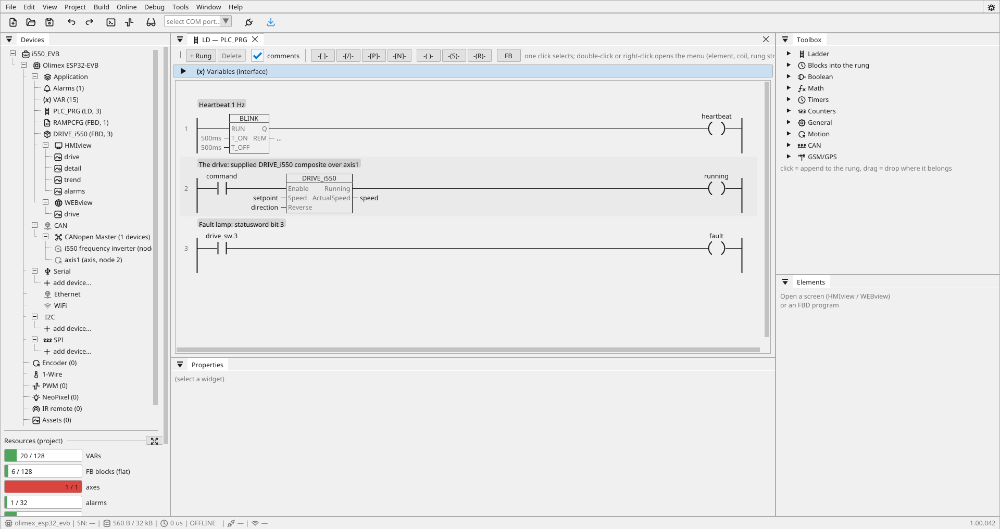
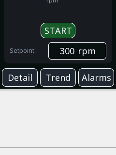
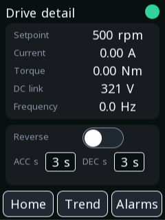
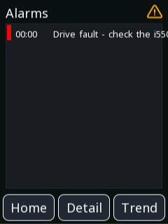

# Drive control — Lenze i550

A frequency drive on CANopen, driven from the EVB's 2.8" portrait glass
and mirrored to a phone: a speed dial with START/STOP, a keypad
setpoint, live current, torque, DC link and output frequency read from
the drive's own objects, a trend and an alarm — all without a single
line of communication code.

**Project:** `examples\i550_EVB.prj32`
**Board:** Olimex ESP32-EVB with a MOD-LCD2.8RTP, 240×320 portrait
**Needs:** a Lenze i550 on the CAN bus (node 2, 500 kbit/s) — or
nothing: the screens run without it, the fault lamp is simply lit

!!! warning "The motor is real"
    The drive starts **only** after START is pressed — a deliberate
    command, never a side effect of downloading. And stopping over
    CANopen is **not** a safety function: an emergency stop belongs on
    the i550's STO terminals, hard-wired. See
    [motion blocks](blocks-motion.md).

---

## What it shows

The complete shape of a drive project: one supplied block does the
CiA 402 state machine, the drive's diagnostics arrive as plain
variables with a gain, and everything on the screens — the dial, the
lamps, the alarm — just reads them. The phone page is the same
variables again over [WEBview](webview.md).

---

## The drive on the bus

The i550 is added from the device list — its profile brings the PDO
layout along — and `axis1` binds it as node 2. Two things the profile
does that are easy to miss:

- The i550 ships with **Lenze's own state machine active**, not
  CiA 402. The profile switches the mode itself over SDO at startup,
  so the drive reacts to the controlword from the first command. (If
  you have ever written correct values into 0x6040 and watched nothing
  happen — that was this. See [CANopen](canopen.md).)
- **TPDO1 starts with the statusword and the actual speed** — the
  profile reads those four bytes for the state machine. Everything
  after them is ordinary data, which is where the diagnostics below
  ride.

Node address and bit rate are set by DIP switches on the drive itself.

### Diagnostics without code

Four variables read the drive's own objects straight from the PDOs —
`source: canopen`, an index and a gain, no logic anywhere:

| Variable | Object | Gain | Shows |
|:---|:---|:---|:---|
| `current` | 0x6078 | ×&nbsp;0.0016 | motor current in A |
| `torque` | 0x6077 | ×&nbsp;0.001177 | torque in Nm |
| `dc_voltage` | 0x6079 | ×&nbsp;0.001 | DC link in V |
| `frequency` | 0x2DDD | ×&nbsp;0.1 | output frequency in Hz |

The drive publishes per-mille of its **rated** values, so the gains
come from the nameplate: rated current 1.6 A gives 0.0016, rated
torque 1.177 Nm gives 0.001177. Every one carries a deadband, so a
standing motor does not repaint the screen with noise.

One worth knowing: **0x2DDD is the actual output frequency**. The
neighbouring 0x2D87 is the setpoint *after the ramp* — it looks alive
and correct right up until the load slips.

The statusword itself is a variable too (`drive_sw`), and the fault
lamp is one rung of bit access: `drive_sw.3` — CiA 402 bit 3 — into
`fault`. The same bit drives the alarm.

---

## The logic

{: .sb-center}

Three rungs and a helper:

1. **A heartbeat** — BLINK at 1 Hz onto a lamp. Anybody at the panel
   can see the program is alive.
2. **The drive** — the supplied `DRIVE_i550` composite over `axis1`:
   `command` enables it, `setpoint` is the speed, `direction` reverses,
   and it hands back `running` and the actual `speed`. The whole
   CiA 402 state machine is inside the block. See
   [composite blocks](fbd-composites.md).
3. **The fault lamp** — `drive_sw.3` into `fault`, which the alarm and
   both fault LEDs read.

The ramp times live in **RAMPCFG**, a one-block FBD program:
`CO_RAMPTIME` writes `acc` and `dec` to the drive, and since it has no
output pin — and a ladder rung must anchor on one — it gets a small
FBD program of its own instead of a rung.

---

## The screens

{: .sb-center}

**Drive.** The dial is the actual speed, START/STOP is one toggle
button — green START at rest, lit red STOP while running — and the
setpoint opens a keypad, clamped to 0–1500 rpm. The written value
**persists across power cycles** (`persist: true`), which is why this
capture from a running bench shows the last written 500 rpm rather
than the project default. Three lamps in the corner: running, fault,
heartbeat.

{: .sb-center}

**Detail.** The four diagnostics with the setpoint, plus the reverse
switch and the ramp times. This capture is a live bench: the motor
stands (0.00 A, 0.0 Hz) and the DC link sits at 314 V — real numbers
from the drive's own objects, no code behind them.

**Trend.** The actual speed over the last 60 seconds, sampled every
250 ms and recorded in the board, with the speed and current readable
as numbers below the chart.

{: .sb-center}

**Alarms.** One alarm: the fault bit, 200 ms of delay so a bus hiccup
does not ring the bell. This capture is the simulation — without a
drive on the bus the statusword reads −1, bit 3 included, so the fault
raises itself. The same happens on real hardware with the drive
unplugged, which is exactly what you want a fault lamp to do.

---

## The phone mirror

---

## Worth copying from it

- **diagnostics as data variables.** An object index and a gain
  replace what would elsewhere be a page of polling code. Any value
  the device publishes in a PDO can become a variable this way.
- **the fault lamp from a statusword bit.** `drive_sw.3` — bit access
  in a rung, no masking blocks.
- **a setpoint that survives power cycles.** One flag on the variable.
- **START/STOP as one toggle button** with `text_on` — the caption and
  the colour swap together, so the button always names the action it
  will take.
- **blocks without output pins get a small FBD program**, not a forced
  rung.

---

## Try changing

- the ramp times from the detail screen — the drive re-ramps on the
  next start, no download needed
- add the motor voltage: 0x2D89 already arrives in TPDO2, so it is one
  new variable with `gain: 0.1` and one value widget
- the dial's `max` to your motor's actual range — the input clamp and
  the trend scale are separate `min`/`max`, change them together

---

| | |
|:---|:---|
| [Examples](examples.md) | back to the list |
| [CANopen](canopen.md) | the bus, profiles and PDO mapping |
| [Composite blocks](fbd-composites.md) | what DRIVE_i550 is made of |
