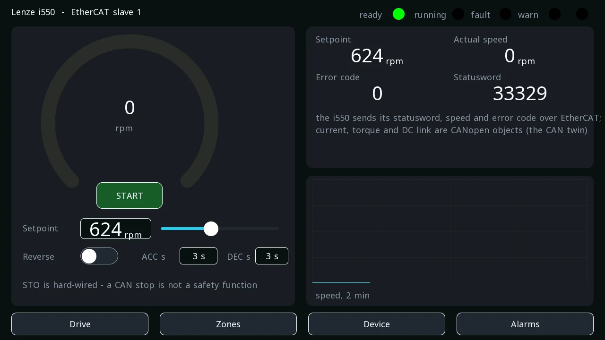
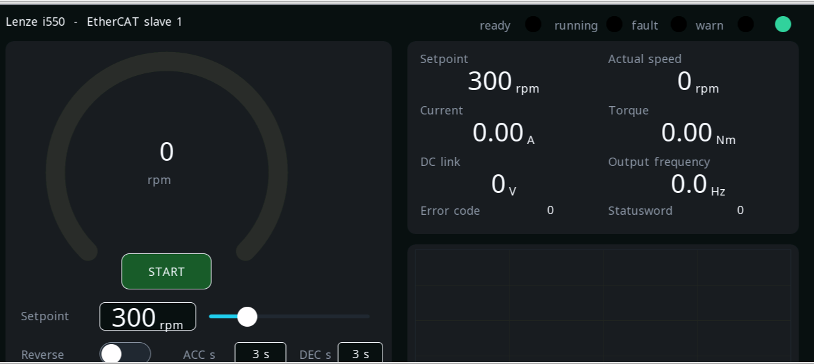
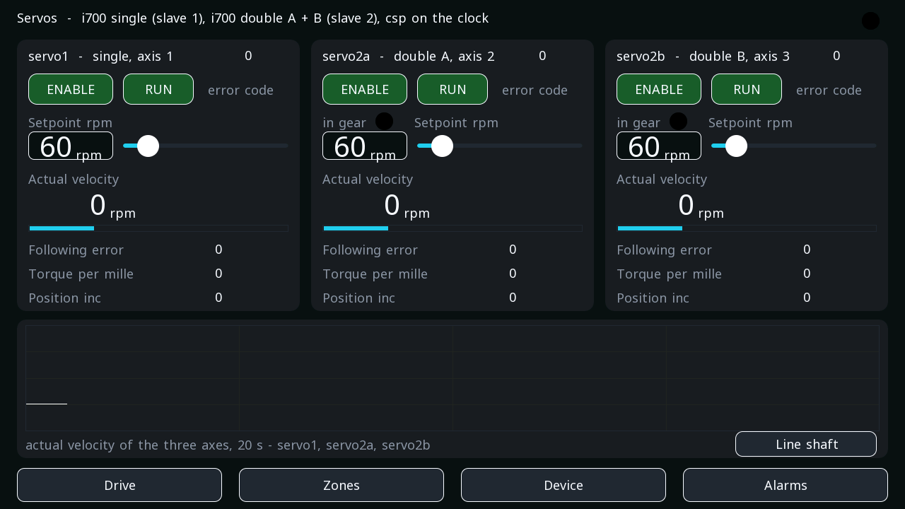
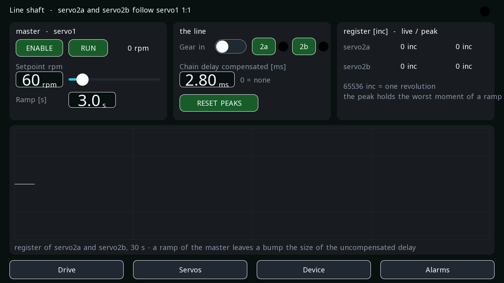
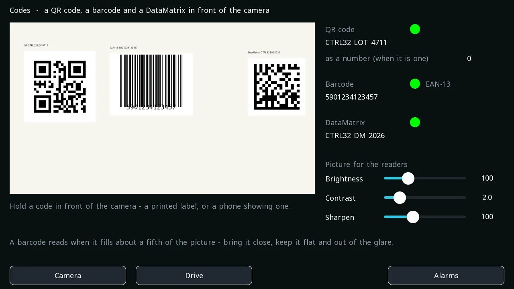

# reTerminal — the same, with the drive on EtherCAT

The [reTerminal example](example-reterminal.md) with one change: the
Lenze i550 hangs on the E10-1's second network port as an **EtherCAT
slave** instead of its CAN terminal. The screens, the RS-485 pair, the
device page and the alarms are the same project; the drive's part
shows what moving a drive from one bus to the other costs — a few
lines.

**Project:** `examples\reterminal_ecat_example.prj32`
**Board:** Seeed reTerminal (CM4) with the reTerminal E10-1 expansion
**Needs:** a Lenze i550 with its EtherCAT module on the E10-1's second
network port, and the two slaves of the [RS-485 system](example-rs485.md)
on its RS-485 terminal — or nothing: the screens run, the lamps stay dark.
The line in the file also carries **two Lenze i700 servo inverters** ahead
of the i550 (a single and a double); without them the master reports
the missing slaves and the i550 alone does not run - remove the two
slaves and their axes, or put the same drives on the line

!!! warning "The motor is real"
    The drive starts **only** after START is pressed and confirmed.
    Stopping over EtherCAT is **not** a safety function: the emergency
    stop belongs on the i550's STO terminals, hard-wired.

---

## What changes

{: .sb-center}

{: .sb-center}

- **The axis** names the EtherCAT backend and the slave's position on
  the bus instead of a CANopen node: `backend: cia402_ecat, node: 3` -
  the i550 is the third slave, after the two servos.
- **The slave comes from its ESI.** The i550's description sits in the
  device library; *Add from library* on the EtherCAT page fills the
  identity, the image sizes, the CiA 402 layout and the error-code
  signal — the section below is what that produces, plus the mapping.
- **An `ethercat:` section** describes the line: the cycle, the slave
  (vendor and product so a wrong device is refused), its image sizes,
  the SDO writes that put the drive under network control, and the
  **signals** — which bytes of the slave's input image land in which
  variable. The statusword and the error code are two such signals.
- **The device's setting** `ecat=eth1` names the interface — written
  from the editor's board window, like the serial port.
- **What the drive sends** is partly fixed — statusword, actual
  velocity, error code — and partly the master's choice: the i550 has a
  user-configurable process data object, and the `sdo_init` list maps
  current, torque, DC link and output frequency into it at every start
  (the assignment cleared first, the mapping written, then the
  assignment set to both objects). The list declares the assignment of
  the fixed receive object as well — a drive that lost either one, say
  switched off and on while the master was configuring it, is set right
  at the next start instead of refusing every output image. Four more
  signals with a gain, and the screen shows the same numbers as the CAN
  twin.

The `DRIVE_i550` block, the confirmation on START, the setpoint by
keypad or slider, the ramps, the lamps from statusword bits, the trend,
the pair, the device page and the alarms: unchanged.

---

## The servos

The two i700s are servo inverters and run **cyclic position mode**
(csp): the device computes the position setpoint every cycle and the
drive follows it, so the line runs on the **distributed clock** at
1 ms (`cycle_us: 1000`, `dc: true`); the i550 has no use for the clock
and stays synchronous to its process data, which the console says at
start.

Each servo slave is what *Add from library* produces for an i700: the
mode `csp`, only the csp pair of process data objects assigned (the
start-up writes declare it), and the offsets of the 32-bit words - the
target position, the velocity feed-forward and the mode in the 17 bytes
the drive takes, the actual velocity and the actual position in the 21
it sends. The double inverter carries **two axes in one slave**: its
record says where axis B's words begin (`stride_out: 17`,
`stride_in: 21`) and the axis on it says `sub: 1`. Three signals per
axis read the error code, the actual position and the following error
into variables.

{: .sb-center}

The **servo screen** (the *Servos* door on the drive screen; the
browser shows the same screens as the glass) puts the three axes side by side: enable and run
with a confirmation, the setpoint by keypad or slider, the actual
velocity with a bar, the following error, the torque and the position
straight from the drive's words, the error code - and one trend of the
three actual velocities at 50 ms. A well-tuned axis draws a flat line;
one whose loop hunts draws a band, which is what the screen is for: the
drive's loops are tuned against it (the current, speed and position
controller settings are start-up writes of the slave, so a setting
found on the bench is written at every start).

Three axes - `servo1` on the single, `servo2a` and `servo2b` on the
double - are commanded by the `SERVO` program, three lines per axis:

```
pw1(AXIS := 1, Enable := s1_en);
mv1(AXIS := 1, Execute := s1_go, Velocity := s1_rpm);
rd1(AXIS := 1, Enable := TRUE);
s1_act := rd1.Velocity;
```

`MC_Power` enables the drive, `MC_MoveVelocity` sets the velocity - the
device ramps it and integrates it into the setpoint the drive follows -
and `MC_ReadActualVelocity` reads the actual velocity back. The variables
`s1_en`, `s1_go` and `s1_rpm` are what the servo screen's buttons and
slider write; the program is there to be copied.

---

## The line shaft

{: .sb-center}

The same program gears the double's two axes to the single with
`MC_GearIn` - ratio 1:1, the master's measured position every bus
cycle - and reads each follower's **register** (its actual position
against the master's, in increments; 65536 = one revolution) into a
variable, with a peak the RESET PEAKS button clears. `CO_RAMPTIME`
gives the master its ramp, so a run is a real profile: ramp up, hold,
ramp down. The *Line shaft* screen (the door on the servo screen) has
the master's run and ramp, the gear switch, the delay the followers
compensate, the two registers live and at their peaks, and a trend of
both.

What the bench measured with it, the followers at 1:1. The chain delay
first - one run per bus cycle with the compensation off, the register
in the hold divided by the master's velocity:

| bus cycle | delay found at 60 rpm | at 300 rpm | at 600 rpm |
|:---:|:---:|:---:|:---:|
| 2 ms | | 4.5 ms | |
| 1 ms | 3.0 ms | 3.1 ms | 3.0 ms |
| 500 µs | | 2.3 ms | |
| 250 µs | | 1.7 ms | |

The delay does not depend on the speed - it is a property of the chain
(the drives' input latch, their velocity filter and loop, the bus's
sampling and applying) - and it shrinks with the cycle, roughly 1.2 ms
plus 1.7 cycles. Without the compensation the register is the velocity
times that delay: −1058 increments at 300 rpm on the 1 ms cycle, −1993
at 600 rpm, 1.4 times as much on a 2 ms cycle - the error a press shows
as colours running away during ramps. The delay is found the way the
table shows: one run with the compensation off, the hold's register
divided by the velocity in increments per second; the screen's peak
values make the run a matter of reading two numbers.

With the delay set, what remained was a spike of ~230 increments at the
START of every ramp - the followers' own loop taking up the breakaway,
the same size at 20, 100, 300 and 600 rpm/s, so it is not the
acceleration. The position controller gain is the lever (1 ms cycle,
300 rpm in 3 s):

| position controller gain (0x2980) | spike at the ramp start | register through the ramp | in the hold |
|:---|:---:|:---:|:---:|
| 28.4 1/s (the drive's own number for the motor) | −225 | ±60 | +60 |
| 50 1/s | −137 | ±100 | +85 |
| 80 1/s (the example's setting) | −17 | −45..+126 | +5..+110 |

A gain of 120 1/s was taken by the drive and was worse - the follower
lagged half a millisecond more - so 80 is where the example stops. It
ships 80 1/s and a delay of 2.8 ms; the delay is re-measured after any
change of a drive's loops, because the number the hold implies includes
the follower's response. What is left - a few tens of increments that
differ from run to run, the same size as the two drives' own following
errors in the hold - is the drives' speed loops, and that is tuned on
the real machine with its motors and loads. Through all of it the bus
stayed clean: no lost frame, no overrun, the worst wake-up under 30 µs
at 1 ms and 250 µs alike.

### The virtual master

A printing machine's drum is a drive that lives its own life: it gets
a velocity and a ramp, nothing more. Its position is measured - the
encoder on the drive's input B - and everything else derives from that
measurement. The example has that shape: the axis `vm` is a **virtual
master** with no drive behind it that follows servo1's actual position
signal (the stand-in for the drum's encoder), servo1 runs on its own
velocity command and ramp, and the double's axes gear to `vm` with the
chain delay compensated. The line screen's *Master source* switch
compares that with gearing to servo1 directly, and the *register vs
drum* row reads the followers against servo1 from the positions
themselves, whichever master leads.

What the bench read, 1:1, the delay 2.8 ms compensated:

| master | 300 rpm, in the hold | 600 rpm, in the hold | after the stop |
|:---|:---:|:---:|:---:|
| servo1 directly | −100 / −99 inc | −98 / −138 inc | 0 |
| the virtual master reading its encoder | −37 / −65 inc | −108 / −123 inc | 0 |

The virtual master adds nothing to the error - the counter it reads is
the same word the direct master reads - and the followers stay
position-locked to the measured drum: after a run the register is
where it was, no drift. The same axis can instead run a profile of its
own (no source named) for a line where the drum too is geared in
position; a drum that follows a velocity only, measured the same
evening, ran 4 500 increments off its followers at 300 rpm and drifted
with every stop - which is why the drum is measured.

### Jobs

[The line shaft, step by step](tutorial-line-shaft.md) walks this part
of the project from the first servo to the jobs.

A printing job is a speed, a ratio per colour and a phase per colour.
The example keeps them as a **recipe** named `job` (the *Jobs* screen,
on the glass and in the browser): the master's setpoint, the two
followers' ratios as numerator and denominator, and their phases in
increments of the follower's revolution. The followers gear to the
virtual master through `MC_GearInPos` with the job's ratio and phase:
at gear-in each follower moves the shortest way into "master at 0,
follower at its phase", a phase edited on the screen while the line
runs is a smooth move to the new relation (the register trim), a ratio
loaded from another job is applied the moment the line stands still.
The job's values are persisted, so after a restart the same numbers
are in the variables and the next gear-in finds the same relation -
the drives' positions are absolute, nothing has to be homed. *Load*,
*Save* and *Delete* act on the row selected in the table; the two lamps
say when a follower is in its relation.

The line screen's *acc FF gain* field is the followers' acceleration
feed-forward (`MC_TorqueFF`, one gain for both, 0 = off) and the two
*offset* values show the torque offset each follower writes to its
drive. On the bench the field stays at 0: a bare motor's inertia
torque is under a per cent even at 25 revolutions per second squared,
so no gain moves the register here. On a press the plate cylinder is
the inertia, and the gain is found there: raise it until the register
stops dipping at the start of a ramp, and stop before it overshoots.
The motors are real. The bench feeds the i700s single-phase from 230 V,
so their start-up writes set the rated mains voltage to 230 V
(`0x2540:1 = 0`; on a 400 V supply drop the line): with the 400 V
default the DC link of such a supply sits between the drive's
undervoltage error and its reset threshold, and every enable answers
the error 0x3220 while everything else looks healthy. The start-up
writes also carry the **motor**: the MCS06C60's catalogue row in the
drive's units (resistance, inductance, rated speed and frequency, power,
voltage, the back-EMF constant, the inertia, rated current and torque)
and the loops for it - the current controller's gain scaled to the
motor's inductance, the speed and position controller gains - because
an i700 keeps nothing at power-off. On the factory set (another motor
with four times the inductance) the axes turned but hunted at low speed;
with their own row every axis holds its setpoint within a few tens of
increments. The double inverter's second axis takes the same objects
0x800 higher. Another motor: its catalogue row in place of these lines.

---

## Reading codes

The **Codes** screen (a button on the camera screen's title row) reads
a **QR code, a barcode and a DataMatrix** from the line's camera.
Hold a code in front of the camera — a printed label, or a phone
showing one — and the text appears within half a second, with a lamp
for "found", the barcode's kind beside it (EAN-13, Code 128, ...) and
the QR's value as a number when it is one (an EAN-13 label reads as
its thirteen digits — as text: thirteen digits do not fit a number
exactly, so a barcode's value is its text).

The screen shows **two pictures**: the camera on the left, with a
green frame marking the **reading area** — the middle of the picture,
a Crop block the readers work on, so a code held elsewhere does not
count and the search costs a quarter — and, on the right, that area
as the readers get it, the Sharpen block's picture, live (a camera
element whose text names the block as `prep.shp`). Under them
sit three sliders — **Brightness, Contrast, Sharpen** — for that
prepared picture, neutral by default (100, 0, 1 = the camera's own
picture): a glossy label under a lamp wants less light, a soft picture
a little more edge, and the right-hand picture shows the effect at
once — a slider turned too far turns a dim scene into grain no reader
can use. They are variables the blocks read before every run, kept
over a restart.

{: .sb-center}

Behind it are two more vision programs. `prep` runs every 100 ms:
the camera, then **Gamma**, **Stretch contrast** and **Sharpen** with
their settings bound to the sliders' variables (`gamma: "@rd_gamma"`)
— its Sharpen block is the right-hand picture. `codes` runs every
400 ms with the same three blocks and three **Read code** blocks on
the prepared picture (a reader takes a few hundred milliseconds; a
preview at that pace would stutter, so it has its own program) — one
set to *qr*, one
to *barcode* (every one-dimensional code: EAN, UPC, Code 128, Code 39,
ITF, Codabar, GS1 DataBar) and one to *datamatrix*. Their answers are
variables — `qr_found`, `qr_text`, `qr_number`, `bar_found`,
`bar_text`, `bar_kind`, `dm_found`, `dm_text` — so a rung can compare
a lot number, a recipe can be picked by what the label says, and the
browser shows the same text. The *text* of a code lands in a
**STRING** variable, a kind only a Linux device has; the *expect*
setting of a Read code block is empty here, so any code counts — put
a text there and *match* says whether the code carries it. A Read
code block also knows *pdf417*, *aztec* and *any* (every kind at once,
the *format* output naming what it read).

A barcode reads when it is about a fifth of the picture wide or more
— bring a small label close, keep it flat and out of the glare.
The program runs every 500 ms, on its own thread beside the PLC: a
picture nobody had time to read is dropped, never a cycle.

## Worth copying

- **A bus is a section, a drive is an axis.** The program never knows
  which bus its axis rides; `MC_Power` and `MC_MoveVelocity` inside
  `DRIVE_i550` are the same blocks over CANopen and over EtherCAT - and
  the same blocks command a servo in csp.
- **Signals, not code.** A byte range of a slave's image, a variable,
  a gain — that is the whole of reading a drive's or a terminal's data.
- **Vendor and product in the slave.** With them the runtime refuses
  to run the line when the wrong device sits at that position, instead
  of writing a controlword into it.

How a line is put together, device by device:
[EtherCAT](ethercat.md).

---

## The same board, four buses

The reTerminal carries this project on all four, and the pages differ
only in how it talks to the machine:

- [the drive on CANopen](example-reterminal.md),
- [the drive on EtherCAT](example-reterminal-ecat.md),
- the same line with four drives: `reterminal_ecat_4x.prj32` in the
  examples (position on the line = axis number, a screen with a column
  per drive),
- [two slaves on an RS-485 pair](example-rs485.md),
- [a SIMATIC over ethernet](example-reterminal-s7.md).

---

*EtherCAT® is a registered trademark and patented technology, licensed by Beckhoff Automation GmbH, Germany.*
