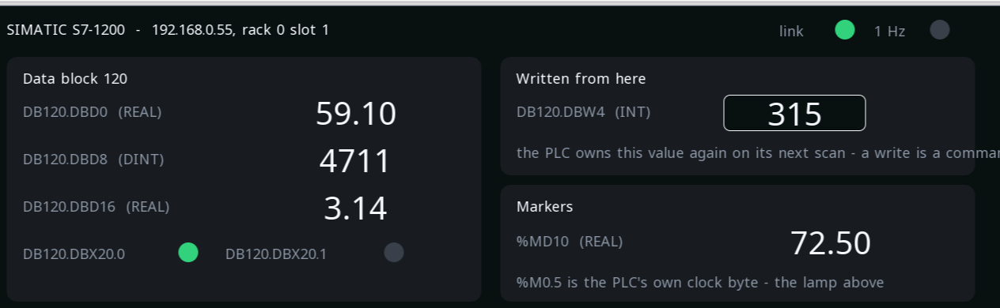

# reTerminal — the panel of a SIMATIC

The same board again, and this time no fieldbus at all: the PLC is a
**SIMATIC S7-1200** on the same ethernet, and the reTerminal is its
operator panel. It reads a data block live, writes one value back, and
watches the PLC's own clock bit to know the controller is alive.

**Project:** `examples\reterminal_s7_example.prj32`
**Board:** Seeed reTerminal (CM4)
**Needs:** an S7-1200 or S7-1500 reachable on the network, with
**PUT/GET** allowed in its protection settings — or nothing: the
screens run and the link lamp stays dark

---

## What it shows

{: .sb-center}

**A data block, read live.** A REAL, a DINT, a second REAL and two
bits out of `DB120`, each with the PLC's own address printed beside
it, so the screen doubles as the map between the two sides.

**One value written back.** `DB120.DBW4` is an INT the operator types
here and the PLC receives. A write is a command, not a force: the PLC
owns the value again on its next scan.

**The markers.** A REAL at `%MD10`, and `%M0.5` — a bit of the
controller's own clock byte. That lamp blinking is the simplest proof
there is that the PLC is in RUN and the link is alive.

**The panel's own life.** A counter running in the reTerminal's
program, beside the PLC's values. When the two disagree — the counter
moving, the PLC's values frozen — the fault is on the network, not in
the panel.

---

## Worth copying

- **No mapping table.** A variable names the area, the block and the
  offset, and that is the whole configuration. There is no tag list to
  keep in step on two sides.
- **The address in the label.** Writing `DB120.DBD0` beside the value
  costs nothing and saves the next person half an hour.
- **A link lamp and a life counter.** Together they say which of the
  two machines stopped.
- **PUT/GET is a setting in the PLC.** An S7-1200 refuses this
  connection until it is allowed, and the refusal looks like a network
  fault. Check it first.

---

## Something to try

- Type a value into `DB120.DBW4` and watch it in the PLC's own
  monitoring table.
- Stop the PLC. The link lamp goes out, the alarm arrives after three
  seconds, and the panel's counter keeps running.
- Add a variable of your own: the area, the block, the offset, and it
  is on the screen.

---

## The same board, four buses

The reTerminal carries this project on all four, and the pages differ
only in how it talks to the machine:

- [the drive on CANopen](example-reterminal.md),
- [the drive on EtherCAT](example-reterminal-ecat.md),
- [two slaves on an RS-485 pair](example-rs485.md),
- **a SIMATIC over ethernet** — this page.
