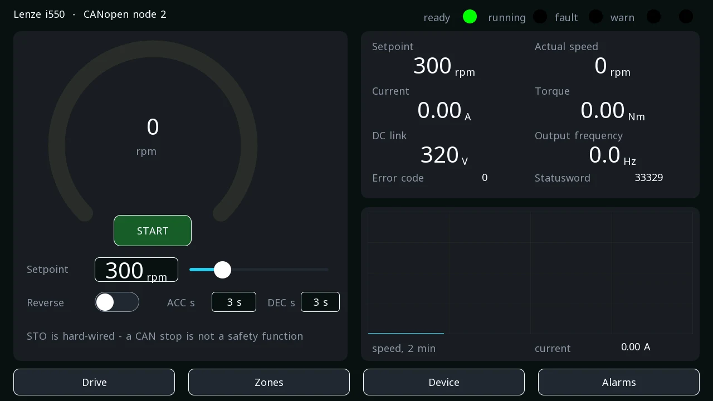
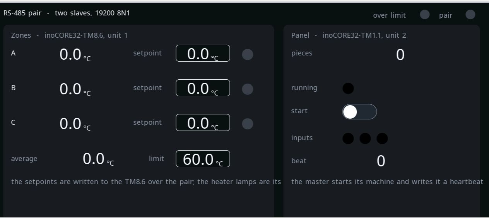
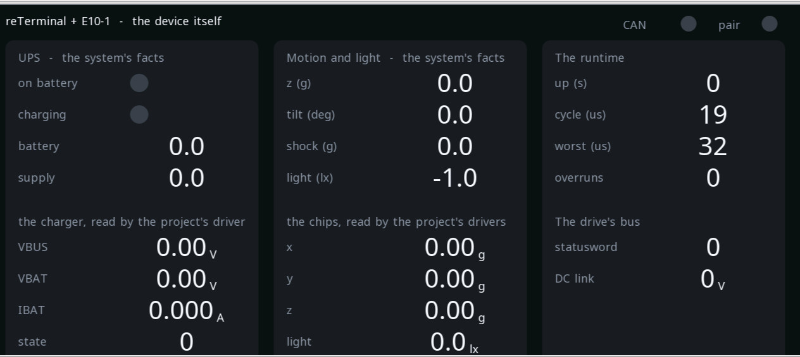

# reTerminal — a drive, a pair and the device itself

A Linux device doing everything at once: a frequency drive driven over
CANopen from one screen, two Modbus RTU slaves on an RS-485 pair, the
device's own UPS and sensors, alarms — on a 1280×720 glass and on a
phone.

**Project:** `examples\reterminal_example.prj32`
**Board:** Seeed reTerminal (CM4) with the reTerminal E10-1 expansion
**Needs:** a Lenze i550 on the E10-1's CAN terminal (node 2, 500 kbit/s)
and, on its RS-485 terminal, the two slaves of the
[RS-485 system](example-rs485.md) — or nothing: the screens run without
them, the lamps simply stay dark

!!! warning "The motor is real"
    The drive starts **only** after START is pressed and confirmed — a
    deliberate command, never a side effect of downloading. Stopping
    over CANopen is **not** a safety function: an emergency stop belongs
    on the i550's STO terminals, hard-wired. See
    [motion blocks](blocks-motion.md).

---

## What it shows

{: .sb-center}

**One screen, the whole motor.** The supplied `DRIVE_i550` block does
the CiA 402 state machine over the axis; everything on the screen just
reads and writes variables: the speed dial, START/STOP with a
confirmation, the setpoint by keypad or slider, direction, the ramps,
live current, torque, DC link, output frequency and the drive's error
code — all of them CANopen objects the drive sends in its PDOs, with a
gain — the CiA 402 lamps (ready, running, fault, warning) from bits of
the statusword, and a two-minute trend.

{: .sb-center}

**The RS-485 pair.** The E10-1's serial port masters two slaves — a
TM8.6 with three temperature zones whose setpoints are written from
this screen, and a TM1.1 panel whose machine this screen starts. The
same slaves and the same registers as the RS-485 system example.

**The device itself.** The UPS (on battery, charging, the pack and the
supply voltage), the accelerometer and the light sensor — twice: as the
system's own facts (`SYS.ON_BATTERY`, `SYS.TILT`, `SYS.LIGHT`, …) and
as chips read by the project's own drivers over I2C — and the cycle
(time, worst, overruns).

{: .sb-center}

**Alarms.** The drive's fault, a zone over the limit, the supply gone,
the pair or the CAN interface silent.

The device's serial port, the way its RS-485 transceiver is driven and
its CAN interface are **settings of the device**, written from the
editor's board window — not lines in the project.

---

## Worth copying

- **Diagnostics without code.** `current`, `torque`, `dc_voltage`,
  `frequency`, `error_code` are plain variables with a CANopen source
  and a `gain` — the PDO mapping under `can_devices` says which objects
  travel; the screen only names variables.
- **A lamp from one bit.** `drive_sw.3` is the fault bit of the
  statusword: an AND block with it on one input makes the `fault`
  variable the lamp and the alarm read.
- **A confirmed command.** `confirm: true` on the START button is not
  cosmetics on a machine — a false touch next to a drive happens.
- **The system's facts beside the chips.** The same accelerometer read
  both ways shows what the facts cost: nothing — the runtime reads them
  anyway; the project's driver is for the values a program needs at
  full rate.

---

## Something to try

- Change a zone's setpoint on the Zones screen and watch the TM8.6's
  heater lamp follow.
- Pull the supply plug: the Device screen shows the battery taking
  over, and the alarm appears.
- Add a third RS-485 slave: one more block of variables naming
  `unit: 3`.

---

## The same board, three buses

The reTerminal carries this project on all three, and the three
pages differ only in the bus:

- [the drive on CANopen](example-reterminal.md),
- [the drive on EtherCAT](example-reterminal-ecat.md),
- [two slaves on an RS-485 pair](example-rs485.md).
