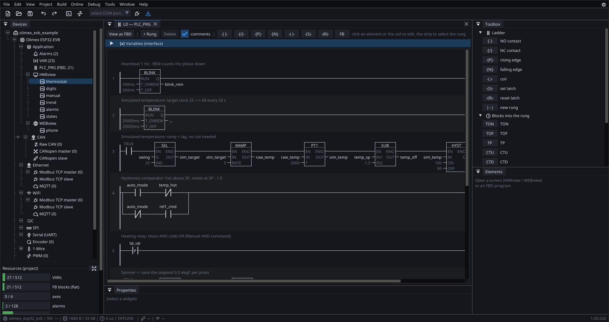
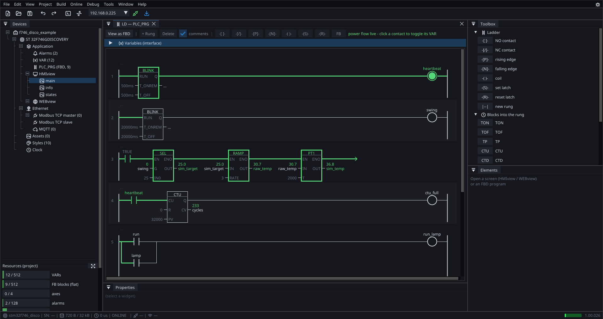
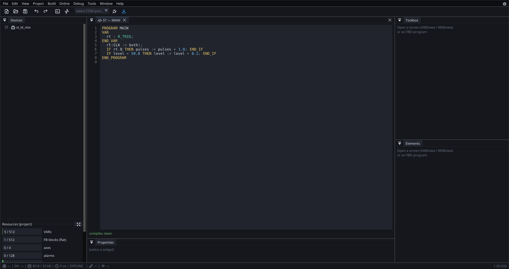
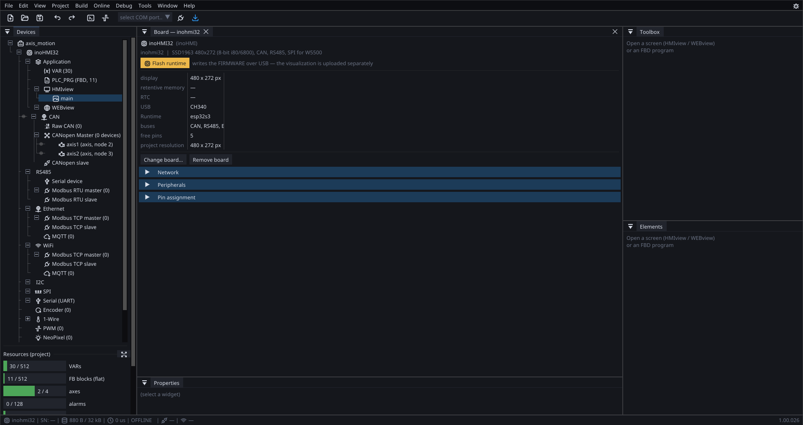
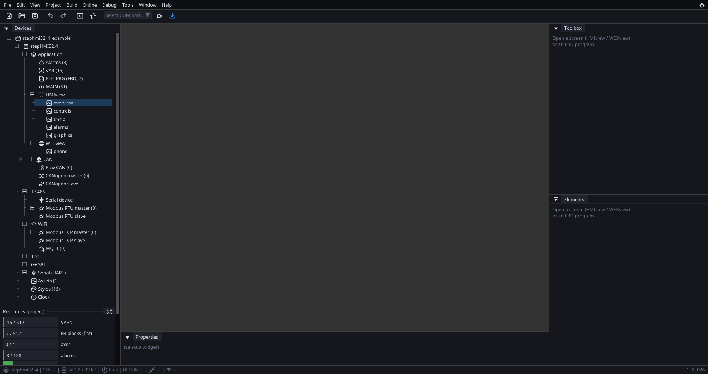

# Examples

Complete projects that ship with the editor. Open one, look at how it is
built, change something, download it — usually faster than starting from
an empty file, because the scaffolding you would have built anyway is
already there and already consistent.

They are not toys cut down for a manual. They are real projects that get
extended as features arrive, which is also why they are worth re-opening
after an update.

---

## The projects

| Project | Board | What it is |
|:---|:---|:---|
| [Thermostat](example-thermostat.md) | Olimex ESP32-EVB, 240×320 | a wall thermostat: hysteresis, two relays, manual mode, trend, alarms and a phone page |
| [Drive control](example-i550.md) | Olimex ESP32-EVB, 240×320 | a Lenze i550 over CANopen: the DRIVE_i550 block, diagnostics straight from the drive's objects, START/STOP from the glass and from a phone |
| [Showcase](example-showcase.md) | STM32F746 Discovery, 480×272 | the same runtime on other silicon: status word lamps, bit access, ethernet, online |
| [RS-485 system](example-rs485.md) | reTerminal + E10-1, inoCORE32-TM8.6, two inoCORE32-TM1.1 | one Modbus RTU master and three slaves on one pair, an i550 on the master's CAN — a system project the editor deploys as one |

More will be added here. Each gets its own page, with what it shows,
what is worth copying from it, and something to try changing.

---

## Where they live

Find them in **ProgramData\ctrl32**, or open them from the editor's
welcome screen. The projects are sorted into three folders:

| Folder | Holds |
|:---|:---|
| `examples\` | the board projects and feature demos — this page |
| `tutorials\` | [small, single-idea projects](tutorials.md), one lesson each |
| `examples\tests\` | regression fixtures. Real projects, but written to exercise the compiler rather than to be read |

---

## The editor, working

The same tool in the views you will spend your time in. These come from
the projects above.

### Ladder

{: .sb-center}

Blocks sit **in** the rungs with EN/ENO — BLINK, SEL, RAMP, PT1, HYST
— the editor is described on [Ladder](ladder.md) —
so the whole control chain is one picture rather than a diagram
somewhere else. Comments run above each rung.

### Ladder, online

{: .sb-center}

The same program, connected to a running board. **Green is current
flowing**, and every pin carries its live value.

This is the view worth knowing about before you need it: when something
behaves differently than you expected, you watch the rung rather than
guess.

### Function block diagram

{: .sb-center}

A tank controller as a diagram — from
[tutorials](tutorials.md). Blocks run top to bottom and pass values
through variables, which is why the order on screen **is** the data
flow.

### Structured Text

{: .sb-center}

For anything a diagram makes clumsy: loops, step sequences, a long
calculation — the language reference is [Structured Text](st-language.md).
It compiles as you type, and the same block library is
callable from it.

### CANopen

{: .sb-center}

Nodes on the bus, their objects, and the variables generated from them.
An EDS file from the manufacturer becomes correctly typed, correctly
addressed variables — see [CANopen](canopen.md).

### A different board

{: .sb-center}

Same editor, same languages, same widgets. The board is a choice in the
project, not a different tool.

---

## Using one as a starting point

2. Change the **target board** in the project settings to yours.
3. Delete the screens you do not want. Nothing else breaks — a screen is
   only referenced by the `nav` buttons pointing at it.
4. Keep the variables you need, rename the rest.

!!! tip "The examples are regression tests too"
    They are compiled and rendered on every build, which is why they
    stay current. If an example does something the documentation does
    not describe, the example is the one telling the truth.

---

| | |
|:---|:---|
| [Your first project](tutorial.md) | build one from an empty file |
| [Tutorial projects](tutorials.md) | ten small ones, a single idea each |
| [Supported hardware](hardware.md) | what the runtime runs on |
