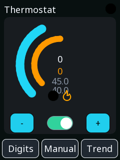
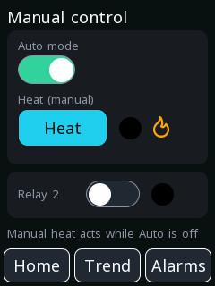
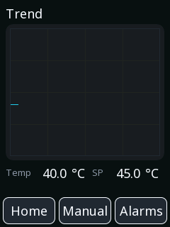
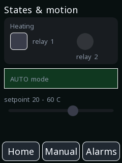
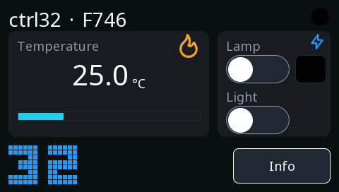
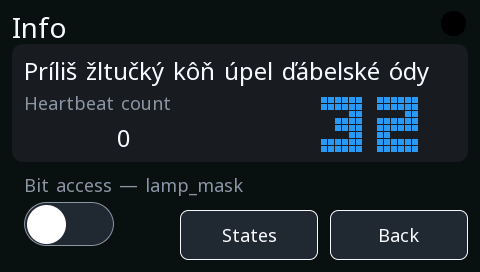
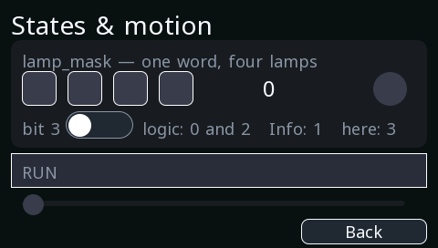

# Example projects

Two complete projects ship with the editor, and they are the fastest way
to see how the pieces fit together. Open one, look at how it is built,
change something, download it.

They are not toys cut down for a manual. Both are real projects that get
extended as features arrive — which is also why they are worth
re-opening after an update.

Find them in **ProgramData\ctrl32**, or open them from the editor's
welcome screen. They are sorted into three folders:

| Folder | Holds |
|:---|:---|
| `examples\` | the board projects and feature demos — what this page is about |
| `tutorials\` | small, single-idea projects that teach one thing each |
| `examples\tests\` | regression fixtures. Real projects, but written to exercise the compiler rather than to be read |

---

## Thermostat — Olimex ESP32-EVB

A wall thermostat on a 2.8" portrait screen, driving the two relays the
board has. There is no temperature sensor on it: a simulated measurement
sweeps the range, so the heating relay audibly clicks around the
setpoint the moment you download it.

**What it shows:** a complete small project. Ladder logic with
hysteresis, a screen somebody can actually operate, a manual mode, a
trend, alarms — and a WEBview page shaped for a phone.

The home screen. The gauge is the measurement, the buttons below adjust
the setpoint, and the switch turns automatic mode on and off.

Manual — every actuator on its own, which is what you want during
commissioning and when something has stopped and you need to know which
part still works.

The trend, a few seconds after starting — the chart fills as the board
samples. Both traces are recorded **in the board**, so the history
exists whether or not anybody is watching, and the current values sit
under the chart where they can be read without interpreting the lines.

States and motion. Two lamps on one variable — one from a named colour
set, one with its own colours — a panel whose **background** is the
state, and a marker that travels the scale as the setpoint moves.

**Worth copying from it:**

- the hysteresis block driving a relay — the smallest complete control
  loop there is
- a manual screen that mirrors the automatic one
- a WEBview page designed for a phone rather than copied from the board

---

## Showcase — STM32F746 Discovery

The same runtime on entirely different silicon: an STM32F7 with a 4.3"
landscape screen, ethernet and a touch glass.

**What it shows:** that a project is not tied to a chip family. The same
languages, the same widgets, the same pack format — a different board
underneath.

The main screen. Vector icons, switches bound to variables, and a value
in a large font — the fastest thing on any screen to read.

Info. The line of accented text is deliberate — *Príliš žltučký kôň úpel
ďábelské ódy* is the proof that the font carries the characters your
language needs, which is a thing to find out at your desk rather than on
the finished board.

Below it, bit access — a switch writing **one bit** of a word that the
logic is hammering at the same time, and neither losing the other's
work.

The states screen, and the picture worth understanding: **four lamps on
four bits of one 16-bit variable**, with no logic between them. Two bits
are driven by the program at different rhythms, one by a switch on
another screen, one by the switch beside them. Three independent writers
into one word, and none of them can undo another.

**Worth copying from it:**

- a row of lamps reading a status word — exactly how a drive's status is
  displayed
- an alarm defined once and shown by a lamp *and* an alarm table
- the layout of a landscape screen that stays readable at arm's length

---

## The editor, working

The same tool, in the views you will spend your time in.

### Ladder

The thermostat's program. Blocks sit **in** the rungs with EN/ENO —
BLINK, SEL, RAMP, PT1, HYST — so the whole control chain is one picture
rather than a diagram somewhere else. Comments run above each rung.

### Ladder, online

The same program, connected to a running board. **Green is current
flowing**, and every pin carries its live value: the simulated
temperature at 30.7, the filter's output at 36.8, the counter at 233.

This is the view worth knowing about before you need it. When something
behaves differently than you expected, you watch the rung rather than
guess — and the answer is usually visible in a second.

### Function block diagram

A tank controller as a diagram: a 4-20 mA input scaled to a percentage,
hysteresis deciding when it is full, a low-level detector with a
three-second delay so a wave does not trip it.

Blocks run top to bottom and pass values through variables — which is why
the order on screen **is** the data flow.

### Structured Text

For anything a diagram makes clumsy: loops, state machines, a long
calculation. It compiles as you type — the status line says so — and the
same block library is callable from it.

### CANopen

Nodes on the bus, their objects, and the variables generated from them.
An EDS file from the manufacturer becomes correctly typed, correctly
addressed variables — see [CANopen](canopen.md).

### A different board

A stepHMI32.4 project. Same editor, same languages, same widgets — the
board is a choice in the project, not a different tool.

---

## Which one to start from

| You have | Open |
|:---|:---|
| an ESP32 board, with or without a screen | **Thermostat** |
| an STM32 board | **Showcase** |
| no hardware yet | either — both run in simulation |

---

## How to use one as a starting point

1. Open the example and **Save As** under your own name.
2. Change the **target board** in the project settings to yours.
3. Delete the screens you do not want. Nothing else breaks — a screen is
   only referenced by the `nav` buttons pointing at it.
4. Keep the variables you need, rename the rest.

That is usually faster than starting from an empty project, because the
scaffolding you would have built anyway — a theme, a font, a navigation
row, an alarm table — is already there and already consistent.

!!! tip "The examples are the regression tests too"
    These projects are compiled and rendered on every build, which is
    why they stay current. If an example does something the
    documentation does not describe, the example is the one telling the
    truth.
