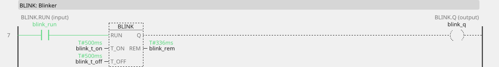
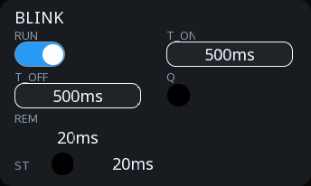

# BLINK

Blinks: while RUN is TRUE, Q alternates T_ON on and T_OFF off.

{: .sb-center}

{: .sb-center}

## In Structured Text

```iecst
PROGRAM BLINK_ST
VAR blink : BLINK; END_VAR
  blink(RUN := blink_run, T_ON := blink_t_on,
        T_OFF := blink_t_off);
  blink_q_st := blink.Q;
  blink_rem_st := blink.REM;
END_PROGRAM
```

## Where it runs

| Linux runtime | ESP32 boards | STM32 |
|:---:|:---:|:---:|
| yes | yes | yes |

## Pins

| Pin | Kind | Type | Default | Meaning |
|:---|:---:|:---:|:---:|:---|
| `RUN` | input | BOOL | - | While TRUE, the block blinks. |
| `T_ON` | parameter | TIME | T#500ms | How long Q stays on. |
| `T_OFF` | parameter | TIME | T#500ms | How long Q stays off. |
| `Q` | output | BOOL | - | The blinking signal. |
| `REM` | output | TIME | - | Time left in the current phase. |

## Description

The two times are separate, which is more useful than it first looks: a
short on-time in a long off-time reads as a discreet heartbeat, the
reverse reads as an urgent alarm, and equal times read as a plain flash.

**What it is for:** telling a person something without words. A flashing
lamp for an unacknowledged alarm, a slow pulse to show the program is
alive, a fast one for "do not touch, it is about to move".

```
fault_unacked ──[BLINK T_ON=T#200ms T_OFF=T#200ms]── Q ──> beacon
running       ──[BLINK T_ON=T#100ms T_OFF=T#1s900ms]── Q ──> heartbeat_led
```

!!! tip "A heartbeat is the cheapest diagnostic you will ever build"
    One BLINK on a spare output, and anyone standing at the hardware can
    see whether the program is running - before opening a laptop.

`REM` counts *down* through the current phase. It is there when you need
to synchronise something with the blink rather than just watch it.

### Choosing between the timers

| You want | Block |
|:---|:---:|
| ignore a signal until it has held | **TON** |
| keep something running after the reason stopped | **TOF** |
| a fixed dose, regardless of how long the trigger lasts | **TP** |
| something that flashes | **BLINK** |

The times are durations written the IEC way (`T#500ms`); a bare number
means milliseconds. The block measures real elapsed time, never cycles.

---

Every block of the family: [Timers](blocks-timers.md) · every block: [Function blocks](blocks.md)
