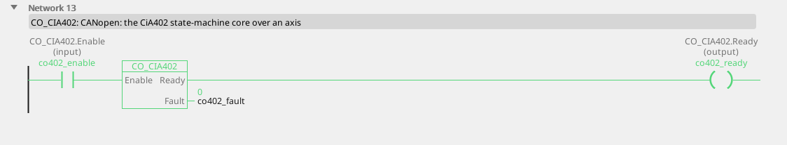

# CO_CIA402

The CiA 402 drive state machine on its own: Enable walks the drive to operation enabled, Ready says it got there.

{: .sb-center}

{: .sb-center}

## In Structured Text

```iecst
PROGRAM CO_CIA402_ST
VAR co402 : CO_CIA402; END_VAR
  co402(AXIS := 0, Enable := co402_enable);
  co402_ready_st := co402.Ready;
  co402_fault_st := co402.Fault;
END_PROGRAM
```

## Where it runs

| Linux runtime | ESP32 boards | STM32 |
|:---:|:---:|:---:|
| yes | yes | - |

**Needs:** a CANopen drive on the CAN bus, assigned as an axis.

## Pins

| Pin | Kind | Type | Default | Meaning |
|:---|:---:|:---:|:---:|:---|
| `Enable` | input | BOOL | - | Run the state machine. |
| `Ready` | output | BOOL | - | The drive is in operation enabled. |
| `Fault` | output | BOOL | - | The drive is in fault. |

## Errors

| When | What it means |
|:---|:---|
| Fault | The drive reports a fault in its statusword. |

## Description

Like the other CANopen blocks, it is bound to an **axis** at the call:
`drv(AXIS := 0, …)`.

This is what [MC_Power](blocks-motion.md) uses underneath, and the
building block of the drive composites, exposed for when you want to
build something the MC_ blocks do not cover.

A CiA 402 drive is not controlled by writing a speed. There is a
state machine, driven through controlword `0x6040` and observed through
statusword `0x6041`, and it must be walked through in order -
*switch on disabled* → *ready to switch on* → *switched on* →
*operation enabled*. `Ready` is TRUE only at the end of that walk.

### PDO timing belongs to the cycle

Anything cyclic - actual position, actual speed, controlword, setpoint -
travels as **PDO**, and the timing is tied to the cycle: **RPDO**
received at the start of the cycle, into the process image; **TPDO**
transmitted at the end. Never asynchronously. A PDO arriving at a random
moment produces jitter that cannot be estimated and therefore cannot be
compensated, and non-reproducible faults are the most expensive kind.

For position feedback specifically, set the drive's PDO to
**synchronous** transmission (sent after SYNC). Event-driven
transmission means values at unpredictable times, and the delay
compensation the positioning depends on stops working.

### What the bus can carry

At 500 kbit/s an 8-byte PDO takes about 130 µs. Four drives with two
PDOs each is eight frames, roughly 1 ms - about **10 % of a 10 ms
cycle**. Eight drives is still comfortable. Beyond that, either shorten
the cycle or move to 1 Mbit/s, which costs bus length.

### Heartbeat is not optional

A drive that stops answering must be noticed. Heartbeat monitoring is
mandatory, and the reaction to a drop-out is a **quick stop** - not
carrying on with the last values received. See [Buses](buses.md) for
wiring, node IDs and termination.

---

Every block of the family: [CANopen](blocks-can.md) · every block: [Function blocks](blocks.md)
