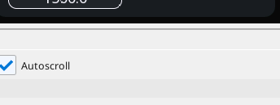

# CO_RAMPTIME

Sets the drive's acceleration and deceleration times - written only at standstill and only on change.

{: .sb-center}

## In Structured Text

```iecst
PROGRAM CO_RAMPTIME_ST
VAR coramp : CO_RAMPTIME; END_VAR
  coramp(AXIS := 0, ACC := coramp_acc, DEC := coramp_dec,
         REF := coramp_ref);
END_PROGRAM
```

## Where it runs

| Linux runtime | ESP32 boards | STM32 |
|:---:|:---:|:---:|
| yes | yes | - |

**Needs:** a CANopen drive on the CAN bus, assigned as an axis.

## Pins

| Pin | Kind | Type | Default | Meaning |
|:---|:---:|:---:|:---:|:---|
| `ACC` | input | REAL | - | Acceleration time in seconds, 0 → target rpm. |
| `DEC` | input | REAL | - | Deceleration time in seconds. |
| `REF` | input | REAL | - | Reference speed the times relate to. |

## Description

Bound to an **axis** at the call.

Writes the CiA 402 ramp objects `0x6048` and `0x6049` - and it is
careful about when:

- **only when the axis is at standstill**, and
- **only when the values actually changed**.

So the cycle never touches SDO while the drive is moving. This is the
block that lets ACC and DEC be adjustable from a [WEBview](webview.md)
screen without the adjustment being able to disturb a running axis -
made for the i550 with ACC/DEC inputs on a WEBview screen.

!!! warning "One place owns the ramp"
    If the drive ramps and the program ramps too, the two disagree and
    the axis overshoots or oscillates. See [Motion blocks](blocks-motion.md).

---

Every block of the family: [CANopen](blocks-can.md) · every block: [Function blocks](blocks.md)
