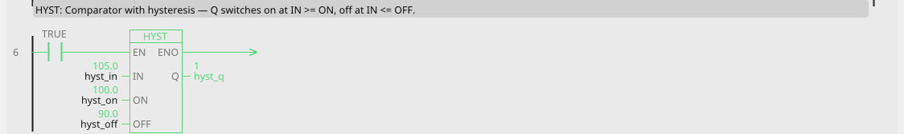
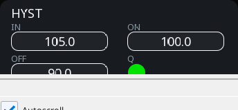

# HYST

Comparator with hysteresis: Q switches on at IN >= ON, and off again only at IN <= OFF.

{: .sb-center}

{: .sb-center}

## In Structured Text

```iecst
PROGRAM HYST_ST
VAR hyst : HYST; END_VAR
  hyst(IN := hyst_in, ON := hyst_on, OFF := hyst_off);
  hyst_q_st := hyst.Q;
END_PROGRAM
```

## Where it runs

| Linux runtime | ESP32 boards | STM32 |
|:---:|:---:|:---:|
| yes | yes | yes |

## Pins

| Pin | Kind | Type | Default | Meaning |
|:---|:---:|:---:|:---:|:---|
| `IN` | input | REAL | - | The measurement. |
| `ON` | parameter | REAL | 100 | Switch-on level. |
| `OFF` | parameter | REAL | 90 | Switch-off level. |
| `Q` | output | BOOL | - | The switched output. |

## Description

The gap between ON and OFF is the hysteresis, and it is why this block
exists: a plain comparison at a single threshold chatters when the
measurement sits near it, and everything downstream chatters with it.

**What it is for:** anything where a number switches something physical.
Thermostats above all.

```
temp ──[HYST ON=22 OFF=20]── Q ──> heating
```

Heating comes on at 22 and off at 20 - a two-degree swing that stops the
relay clacking every few seconds.

**ON must be greater than or equal to OFF**, and the editor refuses a
block where it is not - a rising threshold below the falling one is
almost always a swapped pair of numbers rather than an intention.

For the opposite sense - switch on when a value *falls* - put a
[NOT](blocks-boolean.md) after it. `HYST ON=22 OFF=20` followed by NOT
gives you cooling that starts at 20 and stops at 22, with the same
two-degree gap doing the same job.

!!! success "How wide should the gap be?"
    Wide enough that normal noise cannot cross it, and no wider - the
    swing is felt by whatever the equipment does. For temperature, a
    degree or two. For a pressure switch, a few percent. If you are
    unsure, watch the raw value in the [Scope](scope.md) for a minute
    and make the gap bigger than the wobble you see.

---

Every block of the family: [Signal handling](blocks-signal.md) · every block: [Function blocks](blocks.md)
