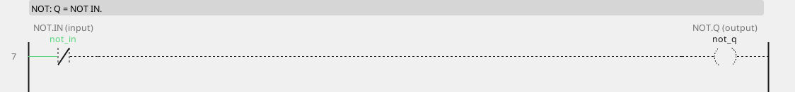

# NOT

Q is TRUE when the input is FALSE.

{: .sb-center}

{: .sb-center}

## In Structured Text

```iecst
PROGRAM NOT_ST
  not_q_st := NOT not_in;
END_PROGRAM
```

## Where it runs

| Linux runtime | ESP32 boards | STM32 |
|:---:|:---:|:---:|
| yes | yes | yes |

## Pins

| Pin | Kind | Type | Default | Meaning |
|:---|:---:|:---:|:---:|:---|
| `IN` | input | BOOL | - | The input. |
| `Q` | output | BOOL | - | NOT IN. |

## Description

| Block | Inputs | Output | Q is TRUE when |
|:---|:---:|:---:|:---|
| **AND** | IN1, IN2 | Q | both inputs are TRUE |
| **OR** | IN1, IN2 | Q | at least one input is TRUE |
| **XOR** | IN1, IN2 | Q | exactly one input is TRUE |
| **NOT** | IN | Q | the input is FALSE |

An unconnected input is FALSE, so an unconnected NOT gives TRUE.

NOT after a [HYST](blocks-signal.md) turns its sense around: `HYST
ON=22 OFF=20` followed by NOT gives cooling that starts at 20 and stops
at 22, with the same two-degree gap.

In ladder the inversion is the NC contact `-[/]-`, which conducts while
the variable is FALSE.

### Bit access

Write `status.3` on a pin and it reads bit 3 of the integer variable
`status`; the same spelling works as an output. Bits are written
**atomically**. See [Variables](variables.md).

---

Every block of the family: [Boolean](blocks-boolean.md) · every block: [Function blocks](blocks.md)
