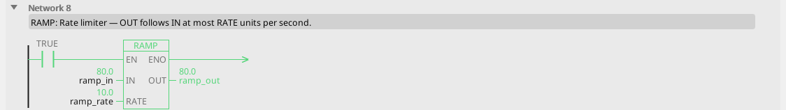
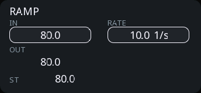

# RAMP

Rate limiter: OUT follows IN, but changes at most RATE units per second.

{: .sb-center}

{: .sb-center}

## In Structured Text

```iecst
PROGRAM RAMP_ST
VAR ramp : RAMP; END_VAR
  ramp(IN := ramp_in, RATE := ramp_rate);
  ramp_out_st := ramp.OUT;
END_PROGRAM
```

## Where it runs

| Linux runtime | ESP32 boards | STM32 |
|:---:|:---:|:---:|
| yes | yes | yes |

## Pins

| Pin | Kind | Type | Default | Meaning |
|:---|:---:|:---:|:---:|:---|
| `IN` | input | REAL | - | The target. |
| `RATE` | parameter | REAL | 10 | The fastest OUT may change, in units per second. |
| `OUT` | output | REAL | - | The rate-limited value. |

## Description

**What it is for:** stopping a step change from becoming a mechanical
shock. An operator typing a new speed, a recipe changing a setpoint, a
mode switch - all of them can move a number instantly, and the equipment
cannot follow instantly.

```
speed_request ──[RAMP RATE=50]── OUT ──> speed_setpoint
```

The request may jump from 0 to 500; the setpoint takes ten seconds to
get there.

!!! warning "Two ramps fighting is the classic drive problem"
    If the drive has its own acceleration ramp *and* the program ramps
    the setpoint, the two disagree and the axis overshoots or
    oscillates. Set the drive's ramps to minimum and let one place own
    the profile. See [Motion blocks](blocks-motion.md).

---

Every block of the family: [Signal handling](blocks-signal.md) · every block: [Function blocks](blocks.md)
