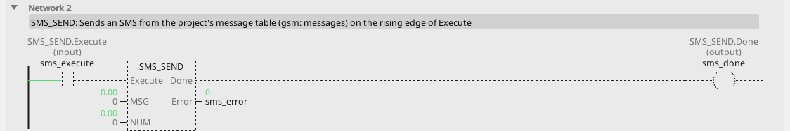

# SMS_SEND

Sends an SMS from the project's message table on the rising edge of Execute.

{: .sb-center}

{: .sb-center}

## In Structured Text

```iecst
PROGRAM SMS_SEND_ST
  IF sms_execute THEN
    sms_done_st := SMS_SEND('block library: SMS_SEND fired', 0);
  END_IF;
END_PROGRAM
```

## Where it runs

| Linux runtime | ESP32 boards | STM32 |
|:---:|:---:|:---:|
| - | yes | - |

**Needs:** a cellular modem and the project's message table.

## Pins

| Pin | Kind | Type | Default | Meaning |
|:---|:---:|:---:|:---:|:---|
| `Execute` | input | BOOL | - | Send on the rising edge. |
| `MSG` | parameter | REAL | 0 | Which message, 0–7 as numbered on the modem page. |
| `NUM` | parameter | REAL | 0 | Recipient: 0 = every configured number, 1–4 = one number (#1–#4 on the modem page). |
| `Done` | output | BOOL | - | Queued successfully (held while Execute holds). |
| `Error` | output | BOOL | - | No modem service, an empty message or number, or the service is busy. |

## Errors

| When | What it means |
|:---|:---|
| Error | No modem service configured, an empty message or number, or the service is busy - retried simply by giving Execute another rising edge. |

## Description

Message texts and phone numbers live in the **project**, not the logic -
so changing a text or a number is an edit and an upload, not a code
change. The block picks message MSG and sends it to recipient NUM.

`Done` holds while Execute holds, after the SMS was queued. The modem
takes seconds to send; the block reports on its outputs and the cycle
carries on.

**What it is for:** telling somebody who is not standing at the
hardware. A cold store that lost cooling at three in the morning, a pump
station that tripped, a batch that finished.

```
fault_critical ──[TON PT=T#1m]── Q ──[R_TRIG]── Execute ──[SMS_SEND MSG=0 NUM=0]
```

The minute of delay is deliberate - it stops a fault that clears itself
from waking anybody up.

!!! warning "An SMS is a notification, never a control path"
    Messages get delayed, dropped and duplicated by networks you do not
    control. Nothing on the equipment may depend on one arriving.

!!! tip "Rate-limit yourself"
    A fault that chatters can send hundreds of messages and a bill to
    match. Put a TON in front of the trigger and a latch behind it, so
    one fault sends one message.

Gate the trigger on [GSM_INFO](blocks-services.md)'s `Ready`: sending
while the modem is not registered wastes a trigger. The modem, the
texts and the numbers are set up on the project's modem page - see
[Peripherals and services](peripherals-and-services.md). That separation
is deliberate: a phone number changes when somebody changes job, and
that should be an edit in a form, not a change to the logic.

---

Every block of the family: [Services](blocks-services.md) · every block: [Function blocks](blocks.md)
