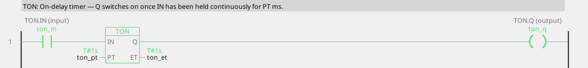
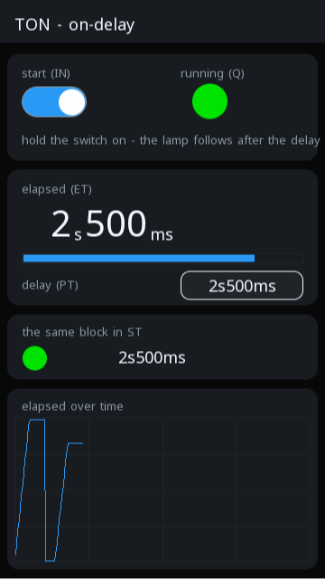

# TON

Delays switching on: Q goes TRUE once IN has been held continuously for PT.

{: .sb-center}

{: .sb-center}

## In Structured Text

```iecst
PROGRAM TON_ST
VAR ton : TON; END_VAR
  ton(IN := ton_in, PT := ton_pt);
  ton_q_st := ton.Q;
  ton_et_st := ton.ET;
END_PROGRAM
```

## Where it runs

| Linux runtime | ESP32 boards | STM32 |
|:---:|:---:|:---:|
| yes | yes | yes |

## Pins

| Pin | Kind | Type | Default | Meaning |
|:---|:---:|:---:|:---:|:---|
| `IN` | input | BOOL | - | The condition being timed. |
| `PT` | parameter | TIME | T#1s | How long IN must hold before Q switches on. |
| `Q` | output | BOOL | - | TRUE once IN has held for PT. |
| `ET` | output | TIME | - | Elapsed time so far. |

## Description

The word that does the work is **continuously**. Any drop of IN, however
brief, puts ET back to zero and the wait starts again.

**What it is for:** ignoring things that are not real yet. A door switch
that rattles, a pressure that dips for an instant, an operator leaning on
a button. TON is how you say "only if it is still true half a second
later".

```
door_open ──[TON PT=T#2s]── Q ──> alarm_door
```

The alarm fires when the door has been open two seconds, not when
somebody walks through.

!!! tip "ET is worth showing"
    Bind `ET` to a variable and put a bar on the screen. An operator
    waiting for a delay with no feedback assumes the equipment is broken;
    the same operator watching a bar fill waits patiently.

In a ladder rung TON can sit in the series itself: the network drives
IN and Q carries the rung on. As a box with EN/ENO, a rung that stops
conducting keeps the block's state and its outputs hold their last
value, so a rung that flickers does not silently restart the
measurement.

### Choosing between the timers

| You want | Block |
|:---|:---:|
| ignore a signal until it has held | **TON** |
| keep something running after the reason stopped | **TOF** |
| a fixed dose, regardless of how long the trigger lasts | **TP** |
| something that flashes | **BLINK** |

### Real time, not cycles

The time is a duration written the IEC way (`T#500ms`, `T#1s500ms`,
`T#2m`); a bare number typed into the field means milliseconds. The
block measures real elapsed time on a monotonic millisecond clock.
Never build a timer by counting cycles: `n := n + 1; IF n > 100 THEN`
looks like it waits a second and does - until the WiFi stack gets busy,
the cycle stretches, and your second becomes 1.4. The same applies to
your own ST blocks: take a timestamp, compare timestamps.

---

Every block of the family: [Timers](blocks-timers.md) · every block: [Function blocks](blocks.md)
