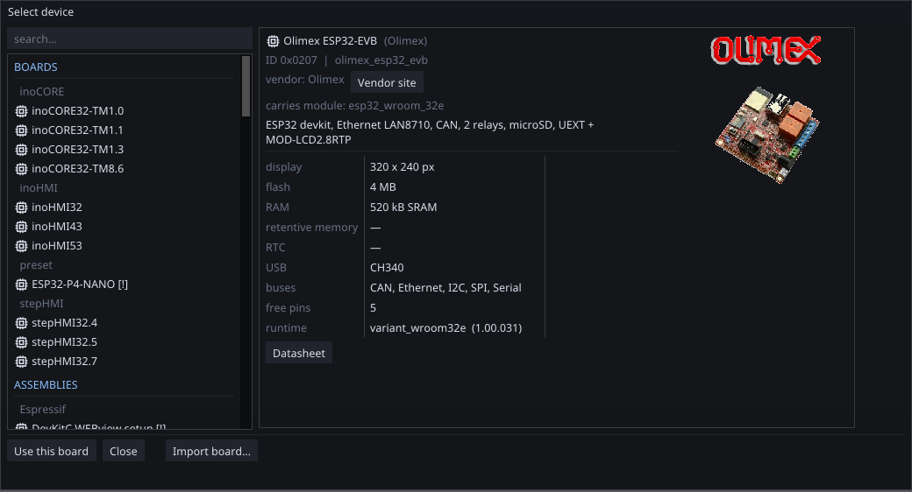

# Supported hardware

ctrl32 is software. It runs on hardware you buy elsewhere — from a bare
module you solder onto your own board, through a development kit with an
ethernet socket, to a finished board with a touch screen.

The catalogue in the editor holds **95 entries**. You never have to know
that number: you pick your board from a list, and everything that follows
— pin assignments, which buses exist, how much memory there is, what the
runtime is flashed with — comes from that choice.

---

{: .sb-center}

## The three kinds of entry

| Kind | How many | What it is |
|:---|:---:|:---|
| **Modules** | 66 | a bare ESP32 module: you design the board around it |
| **Development boards** | 13 | a ready board with connectors, for prototyping and small installations |
| **Panels** | 11 | a finished device with a display, ready to mount in a door |
| **Presets** | 5 | a development board plus a known-good configuration, to start from |

A **preset** is worth explaining: it is not different hardware, it is the
same board with the peripherals already filled in. `S3 SSD1963 setup` is
an S3 DevKit with the display wired the way the driver expects. Start
from one when you are learning, then change what you need.

Every chip, module and board, the size it belongs to and what it reaches
(display, Ethernet, WiFi, CAN, RS485) is one page: [Supported hardware](modules.md).

**A module is a target too.** Pick a bare module from the catalog and the
project is *your own hardware around that part*: every bus pin is
assigned on the bus pages, and the module's electrical rules check each
one as you type — flash pins, input-only pins, a pin claimed twice. See
[Buses](buses.md).

### Your own board as a file — `.hdw32`

A board you designed can travel as one file: a `.hdw32` is a small
package holding the board's description over a catalog module, plus a
photo carrying the same name. *Import board…* in the board picker
validates it at the door — an illegal pin assignment is refused with the
reason, before anything is installed — and the board then appears in
your catalog marked *(imported)*, usable like any other — the same
way an EDS file brings a CANopen device in. The installer registers
the extension, so double-clicking a `.hdw32` opens the import too.
The project's own package format is described on
[Project format](project-format.md).

---

## Which processor

| Processor | Entries | Where it fits |
|:---|:---:|:---|
| **ESP32** | 45 | the workhorse: two cores, ethernet MAC, CAN, plenty of I/O |
| **ESP32-S3** | 39 | more RAM and a faster bus — the reference platform for boards with a display |
| **ESP32-PICO-V3** | 9 | the same ESP32 in a much smaller package |
| **ESP32-P4** | 1 | the fastest, with a native display interface (MIPI DSI) |
| **STM32F7** | 1 | the first of the STM32 family — see below |

**The ESP32-S3 is the reference platform.** Everything ctrl32 does must
work on it; when something does not fit, the design changes rather than
the platform. If you are choosing and have no other constraint, choose an
S3.

The **classic ESP32** has one thing the S3 does not: an **ethernet MAC**.
For a board that must sit on a wired network without an extra chip, this
is the reason to pick it.

!!! tip "Memory suffixes are worth reading"
    `N16R8` means 16 MB flash and 8 MB PSRAM; `N4` means 4 MB flash and
    no PSRAM. More flash means room for screens and fonts; PSRAM means
    room for trends, alarm history and images. The editor tells you when
    a project outgrows the board you picked — at your desk, not on the
    equipment.

## What each family can do

The families run the same runtime — same variables, same logic, same
pack — but the silicon differs, and a few capabilities follow the
silicon. This is the table to check before choosing:

| Capability | ESP32 | ESP32-PICO-V3 | ESP32-S3 | ESP32-P4 | STM32F7 |
|:---|:---:|:---:|:---:|:---:|:---:|
| Display | SPI panels | SPI panels | parallel bus, up to 7" | MIPI DSI, 10.1" | on-chip LTDC |
| WiFi | yes | yes | yes | via C6 companion | — |
| Ethernet | on-chip MAC | on-chip MAC | W5500 over SPI | on-chip | on-chip |
| CAN / CANopen | yes | yes | yes | yes | yes |
| RS485 / Modbus RTU | yes | yes | yes | yes | yes |
| Modbus TCP | yes | yes | yes | yes | yes |
| MQTT telemetry | yes | yes | yes | yes | yes |
| MQTT over TLS | — | — | **yes** | **yes** | **yes** |
| PSRAM variants | quad (WROVER) | 2 MB | up to 8 MB octal | 32 MB | SDRAM |
| Trend curves in a project | 4 | 4 | 8 | 8 | 8 |
| WEBview clients | 2 | 2 | 2 | 2 | 1 |
| Headless (bigger program limits) | yes | yes | yes | yes | yes |

Two rows deserve a sentence. *MQTT over TLS* needs RAM the classic
ESP32 does not have — the editor refuses the option for such a board
at your desk (see [MQTT](mqtt.md)). And *trend curves*: the classic
core's RAM carries four curve buffers; the S3, P4 and F7 carry the
full eight.

---

## STM32, F7 first

The runtime is not tied to Espressif. The first STM32 target ships:
the **STM32F746 Discovery** is in the catalogue, its runtime flashes
[straight from the editor](first-run.md) over the on-board ST-LINK,
and the [showcase example](example-showcase.md) runs on it — the
same VM, the same variables, the same Modbus and CANopen, the same
rasteriser and the same pack format.

What that means for you: a project is not locked to a chip family. The
screens, the logic and the variables are data, and the same data runs on the
silicon that suits the installation.

More of the family follows. Nothing below 64 kB of RAM will be
supported — under that, the runtime has nowhere to live.

---

## Boards with a display

**29 of the entries have a screen.** The rest are headless: they run
logic, talk to fieldbuses and serve the WEBview to a phone or a laptop,
without a display of their own.

Headless is a perfectly good way to build a setup. A board in the door
costs money and a hole in the enclosure; a WEBview on the operator's
phone costs neither. Many installations want both, and the same project
serves both without being written twice.

---

## The finished boards

These are complete devices — enclosure, display, touch, terminals:

| Family | Sizes |
|:---|:---|
| **inoCORE32** | compact controllers, with and without a display |
| **inoHMI32 / 43 / 53** | boards around 3.2", 4.3" and 5" |
| **stepHMI32** | boards in several sizes, 480×272 class |
| **Waveshare P4-NANO** | 10.1" on the ESP32-P4 |

---

## Every board has an identity

Each entry carries a unique hardware code, and a new board revision gets
a **new** code — never a reused one. That code travels through the
system: the board catalogue, the runtime and the pack's `verify_target`
field all carry it.

The practical consequence: a pack built for one board is **refused** by
another. Upload the wrong file to the wrong board and it tells you so
instead of running something that was never meant for it.

---

## Choosing, briefly

| You need | Look at |
|:---|:---|
| a display in the door | a **board** — the size decides the rest |
| wired ethernet, no display | a classic **ESP32** development board with a LAN port |
| your own board around a module | a **module** — the pinout is yours to design |
| to try ctrl32 out this afternoon | a **preset** — DevKit plus a working configuration |
| the most headroom | **ESP32-S3** with 16 MB flash and PSRAM |

Then check [Performance and limits](limits.md) for what fits, and
[Peripherals and services](peripherals-and-services.md) for what you can
attach.
