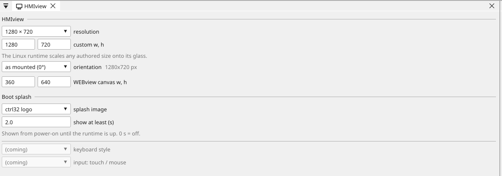

# HMIview — the board's own screen

The screen on the front of the box. What you see when you walk up to
something you built and want to know what it is doing.

HMIview is drawn in the same editor as everything else, from the same
variables, and travels in the same file. This page is how it works and how to
draw one that helps; the [Property reference](widgets.md) lists every
widget and its properties.

---

## Screens, not pages

A project has up to **32 screens** and up to **64 widgets on each**
(a [Linux box](linux-boxes.md) carries 320 and 256). One is shown at
a time; the operator moves between them with `nav` widgets.

That is generous for a project and deliberately not unlimited. An
installation that needs forty screens usually needs three good ones
instead — an operator who has to remember where something lives will
not find it in a hurry.

**A useful default shape:**

| Screen | Holds |
|:---|:---|
| Home | the state of the equipment in one glance, and the two controls that matter |
| Manual | every actuator, individually, for commissioning and fault-finding |
| Settings | setpoints, times, recipe values |
| Alarms | what is wrong and what was wrong |
| Trend | how a value has behaved |

---

## The resolution

Clicking **HMIview** in the device tree opens its settings page. On a
board with glass there is nothing to decide — the screen's pixels are
the board's pixels, and the page says so. On a target that scales
(a [Linux box](linux-boxes.md)), the page offers the common
resolutions and a custom size: author at whatever suits the design,
and the box fits it to its glass with the shape kept.

The same page sets the **orientation** — a glass mounted on its side
authors portrait screens, and the board transposes as it draws — and
the **WEBview canvas**, the size the browser screens are drawn for,
usually a phone in portrait.

{: .sb-center}

---

## Drawing is exact

The editor canvas is not an approximation. It runs **the board's own
rasteriser** — the same code, the same fonts, the same rounding, the same
colours — so what you place is what appears on the glass.

This is worth more than it sounds. Text that fits by two pixels in the
editor fits by two pixels on the board; a font that renders your
language's diacritics correctly on screen renders them correctly on the
equipment.

!!! tip "Test at the real size"
    A screen designed on a 27" monitor and shown on a 4.3" board is
    always smaller than you expected. Keep the canvas at the board's real
    resolution while you work, and stand back from the monitor
    occasionally.

---

## Touch is not a mouse

A finger is about **10 mm** across and arrives with a person attached to
it.

- **Resistive touch** (the cheaper glass) wants a firm press and is
  accurate. It works with gloves and wet hands, which on many projects
  decides the matter.
- **Capacitive touch** is light and precise, and does not work through
  most gloves.

Make targets **big**. A button 40 px tall on a 480×272 board is
comfortable; 30 px is possible on capacitive glass and unkind on
resistive. Space them so that a press slightly off-centre still hits the
right one.

!!! warning "Confirm anything that moves something real"
    Capacitive touch near a frequency drive can register presses that
    nobody made. A `confirm` on a command that starts a motor is not
    decoration — it is the difference between electrical noise and an
    axle turning.

---

## Colour carries meaning

The screen is read by somebody who is tired, in a hurry, and possibly
holding a torch. Colour does more work than text.

Use [states](states-motion.md) rather than drawing one widget per
condition: a lamp with a true, false and alarm colour is one widget
that says three things, driven by a variable or by one bit of an
integer.

**A convention worth keeping:** green means running as intended, grey
means off and correct, red means it needs a person, amber means it will
need one soon. Then keep it identical on every screen — an operator
learns the colours once and reads every screen afterwards.

!!! tip "Never let colour be the only signal"
    Roughly one man in twelve cannot separate red from green reliably.
    Give the important states a shape or a word as well as a colour.

---

## What redraws, and why it matters

The board does not repaint the screen continuously. A widget whose value
changed marks its own rectangle, the rectangles are merged into bands and
only those are sent to the display.

Repainting a whole 800×480 frame costs 20–25 ms; repainting the part that
changed costs almost nothing. That is why a busy screen still feels
immediate — and why an analog value **without a deadband** is expensive:
it marks itself dirty on every flicker of its last digit and repaints
forever.

Set a deadband on every analog variable. It is the single most effective thing
you can do for a screen's responsiveness. See [Variables](variables.md).

!!! note "Flat colours are nearly free; gradients are not"
    Filled areas, text and lines cost almost nothing. Gradients, shadows
    and anti-aliased rounded corners are expensive to compute. Use them
    where they earn their place — a header, a title bar — and not
    everywhere.

---

## Graphics never delay control

The rule is **logic before communication before graphics**. The renderer
takes a snapshot of the variable table and works from that; it never holds
anything the PLC cycle needs.

Under load, frames are dropped. The cycle is never extended. A screen may
stutter while the program is doing something demanding — control never
waits for a picture.

---

## The board with no screen

Plenty of installations have no display at all. The logic runs, the
fieldbuses run, and the visualisation lives in a browser — see
[WEBview](webview.md).

If you draw no WEBview screens, the browser is served the HMI ones. So a
headless controller can still have a full visualisation, and a board with
a display can be watched from a phone, from the same project.

---

## Where to go next

| | |
|:---|:---|
| [Property reference](widgets.md) | every widget, every property |
| [States and motion](states-motion.md) | colour from a state, movement from a value |
| [Variables](variables.md) | what the screens are drawing, and deadband |
| [WEBview](webview.md) | the same project in a browser |
| [Performance and limits](limits.md) | how many screens, widgets and variables fit |
