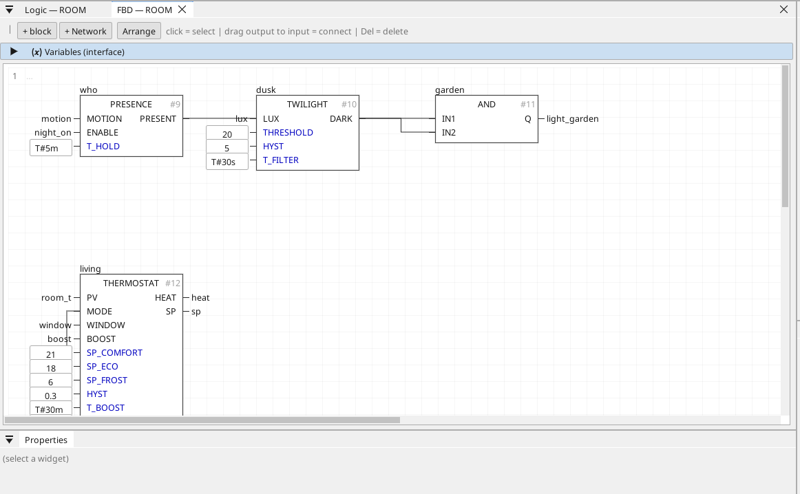

# THERMOSTAT

A room: two-point heating with three setpoints, a boost and a window pause.

{: .sb-center}

## In Structured Text

```iecst
PROGRAM THERMOSTAT_ST
VAR thermostat : THERMOSTAT; END_VAR
  thermostat(PV := thermostat_pv, MODE := thermostat_mode, WINDOW := thermostat_window, BOOST := thermostat_boost, SP_COMFORT := thermostat_sp_comfort, SP_ECO := thermostat_sp_eco, SP_FROST := thermostat_sp_frost, HYST := thermostat_hyst, T_BOOST := thermostat_t_boost, T_WINDOW := thermostat_t_window);
  thermostat_heat := thermostat.HEAT;
  thermostat_sp := thermostat.SP;
END_PROGRAM
```

## Where it runs

| Linux runtime | ESP32 boards | STM32 |
|:---:|:---:|:---:|
| yes | yes | yes |

## Pins

| Pin | Kind | Type | Default | Meaning |
|:---|:---:|:---:|:---:|:---|
| `PV` | input | REAL | - | The room temperature. |
| `MODE` | input | INT | - | 0 = frost protection, 1 = eco, 2 = comfort. |
| `WINDOW` | input | BOOL | - | The window contact: open longer than T_WINDOW pauses the heating. |
| `BOOST` | input | BOOL | - | An edge raises the setpoint by 2 degrees for T_BOOST. |
| `SP_COMFORT` | parameter | REAL | 21.0 | The comfort setpoint. |
| `SP_ECO` | parameter | REAL | 18.0 | The eco setpoint. |
| `SP_FROST` | parameter | REAL | 6.0 | The frost-protection setpoint. |
| `HYST` | parameter | REAL | 0.3 | The switching band, half above and half below SP. |
| `T_BOOST` | parameter | TIME | T#30m | The boost time. |
| `T_WINDOW` | parameter | TIME | T#2m | An open window shorter than this is ignored. |
| `HEAT` | output | BOOL | - | The valve or the relay. |
| `SP` | output | REAL | - | The setpoint in force, for the screen. |

## Description

`HEAT` comes on below `SP - HYST` and goes off above `SP + HYST`. A window
open longer than `T_WINDOW` keeps `HEAT` off.

Drive `MODE` from a DAYTIME block (comfort by day, eco at night), from a
SCHEDULE's `VALUE` (the room heats by the clock) or from a screen button;
a PRESENCE block can drop it to eco while nobody is home.

It uses 2 of the program's 32 timers and edge detectors.

---

Every block of the family: [Home automation](blocks-home.md) · every block: [Function blocks](blocks.md)
