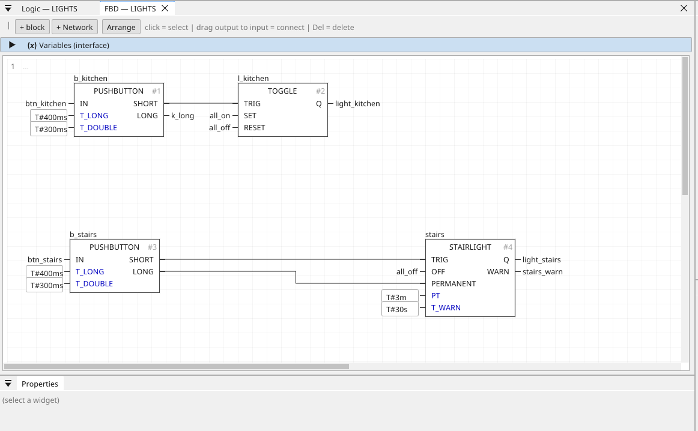

# TOGGLE

The light switch: every rising edge of TRIG flips Q; SET and RESET are the central commands.

{: .sb-center}

## In Structured Text

```iecst
PROGRAM TOGGLE_ST
VAR toggle : TOGGLE; END_VAR
  toggle(TRIG := toggle_trig, SET := toggle_set, RESET := toggle_reset);
  toggle_q := toggle.Q;
END_PROGRAM
```

## Where it runs

| Linux runtime | ESP32 boards | STM32 |
|:---:|:---:|:---:|
| yes | yes | yes |

## Pins

| Pin | Kind | Type | Default | Meaning |
|:---|:---:|:---:|:---:|:---|
| `TRIG` | input | BOOL | - | The button's SHORT; every rising edge flips Q. |
| `SET` | input | BOOL | - | An edge switches on (all lights on). |
| `RESET` | input | BOOL | - | An edge switches off (leaving the house). |
| `Q` | output | BOOL | - | The light. |

## Description

The edges of `SET` and `RESET` win over the toggle in the same cycle.
Drive `TRIG` from a PUSHBUTTON's `SHORT`, and `SET` / `RESET` from
CENTRAL's `ALL_ON` / `ALL_OFF`.

It uses 3 of the program's 32 timers and edge detectors.

---

Every block of the family: [Home automation](blocks-home.md) · every block: [Function blocks](blocks.md)
