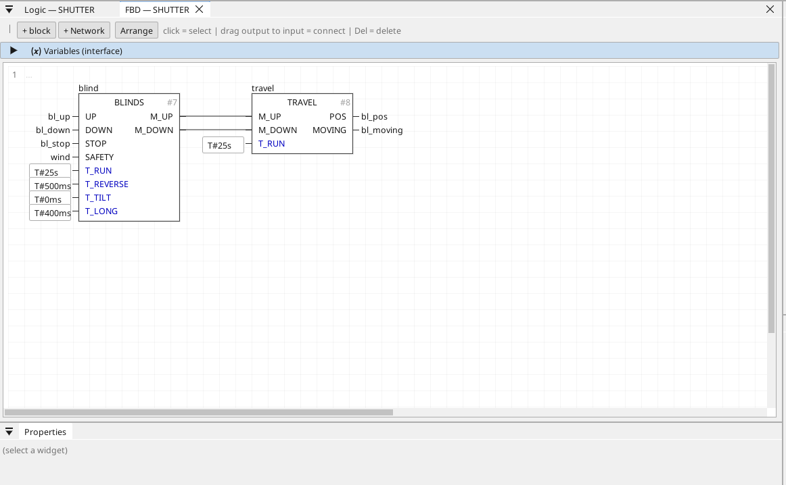

# TRAVEL

Where the blind is: integrates the motor time into a position, 0 = up, 100 = down.

{: .sb-center}

## In Structured Text

```iecst
PROGRAM TRAVEL_ST
VAR travel : TRAVEL; END_VAR
  travel(M_UP := travel_m_up, M_DOWN := travel_m_down, T_RUN := travel_t_run);
  travel_pos := travel.POS;
  travel_moving := travel.MOVING;
END_PROGRAM
```

## Where it runs

| Linux runtime | ESP32 boards | STM32 |
|:---:|:---:|:---:|
| yes | yes | yes |

## Pins

| Pin | Kind | Type | Default | Meaning |
|:---|:---:|:---:|:---:|:---|
| `M_UP` | input | BOOL | - | The motor relay up (from BLINDS). |
| `M_DOWN` | input | BOOL | - | The motor relay down. |
| `T_RUN` | parameter | TIME | T#25s | The full travel time - the same number as in BLINDS. |
| `POS` | output | REAL | - | The position, 0..100 % (0 = open / up, 100 = closed / down). |
| `MOVING` | output | BOOL | - | TRUE while a motor runs. |

## Description

A full run to either end resets the position exactly; between them it is
the motor time, good to a few percent. Show `POS` on a screen or use it to
decide a scene. Wire `M_UP` / `M_DOWN` from BLINDS, or from the relays'
own feedback.

It uses 1 of the program's 32 timers and edge detectors.

---

Every block of the family: [Home automation](blocks-home.md) · every block: [Function blocks](blocks.md)
