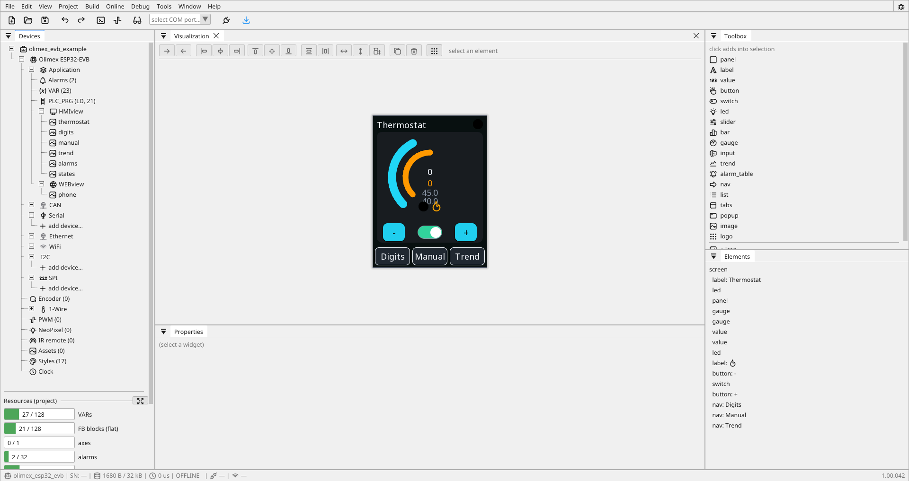

# ctrl32

**A development and learning environment for automation — on ESP32
and STM32 boards and on Linux devices.** You draw the screens, define
the variables, write the logic in [ladder](ladder.md), in a function
block diagram or in [ST](st-language.md) — and download it to the
device. The same visualisation also runs in a browser.

Everything a PLC course, a prototype or a private project needs: real
ladder, a real cycle, real Modbus and CANopen — on hardware that costs a
fraction of the established engineering systems.

!!! warning "Read this before you plan anything with it"
    ctrl32 carries **no certification of any kind** — not CE marking for
    a finished product, not a functional-safety rating, not a type
    approval. It is a tool for learning, experimenting and building your
    own things.

    It does not belong in an installation where people's safety, other
    people's property, or an insurer's opinion depends on it. See
    [Intended use](intended-use.md) — it takes two minutes and it is the
    most important page here.

!!! note "It has bugs, like everything else"
    ctrl32 is software written by people, so it has bugs — and we would
    be lying if we said otherwise. What we can promise is that they get
    fixed: things are tested on real boards, on the bench, before a
    release goes out, and what turns up afterwards gets sorted rather
    than argued about.

    Features arrive the same way — steadily, and usually because
    somebody asked. If you find something broken or missing, say so.
    Half the good ideas in here came from exactly that, and the other
    half came from breaking something first and writing down why.

    [What's new](changelog.md) is the honest record of both.

{: .sb-center}

## What it is made of

| Part | What it does |
|:---|:---|
| **Runtime (firmware)** | runs on ESP32 and STM32 boards, draws [HMIview](hmiview.md) on a touch display, reads Modbus and CAN, executes the logic |
| **Linux runtime** | the same engines on a Raspberry Pi or an industrial Linux device — ten-times limits, OPC UA |
| **ctrl32 Editor** | an installed desktop application — you draw screens, define variables, write the program and download it |
| **WEBview** | the same visualisation in a browser, served straight from the device |
| **net32** | many ctrl32 devices sharing variables as one system — one project, one Deploy |

## The core principle: the visualisation is DATA, not code

Screens are **not compiled into the firmware**. The editor packs them
into a binary pack and the board reads it directly from flash. Changing a
screen therefore means uploading a file, **not reflashing the board** —
and when something goes wrong, the old pack stays in the other slot and
the board keeps running.

That is also why the editor shows exactly what the board will: both draw
the same data with the same code.

## An assistant that works inside the editor

The editor can open a door for an AI assistant on your computer: any
client that speaks MCP joins the running session, reads the project,
edits it and deploys it — with your consent
switch. Nothing in this segment offers that. See [The AI assistant
(MCP)](mcp.md).

## What it really handles

Measured on the slowest board we support (a classic ESP32 at 240 MHz),
with ethernet and CAN running alongside:

| | |
|:---|:---:|
| 400 ladder blocks | **0.52 ms** out of a 10 ms cycle (5 %) |
| a complete program (190 ST lines, 215 variables) | **0.30 ms** (3 %) |
| 10 000 ST instructions | 1.42 ms (14 %) |

400 blocks still leave the cycle 95 % idle. Details and method in
[Performance and limits](limits.md).

## What it is not

!!! danger "Never route safety through the board"
    Emergency stop, guards, light curtains and limit switches are
    **hard-wired**, always. Not through this software, not through any
    software you write in it. Stopping a drive over CANopen is not a
    safety function — that is what a drive's STO terminals are for.

Nor is it a real-time system. It holds a 10–20 ms cycle dependably, but
jitter from the network stack exists and we never promise it away.

## Where to start

-   **First time in your hands**

    ---

    From installation to your first program in the board, in minutes.

    [Quick start](quickstart.md)

-   **What it is for, and what it is not**

    ---

    Where ctrl32 belongs, where it does not, and why there is no
    certification.

    [Intended use](intended-use.md)

-   **Build one yourself**

    ---

    An empty file to something running, in half an hour. No hardware
    needed until the last step.

    [Your first project](tutorial.md) · then [your own function block](own-block.md) · [a drive over CAN](tutorial-i550-can.md)

-   **When something does not work**

    ---

    The actual messages the system prints, and what is behind them.

    [Troubleshooting](troubleshooting.md)

