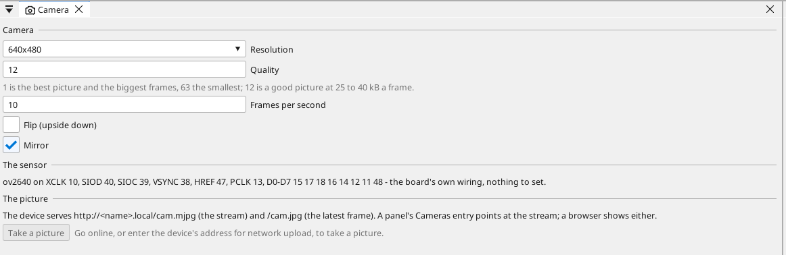
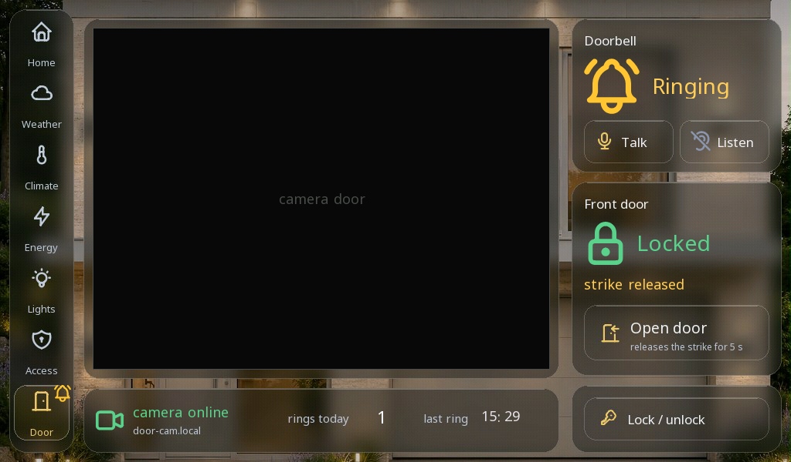
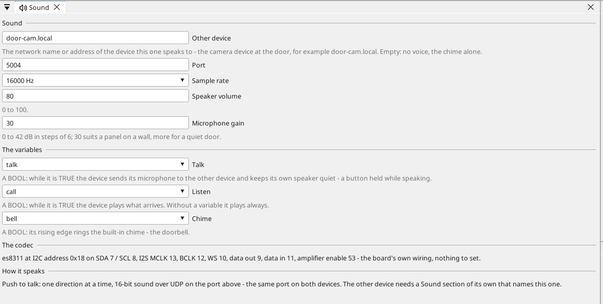

# Intercom

A door intercom is a camera at the door, its live picture on the wall
panel, a bell, a voice both ways and a door button. In ctrl32 the door
station is an **ESP32-P4 board** running its **camera runtime** - the
camera module on the board's connector, the board's own microphone and
speaker, a bell button and a relay on two of its pins - and the picture
is the **camera element** on an **ESP32-P4 panel** (or a Linux device).
Nothing is programmed on either side beyond a few lines; the bell, the
call and the door are variables of the system, shared over net32 like
any other.

## The door station

An ESP32-P4 board with a camera connector - the **Waveshare
ESP32-P4-NANO** (its kit camera, an OV5647) or the **MaTouch ESP32-P4 7"**
(its SC2336 module) in the catalog. Pick it as the project's board and
add **Camera** from the device's context menu in the tree: the project
moves onto the board's **camera runtime** - no screen, the WEBview, the
standard program limits of an ESP32 - and the board window's *Runtime
type* says so. The camera runtime leaves the board's memory to the
picture; a panel that shows pictures keeps its display runtime.

A plain camera device without a voice can also be a small ESP32-S3
board with a sensor on its DVP lines - the **Seeed XIAO ESP32S3 Sense**
in the catalog: an OV2640 on its expansion board, native USB for the
console and the runtime, eleven free pins on the edge. Its project is
the same **Camera** section; its runtime is the board's own.

{: .sb-center}

The page:

| Setting | Meaning |
|:---|:---|
| **Resolution** | 320x240, 640x480, 800x600, 1024x768 or 1280x720 |
| **Quality** | the JPEG quality the sensor compresses with, 1 (best) to 63 (smallest) - 12 is a good picture at 25 to 40 kB a frame |
| **Frame rate** | 1 to 25 frames a second - 10 is plenty for a door |
| **Flip**, **Mirror** | the picture turned for a sensor mounted upside down or seen from behind |

The pins come from the catalog board; the page shows them and nothing
has to be wired in the project. On a P4 the sensor runs at its own
size and the picture is cut to the chosen proportions and scaled to the
chosen size in hardware, so every size of the table is available
whatever module is plugged in. The device serves the picture on its own
web server: `http://<name>.local/cam.mjpg` is the stream, `/cam.jpg` the
latest frame - open either in a browser to see the camera before the
panel does, or press **Take a picture** on the page while the device is
reachable. Two viewers may watch the stream at a time; a third is told
so. The device's INFO line carries `camsrc=<frames per second>,<viewers>`,
and the diagnostic buffer says once when the sensor did not answer (the
camera module not seated).

## The picture on the panel

On the P4 panel's project, add the camera under **Cameras** (the
device's context menu) with the camera device's address as its source:

```
http://door-cam.local/cam.mjpg
```

Then draw a **camera** element on a screen and set its text to the
camera's name. The panel reads the stream, decodes every frame with its
JPEG hardware and scales it into the element with the proportions kept;
the browser of the panel's WEBview shows the same picture. The panel's
scaler works in sixteenths of the picture, so an element whose size is a
whole sixteenth of the camera's (560x420 or 480x360 for a 640x480
camera, 640x480 for the picture as it comes) is filled edge to edge; any
other size leaves a narrow frame of the element's background around the
picture. A panel shows
up to two cameras; any network camera with an `http://` MJPEG stream
works the same way. A USB camera and the vision blocks remain the Linux
devices' - see [Cameras](cameras.md).

While the stream is not there (the camera device starting, the network
down) the element shows its border and the camera's name; the panel
tries again after 2 s, 4 s, up to every 30 s, and the diagnostic buffer
says once what stopped it. The INFO line carries
`camv=<live>/<cameras>,<frames>,<failures>`.

## The bell and the door

The door station has free pins on its header: a bell button on one of
them is a BOOL variable published over net32, and a relay for the door
strike on another follows a command the panel publishes. The panel
subscribes to the bell, counts the rings, keeps the time of the last
one, lights a lamp, rings its chime and marks the Door tab on every
screen while it rings; its **Open door** button raises the strike's
command for five seconds, and the door station's own program holds the
relay for five seconds at most, whatever the panel says. All of it is
the net32 and screen work described elsewhere; the house dashboard
example carries a Door screen built this way - the camera element, the
bell, the strike and the lock on one screen, the two devices in one
project.

{: .sb-center}

## The voice

A device whose board carries an audio codec - a microphone and a
speaker amplifier, as the ESP32-P4 panels do - speaks to one other
device over the network and rings a chime of its own. The project's
**Audio** section names the other device (`peer`: its network name or
address), the port, the sample rate (8 or 16 kHz), the speaker's volume,
the microphone's gain and three BOOL variables:

- `talk`: while it is TRUE the device sends its microphone to the peer,
  and its own speaker stays quiet meanwhile. On the panel it is the
  **Talk** button of the Door screen, held while speaking; on the
  device at the door a program sets it.
- `listen`: while it is TRUE the device plays what the peer sends.
  Without the variable it plays always - the device at the door. On the
  panel it is **Listen**, and the house publishes it over net32 as
  `call`, so the door device's program sets its own `talk` to it: the
  door speaks while the panel listens.
- `chime`: a rising edge plays the built-in two-tone chime - the
  doorbell on the panel, a ding at the door.
- **Volume from variable** and **Microphone gain from variable**: a
  number variable the device follows while it runs - a slider on a
  screen sets it (0..100 for the speaker, 0..42 dB for the microphone);
  the volume and gain numbers above are the start values. The house
  example puts four sliders on the Door screen: the panel's speaker and
  microphone, and the door station's pair, which travel to the door over
  net32.

{: .sb-center}

Push to talk is the intercom of a gate station: one direction at a
time, no echo, nothing to tune. The voice is a quarter of a megabit,
small beside the picture; a device without a peer still rings its
chime. The pins of the codec come from the board's catalog record -
nothing to assign. The INFO line carries
`aud=<peer known>,<sent>,<received>,<lost>` and the diagnostic buffer
says when the codec did not answer or the peer's name could not be
resolved.

The door station and the panel carry the same codec, so the house
example speaks both ways out of the box: the door station's **Sound**
page names the panel as its peer, the panel's names the door station,
and a speaker on the door station's header is all the wiring. The bell
rings the panel's chime through its speaker and a ding at the door.

## Numbers to plan with

| | |
|:---|:---|
| 640x480 at 10 fps | 3 to 4 Mbit/s on the network |
| 1280x720 | 5 fps at most, a quarter of the panel's screen |
| Streams on one panel | two |
| Viewers of one camera device | two at a time (its own server's limit) |
| Delay door to panel | under a second: a frame's time and the network |
| The voice | 16 kHz, 16-bit, one channel: 256 kbit/s a direction, a tenth of a second from mouth to ear |
