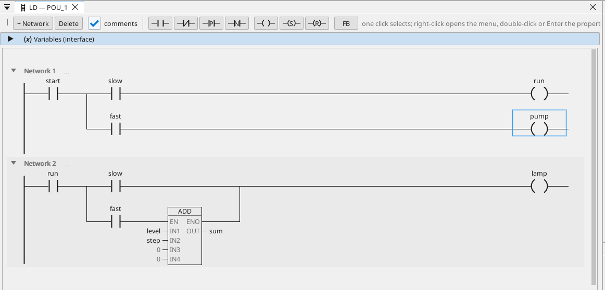
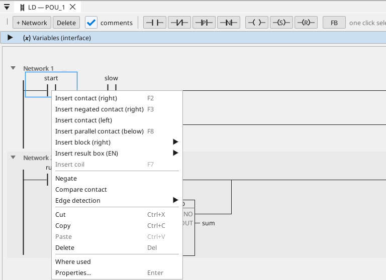
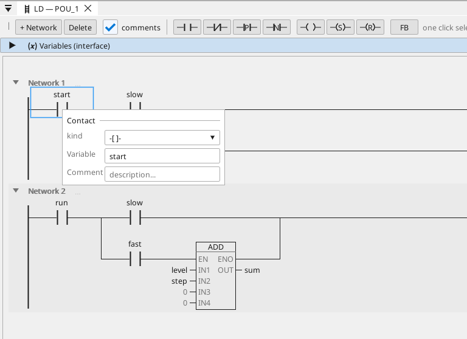
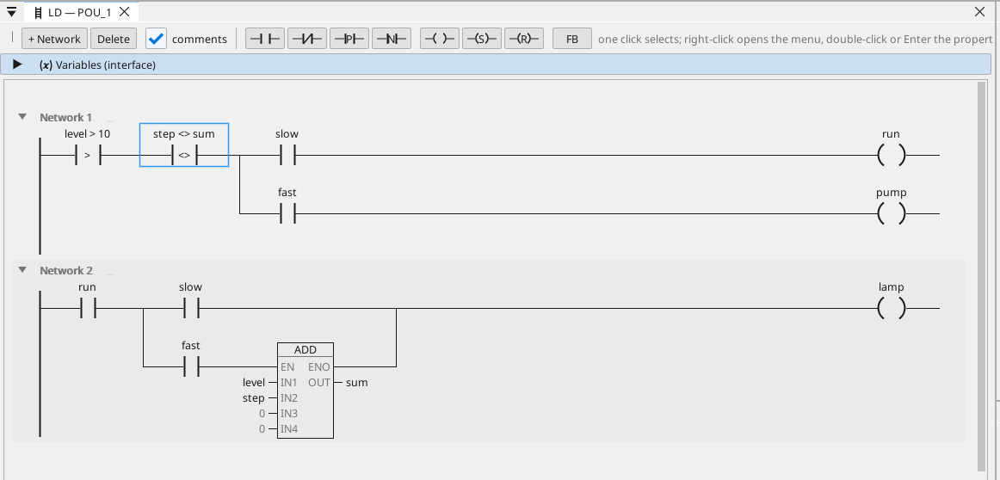
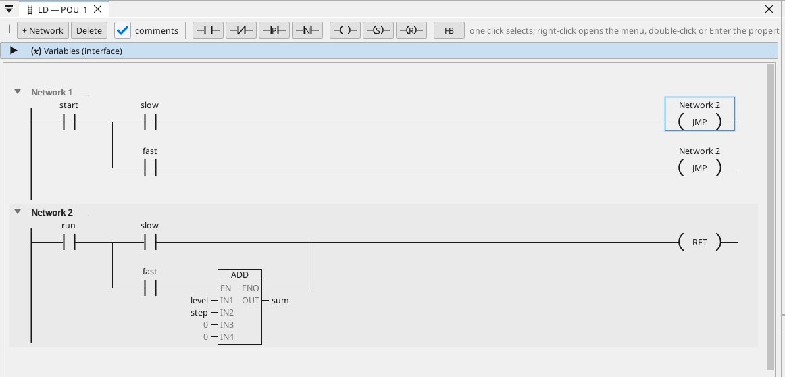
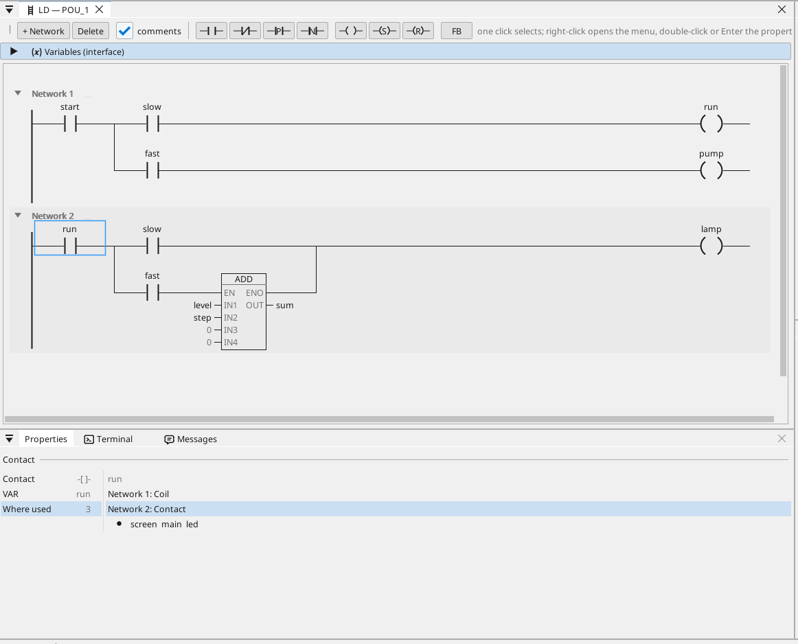
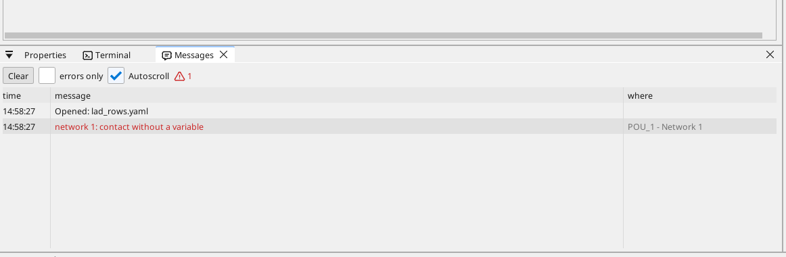

# Ladder (LD) on ctrl32

The ladder editor draws the logic the way an electrician reads a
schematic: networks between the power rail and the coil column, contacts
in series and in parallel, the outputs at the right. Underneath there is
no separate "ladder runtime" — every network compiles into the same
function blocks the FBD editor produces and the board already executes.
Downloading a ladder program is downloading data, never firmware.

{: .sb-center}

## Networks

A program is a list of **networks**, numbered from 1. Every network is a
band on the canvas: its header carries the number, the comment line is
written straight on the band (click it and type), and the arrow at the
left folds the network to its header when the list grows long.
**+ Network** adds one; the right button on a header inserts a network
above or below, moves it, cuts, copies and pastes it.

Inside a network the elements sit on a **grid**: a contact is one cell,
the wires run along the cells, and every coil of the program stands in
the **coil column** at the right — a network reads the same way whether
it holds one contact or a dozen.

## Elements

| Symbol | Meaning |
|:---|:---|
| `-[ ]-` | NO contact — conducts while the variable is TRUE |
| `-[/]-` | NC contact — conducts while the variable is FALSE |
| `-[P]-` / `-[N]-` | rising / falling edge (one cycle) |
| `-[ > ]-` | **compare contact** — conducts while the comparison holds (`level > 10`, `step <> sum`) |
| `-( )-` | coil — the network's result lands in the variable |
| `-(S)-` / `-(R)-` | set / reset latch |
| `-( JMP )-` | jump — while the network conducts, the networks up to the named one are skipped |
| `-( RET )-` | return — while the network conducts, the program ends for this cycle |
| block in the network | TON, TOF, TP, CTU, CTD — the network drives IN, Q carries on |
| **box** | **any block from the library** with EN/ENO: while the wire before it conducts it executes, while it does not its state freezes and the outputs hold |

An operand that is not bound yet reads **`??.?`** in red — the one thing
on the network that still needs a hand. The program is built after every
change; a network the build refuses is framed red and the reason stands
at the top of the page and in the **Messages** pane.

## Drawing with the keyboard

The **cursor** is the frame around a cell. From there:

| Key | Does |
|:---|:---|
| arrows | move the cursor along the network, into the rows of a branch, to the next network |
| **F2** / **F3** | a NO / NC contact to the right of the cursor |
| **F7** | a coil — at the end of the cursor's lower row, else the network's |
| **F8** | a parallel branch opened on the cursor |
| **Enter** | the sheet of the element under the cursor |
| **Tab** / Shift+Tab | the next / previous `??.?` across the program |
| a letter | the sheet opens with that letter already typed — keep typing the name, Enter binds it |
| Delete | removes the element; Ctrl+C / X / V the clipboard; Ctrl+Z undo |

**Typing an operand.** A letter on a `??.?` opens the variable field with
the letter in it. The list under the field shows every variable that fits
the pin — its name, its type and its comment — and filters as you type;
Enter binds the exact name or the first match, and a name that does not
exist yet becomes a new variable of the pin's type (BOOL for a contact,
REAL for a numeric pin). Typing a comparison — `speed>100`,
`lvl <= limit` — on a contact makes a compare contact of it.

## The mouse

- **One click selects**; the Properties panel at the bottom follows.
- **Double-click (or Enter) opens the sheet** — the properties of the
  element alone, in one column.
- **The right button opens the menu**: insert a contact right / negated /
  left, a parallel branch below, a block right, a coil, a result box;
  Negate, Edge detection, Compare contact, Coil type; the clipboard;
  Where used; Properties.
- A Toolbox tile dropped on a cell lands before or after it — the marker
  on the wire says which half you are over; an element can be dragged to
  another cell the same way.
- **Ctrl + wheel** zooms the canvas (50–200 %).

{: .sb-center}

## The sheet

{: .sb-center}

Every element has ONE sheet: the kind, the variable (the typed field with
the list under it), the bit of an integer variable when the contact
stands on one, the comment. A block's sheet lists its pins — a result,
the inputs, the parameters — each a typed field or a number; a jump's
sheet takes the target network; a compare contact's the two sides and
the operator.

**The pin rule.** A BOOL pin — a contact, a coil, a block's BOOL input or
output — takes a BOOL variable or **one bit of an integer variable**
(`mask.3`, the spelling ST uses); a numeric pin or parameter takes a
numeric variable and never a BOOL. The lists offer exactly that.

## Branches

**F8** opens a parallel branch on the cursor; a branch may stand anywhere
in a network and hold anything:

- a row of contacts ORs with the other rows — the classic seal-in:

```
|--[ start ]--+--[/ stop ]-----------------( run )--|
|--[ run   ]--+
```

- a lower row may **end in a coil of its own** — the coil stands in the
  coil column with the others and the row does not rejoin the wire: an
  output under an output, each with its own condition;
- a row may **carry a box** — the block runs while the power reaches its
  place, and the row goes on behind it.

A coil belongs at the end of a lower row; the top row is the network's
main wire, whose coil is the network's.

## A contact that compares

{: .sb-center}

A **compare contact** conducts while a comparison holds: `level > 10`,
`step <> sum`. The left side is a numeric variable, the right one a
numeric variable or a number; the operators are `>`, `>=`, `<`, `<=`, `=`
and `<>`. Make one from the kind list of a contact's sheet (`-[CMP]-`),
from the menu's **Compare contact**, or by typing the comparison on a
`??.?`. **Negate** on it is the complement (`>` becomes `<=`). Underneath
it is the comparator block the block editor shows, ANDed into the
network like any contact.

## Jump and return

{: .sb-center}

A network may end in a **jump** or a **return** instead of a coil — the
coil's kind list and the menu's **Coil type** offer `(JMP)` and `(RET)`;
a lower row of a branch may end in one too.

- `( JMP )` names a target network — a fresh jump aims at the next one,
  the sheet's field changes it. While the network conducts, the networks
  between the jump and its target are **skipped** this cycle. A jump
  goes **forward** only; two jumps either nest or stay apart.
- `( RET )` ends the program for this cycle while its network conducts;
  the networks after it do not run.
- The whole network is evaluated before the jump is taken — every coil
  of it is written.
- The header of a network that is a jump's target reads in the full
  colour, so the landing place is visible from anywhere.

A jump backwards, past the end, or across another jump's target is
refused at the desk with the network named.

The two coils are blocks of the library with a page of their own:

<!-- fb-index: begin -->

| Block | What it does | Linux | ESP32 | STM32 |
|:---|:---|:---:|:---:|:---:|
| [LD_RET](fb-ld_ret.md) | Return: while its network conducts, the program ends here for this cycle. | yes | yes | yes |
| [LD_JMP](fb-ld_jmp.md) | Jump: while its network conducts, the networks between it and network N are skipped this cycle. | yes | yes | yes |

<!-- fb-index: end -->

## Where used

{: .sb-center}

Every element's Properties card ends with **Where used**: every place in
the project that reads or writes the element's variable — the networks
of every ladder program (contact, coil, box pin), the blocks of the
diagram programs, the ST programs, the screens and the alarms. A ladder
row is a go-to: click it and the cursor lands on that element, in that
network, of that program. The menu's **Where used** opens the card on
this section.

## Messages

{: .sb-center}

The **Messages** tab beside Properties keeps every line the editor says
while you work: the build's refusals with their network, warnings,
progress. Errors are red, *errors only* filters them, and a double-click
on a line with a place opens that program's ladder on that network. The
**Terminal** tab beside it is the console of the connected device.

## A network does not need a coil

A new network starts as a **bare arrow** — no wire across, no coil. Build
it from either end:

- add contacts and finish with a coil — the classic network;
- or put **boxes on the rail**: a box on a network with no coil executes
  every cycle (a drawn `TRUE` contact in front of it says so), and the
  run wire simply ends in an arrow. Contacts placed before the boxes
  become their EN condition — no helper variable needed.

**Everything fits in ladder.** Timers, counters, ramps, filters,
comparators with hysteresis, PID, motor and valve blocks — every block
sits in a network as a box with the standard EN/ENO behaviour. The
Toolbox offers them in the same groups as the block editor: Boolean,
Math, Timers, Counters, General, Motion, CAN, GSM/GPS. A block the power
can flow through (BOOL in, BOOL out) lands IN the network from every
group; the others are boxes.

Blocks show their inner value at the right stub: a counter its **CV**, a
timer its **ET** (elapsed), a blinker its **REM** (time left in the
current phase). Bind it to a variable, or just read it — in simulation
and during [online monitoring](online.md) every stub variable carries
its live value on the line above it.

## Calling a program from a network

The box menu of a network (and the Toolbox's box list) offers the other
programs of the project under *Programs*. Such a box has no pins: while
the network conducts, the program runs at that point of the cycle, on
the project's variables, and the network's ENO carries on. A program
called this way needs no task of its own, and it cannot be called and
run by a task at the same time.

## Working with networks

- A `(S)` and `(R)` pair on the same variable becomes ONE flip-flop; the
  pair's order decides the priority (set-first = set wins).
- **Two plain coils on one variable are refused at the desk** — the last
  writer would silently win on the board. Use a branch or S/R.
- Every contact and coil shows its variable name and, above it, the
  variable's **description as a `//comment`**, both centred over the
  symbol (the *comments* checkbox hides them when the networks should
  pack tighter). Descriptions travel with the project.
- An unfinished network (a block without a result, a contact without a
  variable) stays on its page while you visit another program and come
  back; it goes only when the program itself changed underneath it.
- **Test mode** runs the same program the board runs, with every drive
  simulated (Enable brings it to operation, the velocity follows the
  setpoint with your ramps), so a motion network behaves at the desk the
  way it behaves on the equipment. In test mode the networks show the
  live power flow: conducting wires, symbols and block frames turn green,
  what does not conduct is a fine dashed line; a compare contact lights
  while its comparison holds, a jump while it fires. Clicking a contact
  toggles its variable (simulation only; connected to a board everything
  is read-only).

## The Properties panel

Click any contact, coil or block and the **Properties** panel at the
bottom shows everything about it in sections: the kind, the variable and
bit, a block's result, inputs, parameters and axis, Where used. Every
row there is the same operation the sheet performs — use whichever is
closer to hand.

## Ladder and FBD — one language per program

A program is drawn in the language it was created in — ladder, FBD or
ST — and keeps it. Both diagram languages compile to the same blocks and
the same runtime, so nothing is lost either way; what you choose is the
picture you want to look at. Create a new program for the other view
when you need it.

## Limits

32 networks per program, 8 parallel rows per branch, one coil column.
The block budget is shared with the whole program — 512 blocks per
project (see [limits](limits.md)); the Resources board shows the
consumption as you build.

---

The short overview — real networks, the simulator and where the values
come from — lives at [ctrl32.com/ladder](https://ctrl32.com/ladder/).
