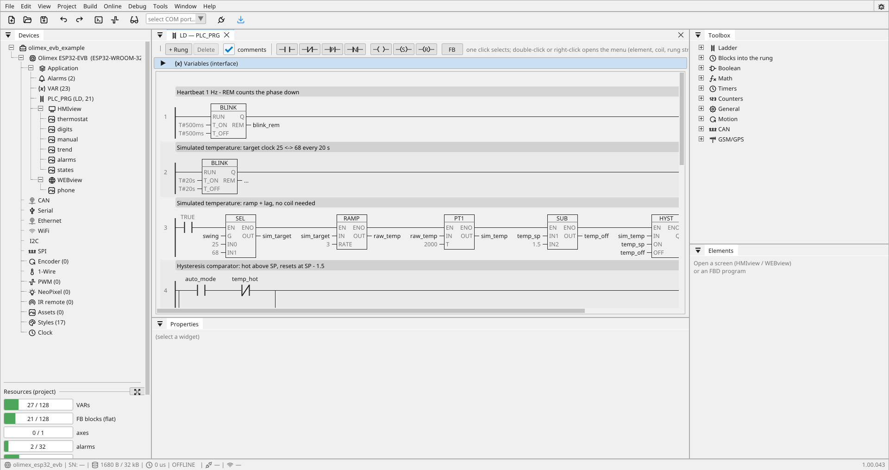

# Ladder (LD) on ctrl32

The ladder editor draws the logic the way an electrician reads a
schematic: rungs between two power rails, contacts in series and in
parallel, the coil at the right. Underneath there is no separate
"ladder runtime" — every rung compiles into the same function blocks
the FBD editor produces and the board already executes. Uploading a
ladder program is uploading data, never firmware.

{: .sb-center}

## Elements

| Symbol | Meaning |
|:---|:---|
| `-[ ]-` | NO contact — conducts while the variable is TRUE |
| `-[/]-` | NC contact — conducts while the variable is FALSE |
| `-[P]-` / `-[N]-` | rising / falling edge (one cycle) |
| `-( )-` | coil — the rung result lands in the variable |
| `-(S)-` / `-(R)-` | set / reset latch |
| block in the rung | TON, TOF, TP, CTU, CTD — the rung drives IN, Q carries on |
| **box on the rung** | **any block from the library** with EN/ENO: while the rung conducts it executes, while it does not its state freezes and the outputs hold |

**Everything fits in ladder.** Timers, counters, ramps, filters,
comparators with hysteresis, PID, motor and valve blocks — every block
sits in a rung as a box with the standard EN/ENO behaviour. The Toolbox
offers them in the same groups as the block editor: Boolean, Math,
Timers, Counters, General, Motion, CAN, GSM/GPS.

Blocks show their inner value at the right stub: a counter its **CV**,
a timer its **ET** (elapsed), a blinker its **REM** (time left in the
current phase). Bind it to a variable, or just read it — in simulation and
during [online monitoring](online.md) every stub variable carries its
live value on the line above it.

Series contacts AND together; a parallel branch ORs. The classic
start/stop seal-in is exactly:

```
|--[ start ]--+--[/ stop ]-----------------( run )--|
|--[ run   ]--+
```

### A contact on one bit of a word

**The pin rule.** A BOOL pin of a block - a contact, a coil, a block's
BOOL input or output - takes a BOOL variable or **one bit of an integer
variable**; a numeric pin or parameter takes a numeric variable and never
a BOOL. The pickers offer exactly that, in the sheet and in Properties.

**Typing a variable.** Every variable field - a contact, a coil, a
block's pin in the sheet or in Properties - is a text field: click it
and type. A list of the variables that fit the pin hangs under it and
filters as you type; a click on a row binds it, Enter binds the exact
name or the first match, and a name that does not exist yet is created
as a variable of the pin's type (BOOL for a BOOL pin, REAL for a numeric
one) - the `+ name` row in the list says so.

A contact or a coil can sit on **one bit of an integer variable**:
pick the variable in the element's sheet and the sheet asks for the bit;
the label reads `mask.3`, the same spelling ST uses. The sheet of a
bound contact shows that bit in its own field, so changing it is a
matter of typing the new number and Enter - the variable stays.

## A rung does not need a coil

A new rung starts as a **bare arrow** — no wire across, no coil. Build
it from either end:

- add contacts and finish with a coil — the classic rung;
- or put **blocks on the rail**: a box on a rung with no coil executes
  every cycle (a drawn `TRUE` contact in front of it says so), and the
  run wire simply ends in an arrow. Contacts placed before the boxes
  become their EN condition — no helper variable needed.

## Calling a program from a rung

The box menu of a rung (and the palette's box list) offers the other
programs of the project under *Programs*. Such a box has no pins: while
the rung conducts, the program runs at that point of the cycle, on the
project's variables, and the rung's ENO carries on. A program called
this way needs no task of its own, and it cannot be called and run by
a task at the same time.

## Working with rungs

- **+ Rung** adds a rung; **click a contact, box or the coil** to
  change its variable (with a filter), its kind, insert contacts
  before/after, add a parallel branch or another box. Right-click
  offers cut/copy/paste for elements, boxes and whole rungs, and
  insert rung above/below. Everything is undoable.
- **The comment line above every rung is written directly on the
  canvas** — a grey plate across the whole rung; click it and type,
  multiple lines welcome, click away to keep it. The same text is the network comment in the block-diagram
  view.
- Selecting a rung highlights it with a quiet grey background; the
  palette then targets that rung.
- A `(S)` and `(R)` pair on the same variable becomes ONE flip-flop; the
  pair's order decides the priority (set-first = set wins).
- **Two plain coils on one variable are refused at the desk** — the last
  writer would silently win on the board. Use a branch or S/R.
- Every contact and coil shows its variable name and, above it, the
  variable's **description as a `//comment`**, both centred over the
  symbol (edited right in the element popup; the *comments* checkbox
  hides them when the rungs should pack tighter). Descriptions travel
  with the project.
- **Test mode** runs the same program the panel runs, with every drive
  simulated (Enable brings it to operation, the velocity follows the
  setpoint with your ramps), so a motion rung behaves at the desk the
  way it behaves on the equipment. In test mode the rungs show the live power flow: conducting
  wires, symbols and block frames turn green — every line of a block
  that conducts, its pin stubs and the line under its name included;
  only the text keeps its colour, so the active path reads at a glance. Clicking a contact
  toggles its variable (simulation only; connected to a board everything
  is read-only).

## The Properties panel

Click any contact, coil or block on a rung and the **Properties** panel
at the bottom shows everything about it: the kind of a contact, its
variable and bit, a block's result, inputs, parameters and axis. Every
row there is the same operation the right-click sheet performs — use
whichever is closer to hand. An unfinished rung (a block without a
result, a contact without a variable) stays on its page while you visit
another program and come back; it goes only when the program itself
changed underneath it.

## Ladder and FBD — one language per program

A program is drawn in the language it was created in — ladder, FBD or
ST — and keeps it. Both diagram languages compile to the same blocks and
the same runtime, so nothing is lost either way; what you choose is the
picture you want to look at. Create a new program for the other view
when you need it.

## Limits

32 rungs per program, 8 parallel branches per fork, one coil column.
The block budget is shared with the whole program — 512 blocks per
project (see [limits](limits.md)); the Resources board shows the
consumption as you build.

---

The short overview — real rungs, the simulator and where the values come
from — lives at [ctrl32.com/ladder](https://ctrl32.com/ladder/).
