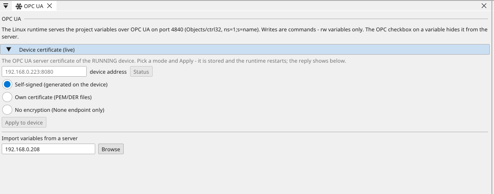

# The Linux runtime

Some jobs outgrow a microcontroller: hundreds of variables, dozens of
screens, a site that wants OPC UA. For those, ctrl32 also ships as a
**Linux runtime** — same project file, same editor, same logic
engines, running as a program on a Linux device with gigabytes
instead of kilobytes.

Two devices are in the catalogue today:

| Device | Glass | Runs on |
|:---|:---|:---|
| Seeed reTerminal | 5" 1280 × 720 touch | Raspberry Pi CM4 |
| ST STM32MP157C-DK2 | 4" 480 × 800 touch | STM32MP1 (dual Cortex-A7) |

The runtime draws straight onto the glass — no desktop, no browser in
between. The device boots into your visualisation. Setting one up
from a blank card is [its own page](linux-setup.md).

---

## The same project, bigger numbers

A Linux target is picked like any board. What changes is the budget —
the third column of the [limits table](limits.md):

| | ESP32 / STM32 | Linux |
|:---|:---:|:---:|
| Variables | 512 | **5 120** |
| Screens | 32 | **320** |
| Widgets per screen | 64 | **256** |
| Compiled program | 32–64 kB | **320 kB** |
| Instance data | 8–24 kB | **240 kB** |
| LD/FBD blocks | 512–1024 | **5 120** |

And the glass is flexible: the Linux runtime **scales any authored
resolution** onto its screen, rotation and aspect kept. The same
project can run on the reTerminal's 1280 × 720 and the DK2's 4" glass
without redrawing a single screen.

A **USB mouse** needs no configuration either: plug one in — even
into a running device — and a cursor appears; a click presses exactly
like a finger. Unplug it and the cursor is gone. Touch and mouse
work side by side. The **on-screen keypad scales with the glass**
too: on a 1280 × 720 screen the keys are finger-sized, on a small
panel it stays exactly as it always was.

---

## The device's network, from the editor

On the board page, a Linux target's **Device network** section talks
to the *running* device: join a WiFi network, switch the ethernet
between DHCP and a static address. The device applies it through its
own network manager and its answer shows right there — including a
refusal, when it has no manager to apply with.

---

## Getting a program onto it

The runtime is installed on the device **once**
([Setting up](linux-setup.md)); after that everything travels over
the network:

1. Open the scanner (:ti-eyeglass:) — the device appears with its
   name, address and the program it runs, like
   [any other board](find-devices.md).
2. **Use** the row, then download (F5) as usual. The runtime
   validates the file, swaps it in atomically and restarts into the
   new visualisation — a refused file leaves the old one running, so
   an upload cannot leave the glass dark.
3. Go **online** the same way as over a COM port: live values on the
   canvas, the variable table, the [scope](scope.md),
   [forcing](force.md) — the wire is TCP instead of a cable, the
   experience is the same.

---

## OPC UA — every variable, served

The Linux runtime is also an **OPC UA server**. Every variable of the
running project is a node under `Objects/ctrl32`
(`ns=1;s=<variable name>`), readable by any OPC UA client — SCADA,
historians, test tools.

Writing follows the same rule as everywhere else in ctrl32: a write
from outside is a **command**, and only variables marked `rw` accept
one. Everything else answers "not writable" — the logic owns its
outputs.

The connection can be **encrypted**: beside the open endpoint the
server offers Basic256Sha256 (and Aes128/Aes256) sign-and-encrypt
endpoints. The certificate is chosen on the OPC UA page, in **Device
certificate** — three modes, applied to the running device with one
button:

- **Self-signed** (the default): the runtime issues its own ten-year
  certificate at first start — trust it once in your client, the
  way a network printer's is trusted.
- **Own certificate**: pick a PEM or DER certificate and key from
  your company's PKI; the runtime checks that both parse before it
  replaces anything.
- **No encryption**: only the open endpoint remains.

A variable can also be kept **off the server** entirely: untick
*OPC UA server* on the variable and it simply is not there —
internals stay internal without touching access rights.

## …and read from another server

The runtime can also be the client. On the **OPC UA page** (in the
device tree under Ethernet) the editor browses any OPC UA server —
another ctrl32 device, a PLC, a SCADA — and imports the picked
variables into VAR. Each one carries its node, and at runtime the
values are polled into them; the editor never speaks OPC once
the design leaves the desk.

{: .sb-center}

One server per project, named once. A runtime that loses the server
keeps running on the last values — logic first, network second.

---

## Buses on a Linux device

Ethernet is the first bus — Modbus TCP (master and slave-side
polling), WEBview, OPC UA, the editor's online wire — and since
version 1.00.040 every Linux device also has **CAN** and **RS485**:

- **CAN** (CANopen master or slave, raw CAN, net32 over CAN) over
  the interface the operating system knows as `can0` — a CAN HAT on
  a Raspberry Pi, the DK2's FDCAN with a transceiver, or a USB-CAN
  adapter. The runtime sets the interface's bitrate from the project
  and brings it up itself — nothing is typed on the device.
- **RS485** (Modbus RTU master or slave) over a USB-RS485 adapter or
  a HAT on the device's own UART — up to **four lines**, each with its
  own baud rate and parity, like the four CAN buses.
- **EtherCAT master** (since 1.00.040): the device runs an EtherCAT
  line on a second network interface — digital and analog terminals
  map their process data to variables, a CiA402 drive on the line is
  an axis the motion blocks command exactly like a CANopen drive. The
  master is EtherCAT slaves in bus order, each with its expected
  vendor/product and the signals of its process image, set on the
  EtherCAT page — or taken from the device's ESI file in the device
  library with *Add from library*, which fills the identity, the image
  sizes, the CiA 402 layout and the default signals. What the device is
  told when the line starts, and the values it should send beyond its
  default data, are picked from its own object dictionary on the same
  page. (Selling a device as an EtherCAT master requires the
  EtherCAT Master License from the EtherCAT Technology Group (ETG);
  ctrl32 handles that for its own products.)
- **Motion**: up to **32 axes** on a Linux device (the boards keep
  four).

The adapter is a **device name** in the runtime's settings file
(`CTRL32_CAN`, `CTRL32_RS485` — see [Setting up a Linux
device](linux-setup.md)), never a pin: the editor's board card says
so, and a project's CAN or RTU configuration is carried to the
device unchanged.

## Cameras

A USB camera plugged into a Linux device shows its live picture on
the device's screen and in the browser - a **camera** element on a
screen, no programming. See [Cameras](cameras.md).

## What the Linux runtime does not do (yet)

**Local chips** — I2C and SPI peripherals of the part library — are
not offered on a Linux target; the editor hides those buses and the
build refuses them, so a project cannot carry configuration the
device would silently ignore. They will arrive with their drivers.

And the standing rule of the whole product applies unchanged: a
ctrl32 device is [not a safety device](intended-use.md). Emergency
stops stay hard-wired.

---

*EtherCAT® is a registered trademark and patented technology, licensed by Beckhoff Automation GmbH, Germany.*
