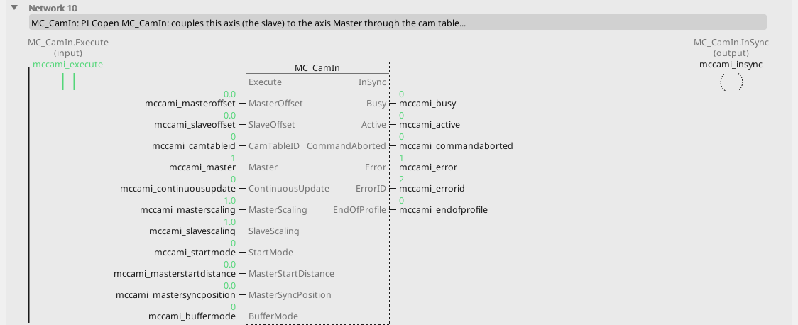
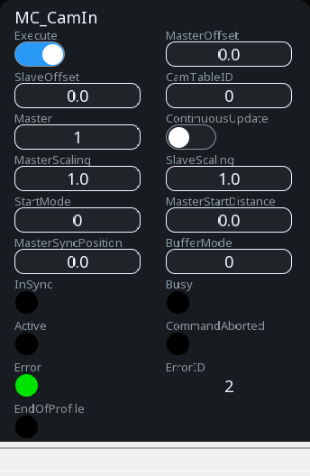

# MC_CamIn

Couples the axis to a master through a cam table.

{: .sb-center}

{: .sb-center}

## In Structured Text

```iecst
PROGRAM MC_CamIn_ST
VAR mccami : MC_CamIn; END_VAR
  mccami(AXIS := 2, Execute := mccami_execute,
         MasterOffset := mccami_masteroffset,
         SlaveOffset := mccami_slaveoffset,
         CamTableID := mccami_camtableid,
         Master := mccami_master,
         ContinuousUpdate := mccami_continuousupdate,
         MasterScaling := mccami_masterscaling,
         SlaveScaling := mccami_slavescaling,
         StartMode := mccami_startmode,
         MasterStartDistance := mccami_masterstartdistance,
         MasterSyncPosition := mccami_mastersyncposition,
         BufferMode := mccami_buffermode);
  mccami_insync_st := mccami.InSync;
  mccami_busy_st := mccami.Busy;
  mccami_active_st := mccami.Active;
  mccami_commandaborted_st := mccami.CommandAborted;
  mccami_error_st := mccami.Error;
  mccami_errorid_st := mccami.ErrorID;
  mccami_endofprofile_st := mccami.EndOfProfile;
END_PROGRAM
```

`AXIS` names the axis at the call - its number on the Motion node, the first axis
is 0; the compiler refuses a motion block without it. The same block sits on a
rung in LD and in a function block diagram with the axis in its properties.

## Where it runs

| Linux runtime | ESP32 boards | STM32 | EtherCAT | CANopen |
|:---:|:---:|:---:|:---:|:---:|
| yes | - | - | yes | - |

**Needs:** a servo in cyclic position mode (csp) on EtherCAT with the distributed clock - a frequency drive answers ErrorID 8.

A board (ESP32) refuses the block at the build; a project for a Linux device
carries it. The STM32 runtime has no motion library.

## Pins

| Pin | Kind | Type | Default | Meaning |
|:---|:---:|:---:|:---:|:---|
| `Execute` | input | bool | - | starts the command on the rising edge; the outputs hold while it is TRUE and fall when it falls (or stay one cycle when it fell before the command ended) |
| `MasterOffset` | input | number | - | added to the master position before the table is read |
| `SlaveOffset` | input | number | - | added to the table's answer |
| `CamTableID` | input | integer | - | the id `MC_CamTableSelect` answered |
| `Master` | parameter | integer | 0 | the master axis - its number on the Motion node (the first axis is 0) |
| `ContinuousUpdate` | parameter | bool | FALSE | a changed input is taken at once while `Execute` holds |
| `MasterScaling` | parameter | number | 1 | the master position multiplied by this before the table is read |
| `SlaveScaling` | parameter | number | 1 | the table's answer multiplied by this |
| `StartMode` | parameter | `MC_StartMode` | `mcAbsolute` | `mcAbsolute` 0, `mcRelative` 1, `mcRampIn` 2, `mcRampInPos` 3, `mcRampInNeg` 4 - absolute: the table IS the position; relative: it adds to where the follower stands; ramp in: the follower blends into the table over `MasterStartDistance` |
| `MasterStartDistance` | parameter | number | 0 | the master's travel over which the follower moves into the relation, in units |
| `MasterSyncPosition` | parameter | number | 0 | the master position of the relation, in units |
| `BufferMode` | parameter | `MC_BufferMode` | `mcAborting` | what the command does to the one running: `mcAborting` 0 takes the axis at once, `mcBuffered` 1 waits for the running one to finish, `mcBlendingLow` 2, `mcBlendingPrevious` 3, `mcBlendingNext` 4, `mcBlendingHigh` 5 join the two moves at that velocity |
| `InSync` | output | bool | - | the follower rides the relation (the table) |
| `Busy` | output | bool | - | the command is taken and not finished |
| `Active` | output | bool | - | this command moves the axis now (a buffered one waits with `Busy` alone) |
| `CommandAborted` | output | bool | - | another command took the axis, or the axis was stopped |
| `Error` | output | bool | - | the command failed |
| `ErrorID` | output | integer | - | why it failed - the table below |
| `EndOfProfile` | output | bool | - | a non-periodic table reached its end - one cycle each time |

## Error codes

`ErrorID` is one table for the whole library ([Motion blocks](blocks-motion.md));
this block answers these of it:

| ErrorID | When |
|:---:|:---|
| 1 | the axis is not bound to a drive |
| 2 | the axis is not powered - `MC_Power` first |
| 3 | the axis is in ErrorStop - acknowledge with `MC_Reset` |
| 4 | the axis is stopping - an `MC_Stop` holds it |
| 5 | the axis is homing - only `MC_Stop` may interrupt it |
| 8 | this drive cannot do it |
| 9 | the master axis is not there, or is this axis |
| 10 | the block is not on this runtime - a Linux block on a board |
| 11 | the drive reports a fault (`MC_ReadAxisError` carries its code) |
| 12 | the target is past a software limit, or a moving axis reached one |
| 13 | the following error passed its limit |
| 15 | the command buffer is full |
| 16 | the table (cam, profile, cam switches) is missing or wrong |

## Description

Engages the follower to `Master` with the table `CamTableID` names: the master
position, offset by `MasterOffset` and scaled by `MasterScaling`, is looked up in
the table and the answer, scaled by `SlaveScaling` and offset by `SlaveOffset`, is
the follower's position - every bus cycle. `StartMode` says how the follower enters:
`mcAbsolute` - the table IS the position, `mcRelative` - it adds to where the
follower stands, the ramp-in modes blend into it over `MasterStartDistance` of the
master's travel from `MasterSyncPosition`. `InSync` once it rides the table,
`EndOfProfile` one cycle each time a non-periodic table ends; `MC_CamOut` releases
it where it stands. A master that is not there answers ErrorID 9, a table that is
missing 16.

---

The library's rules - what every block answers, the axis's states, units and
time, the drives - are on [Motion blocks](blocks-motion.md).
