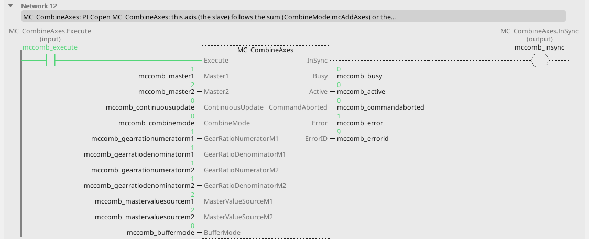
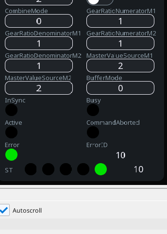

# MC_CombineAxes

The follower is the sum or the difference of two masters.

{: .sb-center}

{: .sb-center}

## In Structured Text

```iecst
PROGRAM MC_CombineAxes_ST
VAR mccomb : MC_CombineAxes; END_VAR
  mccomb(AXIS := 2, Execute := mccomb_execute,
         Master1 := mccomb_master1, Master2 := mccomb_master2,
         ContinuousUpdate := mccomb_continuousupdate,
         CombineMode := mccomb_combinemode,
         GearRatioNumeratorM1 := mccomb_gearrationumeratorm1,
         GearRatioDenominatorM1 := mccomb_gearratiodenominatorm1,
         GearRatioNumeratorM2 := mccomb_gearrationumeratorm2,
         GearRatioDenominatorM2 := mccomb_gearratiodenominatorm2,
         MasterValueSourceM1 := mccomb_mastervaluesourcem1,
         MasterValueSourceM2 := mccomb_mastervaluesourcem2,
         BufferMode := mccomb_buffermode);
  mccomb_insync_st := mccomb.InSync;
  mccomb_busy_st := mccomb.Busy;
  mccomb_active_st := mccomb.Active;
  mccomb_commandaborted_st := mccomb.CommandAborted;
  mccomb_error_st := mccomb.Error;
  mccomb_errorid_st := mccomb.ErrorID;
END_PROGRAM
```

`AXIS` names the axis at the call - its number on the Motion node, the first axis
is 0; the compiler refuses a motion block without it. The same block sits on a
rung in LD and in a function block diagram with the axis in its properties.

## Where it runs

| Linux runtime | ESP32 boards | EtherCAT | CANopen |
|:---:|:---:|:---:|:---:|
| yes | - | yes | - |

**Needs:** a servo in cyclic position mode (csp) on EtherCAT with the distributed clock - a frequency drive answers ErrorID 8.

A board (ESP32) refuses the block at the build; a project for a Linux device
carries it. The STM32 runtime has no motion library.

## Pins

| Pin | Kind | Type | Default | Meaning |
|:---|:---:|:---:|:---:|:---|
| `Execute` | input | bool | - | starts the command on the rising edge; the outputs hold while it is TRUE and fall when it falls (or stay one cycle when it fell before the command ended) |
| `Master1` | parameter | integer | 0 | the first master axis - its number on the Motion node |
| `Master2` | parameter | integer | 1 | the second master axis |
| `ContinuousUpdate` | parameter | bool | FALSE | a changed input is taken at once while `Execute` holds |
| `CombineMode` | parameter | `MC_CombineMode` | `mcAddAxes` | `mcAddAxes` 0, `mcSubAxes` 1 - the follower is the sum or the difference of the two masters through their ratios |
| `GearRatioNumeratorM1` | parameter | integer | 1 | the ratio to the first master |
| `GearRatioDenominatorM1` | parameter | integer | 1 | its denominator |
| `GearRatioNumeratorM2` | parameter | integer | 1 | the ratio to the second master |
| `GearRatioDenominatorM2` | parameter | integer | 1 | its denominator |
| `MasterValueSourceM1` | parameter | `MC_Source` | `mcActualValue` | the first master's position to follow: `mcCommandedValue` 0, `mcSetValue` 1, `mcActualValue` 2 |
| `MasterValueSourceM2` | parameter | `MC_Source` | `mcActualValue` | the second master's position to follow: `mcCommandedValue` 0, `mcSetValue` 1, `mcActualValue` 2 |
| `BufferMode` | parameter | `MC_BufferMode` | `mcAborting` | what the command does to the one running: `mcAborting` 0 takes the axis at once, `mcBuffered` 1 waits for the running one to finish, `mcBlendingLow` 2, `mcBlendingPrevious` 3, `mcBlendingNext` 4, `mcBlendingHigh` 5 join the two moves at that velocity |
| `InSync` | output | bool | - | the follower rides the relation (the table) |
| `Busy` | output | bool | - | the command is taken and not finished |
| `Active` | output | bool | - | this command moves the axis now (a buffered one waits with `Busy` alone) |
| `CommandAborted` | output | bool | - | another command took the axis, or the axis was stopped |
| `Error` | output | bool | - | the command failed |
| `ErrorID` | output | integer | - | why it failed - the table below |

## Error codes

`ErrorID` is one table for the whole library ([Motion blocks](blocks-motion.md));
this block answers these of it:

| ErrorID | When |
|:---:|:---|
| 1 | the axis is not bound to a drive |
| 2 | the axis is not powered - `MC_Power` first |
| 3 | the axis is in ErrorStop - acknowledge with `MC_Reset` |
| 4 | the axis is stopping - an `MC_Stop` holds it |
| 5 | the axis is homing - only `MC_Stop` may interrupt it |
| 7 | an input makes no sense (a velocity of 0, a ratio of 0, a bit that does not exist) |
| 8 | this drive cannot do it |
| 9 | the master axis is not there, or is this axis |
| 10 | the block is not on this runtime - a Linux block on a board |
| 11 | the drive reports a fault (`MC_ReadAxisError` carries its code) |
| 12 | the target is past a software limit, or a moving axis reached one |
| 13 | the following error passed its limit |
| 15 | the command buffer is full |

## Description

Makes the follower the **sum or difference** of two masters through two ratios
(`CombineMode` `mcAddAxes` / `mcSubAxes`), from where it stands at `Execute` - a
cross-cutter whose knife follows the web and the correction axis at once. Each
master is followed from its measured or its set position; `InSync` once the
relation holds. A master that is not there answers ErrorID 9, a ratio with a zero
denominator 7.

---

The library's rules - what every block answers, the axis's states, units and
time, the drives - are on [Motion blocks](blocks-motion.md).
