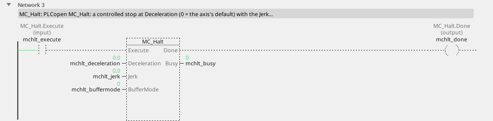
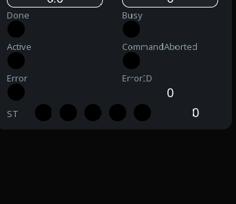

# MC_Halt

A controlled stop that does not lock the axis.

{: .sb-center}

{: .sb-center}

## In Structured Text

```iecst
PROGRAM MC_Halt_ST
VAR mchlt : MC_Halt; END_VAR
  mchlt(AXIS := 0, Execute := mchlt_execute,
        Deceleration := mchlt_deceleration, Jerk := mchlt_jerk,
        BufferMode := mchlt_buffermode);
  mchlt_done_st := mchlt.Done;
  mchlt_busy_st := mchlt.Busy;
  mchlt_active_st := mchlt.Active;
  mchlt_commandaborted_st := mchlt.CommandAborted;
  mchlt_error_st := mchlt.Error;
  mchlt_errorid_st := mchlt.ErrorID;
END_PROGRAM
```

`AXIS` names the axis at the call - its number on the Motion node, the first axis
is 0; the compiler refuses a motion block without it. The same block sits on a
rung in LD and in a function block diagram with the axis in its properties.

## Where it runs

| Linux runtime | ESP32 boards | EtherCAT | CANopen |
|:---:|:---:|:---:|:---:|
| yes | yes | yes | yes |

**Needs:** any drive - a servo, a frequency drive, a stepper chip, the virtual master, the simulation.

## Pins

| Pin | Kind | Type | Default | Meaning |
|:---|:---:|:---:|:---:|:---|
| `Execute` | input | bool | - | starts the command on the rising edge; the outputs hold while it is TRUE and fall when it falls (or stay one cycle when it fell before the command ended) |
| `Deceleration` | parameter | number | 0 | the ramp, in velocity units per second; 0 = the axis's default |
| `Jerk` | parameter | number | 0 | the jerk limit, in acceleration units per second; 0 = none (a trapezoid) |
| `BufferMode` | parameter | `MC_BufferMode` | `mcAborting` | what the command does to the one running: `mcAborting` 0 takes the axis at once, `mcBuffered` 1 waits for the running one to finish, `mcBlendingLow` 2, `mcBlendingPrevious` 3, `mcBlendingNext` 4, `mcBlendingHigh` 5 join the two moves at that velocity |
| `Done` | output | bool | - | the command reached its goal |
| `Busy` | output | bool | - | the command is taken and not finished |
| `Active` | output | bool | - | this command moves the axis now (a buffered one waits with `Busy` alone) |
| `CommandAborted` | output | bool | - | another command took the axis, or the axis was stopped |
| `Error` | output | bool | - | the command failed |
| `ErrorID` | output | integer | - | why it failed - the table below |

## Error codes

`ErrorID` is one table for the whole library ([Motion blocks](blocks-motion.md));
this block answers these of it:

| ErrorID | When |
|:---:|:---|
| 1 | the axis is not bound to a drive |
| 2 | the axis is not powered - `MC_Power` first |
| 3 | the axis is in ErrorStop - acknowledge with `MC_Reset` |
| 4 | the axis is stopping - an `MC_Stop` holds it |
| 5 | the axis is homing - only `MC_Stop` may interrupt it |
| 11 | the drive reports a fault (`MC_ReadAxisError` carries its code) |
| 15 | the command buffer is full |

## Description

Ramps the axis down at `Deceleration` and leaves it in Standstill - but the next
command may take the axis at once, even before it stands. That is the difference to
`MC_Stop`, which holds the axis while its `Execute` is TRUE. Not a safety
function.

---

The library's rules - what every block answers, the axis's states, units and
time, the drives - are on [Motion blocks](blocks-motion.md).
