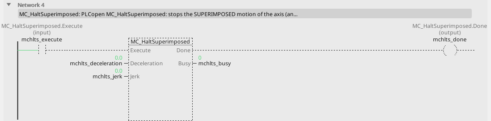
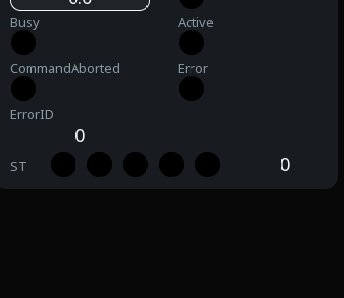

# MC_HaltSuperimposed

Stops the superimposed part of the motion alone.

{: .sb-center}

{: .sb-center}

## In Structured Text

```iecst
PROGRAM MC_HaltSuperimposed_ST
VAR mchlts : MC_HaltSuperimposed; END_VAR
  mchlts(AXIS := 0, Execute := mchlts_execute,
         Deceleration := mchlts_deceleration,
         Jerk := mchlts_jerk);
  mchlts_done_st := mchlts.Done;
  mchlts_busy_st := mchlts.Busy;
  mchlts_active_st := mchlts.Active;
  mchlts_commandaborted_st := mchlts.CommandAborted;
  mchlts_error_st := mchlts.Error;
  mchlts_errorid_st := mchlts.ErrorID;
END_PROGRAM
```

`AXIS` names the axis at the call - its number on the Motion node, the first axis
is 0; the compiler refuses a motion block without it. The same block sits on a
rung in LD and in a function block diagram with the axis in its properties.

## Where it runs

| Linux runtime | ESP32 boards | EtherCAT | CANopen |
|:---:|:---:|:---:|:---:|
| yes | - | yes | - |

**Needs:** a servo the kernel feeds (cyclic position mode).

A board (ESP32) refuses the block at the build; a project for a Linux device
carries it. The STM32 runtime has no motion library.

## Pins

| Pin | Kind | Type | Default | Meaning |
|:---|:---:|:---:|:---:|:---|
| `Execute` | input | bool | - | starts the command on the rising edge; the outputs hold while it is TRUE and fall when it falls (or stay one cycle when it fell before the command ended) |
| `Deceleration` | parameter | number | 0 | the ramp, in velocity units per second; 0 = the axis's default |
| `Jerk` | parameter | number | 0 | the jerk limit, in acceleration units per second; 0 = none (a trapezoid) |
| `Done` | output | bool | - | the command reached its goal |
| `Busy` | output | bool | - | the command is taken and not finished |
| `Active` | output | bool | - | this command moves the axis now (a buffered one waits with `Busy` alone) |
| `CommandAborted` | output | bool | - | another command took the axis, or the axis was stopped |
| `Error` | output | bool | - | the command failed |
| `ErrorID` | output | integer | - | why it failed - the table below |

## Error codes

`ErrorID` is one table for the whole library ([Motion blocks](blocks-motion.md));
this block answers these of it:

| ErrorID | When |
|:---:|:---|
| 1 | the axis is not bound to a drive |
| 2 | the axis is not powered - `MC_Power` first |
| 3 | the axis is in ErrorStop - acknowledge with `MC_Reset` |
| 10 | the block is not on this runtime - a Linux block on a board |
| 15 | the command buffer is full |

## Description

Ramps the superimposed move down at `Deceleration` while the underlying command
goes on untouched; the `MC_MoveSuperimposed` it stopped answers `CommandAborted`.
`Done` when the superimposed velocity is zero.

---

The library's rules - what every block answers, the axis's states, units and
time, the drives - are on [Motion blocks](blocks-motion.md).
