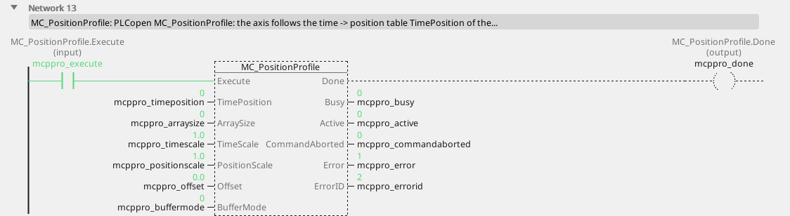
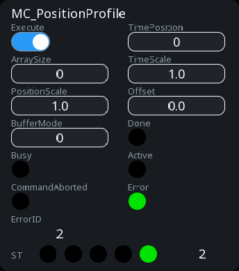

# MC_PositionProfile

The axis follows a table of time against position.

{: .sb-center}

{: .sb-center}

## In Structured Text

```iecst
PROGRAM MC_PositionProfile_ST
VAR mcppro : MC_PositionProfile; END_VAR
  mcppro(AXIS := 0, Execute := mcppro_execute,
         TimePosition := mcppro_timeposition,
         ArraySize := mcppro_arraysize,
         TimeScale := mcppro_timescale,
         PositionScale := mcppro_positionscale,
         Offset := mcppro_offset,
         BufferMode := mcppro_buffermode);
  mcppro_done_st := mcppro.Done;
  mcppro_busy_st := mcppro.Busy;
  mcppro_active_st := mcppro.Active;
  mcppro_commandaborted_st := mcppro.CommandAborted;
  mcppro_error_st := mcppro.Error;
  mcppro_errorid_st := mcppro.ErrorID;
END_PROGRAM
```

`AXIS` names the axis at the call - its number on the Motion node, the first axis
is 0; the compiler refuses a motion block without it. The same block sits on a
rung in LD and in a function block diagram with the axis in its properties.

## Where it runs

| Linux runtime | ESP32 boards | EtherCAT | CANopen |
|:---:|:---:|:---:|:---:|
| yes | - | yes | - |

**Needs:** a servo in cyclic position mode (csp) on EtherCAT with the distributed clock - a frequency drive answers ErrorID 8.

A board (ESP32) refuses the block at the build; a project for a Linux device
carries it. The STM32 runtime has no motion library.

## Pins

| Pin | Kind | Type | Default | Meaning |
|:---|:---:|:---:|:---:|:---|
| `Execute` | input | bool | - | starts the command on the rising edge; the outputs hold while it is TRUE and fall when it falls (or stay one cycle when it fell before the command ended) |
| `TimePosition` | parameter | integer | 0 | the profile table - its number among the project's profiles (the first is 0) |
| `ArraySize` | parameter | integer | 0 | how many points of the table to use; 0 = the whole table |
| `TimeScale` | parameter | number | 1 | the table's time multiplied by this |
| `PositionScale` | parameter | number | 1 | the table's value multiplied by this |
| `Offset` | parameter | number | 0 | added to the table's value |
| `BufferMode` | parameter | `MC_BufferMode` | `mcAborting` | what the command does to the one running: `mcAborting` 0 takes the axis at once, `mcBuffered` 1 waits for the running one to finish, `mcBlendingLow` 2, `mcBlendingPrevious` 3, `mcBlendingNext` 4, `mcBlendingHigh` 5 join the two moves at that velocity |
| `Done` | output | bool | - | the command reached its goal |
| `Busy` | output | bool | - | the command is taken and not finished |
| `Active` | output | bool | - | this command moves the axis now (a buffered one waits with `Busy` alone) |
| `CommandAborted` | output | bool | - | another command took the axis, or the axis was stopped |
| `Error` | output | bool | - | the command failed |
| `ErrorID` | output | integer | - | why it failed - the table below |

## Error codes

`ErrorID` is one table for the whole library ([Motion blocks](blocks-motion.md));
this block answers these of it:

| ErrorID | When |
|:---:|:---|
| 1 | the axis is not bound to a drive |
| 2 | the axis is not powered - `MC_Power` first |
| 3 | the axis is in ErrorStop - acknowledge with `MC_Reset` |
| 4 | the axis is stopping - an `MC_Stop` holds it |
| 5 | the axis is homing - only `MC_Stop` may interrupt it |
| 8 | this drive cannot do it |
| 10 | the block is not on this runtime - a Linux block on a board |
| 11 | the drive reports a fault (`MC_ReadAxisError` carries its code) |
| 12 | the target is past a software limit, or a moving axis reached one |
| 13 | the following error passed its limit |
| 15 | the command buffer is full |
| 16 | the table (cam, profile, cam switches) is missing or wrong |

## Description

A **profile** is a table of time against position the axis follows from `Execute`:
`TimePosition` names it among the project's profiles (made on the Motion page of a
Linux device), `ArraySize` takes the first points (0 = all), `TimeScale` stretches
the time, `PositionScale` the value, `Offset` shifts it. The table's positions are
relative to where the axis stands at `Execute`. Between the points the axis
interpolates linearly; `Done` at the last point. A table that is missing or has
fewer than two points answers ErrorID 16.

---

The library's rules - what every block answers, the axis's states, units and
time, the drives - are on [Motion blocks](blocks-motion.md).
