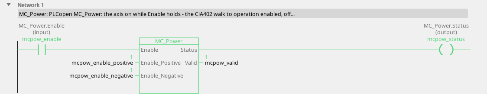
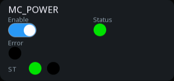

# MC_Power

Switches the axis on and off - the CiA 402 state machine, handled for you.

{: .sb-center}

{: .sb-center}

## In Structured Text

```iecst
PROGRAM MC_Power_ST
VAR mcpow : MC_Power; END_VAR
  mcpow(AXIS := 0, Enable := mcpow_enable,
        Enable_Positive := mcpow_enable_positive,
        Enable_Negative := mcpow_enable_negative);
  mcpow_status_st := mcpow.Status;
  mcpow_valid_st := mcpow.Valid;
  mcpow_error_st := mcpow.Error;
  mcpow_errorid_st := mcpow.ErrorID;
END_PROGRAM
```

`AXIS` names the axis at the call - its number on the Motion node, the first axis
is 0; the compiler refuses a motion block without it. The same block sits on a
rung in LD and in a function block diagram with the axis in its properties.

## Where it runs

| Linux runtime | ESP32 boards | STM32 | EtherCAT | CANopen |
|:---:|:---:|:---:|:---:|:---:|
| yes | yes | - | yes | yes |

**Needs:** any drive - a servo, a frequency drive, a stepper chip, the virtual master, the simulation.

## Pins

| Pin | Kind | Type | Default | Meaning |
|:---|:---:|:---:|:---:|:---|
| `Enable` | input | bool | - | the axis on while TRUE, off when it falls |
| `Enable_Positive` | parameter | bool | TRUE | motion in the positive direction is permitted |
| `Enable_Negative` | parameter | bool | TRUE | motion in the negative direction is permitted |
| `Status` | output | bool | - | the axis is powered - every move waits for it |
| `Valid` | output | bool | - | the values are good: the axis is bound and answers |
| `Error` | output | bool | - | the command failed |
| `ErrorID` | output | integer | - | why it failed - the table below |

A project written before this library used the name `MC_POWER` for it; the old name
opens and builds as an alias.

## Error codes

`ErrorID` is one table for the whole library ([Motion blocks](blocks-motion.md));
this block answers these of it:

| ErrorID | When |
|:---:|:---|
| 1 | the axis is not bound to a drive |

## Description

Nothing moves until `Status` is TRUE. While `Enable` holds, the block walks the
drive's CiA 402 state machine to *operation enabled* - several steps of controlword
and statusword that the block does for you - and `Status` answers that the drive is
operating; when `Enable` falls the axis ramps down and the drive is disconnected.
`Enable_Positive` and `Enable_Negative` permit motion in that direction: a move
into a direction that is not permitted is refused with ErrorID 7.

A move started before `Status` answers ErrorID 2 - a program gates its `Execute`
on `Status`. The shipped `DRIVE_i550` block does exactly that.

---

The library's rules - what every block answers, the axis's states, units and
time, the drives - are on [Motion blocks](blocks-motion.md).
