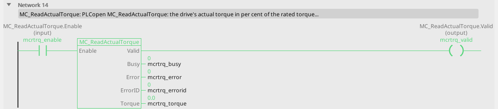
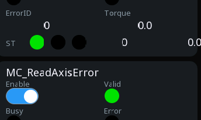

# MC_ReadActualTorque

The measured torque of a servo.

{: .sb-center}

{: .sb-center}

## In Structured Text

```iecst
PROGRAM MC_ReadActualTorque_ST
VAR mcrtrq : MC_ReadActualTorque; END_VAR
  mcrtrq(AXIS := 0, Enable := mcrtrq_enable);
  mcrtrq_valid_st := mcrtrq.Valid;
  mcrtrq_busy_st := mcrtrq.Busy;
  mcrtrq_error_st := mcrtrq.Error;
  mcrtrq_errorid_st := mcrtrq.ErrorID;
  mcrtrq_torque_st := mcrtrq.Torque;
END_PROGRAM
```

`AXIS` names the axis at the call - its number on the Motion node, the first axis
is 0; the compiler refuses a motion block without it. The same block sits on a
rung in LD and in a function block diagram with the axis in its properties.

## Where it runs

| Linux runtime | ESP32 boards | STM32 | EtherCAT | CANopen |
|:---:|:---:|:---:|:---:|:---:|
| yes | yes | - | yes | yes |

**Needs:** a drive whose cyclic set carries the actual torque (a servo; a frequency drive that sends it over its CANopen module).

## Pins

| Pin | Kind | Type | Default | Meaning |
|:---|:---:|:---:|:---:|:---|
| `Enable` | input | bool | - | the block works while TRUE |
| `Valid` | output | bool | - | the values are good: the axis is bound and answers |
| `Busy` | output | bool | - | the command is taken and not finished |
| `Error` | output | bool | - | the command failed |
| `ErrorID` | output | integer | - | why it failed - the table below |
| `Torque` | output | number | - | the measured torque, in per cent of the rated torque |

## Error codes

`ErrorID` is one table for the whole library ([Motion blocks](blocks-motion.md));
this block answers these of it:

| ErrorID | When |
|:---:|:---|
| 1 | the axis is not bound to a drive |

## Description

`Torque` in per cent of the rated torque, from the drive's actual-torque word.
`Valid` falls when the drive stops answering (ErrorID 14).

---

The library's rules - what every block answers, the axis's states, units and
time, the drives - are on [Motion blocks](blocks-motion.md).
