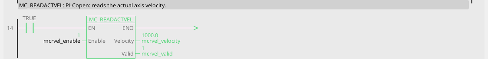

# MC_ReadActualVelocity

The measured velocity.

{: .sb-center}

{: .sb-center}

## In Structured Text

```iecst
PROGRAM MC_ReadActualVelocity_ST
VAR mcrvel : MC_ReadActualVelocity; END_VAR
  mcrvel(AXIS := 0, Enable := mcrvel_enable);
  mcrvel_valid_st := mcrvel.Valid;
  mcrvel_busy_st := mcrvel.Busy;
  mcrvel_error_st := mcrvel.Error;
  mcrvel_errorid_st := mcrvel.ErrorID;
  mcrvel_velocity_st := mcrvel.Velocity;
END_PROGRAM
```

`AXIS` names the axis at the call - its number on the Motion node, the first axis
is 0; the compiler refuses a motion block without it. The same block sits on a
rung in LD and in a function block diagram with the axis in its properties.

## Where it runs

| Linux runtime | ESP32 boards | STM32 | EtherCAT | CANopen |
|:---:|:---:|:---:|:---:|:---:|
| yes | yes | - | yes | yes |

**Needs:** any drive - a servo, a frequency drive, a stepper chip, the virtual master, the simulation.

## Pins

| Pin | Kind | Type | Default | Meaning |
|:---|:---:|:---:|:---:|:---|
| `Enable` | input | bool | - | the block works while TRUE |
| `Valid` | output | bool | - | the values are good: the axis is bound and answers |
| `Busy` | output | bool | - | the command is taken and not finished |
| `Error` | output | bool | - | the command failed |
| `ErrorID` | output | integer | - | why it failed - the table below |
| `Velocity` | output | number | - | the measured velocity, in units per the axis's time base |

A project written before this library used the name `MC_READACTVEL` for it; the old name
opens and builds as an alias.

## Error codes

`ErrorID` is one table for the whole library ([Motion blocks](blocks-motion.md));
this block answers these of it:

| ErrorID | When |
|:---:|:---|
| 1 | the axis is not bound to a drive |

## Description

`Velocity` is the drive's measured velocity, in units per the axis's time base.
`Valid` falls when the drive stops answering (ErrorID 14) - gate what uses the
value on it.

---

The library's rules - what every block answers, the axis's states, units and
time, the drives - are on [Motion blocks](blocks-motion.md).
