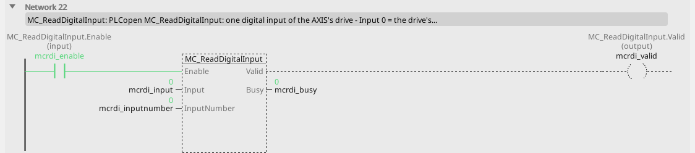
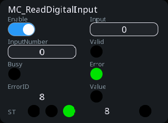

# MC_ReadDigitalInput

One bit of the drive's inputs word.

{: .sb-center}

{: .sb-center}

## In Structured Text

```iecst
PROGRAM MC_ReadDigitalInput_ST
VAR mcrdi : MC_ReadDigitalInput; END_VAR
  mcrdi(AXIS := 0, Enable := mcrdi_enable, Input := mcrdi_input,
        InputNumber := mcrdi_inputnumber);
  mcrdi_valid_st := mcrdi.Valid;
  mcrdi_busy_st := mcrdi.Busy;
  mcrdi_error_st := mcrdi.Error;
  mcrdi_errorid_st := mcrdi.ErrorID;
  mcrdi_value_st := mcrdi.Value;
END_PROGRAM
```

`AXIS` names the axis at the call - its number on the Motion node, the first axis
is 0; the compiler refuses a motion block without it. The same block sits on a
rung in LD and in a function block diagram with the axis in its properties.

## Where it runs

| Linux runtime | ESP32 boards | EtherCAT | CANopen |
|:---:|:---:|:---:|:---:|
| yes | yes | yes | - |

**Needs:** a drive whose cyclic set carries the inputs word (object 0x60FD); no shipped device description carries it yet, so every drive answers ErrorID 8 until one does.

## Pins

| Pin | Kind | Type | Default | Meaning |
|:---|:---:|:---:|:---:|:---|
| `Enable` | input | bool | - | the block works while TRUE |
| `Input` | parameter | integer | 0 | 0 = the drive's inputs word (CiA 402 object 0x60FD) |
| `InputNumber` | parameter | integer | 0 | the bit: 0 the negative limit switch, 1 the positive one, 2 the home switch, 16 and up the manufacturer's |
| `Valid` | output | bool | - | the values are good: the axis is bound and answers |
| `Busy` | output | bool | - | the command is taken and not finished |
| `Error` | output | bool | - | the command failed |
| `ErrorID` | output | integer | - | why it failed - the table below |
| `Value` | output | bool | - | the bit |

## Error codes

`ErrorID` is one table for the whole library ([Motion blocks](blocks-motion.md));
this block answers these of it:

| ErrorID | When |
|:---:|:---|
| 1 | the axis is not bound to a drive |
| 7 | an input makes no sense (a velocity of 0, a ratio of 0, a bit that does not exist) |
| 8 | this drive cannot do it |

## Description

Reads one bit of the drive's digital inputs word: `Input` 0 is the word (CiA 402
object 0x60FD), `InputNumber` the bit - 0 the negative limit switch, 1 the
positive one, 2 the home switch, 16 and up the manufacturer's inputs. `Valid` while
the image carries the word.

---

The library's rules - what every block answers, the axis's states, units and
time, the drives - are on [Motion blocks](blocks-motion.md).
