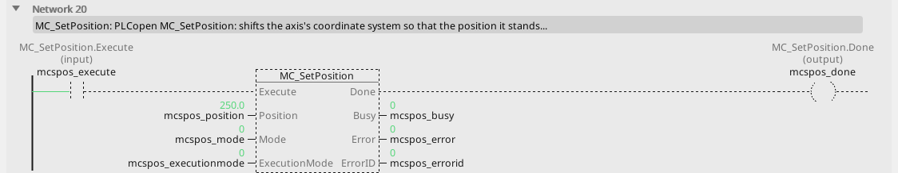
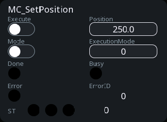

# MC_SetPosition

Moves the coordinate system, not the axis.

{: .sb-center}

{: .sb-center}

## In Structured Text

```iecst
PROGRAM MC_SetPosition_ST
VAR mcspos : MC_SetPosition; END_VAR
  mcspos(AXIS := 0, Execute := mcspos_execute,
         Position := mcspos_position, Mode := mcspos_mode,
         ExecutionMode := mcspos_executionmode);
  mcspos_done_st := mcspos.Done;
  mcspos_busy_st := mcspos.Busy;
  mcspos_error_st := mcspos.Error;
  mcspos_errorid_st := mcspos.ErrorID;
END_PROGRAM
```

`AXIS` names the axis at the call - its number on the Motion node, the first axis
is 0; the compiler refuses a motion block without it. The same block sits on a
rung in LD and in a function block diagram with the axis in its properties.

## Where it runs

| Linux runtime | ESP32 boards | EtherCAT | CANopen |
|:---:|:---:|:---:|:---:|
| yes | yes | yes | yes |

**Needs:** any drive - a servo, a frequency drive, a stepper chip, the virtual master, the simulation.

## Pins

| Pin | Kind | Type | Default | Meaning |
|:---|:---:|:---:|:---:|:---|
| `Execute` | input | bool | - | starts the command on the rising edge; the outputs hold while it is TRUE and fall when it falls (or stay one cycle when it fell before the command ended) |
| `Position` | input | number | - | the new value of the current position, in units |
| `Mode` | parameter | bool | FALSE | FALSE absolute - the axis now stands at `Position`; TRUE relative - `Position` is added |
| `ExecutionMode` | parameter | `MC_ExecutionMode` | `mcImmediately` | `mcImmediately` 0 or `mcQueued` 1 (after the running command); `mcDelayed` 2 is refused with ErrorID 17 |
| `Done` | output | bool | - | the command reached its goal |
| `Busy` | output | bool | - | the command is taken and not finished |
| `Error` | output | bool | - | the command failed |
| `ErrorID` | output | integer | - | why it failed - the table below |

## Error codes

`ErrorID` is one table for the whole library ([Motion blocks](blocks-motion.md));
this block answers these of it:

| ErrorID | When |
|:---:|:---|
| 1 | the axis is not bound to a drive |
| 15 | the command buffer is full |
| 17 | a mode this runtime does not do (`mcDelayed`) |
| 19 | the axis has to stand still for this |

## Description

Sets what the current position reads: absolute (`Mode` FALSE) - the axis now stands
at `Position`; relative (`Mode` TRUE) - `Position` is added to what it reads. The axis
counts as homed afterwards. It has to stand still (ErrorID 19); `ExecutionMode`
`mcQueued` waits for the running command first.

---

The library's rules - what every block answers, the axis's states, units and
time, the drives - are on [Motion blocks](blocks-motion.md).
